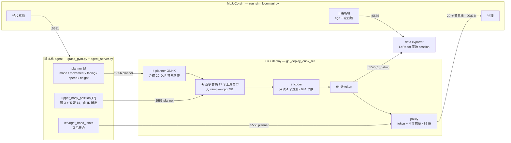
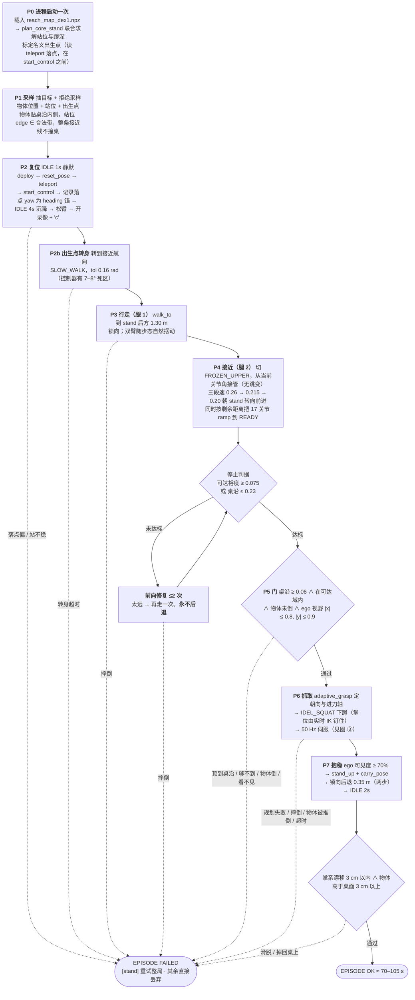
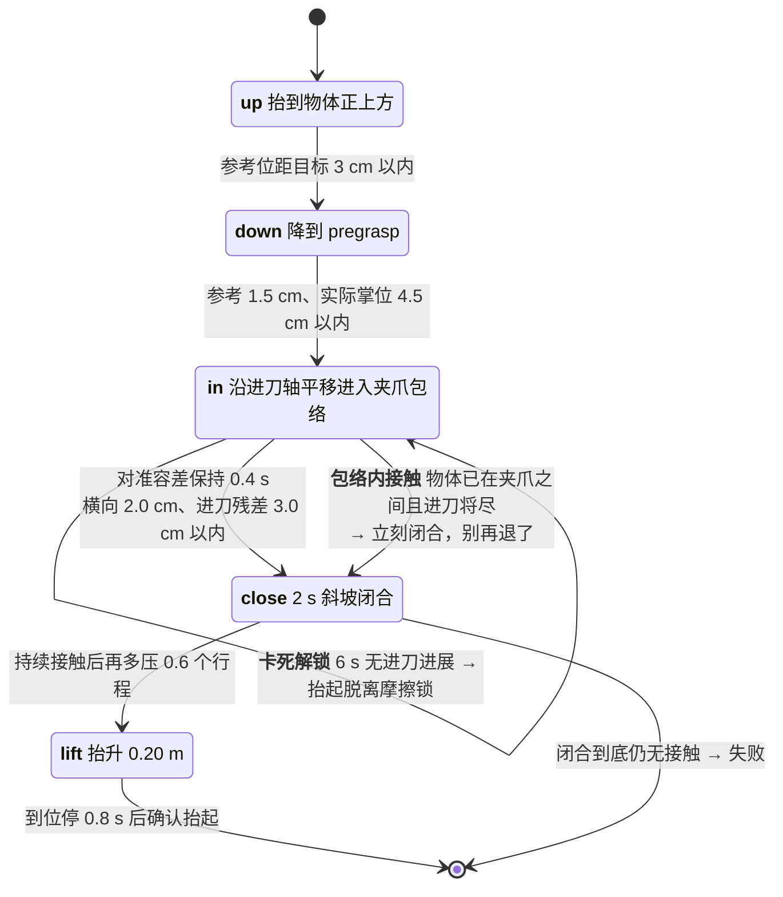

# Teleop-Free Loco-Manipulation Data Engine (Unitree G1 + SONIC)

不需要遥操作的人形机器人 loco-manipulation 数据引擎:在 MuJoCo 里由**脚本化 agent**
驱动 Unitree G1(SONIC 全身控制),自动完成"走到桌前 → 抓起物体"的完整 episode,
导出 **LeRobot v2.1** 数据集,用于 GR00T + SONIC 的 VLA 微调。

**它到底产出什么。**每条成功 episode = 三路 RGB(ego + 左右腕)+ 一条 **78 维 action
序列**(SONIC 的 64 维 motion latent + 左右手关节各 7 维)。这 78 维不是设计选择,是被
deploy 的 wire protocol 定死的:v4 只运 `token_state` + 可选手关节。训练出的 VLA 输入
RGB + 指令(数据集里同时存了 29 维本体状态,要不要喂给模型是训练侧的选择),输出这
78 维,直接喂回同一个 deploy 就能驱动机器人 —— 这条链路已经端到端验证过
(见 [VLA 部署时这条链路怎么变](#vla-部署时这条链路怎么变))。

脚本化 agent 用的是仿真里的**特权信息**(物体真值位姿、可达域、桌沿距离),所以不需要
人来遥操作,也不需要人来判断成功 —— 但这些特权信息只用于**生成**动作,不进入训练输入。

---

## 快速开始

仓库已经装好的话,从零到第一条落盘的成功 episode 就是下面这几行(还没装看
[环境安装](#环境安装),约 1 小时):

```bash
# 0. 仓库外那些东西挂在哪(依赖、conda、日志)。默认 /workspace
export LOCOMANI_WORKSPACE=/workspace

# 1. 装场景(解包 tarball + 改写路径 + 重建),约 5 s
bash scripts/install_scene.sh

# 2. 起 stack = MuJoCo sim + C++ deploy + data exporter
#    首次约 10 min(编 TensorRT engine),之后 40 s。SIM_VIDEO_DIR 必须在这里给,
#    而且必须是绝对路径 —— sim 进程的 cwd 是 third_party/GR00T-WholeBodyControl/,
#    不是仓库根,相对路径会悄悄写到那边去
SIM_VIDEO_DIR="$PWD/outputs/sim_video" bash src/teleop_free/start_stack.sh "pick up the can"

# 3. 跑 12 局,通过全部判据的落盘,失败的自动丢弃
third_party/GR00T-WholeBodyControl/.venv_sim/bin/python -u \
    src/teleop_free/grasp_gym.py --rounds 12 --record \
    --manifest outputs/logs/manifest.jsonl
```

跑起来长这样,一行一局:

```
EPISODE OK in 74s
EPISODE FAILED [grasp] can toppled in the up phase in 64s
[gym] 11/12 OK
```

收尾 `bash src/teleop_free/stop_stack.sh`。落盘的东西在三个地方:

| 东西 | 在哪 |
|---|---|
| exporter 原始 session(训练数据) | `$LOCOMANI_TMP/p03/outputs/<时间戳>/` |
| 第三人称录像(带 ego + 双腕画中画) | 上面第 2 步 `SIM_VIDEO_DIR` 给的那个绝对路径 |
| manifest(每局的目标、指令、成败) | 你用 `--manifest` 指定的路径 |

三条各自怎么配、有什么坑,见[跑一局 → 保存的数据在哪、怎么配路径](#保存的数据在哪怎么配路径)。

**要采一整个数据集不要手跑这几步**,用 `scripts/collect.sh`,见
[大规模采集](#大规模采集)。转成 LeRobot 见[导出](#导出-lerobot-v21-并对接-gr00t)。

---

## 目录结构

```
src/teleop_free/        数据引擎全部代码(见下面的模块地图)
src/teleop_free/tools/  LeRobot v2.1 转换器
scripts/                安装 / 启动 / 批跑脚本
assets/                 预生成的仿真场景 tarball(免去 EmbodiedGen 场景生成)
docs/                   架构图、路线图、reach map 可视化
patches/                对上游仓库的小改动说明(third_party 不入 git)
third_party/            clone 的上游仓库(不入 git)
outputs/                运行时生成(场景、日志、视频、episodes),不入 git
videos/                 最新一批演示视频(每次推送会整体替换)
```

### 模块地图

`src/teleop_free/` 有 60 多个文件,其中 **50 个是 `diag_*.py` 一次性测量脚本**。
真正的流水线只有下面这些:

| 文件 | 角色 |
|---|---|
| **`grasp_gym.py`** | **唯一采集入口**。一局的全部流程:采样 → 复位 → 走 → 接近 → 抓 → 抱稳,以及所有成功判据 |
| `primitives.py` | 动作原语:`walk_to` / `turn_to` / `reach` / `stand_up` / `carry_pose`,以及世界系↔骨盆系换算 |
| `stream_reach.py` | 伸手与抓取的 50 Hz 伺服状态机(`PlannerArm`、`grasp_streamed`) |
| `agent_server.py` | ZMQ 发布端,占据 Pico 遥操作服务器的位置(`frame` / `set_upper_body` / `token_frame`) |
| `reach_map.py` | 可达域体素图:骨盆系里哪些位置**抓得到**,以及站位联合求解 |
| `adaptive_grasp.py` | 从手当前的位置反推抓取朝向与进刀轴 |
| `arm_ik.py` | 单臂阻尼最小二乘 IK(骨盆系) |
| `grasping.py` | 由物体尺寸与 6D 位姿算出手该放哪 |
| `privileged_pub.py` | sim 侧:发布特权真值(:5581),并接收 episode 控制(:5582) |
| `run_sim_locomani.py` | sim 入口:上游 `run_sim_loop.py` 换成我们的双桌面场景 + 特权发布 + 三路相机 |
| `scene_random.py` | 逐局重掷场景外观(颜色、光照、地面),直接改 `mjModel`,不重建场景 |
| `sim_video.py` | 第三人称录像(ego + 双腕画中画、6D 线框盒、坐标读数) |
| `sim_vis.py` | `SIM_VIS` 开关的解析(见[可视化开关](#可视化开关)) |
| `paths.py` / `scripts/paths.sh` | 全仓库唯一的绝对路径来源(见[路径约定](#0-路径约定)) |
| `scene_lib.py` / `build_sim_scene.py` | 场景构建:物体、桌高、腕上相机、目标池都在这里 |
| `tools/convert_to_hf_format.py` | exporter 原始 session → LeRobot v2.1 |
| `tools/check_dataset.py` | **转完先跑这个**:结构 / modality / 抓取因果 / 时序对齐,四段审计([怎么用](#转完先查一遍强烈建议)) |

脚本:

| 脚本 | 干什么 |
|---|---|
| `src/teleop_free/start_stack.sh` / `stop_stack.sh` | 起 / 停三进程 stack |
| `scripts/collect.sh` | **大规模采集**:按批换场景尺寸,批内逐局换目标/出生/外观 |
| `scripts/collect_pilot.sh` | **先导批**:单目标、外观钉死,只变出生点和物体位置,采到 N 条成功为止 |
| `scripts/export_rerun.py` | 把 episode 导成 Rerun `.rrd`,本地 `pip install rerun-sdk && rerun <file>` 看视频+曲线+3D |
| `scripts/install_scene.sh` | 解包并重建场景 |
| `scripts/paths.sh` | 所有 shell 脚本的路径来源 |
| `scripts/env_deploy.sh` | 编译 / 运行 C++ deploy 的环境(替代上游的 `install_deps.sh`) |
| `scripts/push_videos.sh` | 把一批录像替换进 `videos/` 并推送 |
| `scripts/par_batch.sh` | 多实例并行跑(迭代用,不落盘) |

不在流水线上的:`navigator.py`(FMM 导航,当前 gym 不走这条)、`zmq_driver.py`
(最早的 walk-only 验证)、`isaac_scene.py` / `compose_scene.py`(渲染检查)。

`collect_episode.py` 处在中间状态:`grasp_gym.py` 仍然从它 import 四个共享常量与
辅助函数(`PALM_DRIFT_MAX` / `STAND_SETTLE` / `obj_top` / `palm_frame_offset`),
但它**自己那条跑 episode 的路径是旧的**,只有 `FULL_TASK=1` 的完整任务才走它。

---

## 环境安装

前置:Linux + NVIDIA GPU(本仓库在 RTX 5090 / driver CUDA 13 上验证)、
[miniconda](https://docs.conda.io)、[uv](https://docs.astral.sh/uv/)。

先看要装哪些,**第 0–4 步必需,第 5 步只有微调或重新生成场景才要**:

| # | 组件 | 必需? | 耗时 |
|---|---|---|---|
| 0 | 路径变量 | 必需 | 1 min |
| 1 | clone 上游仓库 | 必需(`GR00T-WholeBodyControl`) | 5 min |
| 2 | 两个 venv + SONIC 权重 + **补丁** | 必需 | 20 min |
| 3 | 编译 C++ deploy | 必需 | 30 min(含手动放依赖) |
| 4 | 装场景 | 必需 | 5 s |
| 5 | conda 训练环境 / EmbodiedGen | 可选,只有微调或重新生成场景才要 | 1 h+ |

### 0. 路径约定

**仓库可以放在任何路径,不需要改任何代码。**仓库内的路径由 `src/teleop_free/paths.py`
和 `scripts/paths.sh` 从文件自身位置推导出来。

仓库**外**的东西(依赖、conda、日志、缓存)默认挂在 `/workspace` 下。如果你的机器
不是这个布局,export 一个变量即可:

```bash
export LOCOMANI_WORKSPACE=/home/workspace     # 协作者最常见的情况
```

需要更细的控制时,这几个可以单独覆盖(默认都在 `$LOCOMANI_WORKSPACE` 下):

| 变量 | 默认 | 是什么 |
|---|---|---|
| `LOCOMANI_WORKSPACE` | `/workspace` | 仓库外一切东西的根 |
| `DEPS_DIR` | `$LOCOMANI_WORKSPACE/deps` | TensorRT / ONNX Runtime 解包位置 |
| `CONDA_BASE` | `$LOCOMANI_WORKSPACE/miniconda3` | conda 安装位置 |
| `LOCOMANI_TMP` | `$LOCOMANI_WORKSPACE/tmp` | stack 日志与 exporter 原始 session |
| `LOCOMANI_CACHE` | `$LOCOMANI_WORKSPACE/.cache` | pip / torch / HF 缓存 |
| `LOCOMANI_ROOT` | 自动推导 | 仓库根;只有在极特殊情况下才需要手动指定 |

**验证** —— 这一步永远先做,后面每一步的路径都从它来:

```bash
$ python src/teleop_free/paths.py
  REPO         /workspace/code/locomanipulation
  WORKSPACE    /workspace
  SONIC        /workspace/code/locomanipulation/third_party/GR00T-WholeBodyControl
  SCENE_META   /workspace/code/locomanipulation/outputs/scene/sim/scene_meta.json
  OUTPUTS      /workspace/code/locomanipulation/outputs
  LOGS_DIR     /workspace/code/locomanipulation/outputs/logs
  session_root() /workspace/tmp/p03
```

shell 一侧是 `. scripts/paths.sh; echo "$LOCOMANI_ROOT $VENV_SIM_PY"`。

### 1. Clone 上游仓库到 third_party/

```bash
cd third_party
git clone https://github.com/NVlabs/GR00T-WholeBodyControl.git   # 必需:SONIC sim + deploy + exporter
git clone https://github.com/NVIDIA/Isaac-GR00T.git              # 可选:GR00T 微调
git clone https://github.com/HorizonRobotics/EmbodiedGen.git     # 可选:只有重新生成场景才需要
git clone https://github.com/isaac-sim/IsaacLab.git              # 可选:SONIC 训练(Isaac Sim)
```

### 2. 两个 venv + 权重 + 补丁(必需)

用上游自带的安装脚本,在 `third_party/GR00T-WholeBodyControl/` 下创建两个 venv:

```bash
cd third_party/GR00T-WholeBodyControl
bash install_scripts/install_mujoco_sim.sh        # -> .venv_sim(跑 MuJoCo sim 与所有 src/teleop_free 脚本)
bash install_scripts/install_data_collection.sh   # -> .venv_data_collection(跑 data exporter)
python download_from_hf.py                        # SONIC policy 权重 -> gear_sonic_deploy/policy/release/
```

`.venv_sim` 装完之后还缺一个包:`src/teleop_free/navigator.py` 用 `skfmm`(路径规划的
快速行进法)算距离场,但它是这个仓库自己的依赖,上游安装脚本不装,**必须**手动补上,
否则跑 `grasp_gym.py` 等脚本会在 import 阶段就报 `ModuleNotFoundError: No module named
'skfmm'`:

```bash
uv pip install --python third_party/GR00T-WholeBodyControl/.venv_sim/bin/python scikit-fmm
```

装完之后**必须**再打补丁,否则**录下来的 action 是错的**(整段下蹲会丢失,action 维度
是 267 而不是 78):

```bash
cd third_party/GR00T-WholeBodyControl && git apply ../../patches/vla_action_space.patch
```

原因见 [`patches/vla_action_space.md`](patches/vla_action_space.md)。

**验证**:

```bash
cd third_party/GR00T-WholeBodyControl
.venv_sim/bin/python -c "import mujoco; print(mujoco.__version__)"
.venv_sim/bin/python -c "import skfmm; print(skfmm.__version__)"
ls gear_sonic_deploy/policy/release/model_decoder.onnx   # 权重下来了
git apply --check --reverse ../../patches/vla_action_space.patch && echo "补丁已打"
```

### 3. 编译 C++ deploy(必需)

```bash
# 依赖放 $DEPS_DIR(默认 $LOCOMANI_WORKSPACE/deps)
# 1) TensorRT 10.13.x:apt-get download 对应 deb 后 dpkg -x 解包,并把
#    include/lib 软链成官方 TAR 布局;2) ONNX Runtime 1.16.3 tarball 解包;
# 3) 小依赖:apt install libeigen3-dev libzmq3-dev cppzmq-dev libgtest-dev \
#            nlohmann-json3-dev libmsgpack-cxx-dev
source scripts/env_deploy.sh
cmake -S "$SONIC_DEPLOY_ROOT" -B "$SONIC_DEPLOY_ROOT/build" -DCMAKE_BUILD_TYPE=Release
cmake --build "$SONIC_DEPLOY_ROOT/build" -j"$(nproc)"
```

> **不要跑 `gear_sonic_deploy/scripts/install_deps.sh`。**它有 `apt install cuda`
> 的 fallback,而 `cuda` 元包会拉 `cuda-drivers`,覆盖掉宿主注入的 NVIDIA 驱动。
> `scripts/env_deploy.sh` 就是用来替代它的。

**验证**(二进制落在 `target/release/`,不是 `build/`):

```bash
. scripts/paths.sh && ls -la "$SONIC_DEPLOY_ROOT/target/release/g1_deploy_onnx_ref"
```

### 4. 装场景(必需)

先生成 dex1(平行夹爪)机器人模型 —— `scene_31dof.xml` / `g1_29dof_with_dex1.xml` 是
gitignored 的生成产物,新 clone 的 `third_party/GR00T-WholeBodyControl` 里没有,不生成
会导致 `MjSpec.from_file` 报 `Error opening file ... scene_31dof.xml`:

```bash
third_party/GR00T-WholeBodyControl/.venv_sim/bin/python src/teleop_free/make_dex1_model.py
```

然后见[下一节](#场景直接用现成的推荐)。一行 `bash scripts/install_scene.sh`。

### 5. conda 训练环境(可选)

```bash
bash scripts/setup_sonic.sh    # gear_sonic + Isaac-GR00T
bash scripts/setup_sonic2.sh   # IsaacLab 固定到 v2.3.2 并装 gear_sonic[training]
```

> EmbodiedGen 的 4 个安装脚本(`install_embodiedgen.sh`、
> `install_affordance_noflash.sh`、`eg_env.sh`、`setup_sonic*.sh`)同样改成了这套
> 路径变量,但**没有在别的机器上实测过** —— 它们只在重新生成场景时才用得到,
> 而重新生成场景需要几十 GB 下载。用现成场景的话完全不碰它们。

---

## 场景:直接用现成的(推荐)

场景生成(EmbodiedGen 文生 3D + 布局 + 物理注入)非常耗时,仓库直接附带了做好的场景:

```bash
bash scripts/install_scene.sh
```

解包 `assets/scene_locomani_v1.tar.gz` 到 `outputs/scene/`(双桌面 + 目标/干扰物体的
MJCF、布局、抓取标注、reach map、hand points),把 MJCF 里的绝对路径改写到当前
checkout,**然后重建场景**。

三点值得知道:

- 路径前缀是**探测**出来的,不是写死的,所以在哪台机器上重新打包都不会坏。
- **重建不是多余的一步。**tarball 装的是 EmbodiedGen 慢慢生成的那部分(网格与布局),
  而摆放、桌高、目标物体、腕上相机全在 `scene_lib.py` 里,改得很勤。tarball 里放一个
  构建好的 `scene_locomani.xml`,第一次有人编辑 `scene_lib.py` 它就过时了,而且失败
  是静默的:sim 照常跑,只是新目标物体不存在。重建约 1 秒。
- 需要 `.venv_sim` 才能重建;venv 还没建时脚本会明确说它跳过了这一步。

**验证**:

```bash
ls outputs/scene/sim/scene_locomani.xml outputs/scene/sim/scene_meta.json
python -c "import json;m=json.load(open('outputs/scene/sim/scene_meta.json'));print(m.get('target_pool'))"
# -> ['can', 'bottle', 'cup', 'jar']
```

如需重新生成场景:装好 EmbodiedGen(`src/teleop_free/install_embodiedgen.sh`),依次跑
`compose_scene.py` → `inject_physics_into_mjcf.py` → `build_sim_scene.py`,再用
`make_hand_points.py` / `reach_map.py` / `wrist_map.py` 重建缓存。

---
## 跑一局:起 stack、看日志、读结果

### 三个进程

`start_stack.sh` 按依赖顺序拉起三个长驻进程,采集脚本(`grasp_gym.py`)是第四个,
单独启动:

| 进程 | 用哪个 python | 干什么 |
|---|---|---|
| MuJoCo sim | `.venv_sim` | 跑物理、发三路相机、发特权真值、录第三人称视频 |
| C++ deploy | `target/release/g1_deploy_onnx_ref` | SONIC:encoder 产 token,policy 产关节指令 |
| data exporter | `.venv_data_collection` | 订阅相机与 deploy 输出,落 LeRobot 原始 session |
| **`grasp_gym.py`** | `.venv_sim` | 脚本化 agent:决定机器人做什么 |

```bash
SIM_VIDEO_DIR="$PWD/outputs/sim_video" bash src/teleop_free/start_stack.sh "pick up the can"
```

它按 `[1/3] [2/3] [3/3]` 打印,每一步等到真的起来了才继续(等端口、等日志关键字,
不是 sleep),最后打印:

```
stack up. logs in /workspace/tmp/p03/{sim,deploy,exporter}.log
```

**没看到这一行就是没起来**,去那三个日志里看。`[2/3]` 第一次会卡十分钟,那是在编
TensorRT engine,属正常;之后走缓存,20–40 s。

三个参数在这一步就定死、后面改不了:`SIM_VIDEO_DIR`(不设就完全不录第三人称视频)、
`SIM_VIS` 里的 `reach`(可达域点云在建模型时注入)、`SIM_ONSCREEN=1`(开一个实时
MuJoCo 窗口,需要真的 `$DISPLAY`;`grasp_gym.py` 只是连过去的客户端,不管渲染)。

```bash
SIM_ONSCREEN=1 bash src/teleop_free/start_stack.sh "pick up the can"
```

**已知限制**:`SIM_ONSCREEN=1` 偶尔会拖垮走路控制(sim 单线程被窗口刷新阻塞,
C++ deploy 按真实墙钟时间跑自己的控制环路,两边对不上就可能失稳、走到一半卡住)。
已经做了节流缓解,但没根治。**不要跟正式 `--record` 采集同时开**——平时调参数用它看
效果,采数据时关掉。

### 先不落盘跑一局

调参数、改控制逻辑的时候用这个 —— 不启动 exporter 那条路径,不产生 session:

```bash
third_party/GR00T-WholeBodyControl/.venv_sim/bin/python -u \
    src/teleop_free/grasp_gym.py --rounds 1
```

### 落盘

```bash
third_party/GR00T-WholeBodyControl/.venv_sim/bin/python -u \
    src/teleop_free/grasp_gym.py --rounds 12 --seed 21 --record \
    --manifest outputs/logs/manifest.jsonl
```

- `--record` 才驱动 exporter 落盘,而且**只有通过全部 stage 判据的才留**,失败的
  当场发 `x` 丢弃。
- `--manifest` **不是可选的调试项**:要做逐局不同的指令就必须有它,原因见
  [指令是怎么进数据集的](#指令是怎么进数据集的)。
- `--seed` 固定这一串局的随机数(目标、出生点、外观),复现问题时用。

#### 保存的数据在哪、怎么配路径

三类产出,三个不同的配置入口——**都是 `start_stack.sh` 启动时定死,中途改了不生效**:

| 产出 | 路径 | 怎么配 |
|---|---|---|
| exporter 原始 session(LeRobot 训练数据:三路视频 + 关节/latent parquet) | `$LOCOMANI_TMP/p03/outputs/<时间戳>/`。一次 `start_stack.sh` 一个 session,这次启动之后跑的所有 episode(不管跑几次 `grasp_gym.py`)都落进同一个目录,直到你 `stop_stack.sh` 再重新 `start_stack.sh` | `LOCOMANI_TMP`(默认 `$LOCOMANI_WORKSPACE/tmp`,见[路径约定](#0-路径约定));多实例并行时目录名跟 `INSTANCE` 走 |
| 第三人称跟踪录像(`gym_<timestamp>.mp4`,ego + 双腕画中画) | `$SIM_VIDEO_DIR`,不设就完全不录 | `export SIM_VIDEO_DIR=<绝对路径>`,**必须在 `start_stack.sh` 之前**,而且**必须给绝对路径**——sim 进程自己的工作目录是 `third_party/GR00T-WholeBodyControl/`,不是仓库根,给相对路径会悄悄写到 `third_party/GR00T-WholeBodyControl/outputs/sim_video/` 那边去,不是你以为的仓库根 `outputs/sim_video/` |
| manifest(每次**尝试**一行 JSON:目标、指令、成败、外观 seed、桌高、物体尺寸) | 你用 `--manifest PATH` 指定的路径,`grasp_gym.py` 会自动建好父目录 | `grasp_gym.py --manifest <路径>`。**追加写**(`open(path, "a")`),不会清空旧内容——同一个文件跑多次,新记录接在旧记录后面,统计成功率前检查一下别把几批数据混在了一起 |

```bash
# 三个都配好的完整例子(注意 SIM_VIDEO_DIR 是绝对路径):
SIM_VIDEO_DIR="$PWD/outputs/sim_video" bash src/teleop_free/start_stack.sh "pick up the can"

third_party/GR00T-WholeBodyControl/.venv_sim/bin/python -u \
    src/teleop_free/grasp_gym.py --rounds 12 --record \
    --manifest outputs/logs/manifest_$(date +%s).jsonl   # 时间戳文件名,避免和旧数据混在一起
```

批量采集(`scripts/collect.sh`)是另一套路径,自动按批建目录,见[大规模采集 → 产出在哪](#产出在哪)。

### 结果怎么读

每局一行,失败的行带**阶段前缀**,一眼能看出是哪一段坏的:

| 前缀 | 含义 | 典型原因 |
|---|---|---|
| `[stand]` | 复位 / 走到站位这一段 | teleport 没落稳、出生点转身超时、走路摔倒 |
| `[view]` | 站定后的可见性门 | 顶到桌沿、够不到、罐倒了、ego 里看不见 |
| `[grasp]` | 下蹲 + 50 Hz 伺服 | 规划失败、伺服追不上、把物体推倒、超时 |
| `[hold]` | 抱稳与后退 | 掌内滑脱、物体掉回桌上 |
| `[gym]` | 局外的框架问题 | stack 挂了、端口冲突 |

`[stand]` 类失败会**重试整局**(不算一条数据),其余直接丢弃,**不重试** ——
数据集里只留一次成功的 episode,训出来的模型才会一次成功。

**当前实测**:近几批 11/12、12/12、5/5;一条成功 episode 约 **70–105 s**,
落盘约 **13–18 MB**(三路相机;只留 ego 时约 4.7 MB)。

### Stop and Clean 

```bash
bash src/teleop_free/stop_stack.sh
```

杀掉 sim / deploy / exporter 三个长驻进程,以及 `zmq_driver.py`、`collect_episode.py`、
`grasp_gym.py`、`diag_walk.py` 这几个会绑 `:5556`/`:5580`(跟 `zmq_driver.py` 抢同一对
端口,见 `Primitives` -> `AgentCommander`)的客户端脚本。杀完会打印 `remaining:` /
`ports:` 让你确认真的干净了 —— **不干净**的话下一次 `start_stack.sh` 会在打完启动
横幅之后才报 `Address already in use`,看着像起来了其实没有。

---

## 大规模采集

**不要手工循环那三步。**用 `scripts/collect.sh`:

```bash
bash scripts/collect.sh <批数> <每批局数> [起始 seed]

# 目标 200 条,按 10 批 × 20 局:
bash scripts/collect.sh 10 20 1
```

### 为什么要分批:两类随机化轴

| 轴 | 换的频率 | 为什么 |
|---|---|---|
| 目标物体、出生散布、外观 | **每局** | 都能在运行时改(`mjModel` 字段 / teleport / 采样),零成本 |
| 桌高、物体尺寸 | **每批** | 烘在编译好的 MJCF 里,sim 只在启动时读一次 XML |

所以一批 = 重建场景(约 1 s)+ 重启 stack(约 40 s)+ 跑 N 局。20 局一批的话,
场景尺寸这个轴摊到每条 episode 上只要约 2 s。

`collect.sh` 每批做的事:停 stack → `SCENE_SEED=<seed>` 重建场景 → 起 stack
(**等 `stack up`,不是 sleep**) → `grasp_gym --rounds N --record --manifest` → 下一个 seed。

### 产出在哪

```
outputs/logs/collect/manifest_<seed>.jsonl   每批一个 manifest
outputs/logs/collect/gym_<seed>.log          每批的逐局日志
outputs/logs/collect/stack_<seed>.log        每批的 stack 启动日志
$LOCOMANI_TMP/p03/outputs/<时间戳>/           每批一个 exporter session
```

结束时会打一份汇总:

```
===== totals =====
    112 EPISODE OK
      6 EPISODE FAILED [grasp]
      2 EPISODE FAILED [stand]
```

**一批 = 一个 manifest = 一个 session**,而且顺序一致 —— 转换器就是按这个配对的。

### 中途看进度

```bash
grep -c "^EPISODE OK" outputs/logs/collect/gym_*.log      # 每批成功了几条
tail -3 outputs/logs/collect/gym_*.log | tail -20         # 现在跑到哪
```

### 成本(按实测,不是估算)

| | |
|---|---|
| 一局 | 70–105 s |
| 一条 episode 落盘 | 13–18 MB(三路相机) |
| **200 条** | 约 200 局、**4–6 小时**、**约 3 GB** |

按当前 11–12/12 的成功率,200 条大约要跑 210–220 局。

### 只想先测通 pipeline:`collect_pilot.sh`

第一批数据的目的往往不是"模型能泛化到哪",而是"**转换 → 微调 → 78 维喂回 deploy**
这条链路通不通"。那就不要摊开五个轴 —— 摊得越开,失败时越说不清是哪一环:

```bash
export SCENE_RANDOM=0 SIM_VIS=bbox,readout       # 外观钉死,去掉可达域点云
bash scripts/install_scene.sh                    # 回到出厂尺寸
SIM_VIDEO_DIR=outputs/sim_video \
    bash src/teleop_free/start_stack.sh "pick up the red can"

bash scripts/collect_pilot.sh 200 can            # 200 条成功为止
```

只有两样东西变:**机器人出生点**和**物体在桌沿上的位置**。这两个是有理由留下的 ——
去掉出生点,200 条就是同一条轨迹的 200 次重放,模型可以纯按时间索引拟合;去掉物体
位置,伸手那一段同理。留着它们,"能 work"才说明了点什么。

`collect_pilot.sh` 和 `collect.sh` 的关键区别:**它不起 stack**。所有 chunk 必须落进
**同一个 exporter session**(session 是 exporter 启动时创建的),所以 stack 自己起一次、
一直不动。分 chunk 只为可续 —— 崩了再跑一次,它会数已经落盘的成功条数接着补。

跑完直接转:

```bash
--sessions <那一个 session>  --manifest outputs/logs/pilot/manifest_all.jsonl
```

### 两个坑

- `collect.sh` **就地重建 `outputs/scene/sim`**,跑完场景停在最后一批的尺寸上。
  要回到出厂尺寸:`bash scripts/install_scene.sh`。
- 采完之前不要动 `scene_lib.py`。改了它,后面的批和前面的批就不是一个物体集合了,
  而这件事在数据里是看不出来的。

---

## 导出 LeRobot v2.1 并对接 GR00T

exporter 的原始 session 在 `$LOCOMANI_TMP/p03/outputs/`。转成 LeRobot v2.1
(格式对齐 `hojjunekim/g1_sonic_orange_to_plate_locomani`,含 29-DoF 关节状态 +
64 维 SONIC motion latent + 三路 30fps 视频):

```bash
third_party/GR00T-WholeBodyControl/.venv_data_collection/bin/python \
    src/teleop_free/tools/convert_to_hf_format.py \
    --sessions "$LOCOMANI_TMP"/p03/outputs/<session1> <session2> ... \
    --manifest outputs/logs/collect/manifest_1.jsonl manifest_2.jsonl ... \
    --out datasets/g1_locomani_lerobot
```

**`--sessions` 和 `--manifest` 必须一一对应、同序**:第 k 个 session 是第 k 个
manifest 那一批产生的。`collect.sh` 的批次是按 seed 递增跑的,session 目录名是时间戳,
所以两边都按各自的自然顺序排就对上了(seed 超过 9 时记得用 `sort -V`)。

对错了不会静默 —— 转换器**硬校验**两件事,不符直接报错退出:

- manifest 里 `produced` 的行数 == session 里的 episode 数
- 每一行的 `ok` == 该 episode 在 disk 上是否被 discarded

得到的数据集可直接喂给 `third_party/Isaac-GR00T` 做 GR00T 微调。上层/底层的详细
数据流见 `docs/architecture.drawio`。

### 转完先查一遍(强烈建议)

```bash
third_party/GR00T-WholeBodyControl/.venv_data_collection/bin/python \
    src/teleop_free/tools/check_dataset.py datasets/g1_locomani_lerobot
```

**通过全部检查才去烧 GPU。** 有问题就退出码 1,能直接挂在 CI 或训练前的 gate 上。
四段检查,由便宜到贵:

| 段 | 回答什么 | 内容 |
|---|---|---|
| **structure** | 文件之间自洽吗 | 计数三方一致、`episode_index` 连续、parquet 行数 == 声明长度、`index`/`frame_index`/`timestamp`/`task_index` 自洽、列宽 == `info.json` 声明、无 NaN/Inf、抽检视频帧数 == parquet 行数 |
| **modality** | GR00T 认得出来吗 | 官方 `unitree_g1_sonic` 点的 8 个 state group / 3 个 action group 是否都在、切片是否越界、总维度是否 46 / 78 |
| **grasp** | 数字描述的是一次抓取吗 | 每局有闭合事件、闭合时腕已在物体 30 cm 内、闭合**之后**物体才升、末段物↔腕距离恒定 |
| **alignment** | 第 t 帧和第 t 行是同一时刻吗 | 见下 |

常用开关:`--quick`(只跑前两段,不解码视频,几秒)、`--videos N`、`--align-episodes N`。

**为什么 alignment 要单独测。** 时序错位是这类数据最贵的 bug,而且**看不出来** ——
拖着视频对曲线,差一秒以内怎么看都像对的。所以这里是**量**出来的:腕相机硬连在手臂上,
所以逐帧图像变化量是手臂速度的代理,而手臂速度在表里也有
(`|d(observation.state)/dt|`)。两者互相关,峰值所在的 lag 就是错位帧数。

```
video vs table: 16 wrist-camera measurements, lag distribution {0: 16}
action vs state: body trails the token by a median +3 frames (100 ms)
```

第二条查的是**因果方向**:token 是指令、身体是响应,身体必须**滞后**。0 或负数说明两列在
时间上被搞反了。+3 帧 ≈ 100 ms 就是 SONIC WBC 从 latent 解码到关节动起来的响应时间。

> 相关曲线在 ±3、±6 有规律小凸起,是 50→30 Hz 重采样的混叠(5:3 每 3 帧重复一次取帧
> 模式),不是真实时延 —— 脚本对小于 0.02 的领先量直接当 0,就是为了不被它骗。

**一个反直觉的坑,写在这里免得再踩:** `observation.can_pose` / `plate_pose` 是
**9 维(xyz + rot6d)且在机器人坐标系下**,不是世界坐标。所以"物体相对起始高度上升了吗"
这种判据会在**机器人下蹲**时触发(骨盆降低 → 物体相对高度跳变),在完全正常的数据上报
0/200。判据必须锚在**夹爪闭合那一帧**上。

### VLA 部署时这条链路怎么变

训练好的模型输出 78 维,**不经过 encoder**,用 protocol v4 直接喂进 :5556:

```bash
NO_ENCODER=1 bash src/teleop_free/start_stack.sh     # 关键:必须不加载 encoder
```

`NO_ENCODER=1` 不是省显存。deploy 只要加载了 encoder,`initial_encoder_mode_` 就是 0,
它的 token 路径会不停地翻回 encoder("if encoder mode is not -1, we need to turn on
the encoder",`g1_deploy_onnx_ref.cpp:3096`),外部 token 流永远压不住。不给
`--encoder-file`,mode 变成 -1,才会走 "tokens can be set externally"。

这条路已经端到端验证过(`diag_token_replay.py`):录下成功 episode 的 64 维 token
再喂回去,关节轨迹复现到 **0.2–0.9°**。开环回放抓不到罐子(浮动基座把误差积分成
0.77 m 位移),那是开环的固有性质,不是链路问题 —— VLA 部署是闭环的。

---

## 参数速查

### `grasp_gym.py` 的命令行参数

| 参数 | 默认 | 作用 |
|---|---|---|
| `--rounds N` | `5` | 跑几局 |
| `--record` | 关 | 驱动 exporter 落盘,只留通过全部判据的 |
| `--manifest PATH` | 无 | 每次**尝试**追加一行 JSON(目标、指令、成败、外观 seed、桌高、物体尺寸)。**要逐局指令就必须给** |
| `--seed N` | 随机 | 固定这一串局的采样,复现用 |
| `--targets` | `pool` | `pool` = 场景 `target_pool` 全体;`default` = 单一目标(旧行为);也可 `can,bottle` 指定 |
| `--spawn-off A [B]` | `1.0 3.0` | 出生在站位后方多远。一个值=固定,两个值=逐局在区间内取 |
| `--spawn-lateral M` | `0.35` | 最多偏离接近线多远。`0` 会让每局都正对着走,那种修正模型就永远学不到 |
| `--spawn-yaw-err DEG` | `90` | 初始朝向最多偏多少度,**在出生点**转出来 |
| `--edge-jitter M` | `0.10` | 目标沿桌沿滑动的范围。默认只在 100 cm 桌沿的 20 cm 一段里动,接近段可能被学成"走到 +y 边",目标少的批次建议放宽到 `0.20` |
| `--until-ok N` | 无 | 跑到 **N 局成功**为止,`--rounds` 变成尝试次数上限 |
| `--dump-sample PATH` | 无 | 把这一局的场景采样写成 JSON,给 `diag_token_replay.py` 复现同一初始条件 |

### 环境变量

| 变量 | 默认 | 谁读 | 作用 |
|---|---|---|---|
| `LOCOMANI_WORKSPACE` | `/workspace` | 全部 | 仓库外路径的根,见[路径约定](#0-路径约定) |
| `SIM_VIDEO_DIR` | 未设 | sim | 设了才录第三人称视频。**必须在 `start_stack.sh` 之前 export,且必须是绝对路径**——sim 进程的 cwd 是 `third_party/GR00T-WholeBodyControl/`,不是仓库根,相对路径会写到那边去 |
| `SIM_ONSCREEN` | `0` | sim | `1` 开一个实时 MuJoCo 窗口(跟拍 pelvis)。**必须在 `start_stack.sh` 之前 export**,需要真的 `$DISPLAY`。grasp_gym.py 只是连过去的客户端,不管渲染,所以这个开关在 sim 这边,不在 gym 那边 |
| `SIM_VIS` | `full` | sim + gym | 调试可视化开关,见[下一节](#可视化开关) |
| `SCENE_RANDOM` | `1` | sim | `0` 固定外观,见[外观](#4-外观每局重掷) |
| `WRIST_CAMS` | `1` | sim + exporter | `0` 只录 ego 一路,见[相机](#相机) |
| `SCENE_SEED` | 未设 | `build_sim_scene.py` | 重建时重掷桌高与物体尺寸 |
| `INSTANCE` | `0` | 全部 | 端口块 + DDS domain,多实例并行 |
| `SCENE` | `locomani` | sim | `default` 换成上游空场景 |
| `SONIC_POLICY` | `policy/release` | deploy | 换 checkpoint(`policy/sonic_v1_1` 可用,但步长与时序要重测) |
| `NO_ENCODER` | `0` | deploy | `1` = **不加载 encoder**,token-only / VLA 部署配置 |
| `HAND` | `dex1` | 全部 | `dex1` 平行夹爪 / `dex3` 三指手 |
| `GYM_ARM_PIN` | `0` | gym | `1` 恢复 sim 侧关节 pin(动作更准,但录下的 latent 不再是产生该动作的 latent) |
| `GYM_ARM_CHANNEL` | `planner` | gym | `streamed` 切回旧的流式手臂通道 |
| `GYM_RESTART_DEPLOY` | `1` | gym | 每局重启 deploy。关掉会让第 2 局起漂移、摔倒 |
| `FULL_TASK` | `0` | `collect_episode.py` | 抓起 → 搬运 → 放下的完整任务(尚未迁移到新控制逻辑) |

**采数据时真正会去动的只有四个**:`SIM_VIDEO_DIR`、`SIM_VIS`、`WRIST_CAMS`、
`SCENE_SEED`。其余是排查问题或换配置才碰。

### 端口

`INSTANCE=i` 时全部加 `10*i`,DDS domain 也用 `i`,多实例互不干扰;只有 instance 0
挂 exporter 落盘。

| 端口 | 方向 | 内容 |
|---|---|---|
| 5555 | sim → exporter | 三路相机 RGB |
| 5556 | **agent → deploy** | `command` / `planner` / `pose` 三个 topic,机器人的全部意图 |
| 5557 | deploy → exporter | `g1_debug`,**录下来的 64 维 token 从这里来** |
| 5580 | agent → exporter | 录制控制键(`c` 开始/保存,`x` 丢弃) |
| 5581 | sim → agent | 特权真值(物体位姿、掌位、接触、ego 可见性) |
| 5582 | agent → sim | episode 控制(teleport、pin、ghost、录像开关) |

### 可视化开关

四个调试可视化由一个变量 `SIM_VIS` 控制:

```bash
SIM_VIS=full            # 默认,全开
SIM_VIS=none            # 录像完全干净
SIM_VIS=bbox,readout    # 只留 6D 线框盒 + 坐标读数
# 可选项: reach | ghost | bbox | readout
```

| 项 | 是什么 | 关掉省什么 |
|---|---|---|
| `reach` | 可达域点云:淡绿 = 能抓到的包络,**深绿核心 = 舒适区** | **约 5800 个 box geom** 的模型编译与渲染开销 |
| `ghost` | 洋红色的"幽灵夹爪",停在规划出的抓取位姿上,含抓取中心小球 | 渲染开销 |
| `bbox` | 目标与干扰物的 6D 定向线框盒 | 少量 |
| `readout` | 烧在录像里的骨盆系坐标文字 | 无 |

**这些从来没有污染过训练数据。**`reach` 和 `ghost` 在 geom group 4,MuJoCo 默认可视化
选项就隐藏它;三路相机和 exporter 用的正是默认选项。`bbox` / `readout` 只画进第三人称
mp4。所以这些开关是为了**录像干净**和**省开销**,不是为了数据干净。

两个实现细节:`reach` 的开销只有"不注入"才省得下来,所以它在 sim 启动时读一次,
**跑起来之后改不了**;`ghost` 是建场景时烘进 XML 的,关不掉它的可视化,只能让 gym
**不去摆它**(留在地板下面的出生点)—— 因此 **`SIM_VIS` 要同时给 stack 和 gym 设**:

```bash
export SIM_VIS=none                                   # 对两个进程都生效
SIM_VIDEO_DIR="$PWD/outputs/sim_video" bash src/teleop_free/start_stack.sh
third_party/GR00T-WholeBodyControl/.venv_sim/bin/python src/teleop_free/grasp_gym.py --rounds 3
```

---
## 控制逻辑

### 三层,谁决定什么

| 层 | 在哪 | 它决定什么 | 它**不**决定什么 |
|---|---|---|---|
| **决策** | `grasp_gym.py` | 这一局抓哪个物体、从哪出生、站到哪、现在该走还是该抓、成没成功 | 关节角、步态 |
| **原语** | `primitives.py`、`stream_reach.py`、`reach_map.py`、`arm_ik.py`、`adaptive_grasp.py` | 把"走到 X"、"把手放到 Y"变成 50 Hz 的**意图流** | 怎么迈腿、怎么维持平衡 |
| **控制** | C++ deploy 里的 SONIC(encoder + policy) | 把意图编码成 64 维 token,再解成 29 个关节目标 | 任务是什么 |

agent 能往 deploy 发的**只有三种东西**,全部走 :5556:

| 发什么 | 内容 | 谁消费 |
|---|---|---|
| planner 帧 | `mode` / `movement` / `facing` / `speed` / `height` | k-planner → 合成参考动作 |
| `upper_body_position[17]` | 腰 3 + 双臂 14,由 IK 解出 | **逐字替换**进参考动作 |
| `left/right_hand_joints` | 夹爪开合 | 直接下发,不过 policy |

下面三张图分别回答三个不同的问题。**这里是唯一的真相源** —— `docs/` 下不再有平行的
流程图,因为两份平行文档正是上一版图落后 10 个 commit 的原因。

### ① SONIC latent 是怎么产生的

最容易误解的一点:脚本化 agent **从来不直接输出 latent**,也不直接输出关节角。
它输出的是**意图**;latent 是 deploy 内部的 encoder 从意图渲染出的参考动作里编码出来的。



三个必须记住的点:

1. **`upper_body_position` 是 17 个关节一起替换的**(腰 3 + 双臂 14,MuJoCo 索引
   12–28),而且是**逐字替换、没有 ramp**。所以 IK 只解一只手,另一只手也会被这 17 维
   带走 —— 走路时"举起手臂"是**双臂一起举**,闲着的那只只是被顺带写进去了。
2. **encoder 看不见机器人。**mode 0 下它只读 4 个观测共 644 个数:`encoder_mode_4`(4)、
   `motion_joint_positions_10frame_step5`(290)、`motion_joint_velocities_...`(290)、
   `motion_anchor_orientation_...`(60)。其余声明过的观测全被置零。**token 是纯意图**,
   不含任何本体状态。
3. **下蹲不走 `upper_body`。**它是 planner 帧里的 `mode=IDEL_SQUAT` + `height=<骨盆
   目标高度,绝对米>`,由 k-planner 渲染成弯腿参考动作,再由 encoder 编码进 token。
   所以下蹲**在 token 里**,不需要额外通道。(实测:命令的腰部前倾只交付 2–10%,
   基本等于没有,这条路是死的 —— 见 `diag_lean.py`。)

### ② 一局 episode 分几步



失败的 episode 直接丢弃(exporter 收到 `x`),**不重试** —— 数据集里只留一次成功的
episode,训出来的模型才会一次成功。唯一的例外是 `[stand]`:那是复位没做成,整局重来,
不算一条数据。

### ③ 伸手那几秒里发生了什么

`stream_reach._servo_continuous`,50 Hz 闭环,目标全部由**实时物体真值**重算,
从不从当前掌位外推(否则会追着自己推动的罐子跑)。



两个当初花了很多局才找对的细节:

- **`in → close` 的"包络内接触"分支**是必须的。物体已经进了夹爪、只是被腕部压着时,
  再执行"接触闪避"退一次就会把它捅倒。改成立刻闭合之后,悬停不闭合的现象消失了。
- **`close` 阶段仍在主动保位**。冻结参考会让手掌下沉,闭合的横扫把物体带倒。

---

## 随机化:五个轴

一条 episode 里下面五样东西每次都不同。前三个逐局变,后两个按批变(要重建场景)。

| 轴 | 频率 | 怎么控制 |
|---|---|---|
| [目标物体与指令](#1-目标与指令) | 每局 | `--targets` |
| [物体位置 + 站位](#2-物体位置与站位) | 每局 | 自动(拒绝采样) |
| [出生点:距离/横偏/朝向](#3-机器人从哪里出发) | 每局 | `--spawn-off` / `--spawn-lateral` / `--spawn-yaw-err` |
| [外观:颜色/光照/地面](#4-外观每局重掷) | 每局 | `SCENE_RANDOM` |
| [桌高与物体尺寸](#5-桌高与物体尺寸按批) | 每批 | `SCENE_SEED` + 重建 |

### 1. 目标与指令

每局的目标是从**目标池**里随机抽的,指令里指名它 —— 这是"抓取策略"和"VLA"的
分界线:目标固定时,一个完全不读指令的模型和一个读指令的模型得分一样。

```bash
--targets pool          # 默认,scene_meta 里的整个 target_pool
--targets default       # 只用单一目标(旧行为)
--targets can,bottle    # 指定
```

| 目标 | 尺寸 | 桌沿 | 指令 |
|---|---|---|---|
| `can` | φ4.0–5.6 × 10–13 cm 深红 | +y | pick up the red can |
| `bottle` | φ5.2–6.8 × 12–15 cm 蓝 | −y | pick up the blue bottle |
| `cup` | φ6.2–7.6 × 9.5–11 cm 米白 | −x | pick up the cream cup |
| `jar` | φ3.0–4.2 × 10–12 cm 绿 | −y | pick up the green jar |

`plate` / `fork` / `napkin` / `orange` 是**干扰物**,不进目标池。

#### 为什么目标池只能是细高物体

dex1 平行夹爪有两条硬约束,是量出来的不是拍的:

```
水平跨距 ≤ HAND_APERTURE − PINCH_MARGIN      = 8.48 cm
高度     ≥ GRIP_BELOW_RIM + 伺服 z 地板       = 9.0 cm
```

抓取中心在物体顶面下 6 cm,而伺服把命令 z 压在桌面 +3 cm 以上
(`stream_reach.py:1405`)。**球体因此在结构上出局**:直径 = 高度,不可能同时
≤ 8.48 且 ≥ 9.0 —— 橘子(9.3 cm)缩放也进不来,缩小解决宽度的同时等速破坏高度。
目标只能是 **φ3–8.5 cm × 高 9–15 cm** 的一族(圆柱、瓶、杯)。

`scene_lib.PRIMITIVE_OBJECTS` 里加一条就是一个新目标,重建场景 1.2 秒。

#### 指令是怎么进数据集的

exporter 的 `--task-prompt` 是 **per-session** 的,整个 session 共用一条,所以
逐局不同的指令必须绕过它:

```
grasp_gym --manifest m.jsonl     每产生一个 episode 追加一行(目标、指令、成败)
        ↓
convert_to_hf_format.py --manifest m.jsonl
        ↓
meta/tasks.jsonl      多条 task
meta/episodes.jsonl   每局自己的 task_index
```

对齐靠**顺序**:exporter 按写入顺序给 episode 编号,就是 gym 产生它们的顺序。
转换器会硬校验行数与成败,不符就**直接报错退出**而不是警告 —— 指令标错在数据里是
看不见的,而且恰好毁掉目标随机化想教的东西。

manifest 是**每次尝试一行**而不是每局一行:`[stand]` 类失败会重试整局,而如果
那次失败发生在开始录制之后,session 里就已经留下了一个 episode。判断"这行有没有
对应一个 episode"看 `produced` 字段。

### 2. 物体位置与站位

物体贴桌沿内侧随机摆放,站位由 `plan_core_stand` 从 reach map 里联合求解(站在哪 +
蹲多深),并拒绝掉整条接近线会撞桌的组合。这一轴没有开关,是流程的一部分。

### 3. 机器人从哪里出发

```bash
--spawn-off 1.0 3.0     # 出生在站位后方这个范围(单值=固定)
--spawn-lateral 0.35    # 最多偏离接近线这么远
--spawn-yaw-err 90      # 初始朝向最多偏这么多度,走之前在出生点转出来
```

**转身发生在出生点**,离桌子 1–3 m。近距离转身是记录在案的坑:靠近物体时的
`face_target` 会让机器人原地转 110–160°,骨盆直接怼上桌沿。

两个反直觉的点(都由 `diag_turn.py` 测出来):

- **控制器有 7–8° 的朝向死区。**转身容差不能收到 0.15 rad 以下,收进死区里不会转得
  更准,只会耗光超时。转完必然残留 ±8–9°,后面的接近段按位置闭环把它吸收掉。
- **转身用 `SLOW_WALK` 不用 `IDLE`。**SLOW_WALK 12/12 全收敛、±120° 只要 6 s;
  IDLE 10/12 且耗时在 1–13 s 之间乱跳。人本来也是踏步转身的。

### 4. 外观:每局重掷

由一个整数决定,记在 manifest 里,可复现:

```bash
SCENE_RANDOM=0    # 关掉,外观完全固定(对照实验和回放旧录制时要用)
```

> **默认是开的,而且它在 `start_stack.sh` 那一刻定死。** 起 stack 时没设
> `SCENE_RANDOM=0`,录出来的每一局地面颜色、光照、桌面材质都不一样 —— 上一局蓝格子
> 地面、这一局绿格子是正常的,不是 bug。手工渲染(`mujoco.Renderer` 直接读
> `scene_locomani.xml`)不经过 `scene_random.py`,所以永远是默认外观,和录像对不上也
> 是正常的。
>
> **量成功率时先关掉。** 20 局的样本本来就小,再叠一个外观方差就说明不了问题。等成功
> 率稳定了,再决定正式采集要不要开 —— 见下面这张表决定它值不值。

在 sim 进程里、复位那一刻直接改 `mjModel` 字段,**不重建场景**,所以逐局随机零成本;
也完全不碰控制路径(几何、质量、接触都不动)。

| 变什么 | 幅度 |
|---|---|
| 地面色相 / 格子密度 / 反射率 | 全色相、`texrepeat` 3–14 |
| 光照方向 / 强度 / 环境光 | 天顶 ±50°、diffuse 0.4–1.0、ambient 0.05–0.35 |
| 目标物体颜色 | **在命名色系内**抖动(见下) |
| 桌面等网格物体 | 只有明暗与饱和度 |

**目标颜色是指令的一部分**,所以只能在色系内动:红罐子在红色范围内变,蓝瓶子在蓝色
范围内变。这不是限制而是要点 —— 采一个范围的红,教出来的"红"是色彩空间里的一个区域
而不是一个精确 RGB。另外有 OKLab 距离检查保证任意两个目标不会撞到人眼分不开:
**首次采样有 27% 会撞**,所以那个拒绝循环是真在干活的。

#### 三个看起来能用、其实不能用的机制

都试过、都量过,因为它们**失败得很安静** —— 字段能写进去,渲染不理它:

- **`tex_data`**:纹理在渲染上下文创建时上传到 GPU,之后不再读。重写地面棋盘的像素,
  画面只动了 0.19。所以 builtin 棋盘和天空渐变都改不了色,天空干脆不碰。
- **`mat_texid = -1`**(丢掉贴图改画纯色):同样无效。字段读回来确实是 −1,贴图照旧
  渲染。它一开始看着像有效,是因为我把它和 `mat_rgba` 一起改了,而效果全来自后者 ——
  一张"纯蓝"的桌子量出来是 (121, 66, 20),还是橙的,只是暗了。
- **纹理材质上的 `mat_rgba` 换色**:它是**相乘**,只能压暗和去饱和。桌子的木纹几乎没有
  蓝通道,任何 tint 都变不出蓝桌子。

所以**桌子永远是橙色**。它是抓取瞬间画面里最大的物体,模型仍可能靠它定位 —— 要真正
换掉桌面材质需要**按批重建场景**(约 1 秒,见 `docs/ROADMAP.md`)。

### 5. 桌高与物体尺寸:按批

这两样烘在编译好的 MJCF 里,只能重建场景时换:

```bash
SCENE_SEED=7 "$VENV_SIM_PY" src/teleop_free/build_sim_scene.py outputs/scene outputs/scene/sim
```

`collect.sh` 每批自动做这件事。范围:

| | 范围 |
|---|---|
| 桌面高度 | 0.62–0.80 m,**但会被夹一次**(见下) |
| can | φ4.0–5.6 × 10–13 cm |
| bottle | φ5.2–6.8 × 12–15 cm |
| cup | φ6.2–7.6 × 9.5–11 cm |
| jar | φ3.0–4.2 × 10–12 cm |

**桌高的上限不是任选的,是量出来的。**抓取高度
`grip_z = 桌高 + 物体高 − GRIP_BELOW_RIM`,当它接近站立骨盆高度(0.793)时成功率单调
下降:42 局汇总下,`grip_z − 骨盆 < −0.070` 是 12/15,`≥ −0.045` 只有 6/21
(Fisher p = 0.006)。所以 `scene_lib.GRIP_CEILING = 0.793 − 0.080`,而桌高是在
**物体尺寸之后**采的,按当批最高的物体反算一个上限再夹:

```python
cap = GRIP_CEILING - tallest + GRIP_BELOW_RIM
```

代价是真实餐桌高度(0.72–0.76 m)现在采不到 —— 要打开这一轴,得先修伺服"往上够"
那个 case,记在 `docs/ROADMAP.md` 里。

---
## 相机

三路 **640×480**,都进数据集:

| 流名 | 挂在哪 | 用途 |
|---|---|---|
| `ego_view` | `head_camera`(躯干,pitch 52° / fovy 70) | 主视角,VLA 的输入 |
| `left_wrist` / `right_wrist` | `wrist_yaw_link`(fovy 80,下俯 44°) | 近距离看夹爪与物体的相对关系 |

`WRIST_CAMS=0` 同时关掉两侧(sim 少渲染两路、exporter 少录两路)。三路的代价:
渲染约 3 倍,单局落盘从约 4.7 MB 涨到约 **13–18 MB**。

第三人称录像(`SIM_VIDEO_DIR`)把三路都做成画中画:ego 在右下,左腕在左上,
右腕在左下。

### 官方提供到什么程度

**URDF 里没有腕上相机。**`assets/dex1/...urdf` 唯一的相机是 `d435_link`,挂在
`torso_link` —— 那就是 `head_camera`。挂载点是我们自己加的。

**但对接方式是官方的、统一的**,所以接进去只有几行:

```
sim       base_sim.camera_configs = {流名: {height, width, mjcf_name}}
exporter  run_data_exporter.py --record-wrist-cameras
          → observation.images.{left,right}_wrist
对接约定   exporter 用 feature 名的最后一段查 images[...]
          所以流名叫 left_wrist 就自动对上,缺了会报错而不是录空
```

唯一需要绕的是 `SimulatorFactory` 不转发 `camera_configs`,所以按仓库已有的惯例
monkey-patch `DefaultEnv.__init__`(`run_sim_locomani.install_camera_configs`)。

### 挂载位置是量出来的,不是猜的

`wrist_yaw_link` 系里:外壳占 x −0.018..0.111 / z ±0.031,手指 x 0.123..0.148,
抓取中心 x 0.1515。相机在 **(0.095, 0, 0.055)** 瞄准抓取中心(下俯 44°),视线在
外壳前端高 0.039 > 顶面 0.031,**避开自己的外壳**。

第一版放在 (−0.02, 0, 0.045) 沿 +x 下俯 20°,视线整条从外壳内部穿过,渲染出来
满屏白塑料。**它没被解析检查拦住,因为那个检查和挂载点用了同一个坐标系假设** ——
自洽但同样错。挂载参数改动之后,一定要渲染真实编译后的模型确认。

---

## 数据 schema

一条 episode 的 parquet 里列很多,但**训练用的只有下面这些**。完整推导见
[`patches/vla_action_space.md`](patches/vla_action_space.md)。

### action:78 维

| 分量 | 维度 | 说明 |
|---|---|---|
| `motion_token` | 64 | SONIC latent。**1/16 量化**(整条 episode 只有 31 个取值,约 5 bit/维)→ VLA 输出头应该做**分类**而不是回归 |
| `left_hand_joints` | 7 | 本仓库的任务全程用右手,这一列恒定 |
| `right_hand_joints` | 7 | dex1 是平行夹爪:分量 0 和 1 同步开合(−0.020..0.024),2–6 恒定 |

**这三个名字和 7 这个宽度都不能改。** Isaac-GR00T 的 `unitree_g1_sonic` 配置
(`gr00t/configs/data/embodiment_configs.py`)是**按名字**挑 action group 的,挑不到只打
一句 `Warning: Joint group 'left_hand_joints' not found` 就继续跑 —— 训练照常收敛,只是
两只手被静默丢掉。78 = 64 + 7 + 7 也正是 SONIC 推理端期望的 action space。

至于为什么只有这三个:deploy 的 pose protocol v4 是 token-only 流,必填 `token_state`,
选填 `frame_index` / `left_hand_joints` / `right_hand_joints` / `body_quat_w` ——
**planner 指令(mode / movement / facing / speed / height)没有通道**。它们仍然被写进
parquet(将来可以当辅助监督),但不是 action。

### state:46 维

官方配置只取 8 个 group:`left_leg` 6 + `right_leg` 6 + `waist` 3 + `left_arm` 7 +
`right_arm` 7 + `left_hand` 7 + `right_hand` 7 + `projected_gravity` 3。

`meta/modality.json` 是**菜单**,embodiment 配置才是**点单** —— 菜单里多列的条目
(腕位姿、root 四元数、`can_pose`/`plate_pose` 等特权信息)一个都不会进模型,所以多列
无害;但**改名会致命**,因为点单点不到。

### observation

三路 RGB(`ego_view` / `left_wrist` / `right_wrist`)+ 43 维本体状态(腿 12 + 腰 3 +
双臂 14 + 双手 14)+ 每局自己的指令(`task_index` → `meta/tasks.jsonl`)。

特权量(`observation.can_pose` / `plate_pose`,骨盆系)**留在 parquet 里但不在
modality 里**。它们是分析和写判据用的;把它们声明成 state 就等于让模型吃一条部署时
根本不存在的通道 —— deploy 只有 ego 相机和本体感受。这是这里唯一一个**会照样让 loss
下降**的错误,所以 `convert_to_hf_format.py` 的 `MODALITY` 明确把它们排除在外。

### modality.json 里的切片

转换器写出的 `meta/modality.json` / `modality_gr00t_sonic.json` 就是 GR00T 实际读的
切片表:

| | 维度 | 内容 |
|---|---|---|
| `action` | **66** | `motion_token` 64 + 左右夹爪各 1(7 宽的列是 Dex3 遗留,只取第 0 个分量) |
| `state` | **72** | 43 维关节 + 腕位姿 14 + root/gravity/offset/init_quat 15 |
| `video` | 3 | 按 session 实际有的流填,不写死 |

---

## 常见问题

| 现象 | 原因 / 处理 |
|---|---|
| `start_stack.sh` 卡在 `[2/3]` 十分钟 | 首次运行在编译 TensorRT engine,正常。之后走缓存,20–40 s |
| 没打印 `stack up` | 去 `$LOCOMANI_TMP/p03/{sim,deploy,exporter}.log` 看是哪一个没起来 |
| deploy 起来了但机器人不动 | 检查 :5556 上是不是有**多个** commander 在发。多个进程往同一个 deploy 发冲突意图,表现就是发呆或抽搐 |
| 每局都 `teleport did not land` | 上一局的 deploy 状态没清干净。`GYM_RESTART_DEPLOY=1`(默认)每局重启 deploy 就是为这个 |
| 没有第三人称录像 | `SIM_VIDEO_DIR` 必须在 `start_stack.sh` **之前**给,跑起来之后设无效 |
| 录像里没有绿色点云 | `SIM_VIS` 里没有 `reach`。它在 sim 启动时读一次,跑起来之后改不了 |
| `SIM_VIS=none` 但幽灵夹爪还在 | `SIM_VIS` 只给了 stack,没给 gym。两个进程都要设 |
| 录下来的 `planner_height` 全是 -1 | `patches/vla_action_space.patch` 没打。整段下蹲会从 action 里消失 |
| action 是 267 维而不是 78 维 | 同上,补丁没打 |
| `[manifest] ...: N produced rounds but M episodes on disk` | manifest 和 session 不是同一批。一批写一个 manifest、填一个 session,别混用 |
| `[manifest] ... join is out of phase` | 更糟:数量对上了但成败对不上。**别转这个 session**,指令会标错 |
| `check_dataset.py` 报 `action: MISSING ['left_hand_joints', ...]` | modality 的 action key 被改过名。GR00T 只 warn 不报错,照训但两只手会被静默丢掉 —— 必须修完再训 |
| `check_dataset.py` 报 `lag distribution {3: ...}` 之类的非零 | 视频和表差了那么多帧。先查 exporter 的时间戳,再查转换时的 50→30 Hz 重采样 |
| `check_dataset.py` 报 `body trails the token by -N frames` | action 和 state 在时间上被搞反了,是最严重的一类,**不要拿去训** |
| `[gym] targets not in the scene` | 场景是旧的。`bash scripts/install_scene.sh` 会解包并重建 |
| 采完之后场景尺寸不对了 | `collect.sh` 就地重建场景。`bash scripts/install_scene.sh` 恢复 |
| 换了机器路径全错 | `export LOCOMANI_WORKSPACE=<你的根>`,然后 `python src/teleop_free/paths.py` 自查 |
| 场景 MJCF 找不到 mesh | 重跑 `bash scripts/install_scene.sh`;它会探测并改写 tarball 里烘死的路径 |
| `ValueError: ... Error opening file ... scene_31dof.xml` | 新 clone 的 `third_party` 里没有 dex1 生成文件。先跑 `third_party/GR00T-WholeBodyControl/.venv_sim/bin/python src/teleop_free/make_dex1_model.py`,再 `bash scripts/install_scene.sh` |
| `ModuleNotFoundError: No module named 'skfmm'` | `.venv_sim` 里没装 `scikit-fmm`(上游安装脚本不带,这个仓库自己的依赖)。`uv pip install --python third_party/GR00T-WholeBodyControl/.venv_sim/bin/python scikit-fmm` |

---

## 常用诊断脚本

`src/teleop_free/diag_*.py`(都用 `.venv_sim` 的 python,在 stack 起来后运行)。
结论都写在各自的 docstring 里 —— **它们是这个仓库大部分"为什么是这个数"的出处**。

| 脚本 | 回答什么 |
|---|---|
| `diag_channel.py` + `diag_channel_report.py` | planner 通道 vs streamed 通道的手臂投递精度(216 样本) |
| `diag_squatmode.py [--sweep]` | `IDEL_SQUAT` 的蹲深,以及 `height` → 骨盆高度的标定曲线 |
| `diag_lean.py` | 命令的腰部前倾有多少被交付(答案:2–10%,基本不交付) |
| `diag_height.py` | `height` 字段在 IDLE / SLOW_WALK 下是否有效(答案:没有) |
| `diag_ego_geom.py` | 物体在 ego 相机里的可见距离区间,随躯干前倾的变化 |
| `diag_token_replay.py --phase capture/replay` | 录下的 token 能否复现动作 |
| `diag_shuffle.py` | 每个 speed 命令实际走多快、一步多长 |
| `diag_turn.py` | 原地转身:每个模式、每个角度要多久,以及控制器的朝向死区 |
| `diag_reach_probe.py` | reach map 的实测校验 |
| `diag_ik_grasp.py` | 纯运动学抓取 bench(不经过 policy) |

数据集本身的检查不在这里,在 [`tools/check_dataset.py`](#转完先查一遍强烈建议) —— 它不需要 stack 起着,只读磁盘上已经转好的数据集。

---

## 路线图

下一步要做什么、按什么顺序做,在 [`docs/ROADMAP.md`](docs/ROADMAP.md)。
其中**第 0 节列了已经验证过、不要重做的结论**,动手前先看那一节。
