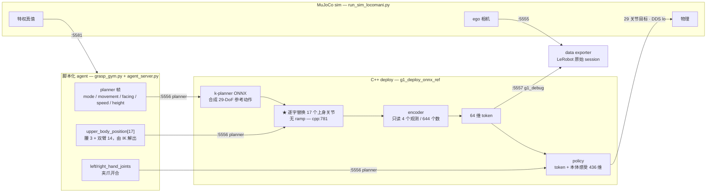
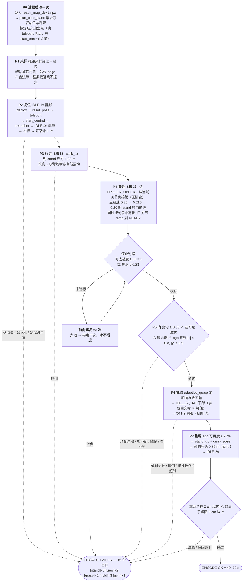
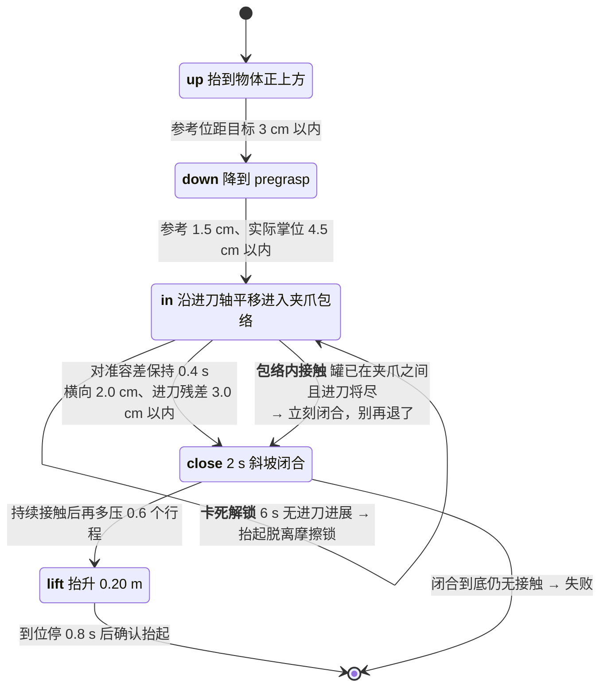

# Teleop-Free Loco-Manipulation Data Engine (Unitree G1 + SONIC)

不需要遥操作的人形机器人 loco-manipulation 数据引擎:在 MuJoCo 里由**脚本化 agent**
驱动 Unitree G1(SONIC 全身控制),自动完成"走到桌前 → 抓起物体"的完整 episode,
导出 **LeRobot v2.1** 数据集,用于 GR00T + SONIC 的 VLA 微调。

**它到底产出什么。**每条成功 episode 一段 ego RGB + 一条 **66 维 action 序列**
(SONIC 的 64 维 motion latent + 左右夹爪各 1 维)。这 66 维不是设计选择,是被
deploy 的 wire protocol 定死的:v4 只运 `token_state` + 可选夹爪。训练出的 VLA
输入 ego RGB(数据集里同时存了 29 维本体状态,要不要喂给模型是训练侧的选择),
输出这 66 维,直接喂回同一个 deploy 就能驱动机器人 —— 这条链路已经端到端验证过
(见 [VLA 部署时这条链路怎么变](#vla-部署时这条链路怎么变))。

脚本化 agent 用的是仿真里的**特权信息**(物体真值位姿、可达域、桌沿距离),所以不需要
人来遥操作,也不需要人来判断成功 —— 但这些特权信息只用于**生成**动作,不进入训练输入。

---

## 目录结构

```
src/teleop_free/        数据引擎全部代码(见下面的模块地图)
src/teleop_free/tools/  LeRobot v2.1 转换器
scripts/                安装 / 启动 / 批跑脚本
assets/                 预生成的仿真场景 tarball(免去 EmbodiedGen 场景生成)
docs/                   架构图、路线图、reach map 可视化
patches/                对上游仓库的小改动说明(third_party 不入 git)
third_party/            clone 的上游仓库(不入 git)
outputs/                运行时生成(场景、日志、视频、episodes),不入 git
videos/                 最新一批演示视频(每次推送会整体替换)
```

### 模块地图

`src/teleop_free/` 有 60 多个文件,其中 **50 个是 `diag_*.py` 一次性测量脚本**。
真正的流水线只有下面这些:

| 文件 | 角色 |
|---|---|
| **`grasp_gym.py`** | **唯一采集入口**。一局的全部流程:采样 → 复位 → 走 → 接近 → 抓 → 抱稳,以及所有成功判据 |
| `primitives.py` | 动作原语:`walk_to` / `turn_to` / `reach` / `stand_up` / `carry_pose`,以及世界系↔骨盆系换算 |
| `stream_reach.py` | 伸手与抓取的 50 Hz 伺服状态机(`PlannerArm`、`grasp_streamed`) |
| `agent_server.py` | ZMQ 发布端,占据 Pico 遥操作服务器的位置(`frame` / `set_upper_body` / `token_frame`) |
| `reach_map.py` | 可达域体素图:骨盆系里哪些位置**抓得到**,以及站位联合求解 |
| `adaptive_grasp.py` | 从手当前的位置反推抓取朝向与进刀轴 |
| `arm_ik.py` | 单臂阻尼最小二乘 IK(骨盆系) |
| `grasping.py` | 由物体尺寸与 6D 位姿算出手该放哪 |
| `privileged_pub.py` | sim 侧:发布特权真值(:5581),并接收 episode 控制(:5582) |
| `run_sim_locomani.py` | sim 入口:上游 `run_sim_loop.py` 换成我们的双桌面场景 + 特权发布 |
| `sim_video.py` | 第三人称录像(带 ego 画中画、6D 线框盒、坐标读数) |
| `sim_vis.py` | `SIM_VIS` 开关的解析(见[可视化开关](#可视化开关)) |
| `paths.py` / `scripts/paths.sh` | 全仓库唯一的绝对路径来源(见[路径约定](#路径约定)) |
| `scene_lib.py` / `build_sim_scene.py` | 场景构建(只有重新生成场景才用得上) |
| `tools/convert_to_hf_format.py` | exporter 原始 session → LeRobot v2.1 |

不在流水线上的:`navigator.py`(FMM 导航,当前 gym 不走这条)、`zmq_driver.py`
(最早的 walk-only 验证)、`isaac_scene.py` / `compose_scene.py`(渲染检查)。

`collect_episode.py` 处在中间状态:`grasp_gym.py` 仍然从它 import 四个共享常量与
辅助函数(`PALM_DRIFT_MAX` / `STAND_SETTLE` / `obj_top` / `palm_frame_offset`),
但它**自己那条跑 episode 的路径是旧的**,只有 `FULL_TASK=1` 的完整任务还走它。

---

## 环境安装

前置:Linux + NVIDIA GPU(本仓库在 RTX 5090 / driver CUDA 13 上验证)、
[miniconda](https://docs.conda.io)、[uv](https://docs.astral.sh/uv/)。

### 路径约定

**仓库可以放在任何路径,不需要改任何代码。**仓库内的路径由 `src/teleop_free/paths.py`
和 `scripts/paths.sh` 从文件自身位置推导出来。

仓库**外**的东西(依赖、conda、日志、缓存)默认挂在 `/workspace` 下。如果你的机器
不是这个布局,export 一个变量即可:

```bash
export LOCOMANI_WORKSPACE=/home/workspace     # 协作者最常见的情况
```

需要更细的控制时,这几个可以单独覆盖(默认都在 `$LOCOMANI_WORKSPACE` 下):

| 变量 | 默认 | 是什么 |
|---|---|---|
| `LOCOMANI_WORKSPACE` | `/workspace` | 仓库外一切东西的根 |
| `DEPS_DIR` | `$LOCOMANI_WORKSPACE/deps` | TensorRT / ONNX Runtime 解包位置 |
| `CONDA_BASE` | `$LOCOMANI_WORKSPACE/miniconda3` | conda 安装位置 |
| `LOCOMANI_TMP` | `$LOCOMANI_WORKSPACE/tmp` | stack 日志与 exporter 原始 session |
| `LOCOMANI_CACHE` | `$LOCOMANI_WORKSPACE/.cache` | pip / torch / HF 缓存 |
| `LOCOMANI_ROOT` | 自动推导 | 仓库根;只有在极特殊情况下才需要手动指定 |

自查当前解析结果:

```bash
python src/teleop_free/paths.py     # 或 . scripts/paths.sh; echo $LOCOMANI_ROOT
```

> EmbodiedGen 的 4 个安装脚本(`install_embodiedgen.sh`、
> `install_affordance_noflash.sh`、`eg_env.sh`、`setup_sonic*.sh`)同样改成了这套
> 变量,但**没有在别的机器上实测过** —— 它们只在重新生成场景时才用得到,
> 而重新生成场景需要几十 GB 下载。用现成场景的话完全不碰它们。

### 1. Clone 上游仓库到 third_party/

```bash
cd third_party
git clone https://github.com/NVlabs/GR00T-WholeBodyControl.git   # 必需:SONIC sim + deploy + exporter
git clone https://github.com/NVIDIA/Isaac-GR00T.git              # 可选:GR00T 微调
git clone https://github.com/HorizonRobotics/EmbodiedGen.git     # 可选:只有重新生成场景才需要
git clone https://github.com/isaac-sim/IsaacLab.git              # 可选:SONIC 训练(Isaac Sim)
```

### 2. 仿真与数据导出 venv(必需)

用上游自带的安装脚本,在 `third_party/GR00T-WholeBodyControl/` 下创建两个 venv:

```bash
cd third_party/GR00T-WholeBodyControl
bash install_scripts/install_mujoco_sim.sh        # -> .venv_sim(跑 MuJoCo sim 与所有 src/teleop_free 脚本)
bash install_scripts/install_data_collection.sh   # -> .venv_data_collection(跑 data exporter)
python download_from_hf.py                        # 下载 SONIC policy 权重(policy/release)
```

装完之后再打上两个补丁,否则**录下来的 action 是错的**(整段下蹲会丢失,action 维度
是 267 而不是 66):

```bash
cd third_party/GR00T-WholeBodyControl && git apply ../../patches/vla_action_space.patch
```

原因见 [`patches/vla_action_space.md`](patches/vla_action_space.md)。

### 3. 编译 C++ deploy(必需)

```bash
# 依赖放 $DEPS_DIR(默认 $LOCOMANI_WORKSPACE/deps)
# 1) TensorRT 10.13.x:apt-get download 对应 deb 后 dpkg -x 解包,并把
#    include/lib 软链成官方 TAR 布局;2) ONNX Runtime 1.16.3 tarball 解包;
# 3) 小依赖:apt install libeigen3-dev libzmq3-dev cppzmq-dev libgtest-dev \
#            nlohmann-json3-dev libmsgpack-cxx-dev
source scripts/env_deploy.sh
cmake -S "$SONIC_DEPLOY_ROOT" -B "$SONIC_DEPLOY_ROOT/build" -DCMAKE_BUILD_TYPE=Release
cmake --build "$SONIC_DEPLOY_ROOT/build" -j"$(nproc)"
```

> **不要跑 `gear_sonic_deploy/scripts/install_deps.sh`。**它有 `apt install cuda`
> 的 fallback,而 `cuda` 元包会拉 `cuda-drivers`,覆盖掉宿主注入的 NVIDIA 驱动。
> `scripts/env_deploy.sh` 就是用来替代它的。

### 4. conda 训练环境(可选)

```bash
bash scripts/setup_sonic.sh    # gear_sonic + Isaac-GR00T
bash scripts/setup_sonic2.sh   # IsaacLab 固定到 v2.3.2 并装 gear_sonic[training]
```

---

## 场景:直接用现成的(推荐)

场景生成(EmbodiedGen 文生 3D + 布局 + 物理注入)非常耗时,仓库直接附带了做好的场景:

```bash
bash scripts/install_scene.sh
```

解包 `assets/scene_locomani_v1.tar.gz` 到 `outputs/scene/`(双桌面 + 橙子/盘子等物体的
MJCF、布局、抓取标注、reach map、hand points),把 MJCF 里的绝对路径改写到当前
checkout,**然后重建场景**。

三点值得知道:

- 路径前缀是**探测**出来的,不是写死的,所以在哪台机器上重新打包都不会坏。
- **重建不是多余的一步。**tarball 装的是 EmbodiedGen 慢慢生成的那部分(网格与布局),
  而摆放、桌高、目标物体全在 `scene_lib.py` 里,改得很勤。tarball 里放一个构建好的
  `scene_locomani.xml`,第一次有人编辑 `scene_lib.py` 它就过时了,而且失败是静默的:
  sim 照常跑,只是新目标物体不存在。重建约 1 秒。
- 需要 `.venv_sim` 才能重建;venv 还没建时脚本会明确说它跳过了这一步。

如需重新生成场景:装好 EmbodiedGen(`src/teleop_free/install_embodiedgen.sh`),依次跑
`compose_scene.py` → `inject_physics_into_mjcf.py` → `build_sim_scene.py`,再用
`make_hand_points.py` / `reach_map.py` / `wrist_map.py` 重建缓存。

---

## 进程、端口与环境变量

### 三个进程

`start_stack.sh` 按依赖顺序拉起三个长驻进程,采集脚本(`grasp_gym.py`)是第四个,
单独启动:

| 进程 | 用哪个 python | 干什么 |
|---|---|---|
| MuJoCo sim | `.venv_sim` | 跑物理、发 ego 相机、发特权真值、录第三人称视频 |
| C++ deploy | 编译出的二进制 | SONIC:encoder 产 token,policy 产关节指令 |
| data exporter | `.venv_data_collection` | 订阅相机与 deploy 输出,落 LeRobot 原始 session |
| **`grasp_gym.py`** | `.venv_sim` | 脚本化 agent:决定机器人做什么 |

### 端口

`INSTANCE=i` 时全部加 `10*i`,DDS domain 也用 `i`,多实例互不干扰;只有 instance 0
挂 exporter 落盘。

| 端口 | 方向 | 内容 |
|---|---|---|
| 5555 | sim → exporter | ego 相机 RGB |
| 5556 | **agent → deploy** | `command` / `planner` / `pose` 三个 topic,机器人的全部意图 |
| 5557 | deploy → exporter | `g1_debug`,**录下来的 64 维 token 从这里来** |
| 5580 | agent → exporter | 录制控制键(`c` 开始/保存,`x` 丢弃) |
| 5581 | sim → agent | 特权真值(物体位姿、掌位、接触、ego 可见性) |
| 5582 | agent → sim | episode 控制(teleport、pin、ghost、录像开关) |

### 环境变量

| 变量 | 默认 | 谁读 | 作用 |
|---|---|---|---|
| `LOCOMANI_WORKSPACE` | `/workspace` | 全部 | 仓库外路径的根,见[路径约定](#路径约定) |
| `SIM_VIDEO_DIR` | 未设 | sim | 设了才录第三人称视频。**必须在 `start_stack.sh` 之前 export** |
| `SIM_VIS` | `full` | sim + gym | 调试可视化开关,见[下一节](#可视化开关) |
| `INSTANCE` | `0` | 全部 | 端口块 + DDS domain,多实例并行 |
| `SCENE` | `locomani` | sim | `default` 换成上游空场景 |
| `SONIC_POLICY` | `policy/release` | deploy | 换 checkpoint(`policy/sonic_v1_1` 可用,但步长与时序要重测) |
| `NO_ENCODER` | `0` | deploy | `1` = **不加载 encoder**,token-only / VLA 部署配置 |
| `HAND` | `dex1` | 全部 | `dex1` 平行夹爪 / `dex3` 三指手 |
| `GYM_ARM_PIN` | `0` | gym | `1` 恢复 sim 侧关节 pin(动作更准,但录下的 latent 不再是产生该动作的 latent) |
| `GYM_ARM_CHANNEL` | `planner` | gym | `streamed` 切回旧的流式手臂通道 |
| `GYM_RESTART_DEPLOY` | `1` | gym | 每局重启 deploy。关掉会让第 2 局起漂移、摔倒 |
| `FULL_TASK` | `0` | `collect_episode.py` | 抓起 → 搬运 → 放下的完整任务(尚未迁移到新控制逻辑) |

### 可视化开关

四个调试可视化由一个变量 `SIM_VIS` 控制:

```bash
SIM_VIS=full            # 默认,全开
SIM_VIS=none            # 录像完全干净
SIM_VIS=bbox,readout    # 只留 6D 线框盒 + 坐标读数
# 可选项: reach | ghost | bbox | readout
```

| 项 | 是什么 | 关掉省什么 |
|---|---|---|
| `reach` | 可达域点云:淡绿 = 能抓到的包络,**深绿核心 = 舒适区** | **约 5800 个 box geom** 的模型编译与渲染开销 |
| `ghost` | 洋红色的"幽灵夹爪",停在规划出的抓取位姿上,含抓取中心小球 | 渲染开销 |
| `bbox` | can / plate 的 6D 定向线框盒(数据集记录的就是这两个物体的位姿) | 少量 |
| `readout` | 烧在录像里的骨盆系坐标文字 | 无 |

**这些从来没有污染过训练数据。**`reach` 和 `ghost` 在 geom group 4,MuJoCo 默认可视化
选项就隐藏它;ego 相机和 exporter 用的正是默认选项。`bbox` / `readout` 只画进第三人称
mp4。所以这些开关是为了**录像干净**和**省开销**,不是为了数据干净。

两个实现细节:`reach` 的开销只有"不注入"才省得下来,所以它在 sim 启动时读一次,
**跑起来之后改不了**;`ghost` 是建场景时烘进 XML 的,关不掉它的可视化,只能让 gym
**不去摆它**(留在地板下面的出生点)—— 因此 **`SIM_VIS` 要同时给 stack 和 gym 设**:

```bash
export SIM_VIS=none                                   # 对两个进程都生效
SIM_VIDEO_DIR=outputs/sim_video bash src/teleop_free/start_stack.sh
third_party/GR00T-WholeBodyControl/.venv_sim/bin/python src/teleop_free/grasp_gym.py --rounds 3
```

---

## 控制流

三张图,分别回答三个不同的问题。**这里是唯一的真相源** —— `docs/` 下不再有平行的
流程图,因为两份平行文档正是上一版图落后 10 个 commit 的原因。

### ① SONIC latent 是怎么产生的

最容易误解的一点:脚本化 agent **从来不直接输出 latent**,也不直接输出关节角。
它输出的是**意图**;latent 是 deploy 内部的 encoder 从意图渲染出的参考动作里编码出来的。



三个必须记住的点:

1. **`upper_body_position` 是 17 个关节一起替换的**(腰 3 + 双臂 14,MuJoCo 索引
   12–28),而且是**逐字替换、没有 ramp**。所以 IK 只解一只手,另一只手也会被这 17 维
   带走 —— 走路时"举起手臂"是**双臂一起举**,闲着的那只只是被顺带写进去了。
2. **encoder 看不见机器人。**mode 0 下它只读 4 个观测共 644 个数:`encoder_mode_4`(4)、
   `motion_joint_positions_10frame_step5`(290)、`motion_joint_velocities_...`(290)、
   `motion_anchor_orientation_...`(60)。其余声明过的观测全被置零。**token 是纯意图**,
   不含任何本体状态。
3. **下蹲不走 `upper_body`。**它是 planner 帧里的 `mode=IDEL_SQUAT` + `height=<骨盆
   目标高度,绝对米>`,由 k-planner 渲染成弯腿参考动作,再由 encoder 编码进 token。
   所以下蹲**在 token 里**,不需要额外通道。(实测:命令的腰部前倾只交付 2–10%,
   基本等于没有,这条路是死的 —— 见 `diag_lean.py`。)

### ② 一局 episode 分几步



失败的 episode 直接丢弃(exporter 收到 `x`),**不重试** —— 数据集里只留一次成功的
episode,训出来的模型才会一次成功。

### ③ 伸手那几秒里发生了什么

`stream_reach._servo_continuous`,50 Hz 闭环,目标全部由**实时物体真值**重算,
从不从当前掌位外推(否则会追着自己推动的罐子跑)。



两个当初花了很多局才找对的细节:

- **`in → close` 的"包络内接触"分支**是必须的。罐子已经进了夹爪、只是被腕部压着时,
  再执行"接触闪避"退一次就会把它捅倒。改成立刻闭合之后,悬停不闭合的现象消失了。
- **`close` 阶段仍在主动保位**。冻结参考会让手掌下沉,闭合的横扫把罐子带倒。

---

## 运行:收集数据

```bash
# 1. 起整个 stack(sim + deploy + exporter),日志在 $LOCOMANI_TMP/p03/
SIM_VIDEO_DIR=outputs/sim_video bash src/teleop_free/start_stack.sh "pick up the can"

# 2. 采集(--record 驱动 exporter 落盘;不加就是只跑不落盘)
third_party/GR00T-WholeBodyControl/.venv_sim/bin/python -u \
    src/teleop_free/grasp_gym.py --rounds 12 --seed 21 --record \
    --manifest outputs/logs/manifest.jsonl
```

`--manifest` 不是可选的调试项 —— **要做逐局不同的指令就必须有它**,原因见
[目标与指令](#目标与指令)。

要点:

- **采集入口是 `grasp_gym.py --record`,不是 `collect_episode.py`。**所有经过验证的
  控制逻辑都在 `grasp_gym.py` 里;`collect_episode.py` 还停在旧路径上(走路时双臂被
  pin 成平举、抓取带 sim 侧关节 pin),只在需要完整任务(`FULL_TASK=1`)时才有用。
- 失败的 episode 会被 `x` 丢弃,只有通过全部 stage 判据的才落盘。
- 一条 episode 约 40–70 s、约 4.7 MB(视频 + parquet)。
- 停止:`bash src/teleop_free/stop_stack.sh`。

---

## 目标与指令

每局的目标是从**目标池**里随机抽的,指令里指名它 —— 这是"抓取策略"和"VLA"的
分界线:目标固定时,一个完全不读指令的模型和一个读指令的模型得分一样。

```bash
--targets pool          # 默认,scene_meta 里的整个 target_pool
--targets default       # 只用单一目标(旧行为)
--targets can,bottle    # 指定
```

| 目标 | 尺寸 | 桌沿 | 指令 |
|---|---|---|---|
| `can` | φ4.8 × 12 cm 深红 | +y | pick up the red can |
| `bottle` | φ6.0 × 14 cm 蓝 | −y | pick up the blue bottle |
| `cup` | φ7.0 × 10 cm 米白 | −x | pick up the cream cup |
| `jar` | φ3.6 × 11 cm 绿 | −y | pick up the green jar |

`plate` / `fork` / `napkin` / `orange` 是**干扰物**,不进目标池。

### 为什么目标池只能是细高物体

dex1 平行夹爪有两条硬约束,是量出来的不是拍的:

```
水平跨距 ≤ HAND_APERTURE − PINCH_MARGIN      = 8.48 cm
高度     ≥ GRIP_BELOW_RIM + 伺服 z 地板       = 9.0 cm
```

抓取中心在物体顶面下 6 cm,而伺服把命令 z 压在桌面 +3 cm 以上
(`stream_reach.py:1405`)。**球体因此在结构上出局**:直径 = 高度,不可能同时
≤ 8.48 且 ≥ 9.0 —— 橘子(9.3 cm)缩放也进不来,缩小解决宽度的同时等速破坏高度。
目标只能是 **φ3–8.5 cm × 高 9–14 cm** 的一族(圆柱、瓶、杯)。

`scene_lib.PRIMITIVE_OBJECTS` 里加一条就是一个新目标,重建场景 1.2 秒。

### 指令是怎么进数据集的

exporter 的 `--task-prompt` 是 **per-session** 的,整个 session 共用一条,所以
逐局不同的指令必须绕过它:

```
grasp_gym --manifest m.jsonl     每产生一个 episode 追加一行(目标、指令、成败)
        ↓
convert_to_hf_format.py --manifest m.jsonl
        ↓
meta/tasks.jsonl      多条 task
meta/episodes.jsonl   每局自己的 task_index
```

对齐靠**顺序**:exporter 按写入顺序给 episode 编号,就是 gym 产生它们的顺序。
转换器会硬校验两件事,不符就**直接报错退出**而不是警告 —— 指令标错在数据里是
看不见的,而且恰好毁掉目标随机化想教的东西:

- manifest 里 `produced` 的行数 == session 里的 episode 数
- 每一行的 `ok` == 该 episode 在 disk 上是否被 discarded

manifest 是**每次尝试一行**而不是每局一行:`[stand]` 类失败会重试整局,而如果
那次失败发生在开始录制之后,session 里就已经留下了一个 episode。

## 数据 schema

一条 episode 的 parquet 里列很多,但**训练用的只有下面这些**。完整推导见
[`patches/vla_action_space.md`](patches/vla_action_space.md)。

### action:66 维

| 分量 | 维度 | 说明 |
|---|---|---|
| `motion_token` | 64 | SONIC latent。**1/16 量化**(整条 episode 只有 31 个取值,约 5 bit/维)→ VLA 输出头应该做**分类**而不是回归 |
| `left_gripper` | 1 | 目前恒定(单手任务),为将来双手任务保留 |
| `right_gripper` | 1 | dex1 的两根平动手指永远同值 |

维度是被 wire protocol 定死的:deploy 的 pose protocol v4 是 token-only 流,
必填 `token_state`,选填 `frame_index` / `left_hand_joints` / `right_hand_joints` /
`body_quat_w` —— **planner 指令(mode / movement / facing / speed / height)没有通道**。
它们仍然被写进 parquet(将来可以当辅助监督),但不是 action。

### observation

ego RGB(`head_camera`,pitch 52° / fovy 70°)+ 29 维关节状态。特权量
(`can_pose` / `plate_pose`,骨盆系)也在 parquet 里,**训练时不能进输入** ——
它们的用途是分析和写判据。

---

## 导出 LeRobot v2.1 并对接 GR00T

exporter 的原始 session 在 `$LOCOMANI_TMP/p03/outputs/`。转换成 LeRobot v2.1
(格式对齐 `hojjunekim/g1_sonic_orange_to_plate_locomani`,含 29-DoF 关节状态 +
64 维 SONIC motion latent + 30fps 视频):

```bash
third_party/GR00T-WholeBodyControl/.venv_data_collection/bin/python \
    src/teleop_free/tools/convert_to_hf_format.py \
    --sessions "$LOCOMANI_TMP"/p03/outputs/<session...> \
    --manifest outputs/logs/manifest.jsonl \
    --out datasets/g1_locomani_lerobot
```

`--manifest` 按顺序与 `--sessions` 一一对应,一个 gym 进程写一个 manifest、填一个
session。不给的话每局都会拿到同一条兜底指令。

得到的数据集可直接喂给 `third_party/Isaac-GR00T` 做 GR00T 微调。上层/底层的详细
数据流见 `docs/architecture.drawio`。

### VLA 部署时这条链路怎么变

训练好的模型输出 66 维,**不经过 encoder**,用 protocol v4 直接喂进 :5556:

```bash
NO_ENCODER=1 bash src/teleop_free/start_stack.sh     # 关键:必须不加载 encoder
```

`NO_ENCODER=1` 不是省显存。deploy 只要加载了 encoder,`initial_encoder_mode_` 就是 0,
它的 token 路径会不停地翻回 encoder("if encoder mode is not -1, we need to turn on
the encoder",`g1_deploy_onnx_ref.cpp:3096`),外部 token 流永远压不住。不给
`--encoder-file`,mode 变成 -1,才会走 "tokens can be set externally"。

这条路已经端到端验证过(`diag_token_replay.py`):录下成功 episode 的 64 维 token
再喂回去,关节轨迹复现到 **0.2–0.9°**。开环回放抓不到罐子(浮动基座把误差积分成
0.77 m 位移),那是开环的固有性质,不是链路问题 —— VLA 部署是闭环的。

---

## 常见问题

| 现象 | 原因 / 处理 |
|---|---|
| `start_stack.sh` 卡在 `[2/3]` 十分钟 | 首次运行在编译 TensorRT engine,正常。之后走缓存,20–40 s |
| deploy 起来了但机器人不动 | 检查 :5556 上是不是有**多个** commander 在发。多个进程往同一个 deploy 发冲突意图,表现就是发呆或抽搐 |
| 每局都 `teleport did not land` | 上一局的 deploy 状态没清干净。`GYM_RESTART_DEPLOY=1`(默认)每局重启 deploy 就是为这个 |
| 录像里没有绿色点云 | `SIM_VIS` 里没有 `reach`。它在 sim 启动时读一次,跑起来之后改不了 |
| `SIM_VIS=none` 但幽灵夹爪还在 | `SIM_VIS` 只给了 stack,没给 gym。两个进程都要设 |
| 录下来的 `planner_height` 全是 -1 | `patches/vla_action_space.patch` 没打。整段下蹲会从 action 里消失 |
| action 是 267 维而不是 66 维 | 同上,补丁没打 |
| `[manifest] ...: N produced rounds but M episodes on disk` | manifest 和 session 不是同一次运行。一个 gym 进程写一个 manifest、填一个 session,别混用 |
| `[manifest] ... join is out of phase` | 更糟:数量对上了但成败对不上。**别转这个 session**,指令会标错 |
| `[gym] targets not in the scene` | 场景是旧的。`bash scripts/install_scene.sh` 会解包并重建 |
| 换了机器路径全错 | `export LOCOMANI_WORKSPACE=<你的根>`,然后 `python src/teleop_free/paths.py` 自查 |
| 场景 MJCF 找不到 mesh | 重跑 `bash scripts/install_scene.sh`;它会探测并改写 tarball 里烘死的路径 |

---

## 常用诊断脚本

`src/teleop_free/diag_*.py`(都用 `.venv_sim` 的 python,在 stack 起来后运行)。
结论都写在各自的 docstring 里 —— **它们是这个仓库大部分"为什么是这个数"的出处**。

| 脚本 | 回答什么 |
|---|---|
| `diag_channel.py` + `diag_channel_report.py` | planner 通道 vs streamed 通道的手臂投递精度(216 样本) |
| `diag_squatmode.py [--sweep]` | `IDEL_SQUAT` 的蹲深,以及 `height` → 骨盆高度的标定曲线 |
| `diag_lean.py` | 命令的腰部前倾有多少被交付(答案:2–10%,基本不交付) |
| `diag_height.py` | `height` 字段在 IDLE / SLOW_WALK 下是否有效(答案:没有) |
| `diag_ego_geom.py` | 罐子在 ego 相机里的可见距离区间,随躯干前倾的变化 |
| `diag_token_replay.py --phase capture/replay` | 录下的 token 能否复现动作 |
| `diag_shuffle.py` | 每个 speed 命令实际走多快、一步多长 |
| `diag_reach_probe.py` | reach map 的实测校验 |
| `diag_ik_grasp.py` | 纯运动学抓取 bench(不经过 policy) |

---

## 路线图

下一步要做什么、按什么顺序做,在 [`docs/ROADMAP.md`](docs/ROADMAP.md)。
其中**第 0 节列了已经验证过、不要重做的结论**,动手前先看那一节。
