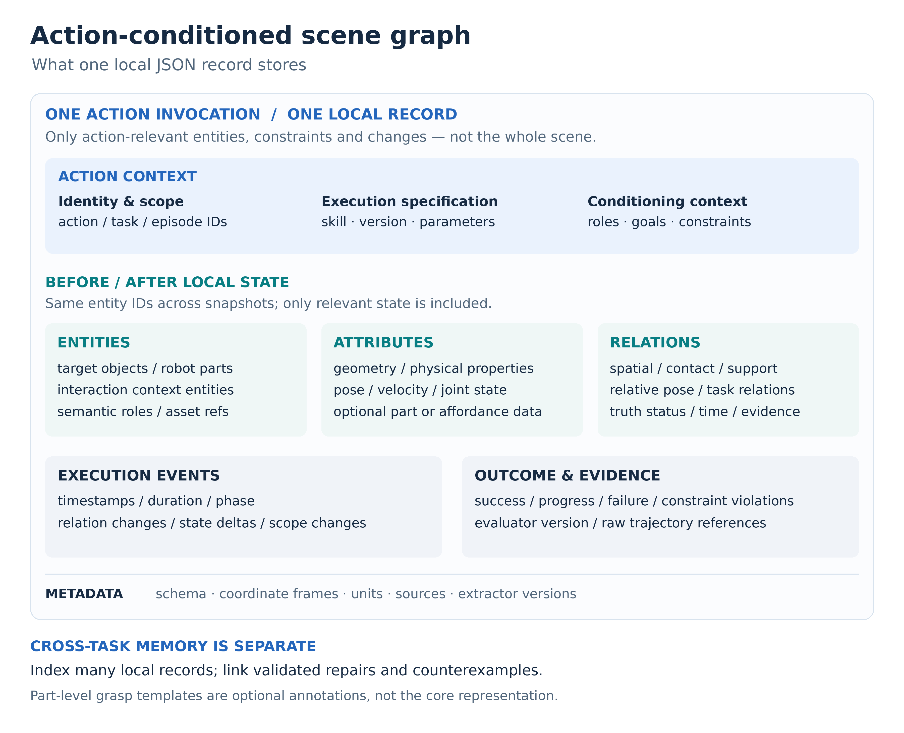

# PAST Action-Conditioned Local Scene Graphs for Cross-Task RSI

**PAST — Privileged Action-conditioned Scene-graph Transitions**

**Proposed core contribution: an action-conditioned scene graph as a knowledge representation for RSI.** Each record organizes the states, execution conditions, temporal changes, and outcome of one action. This enables comparable experience retrieval, failure diagnosis, and reuse of improvements across tasks. The goal is better cross-task transfer and more efficient self-improvement; these benefits remain to be validated.

# 1 Action-Conditioned Local Scene Graphs

**One action invocation produces one local JSON record.** The record captures the local interaction state and its changes—not a global graph of the entire environment. An action can be a skill invocation or a sub-action at a consistent granularity. Each retry creates a new record; a multi-action task produces multiple records.

Action conditioning means more than attaching an action name. The action’s goal, participants, parameters, and constraints determine which entities, attributes, and relations to extract, and how to interpret execution changes. The figure shows the generic contents of each local record.



| Component | Stored content | Connection to the action |
| --- | --- | --- |
| Action context | Action/task/episode IDs, skill/version/parameters, goal, role bindings | Identifies the interaction and comparison conditions |
| Local entities | Target, executing components, relevant supports, obstacles, and regions | Selected by interaction and constraint relevance |
| Entity attributes | Geometry, mass/center of mass, pose/velocity, relevant joint states | Retains variables needed to interpret the outcome |
| Local relations | Spatial, contact, support, holding, and relative-pose relations | Describes interaction structure before and after execution |
| Time and changes | Before/after snapshots, event order, duration, attribute/relation changes | Identifies when and how failures develop |
| Outcome and evidence | Success/progress, constraint violations, evaluator version, trace references | Supports improvement assessment and verification |
| Optional annotations | Parts, affordances, grasp-template references | Included when relevant; not the core novelty |

**Local does not mean a fixed-radius crop.** Include the target, executing components, and relevant contacts, supports, obstacles, and safety constraints. Whole-body actions may require base and foot states. Select the initial scope using information available before execution; timestamp any expansion when newly relevant entities are discovered. Do not present post-action information as if it were known beforehand.

**Storage boundaries:** Keep entity IDs consistent within an action. Explicitly record relation truth values; unknown or omitted relations are not false. Separate observed facts, derived predicates, and causal hypotheses. Cross-task memory separately indexes local JSON records and validated repairs; an individual record does not duplicate the full knowledge base.

# 2 Experience Representation and JSON Sample

An action-local record forms one experience unit. Both graphs below are local to the action:

```math
E_i=\bigl(G_{\mathrm{before}},\ (s_i,v_i,\theta_i),\ \mathcal{T}_i,\ G_{\mathrm{after}},\ o_i\bigr)
```

| Symbol | Meaning | JSON fields |
| --- | --- | --- |
| G_before / G_after | Local states and relations before/after execution; reuse entity definitions within the record | entities + G_before / G_after |
| s / v / θ | Skill, implementation version, execution parameters | action |
| T | Timestamped execution events and state changes | events |
| o | Action outcome assessed using fixed criteria | outcome |

The following compact JSON represents a single action. Values are illustrative. `entities` contains static definitions; the two graphs contain dynamic states and relations. This is not a global scene snapshot.

```json
{
  "schema": "PAST-0.4",
  "record_id": "action_017",
  "episode_id": "episode_03",
  "task_id": "task_05",
  "metadata": {
    "clock": "simulation", "units": "SI",
    "frame": "world", "quaternion_order": "xyzw",
    "state_source": "sim_privileged", "predicate_version": "relations_v1"
  },
  "action": {
    "skill": "lift", "version": "v12",
    "parameters": {"height_m": 0.10, "speed_mps": 0.20},
    "start_s": 1.0, "end_s": 1.5,
    "roles": {"target": "n1", "effector": "n2", "support": "n3"},
    "goal": {"height_gain_m": 0.10, "keep_held": true}
  },
  "scope": {
    "selector": "action_relevance_v1",
    "initial_node_ids": ["n1", "n2", "n3"],
    "added_node_ids": []
  },
  "entities": [
    {"id": "n1", "type": "object", "mass_kg": 0.4, "bbox_m": [0.1, 0.1, 0.1]},
    {"id": "n2", "type": "end_effector", "capability_ref": "configs/tool_v1"},
    {"id": "n3", "type": "support_surface", "fixed": true, "height_m": 0.70}
  ],
  "G_before": {
    "t_s": 1.0,
    "node_states": {
      "n1": {"p_m": [0, 0, 0.75], "q": [0, 0, 0, 1]},
      "n2": {"p_m": [0, 0, 0.75], "q": [0, 0, 0, 1]}
    },
    "edges": [
      {"s": "n1", "r": "held_by", "o": "n2", "value": true},
      {"s": "n1", "r": "supported_by", "o": "n3", "value": true}
    ]
  },
  "events": [
    {
      "dt_s": 0.10, "phase": "execute",
      "edge": ["n1", "supported_by", "n3"], "from": true, "to": false
    }
  ],
  "G_after": {
    "t_s": 1.5,
    "node_states": {
      "n1": {"p_m": [0, 0, 0.85], "q": [0, 0, 0, 1]},
      "n2": {"p_m": [0, 0, 0.85], "q": [0, 0, 0, 1]}
    },
    "edges": [
      {"s": "n1", "r": "held_by", "o": "n2", "value": true},
      {"s": "n1", "r": "supported_by", "o": "n3", "value": false}
    ]
  },
  "outcome": {
    "success": true, "observed_height_gain_m": 0.10,
    "constraint_violations": [], "evaluator_version": "lift_eval_v1"
  },
  "optional_annotations": {"grasp_template_ref": null},
  "evidence_refs": {"trace": "traces/action_017"},
  "memory_refs": []
}
```

High-frequency data remains accessible through `evidence_refs`; `memory_refs` links only relevant historical experiences. `optional_annotations` may be empty or omitted. Missing annotations mean that additional knowledge was not recorded—not that the corresponding parts or affordances do not exist.

# 3 Expected Benefits for Cross-Task RSI

**The transferable unit is action conditions + local relational structure + execution changes + outcome—not an object name or a particular grasp.** Before execution, retrieve using the current local graph and candidate action. After execution, add events and outcomes to retrieve relevant failures and repairs. Match instances through role bindings while retaining physical-condition and version differences.

| RSI operation | Use of local records | Expected benefit |
| --- | --- | --- |
| Cross-task retrieval | Match actions, role relations, and physical conditions; then compare event patterns | Reuse similar interaction experiences across different task goals |
| Failure diagnosis | Align before/after relations, execution events, and discrepancies from the goal | Localize problems and reduce irrelevant code changes |
| Improvement reuse | Link prior code/parameter changes to their validation records | Reuse effective candidates and avoid repeated trial and error |
| Condition revision | Revalidate on other tasks; retain successes and counterexamples | Limit negative transfer and refine applicability |

| Research hypothesis | Required comparison | Main metrics |
| --- | --- | --- |
| H1 Action-local representation improves self-improvement efficiency | Raw states/logs with matched information budgets; static local graphs | Rollouts, tokens, and total time to target performance |
| H2 The representation enables cross-task knowledge reuse | Within-task or category-based retrieval using the same history | Improvement cost and performance gains on held-out tasks |
| H3 Transition patterns and condition filtering improve reliability | Retrieval without temporal changes or physical conditions | Ineffective-patch rate, negative transfer, rollback rate |

**Evaluation constraints:** Match initial skills, simulation information, historical experience, and budgets. Include graph extraction, retrieval, and regression-testing costs. Graph changes provide diagnostic evidence, not automatic causal proof. Promote repairs to reusable knowledge only after paired tests and cross-task validation. Privileged information supports the improvement agent; deployed policies must not acquire dependencies on unavailable ground-truth inputs.

**Contribution boundary:** Parts, affordances, and grasp templates are optional content. The research question is how action-conditioned local knowledge representation improves cross-task transfer and RSI efficiency—not whether individual fields or JSON serialization are novel. Novelty still requires comparison with existing action and transition representation systems.
