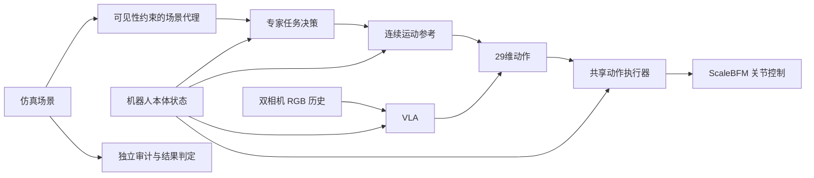

# ScaleBFM 视觉 VLA 采集与验证

2026-09-09 更新：新采集默认使用 `yplus_center_v1`，瓶子与机器人仅在桌子 `y+` 侧初始化；
瓶子沿边以桌子中线为中心随机±8cm，近瓶向桌内12–18cm，深瓶18–24cm。
详情与新入口命令见 [y+ 采集调整](scalebfm_yplus_collection_20260909.md)。
下方原A/B/C流程属于已取消的 `legacy_edges_v1` 实验，不能将旧资格/闭环结果当作新分布的结果。
旧 Goal 保持停止，GPU预约已释放；不要直接执行下面历史完整流程命令。

固定可视检查：说 **“检查采集视频”** 或运行 `bash scripts/scalebfm_video_check.sh`，
导出当前随机化下10集侧前方全身跟随视频。[功能约定与命令](scalebfm_video_check.md)。

实验计划：[scalebfm_goal_plan.md](scalebfm_goal_plan.md)。当前进度和恢复入口：
[scalebfm_goal_state.md](scalebfm_goal_state.md)。资源分配以 [STATE.md](STATE.md) 为准。

本流程比较三种数据策略：A 为冻结的旧任务脚本，B 为通过资格测试的新专家，
C 用恢复示范替换 B 的 25% 常规示范。最佳方案须等固定预算 VLA 闭环比较完成后确定。
专家成功率和下面的接口验证不能替代学生验证。

## 信息边界



专家场景代理以真实像素可见性为前提，限制更新率、延迟、精度和遮挡记忆。
这是仿真辅助感知代理，不能据此声称已实现 RGB 物体定位。
VLA 只接收两路 RGB、本体状态和固定任务文字；不接收物体位置、桌面真值、
任务阶段、接触标志或成功标志。部署执行器只使用动作和机器人状态。

专家的本体跟踪补偿已经包含在动作标签中，VLA 部署时不再重复应用该补偿。
共享执行器保留相同的上一腕部命令，用于限制每个控制周期的腕部位移与旋转。

## 观测和动作协议

| 项目 | 固定定义 |
|---|---|
| 相机 | `ego_view`、`right_wrist`，各 320×240 RGB |
| 图像历史 | 当前帧与 0.4 秒前的帧；开头用首帧补齐 |
| 本体输入 | 91 维：原 53 维关节/FK/重力、9 维自身速度、29 维上一动作 |
| 动作 | 29 维、float32、当前骨盆 yaw 坐标系 |
| 动作字段 | 骨盆位姿9、右腕位姿9、骨盆线速度3/yaw速度1、右腕线速度3/角速度3、夹爪1 |
| 旋转 | 6D 表示，两列依次展开；不是行优先截取矩阵 |
| 采样/控制 | 动作25Hz、控制50Hz；一行动作保持两个控制周期 |
| ScaleBFM 参考 | 从原生速度构造六帧短期参考，不读取未来实测骨盆状态 |
| 重规划 | 每0.4秒，模拟80毫秒延迟；等待期间继续执行上一块动作 |
| 启动 | 首次观测1.60秒，首块动作第2行于1.68秒执行；采集包含前两行启动观测 |

训练必须使用 `configs/gr00t_bfm_visual_2cam.py` 和 `train_visual_vla.py`。
其中显式设置 `data.allow_padding=True`，避免负历史索引绕到同一轨迹末尾的未来图像。
保持完整视野，不进行可能裁掉目标证据的空间裁剪。

## 执行入口

先确认 GPU0 仍归本 Goal 使用。统一采用 `third_party/Isaac-GR00T/.venv/bin/python`；
不同 PyTorch 环境之间已经观测到微小重放差异。

完整比较流程：

```bash
CUDA_VISIBLE_DEVICES='' OMP_NUM_THREADS=1 \
third_party/Isaac-GR00T/.venv/bin/python \
src/teleop_free/scalebfm/run_visual_comparison.py \
  --root outputs/experiments/scalebfm_visual_goal_20260908
```

驱动器要求已有真实的 `c3_final_acceptance.json`。它依次采集、导出、计算统计量、
冻结训练配置、训练六个模型、做配对选择、锁定方案并验证。
GPU 子任务只使用 GPU0；CPU 子任务隐藏 CUDA。流程不使用录制 stack 或端口。

单独采集冻结的新专家：

```bash
CUDA_VISIBLE_DEVICES=0 MUJOCO_GL=egl MUJOCO_EGL_DEVICE_ID=0 \
third_party/Isaac-GR00T/.venv/bin/python \
src/teleop_free/scalebfm/collect_visual_cohort.py \
  --arm B --prior-attempts 145 --out <新的实验目录>
```

本次 B 组的145次旧采集尝试已经退役，必须继续计入880次尝试上限。
正式比较使用 `cohort_B_v2`；旧 `cohort_B` 保留用于审计，不进入最终训练。
重新启动前先查进度和 PID，避免同时启动两个相同任务。

## 检查点与中断恢复

- `config.json` 和 `source/` 保存启动配置与源码；模型、仿真资源有哈希校验。
- `attempt.json` 在物理执行前写入；中断尝试消耗预算，保留后跳到下一种子。
- `simulation_result.json` 是物理运行结果；`result.json` 在录制完成且场景元数据齐备后提交。
- 如果物理结果、完整视频和 `student.npz` 已保存，恢复时可补齐最终元数据，无须重跑仿真。
- `audit.json` 保存每项验收判定；缺少桌高分层或场景路径时直接报错。
- 每个 split 的 `*_attempts.json` 保留所有失败，`*_inputs.json` 固定被接受的输入顺序。
- `pipeline_v2_state.json` 保存阶段、命令、PID、日志和退出码。失败阶段须先诊断，不能盲目重复。
- 训练每500步保存优化器和 RNG 状态，保留最新检查点；只评估最终3000步模型。

上下文压缩后读取 STATE、Goal 检查点和阶段 JSON，然后检查已保存结果和存活进程。
不要通过重跑已完成的实验来恢复记忆。基础模型已固定到本地缓存的具体快照；
训练配置同时记录数据清单、模态配置和 GR00T 源码哈希。

保存完成后可只读审计恢复文件。中间检查点应等训练日志进入下一步再运行，
最终检查点应等训练阶段成功退出；不要审计仍在写入的目录：

```bash
CUDA_VISIBLE_DEVICES='' OMP_NUM_THREADS=1 \
third_party/Isaac-GR00T/.venv/bin/python \
src/teleop_free/scalebfm/audit_visual_checkpoint.py \
  --checkpoint outputs/experiments/scalebfm_visual_goal_20260908/model_A_s17/checkpoint-500 \
  --step 500 \
  --out outputs/experiments/scalebfm_visual_goal_20260908/checkpoint_A17_500_audit.json
```

检查覆盖优化器/调度器步数、Python/NumPy/CPU/CUDA 随机数状态、模型分片索引和
处理器/归一化文件。它不执行额外训练，也不以中间权重做闭环选择。

本次 Goal 已启动独立的只读检查进程 `watch_registered_checkpoints.py`，
位于实验根目录。它跳过已有成功审计，对六个登记训练运行的每500步检查点按上述时机检查，
将状态写入 `checkpoint_audit_watch.json`，新结果写入
`checkpoint_audit_watch_events.jsonl` 和对应的 `checkpoint_*_audit.json`。
恢复上下文时先核对该状态文件中的 PID 是否存活；进程运行期间不要并行手工审计同一检查点，
也不要重复启动。它不控制训练、不重新执行策略或物理；失败仅记录检查错误，训练仍由原驱动管理。
36份登记审计齐全后该检查进程退出，这不代表整个 Goal 或确认评估完成。

恢复训练时 `--resume` 必须指向该运行目录下最新的检查点，保留优化器与 RNG。

## 验证结果的位置

实验根目录为 `outputs/experiments/scalebfm_visual_goal_20260908/`。

| 阶段 | 主要产物 |
|---|---|
| 专家资格与恢复 | `qual_a16/audit_summary.json`、`recovery_a16/audit_summary.json` |
| 启动标签一致性 | `qual_a16/startup_contract.json` |
| 延迟分块重放 | `qual_a16_chunk_replay10/summary.json` |
| 扰动后原动作重放 | `qual_a16_perturbed_replay3/summary.json`；使用原录制时长，不额外延长恢复时间 |
| 数据 | `dataset_{A,B,C}_{train,val}` |
| 配对闭环选择 | `selection_{A,B,C}_s{17,29}`、`selection_locked.json` |
| 锁定后的验证 | `confirmation_*`、`confirmation_report.json` |

选择指标为两次训练种子的平均闭环任务成功率，同时报告常规场景、恢复场景和桌高/瓶深分层。
差距在每60场1次成功以内时，优先姿态违规较少者，再优先简单方案。
分别报告各训练种子的配对结果；同一场景的两个训练种子不当作两个独立场景。

## 环境与数值预处理记录

`environment_manifest.json` 和 `environment_versions.txt` 保存 Python、145个包、
PyTorch/CUDA及GPU版本。该清单在A17第500步之后采集，不能倒推证明更早每个时刻
的全部依赖版本，也不是包含所有平台轮子来源的安装锁文件。源码以每个模型的冻结快照为准。

共同处理器启用q01/q99截断。`processor_action_roundtrip_A.json`验证A17已保存
处理器能在不传state的情况下编码/解码ABSOLUTE动作，预期截断外的数值误差<1e-6。
`normalization_tail_audit.json`按实际阶段量化三组标签的截断（A使用已保存处理器，
B/C使用共同冻结设置和各自数据统计）。不要把原生动作的精确执行器重放，误写成
包含分位截断后仍对所有尾部标签无损。该离线检查没有增加训练或物理评估步数。
