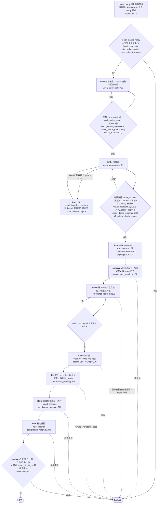
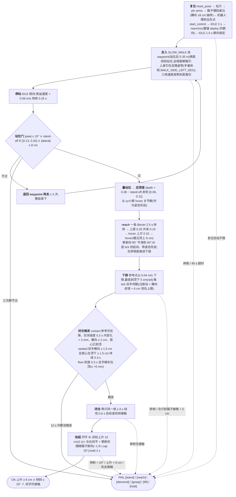

# 双臂详解：设计、原则与演化

怎么跑在 [双臂 runbook](bimanual.md)；哪天跑出什么数在 [双臂台账](ledger/crate.md)。
这一页回答的是**为什么是这样**：视觉专家的信息来源、连续控制怎么做的、观测与动作
记录协议、诊断专家、以及双臂闭环评测器的构造。

数据集格式（LeRobot 布局、schema、导出与审计）两条线共用，在
[单臂详解](single_arm_design.md) 里，不在这里重复。

## 一、任务与能力

### 任务与能力

| 项目 | 当前支持 |
|---|---|
| 默认任务 | 30 cm 低桌、篮子向桌内退入 4 cm + 原始外观 + `configs/task/crate_visual_low_reach.yaml` |
| 动作过程 | 走近并准备双手 → 减速、支撑交接 → 协调俯身与伸手 → 闭合、试提 → 抬升并恢复直立 → 持物验收 |
| 专家输入 | 仿真物体位姿与机器人状态辅助规划，由采集相机的可见性和新鲜度约束动作 |
| 采集能力 | 完整尝试视频、相机观测、发送的动作参考、物理轨迹和成败记录 |
| 后续链路 | `collect.record=true` 经 exporter 录制正式 LeRobot episode（第 4 节），转换与审计已验证；闭环评测 `eval_crate_closed_loop.py` 已实现，10k 步模型 71/100（[评测](#五双臂闭环评测器)） |

当前范围是已知篮子/桌面、正面无障碍接近；不保证任意深度可达或通用搬运。
仿真信息可辅助生成动作，失败接触仍须如实保留。观测、动作与训练边界的详细含义见
[视觉专家说明](bimanual_design.md)。


### 可迁移箱体抓取

[仿真执行阶段](box_rim_execution.md)接续静态规划，使用实测状态验证接近、闭合和试提；正式采集继续使用现有专家。

新的[箱体边沿规划器](box_rim_planning.md)将开口矩形箱体的边沿描述与机器人实际
停车状态作为输入，搜索左右抓点和全身姿态。它用于静态可达性、碰撞与支撑约束
检查，以及 ghost 预览；尚未接入下面的在线专家、合爪或数据采集。
旧篮子专家仍使用原来的固定目标几何；初始化准备已抽成共享入口。
固定站姿下的[可达实验](bimanual_reachability.md)复用这一准备流程与原 expert，
将 IK 候选区域和实际执行通过点分开记录；任务录像在 quiet admission 后开始。

## 二、视觉专家：信息来源与连续控制


使用 `--expert visual` 执行展示视觉篮子的采集，并进行其边缘抓取。
低桌配置使用原始篮子外观的模拟辅助规划。它记录从 1.2–1.5 m 处开始的行走到尝试完成的全过程。
这些是视频/控制试验；它们还没有认证 VLA 训练或学习。
[连续性修订](handoff/crate-continuous-motion-20260914.md) 记录当前实现和现场检查。
早期的 [连续性审计](handoff/crate-continuity-audit-20260914.md) 和 [负重站立批次](handoff/crate-upright-handoff-20260913.md) 保留了变更前的证据。

### 专家使用的信息

"视觉引导"描述可见场景与动作之间的关系。它**不**要求专家限制于 RGB 姿态估计。
模拟对象姿态、机器人状态和几何约束可能有助于产生平滑、可重复的参考。它们的来源必须被准确记录。

`visual.pose_source` 选择一个实现方式：

| 来源 | 规划输入 | 外观和准入条件 |
|---|---|---|
| `assisted`（低桌配置） | 模拟篮子姿态、测量的关节/基座姿态、相机几何、场景遮挡几何 | 原始篮子；新鲜的相机帧和在至少一个记录相机中可见的篮子 |
| `markers`（历史 RGB 实验） | RGB 标记拟合、测量的关节/IMU、已知标记几何 | 添加的墙壁/地板标签；RGB 拟合在接近抓取时需要 |

辅助路径使用截面投影和场景光线来承认可见的篮子。
它**不是** RGB 检测器。需要在一个相机中跨越至少八个像素的三个可见表面样本；空白帧被拒绝。
相机安装体从其自身光线中被排除，隐藏的几何组被排除。
这个几何检查是对记录可见性的近似，不是像素级分割保证。RGB/状态时间戳和来源标签仍然可以检查。

模拟可能会改进目标和轨迹；它不能传送篮子、在演示期间重置机器人、将对象移到可达范围内、无限期地推进看不见的目标、或将失败的接触变成成功的标签。
新遮挡的视图停止目标进展并制动参考；陈旧的输入最终会中止。相同的可见放置决定目标；任意隐藏的局标志不选择抓取风格或未记录的恢复分支。
这限制了潜在的隐藏动作原因，但不能证明特定 VLA 可以学习策略。

历史 [RGB 低到达批次](handoff/crate-visual-low-reach-20260913.md) 使用绘制的场景并成功 4/10。
其观测仍然是历史测量；该速率不能归因于辅助控制器。
早期 [行走](handoff/crate-walk-stability-20260912.md) 和 [仅抓取](handoff/crate-visual-pilot-20260912.md) 证据已保留。
原始 [设计讨论](handoff/crate-visual-expert-design.md) 早于此明确许可在整个规划中使用模拟。

### 运行

在 [采集指南](bimanual.md#1-建场景每台机器一次) 中构建场景并运行单次尝试或批量配置。
该指南管理启动命令、GPU/实例选择、[桌面高度验证过程](bimanual_design.md#table-height-validation) 和所需的 POSE 所有权补丁。
本部分解释场景和来源处理。

配置不更改桌面高度。它选择 `carry.reach_control=whole_body` 和 `visual.pose_source=assisted`。
运行器复制源场景并从副本中移除实验性 `crate_visual_*` 板/标记。
支撑桌的盒形碰撞器用相等大小的八顶点凸网格表示，以避免 MuJoCo 的解析盒/盒幻像接触。
篮子外观及其抓手接触几何保持不变；原始来源被保留。为每个实验使用新的输出目录；旧的制品必须保持完整。

配置解析为默认值 → 配置文件 → 显式 `--set` 覆盖，然后序列化到专家过程。
查看生成的 [字段参考](reference/config_fields.md)。辅助控制需要全身路径。
要重现旧的标记路径，使用 `python -m locomani.tasks.crate.visual_scene SOURCE DESTINATION` 构建不同的场景并显式设置 `--set visual.pose_source=markers`。

### 低桌和自由腰部

`CoordinatedReach` 在整个下降、闭合、提升和负重站立过程中拥有一个支持的身体参考。
`WholeBodyIK` 拥有脚锚、平衡和物理姿态限制。
现有的 `carry` 专家保持作为单独的机械诊断入口。

- 从采样的 1.2–1.5 m 桌边距离行走。当可见的篮子接近时，准备两只手和小腰部倾斜，具有关节速率限制，同时行走规划器仍然拥有脚部。
  连续的安静测量基座间隔授权在交接前进行支撑检查。辅助路径使用当前基座速度/旋转，避免额外的视觉速度滤波器等待。
  无支撑的接触使用剩余的制动余量以获得更接近的可见接近，受 `visual.stand_off` 限制；无支撑的放置仍然可能失败准入。
- 在交接前在深度轴上收敛站立。步态在命令位置周围散落几厘米的实现停止，站立位置远于 `visual.stand_off` 超过 `visual.stand_depth_tolerance` 的（在安静间隔的平均可见深度上判断）将重新行走，收紧停止位置，最多 `visual.stand_depth_retries` 次；接近的站立从不后退。
  每个安静的站立都记录为导航记录中的 `stand_attempts` 和尝试结果（接受或不接受），因此远站立保持可见而不被误认为到达失败。重试仍然受 `visual.walk_timeout` 限制。
  行走命令从不低于 `visual.walk_speed_min`：规划器的速度字段不是 m/s，映射属于当时的部署栈（`ledger/crate.md` 2026-09-22：0.10 曾交付 0.011 m/s，0.20 当天交付 0.05 m/s），落在映射脚下的命令根本不移动机器人，所以以那种方式命令的重新行走会站立不动直到超时。
- 起点由场景的 `robot_start` 朝向定义走入轴（合成桌子场景朝 +x，物流房间朝 +y），物体保持场景自己的偏航再加 `yaw_jitter_deg`。`visual.start_pose` 为 `sampled`（默认）时在近桌沿前 `start_edge_min`–`start_edge_max` 抽起点；为 `scene` 时直接用场景 `robot_start` 沿朝向前移 `start_advance`（房间纸箱线用箱沿线验证局 `dy0.225_r00` 的起点：前移 0.225 m，离平台沿 0.425 m），并跳过初始距离校验（距离照常记录）；`sampled` 时实测距离须落在 `start_edge_min`–`start_edge_max` ± `start_edge_tolerance` 内（区间允许 0.5–2.5 m）。四个布局区间 `start_yaw_range_deg`（起点朝向偏离走入轴）、`start_lateral_range`（起点横移）、`object_setback_range`（物体沿走入轴后退）、`object_yaw_range_deg`（物体偏角）默认 (0, 0) 不抽样，打开时在原有抽样之后均匀抽取、记入 `placement`；guard 走法的朝向命令仍是走入轴、横向不修正（场景能力扫参，`docs/scene_sweep.md`）。
- 横向残差怎么处理由 `visual.stand_lateral_gate` 决定。`walk`（默认）：深度到位但 |lateral| 还在 `stand_lateral_tolerance` 之外就继续走，走着修横向——三组 20 局 pilot 里深度过冲与横向误差负相关，就是这段走出来的。`turn`：深度到位即停，横向残差按 atan2(lateral, depth) 转成原地转向（相位 `turn`，movement 为零，facing 从当前偏航重新指向目标），进容差后走常规的安静 settle；转向精度受控制器 7–8° 的朝向死区限制。
- 在 POSE 交接时保留消耗的规划器关节/根部参考。后端直接切换到准备好的 POSE 流并以原子方式释放规划器覆盖。
  下降从该参考开始；没有中间 VR 阶段。
- 同时移动双手、臀部和所有三个腰轴。用整个身体补偿有界的测量跟踪错误；不要在弯曲后冻结腿部。
  躯干旋转和手部下降共享相同的进度变量。关节/根部速率、加速度、支撑脚错误、支撑 COM、骨盆高度、腰部限制和浅膝弯曲限制解决方案。
- 将每个无支柱边缘视为一个片段，允许沿边缘的不同手位置。将配对中点保持在篮子中心的 15 mm 内。端壁间隙、下颚对齐和垂直重叠仍然限制闭合。
- 在闭合和提升期间维护配对参考，具有实际附着、篮子上升和倾斜检查。提升基线不能应用跟踪反馈两次。
  在空抓手、清晰附着损失、移位的篮子或停滞接触时停止；保留失败和超时的尝试。
- 一旦观察到的附着探针通过，继续提升同时将配对抓取移向其直立准备中心并恢复臀部/躯干。
  提升和恢复坡度在一个时钟上重叠：改变阶段标签不会重置参考或其速度。
  标称手部高度永远不会降低；测量的高度仍然可能偏差，必须在物理轨迹中检查。
  成功需要在 `visual.upright_tolerance_deg` 内实际躯干倾斜、保留的附着和在 `visual.hold_seconds` 期间整个负载/身体安静。
  负载必须保持在其在该完整窗口上平均位置的 `visual.hold_position_tolerance` 内，允许小站立摇摆同时拒绝持续漂移。
  仅到达命令的直立姿态是不充分的。失败的附着、失败的站立和不稳定的拿取有单独的终端原因。

`VisualLowReach` 为历史实验保留了旧的基于标记的策略。
它从静止脚 FK 重建基座平移；该信息合约不能与辅助控制器的测量模拟基座姿态混淆。

相机更新和参考执行有单独的生命周期。新图像允许或使缓存在世界坐标中的篮子姿态无效。
在图像之间，使用当前机器人本体感受重新表达姿态，保留其原始相机时间戳。
每个新的物理状态推进控制器；重用的图像不插入速度为零的静止关节命令。
实际模拟对象状态独立检查位移、附着、倾斜和稳定性。

辅助 POSE 发送器使用 [PosePreview](../src/locomani/backends/sonic/pose_preview.py)。
SONIC v1.1 为其编码器预留 46 个未来帧；仅发送过去的样本使执行滞后于最新参考。
发送器在物理时间以 50 Hz 重新采样参考，保留五个历史刻度并提供 50 个未来刻度，沿当前身体轨迹的切线连续制动至停止。
每个更新替换该预测；它既不是新抓取目标也不是无界外推。每个姿态保持其自己的根旋转和关节速度。
旧的标记和机械专家保持其现有的发送模式。

辅助专家使用**模拟时间**用于运动速率、稳定、阶段持续时间和任务截止。
相机新鲜度和对停滞模拟器的看门狗使用墙时间。
因此，繁忙的机器给物理模拟时间执行其参考而不接受陈旧的图像。
在记录之前，重置必须提供测量的安静直立站立；不成功的初始化报告为零视频帧。
实际 1.2–1.5 m 启动距离检查仍然保留。这个时钟合约不能使异步神经控制器确定性或消除对错过控制更新的敏感性。

### 输出和限制

在共享或打包视频之前，遵循必要的 [视频导出](rendering.md#video-export)：每个预览最多 500,000 字节，具有完整的持续时间/速度和验证的回放。保留原始记录。

- `videos_00/*.mp4`：原始模拟器概览和相机插图。
- `observations/<label>/*.mp4`：专家消耗的原始相机帧。
- `observations/<label>/observations.jsonl`：匹配帧索引、相机/状态时间戳、运动时钟、关节/基座观测、引导来源/可见性、发出的关节/根部参考、身体反馈、捕捉错误、闭合和阶段。
  对于辅助姿态，旧版 `vision` 容器有 `source=simulation` 和 `reprojection_px=null`。
- `observations/<label>/commands.jsonl`：每个成功发送的规划器/POSE 参考，包括交接准备和相机帧之间的命令。
  `command_id`、发送墙时间、决策的状态序列/模拟时间、图像索引/时间戳和阶段将其连接到观测和物理轨迹。
  有效载荷保留实际协议排序：规划器上半身顺序或 POSE Isaac 关节顺序、缓冲帧索引、根部、速度和两个抓手。
  决策状态可以在发送前（特别是在准备期间）。发送日志不认证 deploy 消耗。
  POSE 数据包包括未来预测；其最新 50 帧不能被误认为已执行的训练动作。
- 成功结果包括包容性 `training_tail.end_seq`，具有进入直立负重保持的图像、命令和物理时间边界。
  该边界仅在完整保持成功后发布。未来训练转换应保留通过此边界的前缀并省略最终验证保持；原始视频/控制/物理文件保持完整。
  失败的尝试没有成功的训练边界。这使用共享的 [序列边界含义](../src/locomani/pipeline/verification_tail.py)，但这些试验 manifest 还不是正式数据集转换器的输入。
- `attempts.jsonl`、`manifest_00.jsonl`、每次尝试的 `result.json`：每个采样尝试及其实际成功/失败、上升/倾斜/接触、来源种类和异常。
- `config_snapshot.json`、`deploy_receipts.jsonl`、阶段日志和 `trace/`：来源、部署和模拟证据。制品保持未跟踪状态。

相机 MP4s 使用标称 25 FPS；使用 JSON 时间戳进行测量。概览使用模拟器计时。
好看的视频不能建立因果解释。当前任务涵盖对一个已知篮子/桌子几何的正面、无障碍物接近。
一般导航和运输保持在此试验之外。

`--record`（2026-09-14）从视觉专家驱动数据导出器：在任务开始时为 `c`，评估后为 `c`/`x`，每个批次一个导出器 session 通过 `<out>/inputs.json` 连接到批次 manifest。
导出器写入与单臂行相同的列（43-d 状态、64-d SONIC 令牌、消耗的手命令、三个相机），`convert_to_hf_format.py --trim-verification-tail` 保留前缀直到 `training_tail.end_seq`。
双抓手 VLA 推理和端到端学习仍未经验证；转换数据集在格式中是训练就绪，但不在证明中。

## 三、观测、动作、渲染与其他双臂场景

#### 相机与动作

ego、左腕和右腕用于可见性检查及动作审查。相机 MP4 按名义 25 FPS 保存，
时序测量应读 JSON 时间戳；第三人称原片使用仿真时间。
发送记录不是控制器已经执行的证明，POSE 包含未来参考帧，不能把它们直接当作当前训练 action。
字段和对齐限制见 [观测与动作记录](#输出和限制)。

验收应核对实际初始距离、完整走近过程、双手接触、真实离桌抬升及恢复直立后的持物状态。
停止到俯身、试提到站直之间的停顿和抖动需要结合视频与物理时间测量；
manifest 的成功标签不证明动作质量或 VLA 可学性。

成功结果的 `training_tail.end_seq` 标记进入最终直立持物验证时的训练前缀边界，
仅在完整验证成功后发布；原片仍保留验证尾段，失败尝试不提供成功边界。
正式 token / history 对齐、双爪推理和学习验证仍待完成。

分享或打包执行 [视频导出规则](rendering.md#video-export)：保留原片，
每条预览最多 **500,000 字节**，保持完整时长、正常速度和比例。

#### 渲染并排视频

回放需要该次采集的 trace、场景副本和 Isaac 资产，不需要重新启动 SONIC。
先按 [渲染环境与资产构建](rendering.md#资产构建)准备环境和房间/桌子源文件。
下面以第 6 节的单集 wall 诊断为例：

```bash
V="$LOCOMANI_ROOT/outputs/runs/crate_wall_example"
R="$LOCOMANI_ROOT/outputs/renders_isaac/crate_collect_10"
export LOCOMANI_SIM_DIR="$V/crate_table30_depth04"
CUDA_VISIBLE_DEVICES=0 MUJOCO_EGL_DEVICE_ID=0 \
  bash scripts/build_isaac_assets.sh --snapshot "$LOCOMANI_SIM_DIR"
mkdir -p "$R"
CUDA_VISIBLE_DEVICES=0 MUJOCO_EGL_DEVICE_ID=0 \
  MUJOCO_RENDER_ARGS="--insets" ISAAC_RENDER_ARGS="--insets" \
  bash scripts/render_wall_pilot.sh "$V" "$R" 10 visual_crate_s41 > "$R/render_all.log" 2>&1


```

结果为 `sbs_roundNN.mp4`（左 MuJoCo、右 Isaac）及 `rNN/` 中间文件。
visual / carry 回放须改成实际场景副本和 trace 标签。
两个 `*_RENDER_ARGS` 独立控制画中画；Isaac 使用第二遍重放，缺失或陈旧相机帧会报错。

缺失 trace 可能被跳过，`RENDER_ALL_DONE` 本身不证明每集均成功。
核对预计集数、完整解码与首尾画面、房间和桌子、相机视角；超时残片不能当完整视频交付。
Ghost 只表示规划目标。所有回放视频交付前同样执行上述压缩规则。

### 调整任务

| 想调整什么 | 修改入口 | 注意事项 |
|---|---|---|
| 出生距离、接近与停车 | `CrateTaskConfig.visual` | 检查真实采样距离和完整行走，不仅是配置值 |
| 俯身、双手与持物站直 | `carry` / `visual` 的对应字段 | 参考 [crate 代码导航](reference/change-map-crate.md)定位控制器 |
| 桌高、篮子深度与形状 | 场景构建工具与 `--scene` | 控制 profile 不改变几何；改场景后重新验证接触与可达性 |
| 专家输入 | `visual.pose_source` | 当前默认 profile 为 `assisted`；历史 `markers` 路径需要专门的标记场景 |

配置就是那份实验文件本身：`configs/experiments/<name>.yaml` 全展开，无继承无组合，
运行开始时逐字节复制到运行目录的 `config.yaml` 并据此交付专家。
字段含义以 [配置表](reference/config_fields.md)为准；新实验使用单独的 profile 和输出目录。

#### Waist and reach

低桌 visual / whole-body carry 使用腰部三轴自由度，并协调髋部、支撑和双手。
普通 carry 的自由度由 `carry.waist_dofs` 决定，wall 仍为 pitch-only。
腰关节 pitch、骨盆姿态和躯干世界倾角是不同量，配置上限不能直接当成实际弯腰角。
物体超出可达范围应失败；固定骨盆 CPU IK 不能证明真实 SONIC 跟踪成功。

#### Table-height validation

第 2 节的构建命令保持桌面 XY 尺寸并降到 30 cm。改高度时修改 `--height`，
输出到新场景目录，再把 `scene=` / `scene.dir=` 指过去；同时检查控制 profile 是否适用于新几何。
55 cm、30 cm 下蹲和髋部前俯是不同实验，具体证据在文末。

#### 其他双臂场景与专家

| 用途 | 入口 / 配置 | 录制边界 |
|---|---|---|
| 全身弯腰与双手机械可达性诊断 | `task=crate_low_reach task.expert=carry` | whole-body 动作 pilot，拒绝录制（`collect.record=false`） |
| 传统 planner 搬箱诊断 | `task.expert=carry`，`task.carry.reach_control=planner` | 可录 exporter session |
| 箱壁 / 箱沿接触诊断 | `task=crate_wall task.expert=wall` | 可录 session、轨迹和可选 ghost |

例如单集 wall 接触诊断使用第 2 节构建的原始高度场景：

```bash
# 只跑一局：复制实验文件，把 collect 改成 batch_rounds 1 / max_batches 1 / successes 1
bash scripts/bimanual/run_agent_server.sh configs/experiments/crate_table30_record.yaml \
  --gpu 0 --name crate_wall_example
```

`crate_wall.json` 显式开启 `wall_walk`；不加载 profile 时默认为 false。
wall / planner carry 在 `collect.record=true` 时于本实例启动 exporter，未指定 batch 大小时采用 10；
成功 episode 保存、失败丢弃，检查 `produced` 与 session 配对。
转换参考 [数据指南](single_arm_design.md)和 [双臂数据配置](../configs/gr00t_sonic_3cam_bimanual.py)；
有 exporter 录制入口不等于已经验证 VLA 学习，也不等同于默认 visual 的完整持物站直流程。

## 四、中途停止渲染与清理


```bash
bash scripts/stack/stop_render.sh crate_review_example
```

参数按输出目录筛选，须唯一匹配本人的受管渲染任务。
启动器自动生成内部 job ID，不接受用户指定 `--job-id`；
仅停止归属核验通过的进程，目录仍有 worker 时拒绝重用。
独立启动的未受管渲染器不在该命令范围内。

## 五、双臂闭环评测器

### 回合之间不再交还 planner（2026-09-18，默认）

每个回合的 `finally` 原本调 `p.cmd.exit_streamed()`，那是 `command(planner=True)`。
于是**下一局的 3.4 秒 settle 跑在 planner 模式**，而 planner IDLE 会漂——策略还没被问到
第一个动作，底盘已经走掉了。`warm_up()` 是唯一不调它的 prelude，这就是每批第一局、
且只有它干净的原因。

各 30 局 / 3 批，每局三点采样（spawn / held / streamed）：

| | planner（旧） | 默认（clean） |
|---|---|---|
| settle 中位 | 0.0922 m | **0.0048 m** |
| settle 最大 | **0.8251 m** | 0.0197 m |
| 交接 中位 | 0.0675 m | **0.0003 m** |
| 合计 > 5 cm | 26/30 | **0/30** |
| 单局最差 | **1.0529 m** | 0.0200 m |

现在整批待在 streamed 模式、由单臂那套 CleanClock 发站立 token 保活，并开
`SONIC_AUTO_START`。后者顺带退掉了 [台账](ledger/bottle.md) 定义的"退化" deploy
（planner settle 后 enter_streamed → 行走 token 只按 1/3 执行）——**在此之前双臂所有
闭环数字都是穿过那个状态测的，包括 71/100。**

`--no-clean` 保留旧行为，只用于复现历史数字。

**走过的弯路**：先猜是"上一局遗留的 token 穿过复位"，在 `place()` 里推 12 帧站立 token。
A/B 失败——其余 27 局只从 0.067 降到 0.054，而三个干净局劣化了 70 倍，因为推 token 这个
动作本身就值约 2 cm。是第三个采样点把位移拆成 settle 段和交接段，才看出大头（64%）在
settle，矛头转向 planner 模式。

### 交接处的遥测（2026-09-18 起）

每局的 `placement.takeover` 里有**两个采样**：`held`（token 姿态保持住、`enter_streamed` 之前）
和 `streamed`（切换之后）。每个采样带 `yaw_deg` / `pelvis_xy` / `pelvis_z` / `torso_pitch`。

加它的原因是一次查不下去的调查：2026-09-18 两个 agent 冷启动跑完后，问题是
"评测开局有没有跳变"，而**这条线的 trace 当时只有 `pelvis_xy` / `pelvis_yaw` / `fallen`**，
既没有骨盆高度也没有躯干俯仰；而且 trace 的第一个采样点在切换**之后**，录像的第一帧也是。
单臂线靠 `[gym] win pinned/held/video` 三点采样测出了每局 **−2.2° 到 −6.5° 的单向 yaw 阶跃**
（骨盆同期只动 2–11 mm），双臂只能靠帧差看到"有东西在动"，无法定性。

`trace` 的每一行现在也带 `pelvis_z` 和 `torso_pitch`（`vla_rounds.posture`），
和单臂 trace 对齐。**注意采样仍是每 chunk 一次（约 0.73 s）**，
所以 trace 本身仍看不见 0.3 s 的瞬态——瞬态要看 `takeover` 那两个采样。

### 评测的时间模型：墙钟与 lockstep

策略每看一次（拍照 + 推理）都要时间。现实里拍照几乎是瞬时的，推理约 70 ms，这期间机器人在执行上一块动作。
墙钟评测里 Isaac 渲三路相机还要约 95 ms，这段时间世界照走——现实里并不存在；而且这条线原来的 blocking 循环在
间隙里一帧不发，deploy 把参考钳在最后一帧，新动作块再跳过开头约 4 帧接上。计划与实测来源见
[lockstep + Isaac 评测计划](handoff/lockstep-isaac-eval-plan-20260927.md)。现在有两个时钟可选（`eval.client`）：

| | `blocking`（墙钟，`tasks/crate/vla_rounds.py`） | `lockstep`（仿真时钟，`tasks/crate/vla_lockstep.py`） |
|---|---|---|
| 世界怎么走 | sim 和 deploy 各按墙钟 50 Hz 走 | 每个 tick 都由评测进程请求；两次请求之间什么都不动 |
| 拍照 + 推理期间 | 世界照走；`gap: continue`（默认）由 `GapFeeder` 续发正在执行那块的后续帧，`hold` 什么都不发（2026-09-27 之前的行为） | 世界冻结；本体状态取 deploy 最后一个 tick 的，图取冻结那一刻：MuJoCo 图随 step 回复带回，Isaac 图按那一刻的特权状态 seq 向镜像要（镜像核对 seq，不符即报错） |
| 推理延迟 | 真实耗时，新块从 `latency_index(耗时)` 起接入 | 模拟：`latency_frames`（固定 L 帧）或 `latency_dist`（按分布抽），另加 `camera_frames`（C 帧）；世界按旧块续走（`gap: continue`）或停在最后一帧（`hold`）L + C 帧，新块从第 L + C 号起接入 |
| 渲染耗时 | 计入世界时间 | 不计入 |
| 起栈 | 普通 eval 栈 | `backend.lockstep.enabled`：sim `LOCKSTEP=1`、deploy `--sim-lockstep`（无 planner 模型）、`SONIC_AUTO_START`；`prepare.eval_backend` 按 `client` 设 |

一个 lockstep 周期（帧 = 数据集的一行：25 fps 是一个 token 持续两个 50 Hz tick，50 fps 是一个 tick；H = `execution_horizon`）：
执行新块第 D..D+H−1 帧 → 冻结，观测 → 冻结，推理 → 续走 D 帧（D = L + C）→ 接入下一块第 D 号。
局前准备（摆放、3 s 站立、token 姿态）全部按 tick 数，第一次 reset 前先站 250 tick（lockstep 下 INIT 斜坡会让没接管的机器人摔倒，
[归档](archive/lockstep.md)坑 4）。每次推理带 `policy.seed`，服务端按它播种扩散噪声。

节拍由运行的 `dataset.fps` 定（评测器以 `--dataset-fps` 传给 `vla_rounds`）。50 fps 的运行按官方客户端
`run_vla_inference.py` 走（DECISIONS 2026-10-07）：第一块不混合，站在初始 token 上等到它，从补偿后的序号直接接管（官方 `i` 键的
1 s 混合对应局前 3 s 的 token 姿态）；每块固定执行 H 帧，越过块尾就保持最后一帧，同官方序号钳在 39。warehouse mars 的 smoke 系列取
H = 20（新块接入 0.4 s 后再推理，同官方 2.5 Hz）。25 fps 的运行保持原样（1 s 混合、接入段在块尾截断），历史基线照样复现。

运行设了 `images.camera_delay` 时，评测的图和训练图一样变旧：每局按种子抽一个延迟和 30 fps 拍摄相位（`camera_delay.episode_draw`，
补渲每集用的同一个函数），每次观测取 `camera_delay.camera_seq` 指出的更早状态来渲，本体状态仍取冻结那一刻。lockstep sim 保留最近
64 个 tick 的状态（`observe` 请求）：MuJoCo 图由 sim 从那份状态渲出，Isaac/Unreal 由客户端把那份状态交给镜像渲。设了它就不能再设
`camera_frames`。逐局记录在 trace 的 `camera_delay` 与每行 `image.age_ms`。

`latency_dist` 从评测的逐块记录生成；`--fps` 写进文件，lockstep 拒绝帧率不符的文件（没有这一项的旧文件按 25）：

```bash
"$VENV_SIM_PY" -m locomani.tasks.crate.vla_lockstep latency-dist <run>/eval/traces --out wall.json                    # 墙钟实际跳帧（复刻墙钟）
"$VENV_SIM_PY" -m locomani.tasks.crate.vla_lockstep latency-dist <run>/eval/traces --out infer.json --inference-only   # 扣掉 Isaac 渲染，只剩推理
"$VENV_SIM_PY" -m locomani.tasks.crate.vla_lockstep latency-dist <run>/eval/traces --out infer50.json --inference-only --fps 50  # lockstep 评测：每行的 infer_s（服务端耗时）
```

`box_room_grasp_200_cap120_20260925` 的 713 个块：墙钟跳帧 4 帧 634 次、3 帧 46、5 帧 32、6 帧 1；扣掉渲染后 2 帧 710 次。

**不能逐位复现的原因**：MuJoCo 默认 4× 多重采样（`vis.quality.offsamples`）下，同一状态在同一进程里渲三次，腕部相机就差 1–2 个灰度级；
关掉多重采样则进程内、跨进程都逐位相同。lockstep 的局前 332 个 tick（含 reset、站立、token 姿态）两次运行逐位相同，第一次观测的本体状态相同、
ego 图相同，只有两路腕图差 1 个灰度级，策略由此给出差一个量化步（1/16）的 token，之后轨迹分叉。策略服务端对同一观测 + 同一 seed 输出逐位相同。
Isaac 图本来也不逐位确定（同一状态两次渲染平均差 1.5–2.3/255）。所以 lockstep 给的是"时间模型一致"，不是"逐帧复现"。

**校准与对照**（2026-09-27，checkpoint-5000，Isaac 图，同一组 100 个 seed，[台账](ledger/crate.md)）：墙钟 `hold` 81/100，lockstep 复刻墙钟 83/100
（McNemar p = 0.86，失败构成逐项差 ≤ 3）——lockstep 能当墙钟的替身；lockstep 目标模型（渲染不占世界时间、推理 2 帧续走）88/100（对墙钟 p = 0.27）；墙钟 `gap: continue` 83/100（p = 0.85，续发线程让推理慢一帧，抵掉了参考连续的好处）。


单臂闭环的 crate 版本（2026-09-15）。经 `scripts/bimanual/run_vla_inference.sh`（`task.plugin=crate`
时自动路由到这里）或直接手动调用都行；一条命令负责三件事：在指定实例 / GPU 上起
token-only 栈（`NO_ENCODER=1`，每批重启，与 crate pilot 一致）、用
`configs/gr00t_sonic_3cam_bimanual.py` 在自己的端口（默认 5700，避开实例端口块；
单臂评测的策略端口 5590 正是实例 1 的键盘端口，所以单臂评测运行期间双臂评测要用
`--instance 2`）起策略服务、每批在本进程里接过栈的环境后调 `locomani.tasks.crate.vla_rounds.run`
（2026-10-01 前是每批一个子进程），最后把 manifest 聚合成 `closed_loop.json`（字段与单臂相同：
`successes`、`success_rate`、`wilson95`、`failure_stages`，由两个评测器共用的
`pipeline/closed_loop.py` 算；运行目录模式的准入、收栈、写 summary 也在那里）。

每批**先跑一局不录像的热身回合**（`vla_rounds.warm_up`，约 10 s）。deploy 进程的第一局
必然经过它参考动作的第 0 帧半蹲（膝 0.67、骨盆 0.755 m），并在切到 streamed 的瞬间
一步跳到 token 姿态——0.3 s 内膝伸 0.5 rad、身高 +3.3 cm、俯仰摆 7.5°，就是从前每段
评测录像开头那下前倾；第二局起同样的序列完全无瞬态。实测矩阵、deploy 侧机制和五条
试过无效的方案见 [开局跳变](handoff/crate-eval-prelude-twitch-20260917.md)。

```bash
# 经 CLI(推荐):task=crate_table30 一类实验会自动路由到这里
bash scripts/bimanual/run_vla_inference.sh outputs/runs/<crate_run> --gpu 1

# 手动调用(脱离 pipeline 单独调试用)
"$VENV_SIM_PY" -m locomani.pipeline.eval_crate_closed_loop \
  --checkpoint outputs/<run>/model/checkpoint-10000 \
  --scene outputs/scene/crate_table30_depth04 --out outputs/crate_eval_100 \
  --instance 1 --gpu 1 --serve-gpu 1 --rounds 100 --seed 6000 \
  [--backbone-path ~/Checkpoints/Cosmos-Reason2-2B]   # checkpoint 在别的机器上训练时,见 §3
```

`--backbone-path` 原样透传给它起的 `serve_policy.py`;目录不存在或没有 `config.json` 时,
参数解析阶段就报错,不会起栈。经 CLI 路由时 `eval_stage` 不传这个参数,别处训练的
checkpoint 只能走这条手动命令。

每局：采集专家自己的摆放 `expert.start_placement`（按 `task.visual.*` 与场景的走入朝向；`eval.spawn_edge` 不读）
→ `prepare_token_pose` 用 `eval.initial_token`（训练数据首帧 token 的量化均值 + 首帧手臂关节，**每条线自己的**：
crate `configs/deployment/crate_initial_token.json`、warehouse `warehouse_initial_token.json`，两者肩部差 0.6 rad）
把机器人带到数据的开局姿势 → 阻塞式 chunk 循环：三路相机 + 46 维状态 → token [40,64] 与左右夹爪
[40] → 每次发 `--execution-horizon`（默认 16）帧，两只手各自展开，下限取 `task.visual.close_target`
（warehouse −0.06；单臂的 −0.02 每指只剩约 2 N）→ 判定用 crate 专家自己的
`evaluation.evaluate`（抬升 ≥ 0.6×`lift_height`、倾角 < `max_tilt_deg`、双手同时接触），
连续 2 s 成立才算成功；否则沿用单臂的 `[vla] walk / reach / close` 失败串。
`task.visual.retreat_distance` > 0 时成功局接着跑，`RetreatWatch` 记策略是否带着箱子沿走入轴后退了这么远
（采集成功的后半段；manifest 的 `retreat` / `retreat_ok`，`closed_loop.json` 的 `retreated`）。
2026-09-27 之前摆放是合成桌子的副本（机器人偏航 0、物体 π/2、名字写死 `blue_crate`），在物流房间里朝向错 90°。
图像来源是整次运行的 `images.source`（`mujoco`、`isaac` 或 `unreal`，旧文件的 `eval.image_source` 读作它），由 `run_context.evaluation_of` 交给评测器：它同时定 eval sim 渲不渲（`mujoco` → `live`，`isaac` → `offline` + 镜像），冲突组合加载即拒。有 Isaac stage 的场景：`warehouse_textured`、`box_platform`。逐项核对表与命令见 [warehouse §6](warehouse.md#6-评测)。
观测构造与策略连接在 `vla_obs.py` 里按 `TaskSchema` 切换（`ObsBuilder(schema=SONIC_CRATE)`、
`PolicyLink.get_chunk_bimanual`），策略服务的 modality 与 `SONIC_CRATE` 不一致会直接拒绝。


实测结果(2026-09-15,`crate_vla200_record_20260914` checkpoint-10000,71/100)在
[双臂台账](ledger/crate.md)。

## 六、图解

图里**只写字段名，不写数值**——`crate_table30_record.yaml` 覆盖了 `CrateVisualConfig`
六个默认值（`stand_off`、`settle_seconds`、`walk_brake_margin`、`stand_lateral_tolerance`、
`pregrasp_above`、`approach_speed`），写死的数字只会误导。数值以
[配置字段表](reference/config_fields.md) 和实验文件自身为准。

`task.expert` 决定跑哪个专家（`tasks/crate/prepare.py:15`）。本页这条线是 `visual`；
`wall` / `carry` 是诊断专家，**和 `visual` 不共用任何抓取代码**——`expert.py` 对
`bimanual_wall.py` / `bimanual_carry.py` 零 import，`ACROSS_BIAS`、`OVERDRIVE`、
`LEAD_CAP`、`WALK_SIDE_LEFT_DEG` 这些常量只属于 wall 那条。

### 图 ①：`visual` 专家的一局

`crate_table30_record.yaml` 是 `carry.reach_control: whole_body` + `visual.pose_source: assisted`，
落到 `CoordinatedReach`（`coordinated_reach.py:13`）。另两种组合（`markers` 走
`VisualLowReach`，非 whole_body 走 `VisualCratePolicy`）相位名略有不同，判据同构。



**失败标签**按阶段分组（都可 grep 到）：

| 组 | 标签 |
|---|---|
| 开局 | `initial_stance_unstable`、`invalid_initial_distance`、`external_fall_abort` |
| 感知 | `camera_unavailable`、`stale_camera_abort`、`approach_vision_lost`、`vision_lost` |
| 超时 | `approach_timeout`（`walk_timeout`）、`timeout`（`timeout_seconds`）、`reach_stalled` |
| 可达性 | `unsupported_assisted_reach`（assisted）/ `unsupported_visual_reach`、`unreachable_visual_staging`、`unreachable_visual_lift`（markers） |
| 抓取 | `empty_gripper`、`basket_displaced_before_capture`、`probe_not_attached`、`lost_attachment` |
| 抬升与恢复 | `basket_tilt`、`stand_not_delivered`、`unstable_hold` |
| 事后判定 | `evaluation_fallen`、`evaluation_insufficient_rise`、`evaluation_tilt`、`evaluation_missing_contact` |

仿真辅助（`pose_source: assisted`）另有 `simulation_clock_reversed`、`simulation_stalled`。

### 图 ②：`wall` 诊断专家的一局（原图，2026-09-14）

下面是当时为 `wall` 专家画的图。它**不是**上面那条线：`ACROSS_BIAS` / `OVERDRIVE` /
`LEAD_CAP` / `REACH_POSTURE_W` 全部只存在于 `bimanual_wall.py` 和 `wall_phases.py`。
`task.expert: wall` 时跑的是它，图里的数值是当时那批实验的。
#### wall 专家的相位（原图）



`wall_walk=false` 时把"走入 → 停站 → 站位门"换成:先在出生点把双臂 2 s 平滑抬到 hover 关节解,再 `align_robot_xy`
瞬移到抽样站位(stand-off 0.14–0.28、横向 ±5 cm、yaw ±5°)。出生点在站位后 0.45 m 而不是站位上,是因为 policy
起控时的甩臂把箱子撞转了 84°(pilot 1)。

失败的集直接记 FAIL,**不重试**;唯一像重试的是站位门失败时退回 waypoint 重走——那是要录下的"桌边闭环修正",
不是丢弃。

### ② 伸手、下探、合爪那几秒里发生了什么

单手线在这一段是"下蹲 + 50 Hz 伺服进 capture region";双臂线不蹲,所以整段都是手臂的事:

- **reach 是一条曲线,不是相位序列。**从走路姿势的垫心出发,三次 Bezier 经两个控制点到 hover 点,2.5 s 走完;
  掌俯仰从 90°(手指下垂)线性到 60°。每 tick 用上一 tick 的解热启动 IK,并以 hover 关节解为姿态先验
  (`REACH_POSTURE_W` 0.02)——先验是为了不让 IK 在越沿那一段跳到"手腕扭 90–110°"的分支。日志里 `lag L/R`
  是实测垫心落后曲线的距离,2–3 cm 正常。
- **没有 hover hold。**reach 一结束下探就开始,policy 还欠着的 2–3 cm 由下探伺服吃掉。`wall_walk=false` 保留一段
  ≤ 2.5 s 的 hover(手停下就结束),只是为了旧 A/B 数字可比。
- **下探是参考点在降,不是手在降。**参考以 0.04 m/s 匀速下降到"底"(顶下 5 cm),手跟不跟得上由三个判据看:
  `contact`(手被箱沿顶住不再下降)是主判据,`seated`(垫心确实进到顶下 1.5 cm 且横向居中)是毫米级备用,
  `floor`(参考到底 0.5 s)是兜底、且要求手真在顶上——pilot 23 r5 从 0.30 m 站位闭合时双垫离顶 26–33 mm,夹的是空气。

## 七、运行细节（2026-09-28 从 crate runbook 移来）

crate runbook 只写命令和结果；下面是它原来夹在命令之间的说明。warehouse 特有的部分在 [warehouse 详解](warehouse_design.md)。

### 场景为什么分两步建

`bash scripts/build_scene.sh crate` 跑的是两条命令：先用 `bimanual_scene --crate-setback 0.04` 建 `crate_bimanual_depth04`，再用 `crate_table_height_20260913.py` 把桌子降到 0.30 m，得到 `crate_table30_depth04`。

- 降桌高和选控制参数是两件事：低桌的配置文件不改桌面几何，所以桌高必须在场景里改。
- `--crate-setback 0.04` 同时改 XML 里的初始位置和重置用的元数据，任务 JSON 代替不了它。此前 runbook 漏写了这 4 cm，建出的场景和实验对不上（[复现核对](handoff/crate-reproduction-20260914.md)）。
- 双臂场景只读安装第 4 步装好的源资产，和 `outputs/scene/sim` 建成什么样无关（2026-09-25 核对过逐字节相同）。所以这里不要再跑不带 `SCENE_PRESET` 的 `install_scene.sh`，它会把 bottle 用的 `outputs/scene/sim` 重建成多物体桌。

### 专家

`task.expert` 选专家：`visual` 是正式采集用的视觉专家；`wall` 和 `carry` 是诊断专家（第六节图 ②）。

### 评测器读哪些字段

`eval` 块整份交给评测器，但它只实现了其中一部分：`rounds`、`seed`、`policy_port`、`execution_horizon`、`budget_s`、`initial_token`、`client`、`gap`、`latency_frames`、`latency_dist`、`camera_frames`，图像来源取整次运行的 `images.source`。`client` 只能是 `blocking` 或 `lockstep`，写别的会在启动前报错。其余字段写进 `eval/ignored_eval_fields.json`，可以直接对比"声明了什么"和"实际用了什么"。起点、夹爪下限和后退一列取自 `task.visual`（第五节）。

### 产物和日志

- 采集的 `manifest_NN.jsonl`、`videos/`、`trace/` 在运行目录顶层；bottle 放在 `collect/` 下。
- `trace/<局>_ghost.npz` 是专家命令的抓取目标，第三视角画 ghost 夹爪用；走近阶段就失败的局没有这个文件。
- manifest 每行有 `task`、`produced`、`ok`；成功局还有 `execution.metrics.training_tail.end_seq`（进入直立持物验收的帧号），转换时按它裁掉验收尾段。
- 训练用 `configs/gr00t_sonic_3cam_bimanual.py`：46 维状态（与官方相同，2026-10-07 起不再带两腕位姿）、66 维动作、三路相机。
- 采集日志按专家命名（`visual_NN.log`），不是 `collect_NN.log`。开局是否站稳看 manifest 每行的 `placement.initial_stance_ready`；为 `false` 的局以 `initial_stance_unstable` 失败。
- `collect.record: true` 时，每批一个 exporter session，写在 `$LOCOMANI_TMP/p03_i<实例>/outputs/<时间戳>/`，记在 `collect/inputs.json` 的 `sessions` 里，和 `manifests` 一一对应。

### 数据检查必须带 `--run-dir`

`check_dataset` 带 `--run-dir` 时，按 exporter 记下的 `priv_seq` 从本次运行的 `trace/` 取箱子的世界高度，判断"合爪后抬起"。不带它，检查器只能用骨盆坐标系的位姿列；躯干直立时，这一列会把 20 cm 的真实抬升读成几厘米（2026-09-14 验证批：按世界高度 7/7 通过，按骨盆坐标只判出 2/7）。

### 报错与原因

| 现象 | 原因与处理 |
|---|---|
| 场景和别人的实验对不上 | 建场景时漏了 `--crate-setback 0.04`，或者没降桌高 |
| 采集非零退出，但录像还在 | 保留数没到 `successes`（[运行机制](running.md#采集什么时候停)），已采的记录是完整的 |
| 一整批只跑了几局就结束 | 专家抛了异常，整批中止。在 `visual_NN.log` 里搜 `Traceback` |
| 第三个录制栈起不来或段错误 | 进程数上限（[运行机制](running.md#6-并行)） |
| 评测开局动作突变 | 2026-09-18 已修：回合之间不再交还 planner，稳定阶段跑在 token 通道上。此前底盘在这段里漂移中位 0.09 m、最大 0.83 m。要复现旧行为加 `--no-clean` |
