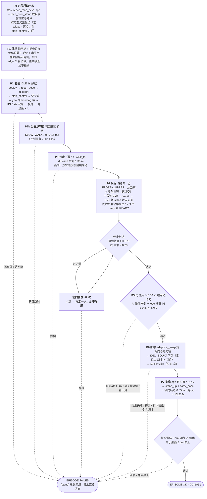
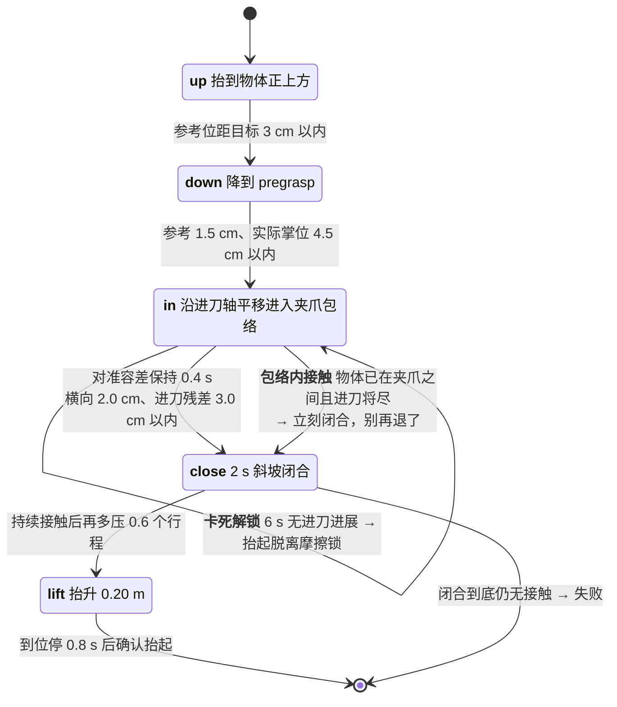

# 数据采集

> 场景、单局流程、大规模采集,以及控制逻辑 / 随机化 / 相机的工作原理。

## 场景:直接用现成的(推荐)

场景生成(EmbodiedGen 文生 3D + 布局 + 物理注入)非常耗时,仓库直接附带了做好的场景:

```bash
SCENE_PRESET=bottle_only bash scripts/install_scene.sh   # VLA 实验的瓶子场景
# 不带 SCENE_PRESET = 老的多物体桌面。预设定义在 scene_lib.SCENE_PRESETS;
# bottle_only = 一个 RoboCasa 水瓶(assets/robocasa/,已入 git),其余全空。
```

解包 `assets/scene_locomani_v1.tar.gz` 到 `outputs/scene/`(双桌面 + 目标/干扰物体的
MJCF、布局、抓取标注、reach map、hand points),把 MJCF 里的绝对路径改写到当前
checkout,**然后重建场景**。

三点值得知道:

- 路径前缀是**探测**出来的,不是写死的,所以在哪台机器上重新打包都不会坏。
- **重建不是多余的一步。**tarball 装的是 EmbodiedGen 慢慢生成的那部分(网格与布局),
  而摆放、桌高、目标物体、腕上相机全在 `scene_lib.py` 里,改得很勤。tarball 里放一个
  构建好的 `scene_locomani.xml`,第一次有人编辑 `scene_lib.py` 它就过时了,而且失败
  是静默的:sim 照常跑,只是新目标物体不存在。重建约 1 秒。
- 需要 `.venv_sim` 才能重建;venv 还没建时脚本会明确说它跳过了这一步。

**验证**:

```bash
ls outputs/scene/sim/scene_locomani.xml outputs/scene/sim/scene_meta.json
python -c "import json;m=json.load(open('outputs/scene/sim/scene_meta.json'));print(m.get('target_pool'))"
# -> ['can', 'bottle', 'cup', 'jar']
```

如需重新生成场景:装好 EmbodiedGen(`src/teleop_free/install_embodiedgen.sh`),依次跑
`compose_scene.py` → `inject_physics_into_mjcf.py` → `build_sim_scene.py`,再用
`make_hand_points.py` / `reach_map.py` / `wrist_map.py` 重建缓存。

---

## 跑一局:起 stack、看日志、读结果

### 三个进程

`start_stack.sh` 按依赖顺序拉起三个长驻进程,采集脚本(`grasp_gym.py`)是第四个,
单独启动:

| 进程 | 用哪个 python | 干什么 |
|---|---|---|
| MuJoCo sim | `.venv_sim` | 跑物理、发三路相机、发特权真值、录第三人称视频 |
| C++ deploy | `target/release/g1_deploy_onnx_ref` | SONIC:encoder 产 token,policy 产关节指令 |
| data exporter | `.venv_data_collection` | 订阅相机与 deploy 输出,落 LeRobot 原始 session |
| **`grasp_gym.py`** | `.venv_sim` | 脚本化 agent:决定机器人做什么 |

```bash
SIM_VIDEO_DIR="$PWD/outputs/sim_video" bash src/teleop_free/start_stack.sh "pick up the can"
```

它按 `[1/3] [2/3] [3/3]` 打印,每一步等到真的起来了才继续(等端口、等日志关键字,
不是 sleep),最后打印:

```
stack up. logs in /workspace/tmp/p03/{sim,deploy,exporter}.log
```

**没看到这一行就是没起来**,去那三个日志里看。`[2/3]` 第一次会卡十分钟,那是在编
TensorRT engine,属正常;之后走缓存,20–40 s。

三个参数在这一步就定死、后面改不了:`SIM_VIDEO_DIR`(不设就完全不录第三人称视频)、
`SIM_VIS` 里的 `reach`(可达域点云在建模型时注入)、`SIM_ONSCREEN=1`(开一个实时
MuJoCo 窗口,需要真的 `$DISPLAY`;`grasp_gym.py` 只是连过去的客户端,不管渲染)。

```bash
SIM_ONSCREEN=1 bash src/teleop_free/start_stack.sh "pick up the can"
```

**已知限制**:`SIM_ONSCREEN=1` 偶尔会拖垮走路控制(sim 单线程被窗口刷新阻塞,
C++ deploy 按真实墙钟时间跑自己的控制环路,两边对不上就可能失稳、走到一半卡住)。
已经做了节流缓解,但没根治。**不要跟正式 `--record` 采集同时开**——平时调参数用它看
效果,采数据时关掉。

### 先不落盘跑一局

调参数、改控制逻辑的时候用这个 —— 不启动 exporter 那条路径,不产生 session:

```bash
third_party/GR00T-WholeBodyControl/.venv_sim/bin/python -u \
    src/teleop_free/grasp_gym.py --rounds 1
```

### 落盘

```bash
third_party/GR00T-WholeBodyControl/.venv_sim/bin/python -u \
    src/teleop_free/grasp_gym.py --rounds 12 --seed 21 --record \
    --manifest outputs/logs/manifest.jsonl
```

- `--record` 才驱动 exporter 落盘,而且**只有通过全部 stage 判据的才留**,失败的
  当场发 `x` 丢弃。
- `--manifest` **不是可选的调试项**:要做逐局不同的指令就必须有它,原因见
  [指令是怎么进数据集的](#指令是怎么进数据集的)。
- `--seed` 固定这一串局的随机数(目标、出生点、外观),复现问题时用。

#### 保存的数据在哪、怎么配路径

三类产出,三个不同的配置入口——**都是 `start_stack.sh` 启动时定死,中途改了不生效**:

| 产出 | 路径 | 怎么配 |
|---|---|---|
| exporter 原始 session(LeRobot 训练数据:三路视频 + 关节/latent parquet) | `$LOCOMANI_TMP/p03/outputs/<时间戳>/`。一次 `start_stack.sh` 一个 session,这次启动之后跑的所有 episode(不管跑几次 `grasp_gym.py`)都落进同一个目录,直到你 `stop_stack.sh` 再重新 `start_stack.sh` | `LOCOMANI_TMP`(默认 `$LOCOMANI_WORKSPACE/tmp`,见[路径约定](setup.md#0-路径约定));多实例并行时目录名跟 `INSTANCE` 走 |
| 第三人称跟踪录像(`gym_<timestamp>.mp4`,ego + 双腕画中画) | `$SIM_VIDEO_DIR`,不设就完全不录 | `export SIM_VIDEO_DIR=<绝对路径>`,**必须在 `start_stack.sh` 之前**,而且**必须给绝对路径**——sim 进程自己的工作目录是 `third_party/GR00T-WholeBodyControl/`,不是仓库根,给相对路径会悄悄写到 `third_party/GR00T-WholeBodyControl/outputs/sim_video/` 那边去,不是你以为的仓库根 `outputs/sim_video/` |
| manifest(每次**尝试**一行 JSON:目标、指令、成败、外观 seed、桌高、物体尺寸) | 你用 `--manifest PATH` 指定的路径,`grasp_gym.py` 会自动建好父目录 | `grasp_gym.py --manifest <路径>`。**追加写**(`open(path, "a")`),不会清空旧内容——同一个文件跑多次,新记录接在旧记录后面,统计成功率前检查一下别把几批数据混在了一起 |

```bash
# 三个都配好的完整例子(注意 SIM_VIDEO_DIR 是绝对路径):
SIM_VIDEO_DIR="$PWD/outputs/sim_video" bash src/teleop_free/start_stack.sh "pick up the can"

third_party/GR00T-WholeBodyControl/.venv_sim/bin/python -u \
    src/teleop_free/grasp_gym.py --rounds 12 --record \
    --manifest outputs/logs/manifest_$(date +%s).jsonl   # 时间戳文件名,避免和旧数据混在一起
```

批量采集(`scripts/collect.sh`)是另一套路径,自动按批建目录,见[大规模采集 → 产出在哪](#产出在哪)。

### 结果怎么读

每局一行,失败的行带**阶段前缀**,一眼能看出是哪一段坏的:

| 前缀 | 含义 | 典型原因 |
|---|---|---|
| `[stand]` | 复位 / 走到站位这一段 | teleport 没落稳、出生点转身超时、走路摔倒 |
| `[view]` | 站定后的可见性门 | 顶到桌沿、够不到、罐倒了、ego 里看不见 |
| `[grasp]` | 下蹲 + 50 Hz 伺服 | 规划失败、伺服追不上、把物体推倒、超时 |
| `[hold]` | 抱稳与后退 | 掌内滑脱、物体掉回桌上 |
| `[gym]` | 局外的框架问题 | stack 挂了、端口冲突 |

`[stand]` 类失败会**重试整局**(不算一条数据),其余直接丢弃,**不重试** ——
数据集里只留一次成功的 episode,训出来的模型才会一次成功。

**当前实测**:近几批 11/12、12/12、5/5;一条成功 episode 约 **70–105 s**,
落盘约 **13–18 MB**(三路相机;只留 ego 时约 4.7 MB)。

### Stop and Clean 

```bash
bash src/teleop_free/stop_stack.sh
```

杀掉 sim / deploy / exporter 三个长驻进程,以及 `zmq_driver.py`、`collect_episode.py`、
`grasp_gym.py`、`diag_walk.py` 这几个会绑 `:5556`/`:5580`(跟 `zmq_driver.py` 抢同一对
端口,见 `Primitives` -> `AgentCommander`)的客户端脚本。杀完会打印 `remaining:` /
`ports:` 让你确认真的干净了 —— **不干净**的话下一次 `start_stack.sh` 会在打完启动
横幅之后才报 `Address already in use`,看着像起来了其实没有。

---

## 大规模采集

**不要手工循环那三步。**用 `scripts/collect.sh`:

```bash
bash scripts/collect.sh <批数> <每批局数> [起始 seed]

# 目标 200 条,按 10 批 × 20 局:
bash scripts/collect.sh 10 20 1
```

### 为什么要分批:两类随机化轴

| 轴 | 换的频率 | 为什么 |
|---|---|---|
| 目标物体、出生散布、外观 | **每局** | 都能在运行时改(`mjModel` 字段 / teleport / 采样),零成本 |
| 桌高、物体尺寸 | **每批** | 烘在编译好的 MJCF 里,sim 只在启动时读一次 XML |

所以一批 = 重建场景(约 1 s)+ 重启 stack(约 40 s)+ 跑 N 局。20 局一批的话,
场景尺寸这个轴摊到每条 episode 上只要约 2 s。

`collect.sh` 每批做的事:停 stack → `SCENE_SEED=<seed>` 重建场景 → 起 stack
(**等 `stack up`,不是 sleep**) → `grasp_gym --rounds N --record --manifest` → 下一个 seed。

### 产出在哪

```
outputs/logs/collect/manifest_<seed>.jsonl   每批一个 manifest
outputs/logs/collect/gym_<seed>.log          每批的逐局日志
outputs/logs/collect/stack_<seed>.log        每批的 stack 启动日志
$LOCOMANI_TMP/p03/outputs/<时间戳>/           每批一个 exporter session
```

结束时会打一份汇总:

```
===== totals =====
    112 EPISODE OK
      6 EPISODE FAILED [grasp]
      2 EPISODE FAILED [stand]
```

**一批 = 一个 manifest = 一个 session**,而且顺序一致 —— 转换器就是按这个配对的。

### 中途看进度

```bash
grep -c "^EPISODE OK" outputs/logs/collect/gym_*.log      # 每批成功了几条
tail -3 outputs/logs/collect/gym_*.log | tail -20         # 现在跑到哪
```

### 成本(按实测,不是估算)

| | |
|---|---|
| 一局 | 70–105 s |
| 一条 episode 落盘 | 13–18 MB(三路相机) |
| **200 条** | 约 200 局、**4–6 小时**、**约 3 GB** |

按当前 11–12/12 的成功率,200 条大约要跑 210–220 局。

### 只想先测通 pipeline:`collect_pilot.sh`

第一批数据的目的往往不是"模型能泛化到哪",而是"**转换 → 微调 → 78 维喂回 deploy**
这条链路通不通"。那就不要摊开五个轴 —— 摊得越开,失败时越说不清是哪一环:

```bash
export SCENE_RANDOM=0 SIM_VIS=bbox,readout       # 外观钉死,去掉可达域点云
SCENE_PRESET=bottle_only bash scripts/install_scene.sh   # 本仓库实验用的那张桌子
SIM_VIDEO_DIR=outputs/sim_video \
    bash src/teleop_free/start_stack.sh "pick up the water bottle"

# SPAWN_ARGS 默认是空的 —— 不给就吃 grasp_gym 的宽默认(3 m 外、背对物体、
# 朝向偏差 ±90°),脚本专家成功率 30% 出头。本仓库两轮实验的全部数字都是在
# 下面这套窄分布上测的,复现必须带上
SPAWN_ARGS="--spawn-edge 0.7 --face-object --spawn-yaw-err 20 --spawn-lateral 0.20" \
JITTER=0.20 PROMPT="pick up the water bottle" \
    bash scripts/collect_pilot.sh 200 water_bottle       # 200 条成功为止
```

四个 spawn 参数的含义和取值理由见 [README 快速开始第 3 步](../README.md#快速开始)
那张表;`--spawn-edge` / `--face-object` 的完整语义见
[grasp_gym.py 的命令行参数](reference.md#grasp_gympy-的命令行参数)。

只有两样东西变:**机器人出生点**和**物体在桌沿上的位置**。这两个是有理由留下的 ——
去掉出生点,200 条就是同一条轨迹的 200 次重放,模型可以纯按时间索引拟合;去掉物体
位置,伸手那一段同理。留着它们,"能 work"才说明了点什么。

`collect_pilot.sh` 和 `collect.sh` 的关键区别:**它不起 stack**。所有 chunk 必须落进
**同一个 exporter session**(session 是 exporter 启动时创建的),所以 stack 自己起一次、
一直不动。分 chunk 只为可续 —— 崩了再跑一次,它会数已经落盘的成功条数接着补。

跑完直接转:

```bash
--sessions <那一个 session>  --manifest outputs/logs/pilot/manifest_all.jsonl
```

### 两个坑

- `collect.sh` **就地重建 `outputs/scene/sim`**,跑完场景停在最后一批的尺寸上。
  要回到出厂尺寸:`bash scripts/install_scene.sh`。
- 采完之前不要动 `scene_lib.py`。改了它,后面的批和前面的批就不是一个物体集合了,
  而这件事在数据里是看不出来的。

---

## 控制逻辑

### 三层,谁决定什么

| 层 | 在哪 | 它决定什么 | 它**不**决定什么 |
|---|---|---|---|
| **决策** | `grasp_gym.py` | 这一局抓哪个物体、从哪出生、站到哪、现在该走还是该抓、成没成功 | 关节角、步态 |
| **原语** | `primitives.py`、`stream_reach.py`、`reach_map.py`、`arm_ik.py`、`adaptive_grasp.py` | 把"走到 X"、"把手放到 Y"变成 50 Hz 的**意图流** | 怎么迈腿、怎么维持平衡 |
| **控制** | C++ deploy 里的 SONIC(encoder + policy) | 把意图编码成 64 维 token,再解成 29 个关节目标 | 任务是什么 |

agent 能往 deploy 发的**只有三种东西**,全部走 :5556:

| 发什么 | 内容 | 谁消费 |
|---|---|---|
| planner 帧 | `mode` / `movement` / `facing` / `speed` / `height` | k-planner → 合成参考动作 |
| `upper_body_position[17]` | 腰 3 + 双臂 14,由 IK 解出 | **逐字替换**进参考动作 |
| `left/right_hand_joints` | 夹爪开合 | 直接下发,不过 policy |

下面三张图分别回答三个不同的问题。**这里是唯一的真相源** —— `docs/` 下不再有平行的
流程图,因为两份平行文档正是上一版图落后 10 个 commit 的原因。

### ① SONIC latent 是怎么产生的

最容易误解的一点:脚本化 agent **从来不直接输出 latent**,也不直接输出关节角。
它输出的是**意图**;latent 是 deploy 内部的 encoder 从意图渲染出的参考动作里编码出来的。


**进程归属速查:**

| 分组 | 语言 / venv | 入口进程 | 关键源码 |
|---|---|---|---|
| 🤖 Agent | Python, `.venv_sim` | `grasp_gym.py` | `agent_server.py`(ZMQ 发布端)、`arm_ik.py`、`primitives.py`、`stream_reach.py` |
| ⚙️ SONIC Deploy | C++,不在本仓库 | `g1_deploy_onnx_ref` | `third_party/GR00T-WholeBodyControl/gear_sonic_deploy/src/g1/g1_deploy_onnx_ref/src/g1_deploy_onnx_ref.cpp`,及 `include/{localmotion_kplanner,encoder,control_policy}.hpp` |
| 🌐 MuJoCo Sim | Python, `.venv_sim` | `run_sim_locomani.py` | `privileged_pub.py`(发布端)、`sim_video.py`、`scene_lib.py` |
| 📦 Data Exporter | Python, `.venv_data_collection` | `run_data_exporter.py` | `third_party/GR00T-WholeBodyControl/gear_sonic/{scripts/run_data_exporter.py, data/exporter.py}` |

Agent 进程和 Sim 进程虽然都用同一个 `.venv_sim`,但是**两个独立的操作系统进程**,靠 ZMQ(:5581/:5582)通信,不是同一个 Python 解释器;D4(64 维 token)没有独立文件,只是 `encoder.hpp` 输出、`control_policy.hpp` 读取之间的一段内存缓冲区,同时镜像发到 `:5557` 给 exporter;SONIC Deploy 的源码在 `third_party/` 下,是 clone 来的上游仓库,不受本仓库 git 管理。

三个必须记住的点:

1. **`upper_body_position` 是 17 个关节一起替换的**(腰 3 + 双臂 14,MuJoCo 索引
   12–28),而且是**逐字替换、没有 ramp**。所以 IK 只解一只手,另一只手也会被这 17 维
   带走 —— 走路时"举起手臂"是**双臂一起举**,闲着的那只只是被顺带写进去了。
2. **encoder 看不见机器人。**mode 0 下它只读 4 个观测共 644 个数:`encoder_mode_4`(4)、
   `motion_joint_positions_10frame_step5`(290)、`motion_joint_velocities_...`(290)、
   `motion_anchor_orientation_...`(60)。其余声明过的观测全被置零。**token 是纯意图**,
   不含任何本体状态。
3. **下蹲不走 `upper_body`。**它是 planner 帧里的 `mode=IDEL_SQUAT` + `height=<骨盆
   目标高度,绝对米>`,由 k-planner 渲染成弯腿参考动作,再由 encoder 编码进 token。
   所以下蹲**在 token 里**,不需要额外通道。(实测:命令的腰部前倾只交付 2–10%,
   基本等于没有,这条路是死的 —— 见 `diag_lean.py`。)

### ② 一局 episode 分几步



失败的 episode 直接丢弃(exporter 收到 `x`),**不重试** —— 数据集里只留一次成功的
episode,训出来的模型才会一次成功。唯一的例外是 `[stand]`:那是复位没做成,整局重来,
不算一条数据。

### ③ 伸手那几秒里发生了什么

`stream_reach._servo_continuous`,50 Hz 闭环,目标全部由**实时物体真值**重算,
从不从当前掌位外推(否则会追着自己推动的罐子跑)。



两个当初花了很多局才找对的细节:

- **`in → close` 的"包络内接触"分支**是必须的。物体已经进了夹爪、只是被腕部压着时,
  再执行"接触闪避"退一次就会把它捅倒。改成立刻闭合之后,悬停不闭合的现象消失了。
- **`close` 阶段仍在主动保位**。冻结参考会让手掌下沉,闭合的横扫把物体带倒。

---

## 随机化:五个轴

一条 episode 里下面五样东西每次都不同。前三个逐局变,后两个按批变(要重建场景)。

| 轴 | 频率 | 怎么控制 |
|---|---|---|
| [目标物体与指令](#1-目标与指令) | 每局 | `--targets` |
| [物体位置 + 站位](#2-物体位置与站位) | 每局 | 自动(拒绝采样) |
| [出生点:距离/横偏/朝向](#3-机器人从哪里出发) | 每局 | `--spawn-off` / `--spawn-lateral` / `--spawn-yaw-err` |
| [外观:颜色/光照/地面](#4-外观每局重掷) | 每局 | `SCENE_RANDOM` |
| [桌高与物体尺寸](#5-桌高与物体尺寸按批) | 每批 | `SCENE_SEED` + 重建 |

### 1. 目标与指令

每局的目标是从**目标池**里随机抽的,指令里指名它 —— 这是"抓取策略"和"VLA"的
分界线:目标固定时,一个完全不读指令的模型和一个读指令的模型得分一样。

```bash
--targets pool          # 默认,scene_meta 里的整个 target_pool
--targets default       # 只用单一目标(旧行为)
--targets can,bottle    # 指定
```

| 目标 | 尺寸 | 桌沿 | 指令 |
|---|---|---|---|
| `can` | φ4.0–5.6 × 10–13 cm 深红 | +y | pick up the red can |
| `bottle` | φ5.2–6.8 × 12–15 cm 蓝 | −y | pick up the blue bottle |
| `cup` | φ6.2–7.6 × 9.5–11 cm 米白 | −x | pick up the cream cup |
| `jar` | φ3.0–4.2 × 10–12 cm 绿 | −y | pick up the green jar |

`plate` / `fork` / `napkin` / `orange` 是**干扰物**,不进目标池。

#### 为什么目标池只能是细高物体

dex1 平行夹爪有两条硬约束,是量出来的不是拍的:

```
水平跨距 ≤ HAND_APERTURE − PINCH_MARGIN      = 8.48 cm
高度     ≥ GRIP_BELOW_RIM + 伺服 z 地板       = 9.0 cm
```

抓取中心在物体顶面下 6 cm,而伺服把命令 z 压在桌面 +3 cm 以上
(`stream_reach.py:1405`)。**球体因此在结构上出局**:直径 = 高度,不可能同时
≤ 8.48 且 ≥ 9.0 —— 橘子(9.3 cm)缩放也进不来,缩小解决宽度的同时等速破坏高度。
目标只能是 **φ3–8.5 cm × 高 9–15 cm** 的一族(圆柱、瓶、杯)。

`scene_lib.PRIMITIVE_OBJECTS` 里加一条就是一个新目标,重建场景 1.2 秒。

#### 指令是怎么进数据集的

exporter 的 `--task-prompt` 是 **per-session** 的,整个 session 共用一条,所以
逐局不同的指令必须绕过它:

```
grasp_gym --manifest m.jsonl     每产生一个 episode 追加一行(目标、指令、成败)
        ↓
convert_to_hf_format.py --manifest m.jsonl
        ↓
meta/tasks.jsonl      多条 task
meta/episodes.jsonl   每局自己的 task_index
```

对齐靠**顺序**:exporter 按写入顺序给 episode 编号,就是 gym 产生它们的顺序。
转换器会硬校验行数与成败,不符就**直接报错退出**而不是警告 —— 指令标错在数据里是
看不见的,而且恰好毁掉目标随机化想教的东西。

manifest 是**每次尝试一行**而不是每局一行:`[stand]` 类失败会重试整局,而如果
那次失败发生在开始录制之后,session 里就已经留下了一个 episode。判断"这行有没有
对应一个 episode"看 `produced` 字段。

### 2. 物体位置与站位

物体贴桌沿内侧随机摆放,站位由 `plan_core_stand` 从 reach map 里联合求解(站在哪 +
蹲多深),并拒绝掉整条接近线会撞桌的组合。这一轴没有开关,是流程的一部分。

### 3. 机器人从哪里出发

```bash
--spawn-off 1.0 3.0     # 出生在站位后方这个范围(单值=固定)
--spawn-lateral 0.35    # 最多偏离接近线这么远
--spawn-yaw-err 90      # 初始朝向最多偏这么多度,走之前在出生点转出来
```

上面是**默认**分布,也是最难的一档。本仓库两轮 VLA 实验实际用的是另外两个参数
钉出来的窄分布,它们没有默认值、不给就不生效:

```bash
--spawn-edge 0.7        # 距【桌子】0.7 m 起步,而不是距【站位】1-3 m。
                        # 站位本身离桌沿 0.17-0.32 m 且随目标移动,所以同一个
                        # --spawn-off 每局对应的桌距都不一样;--spawn-edge 是
                        # 人真正会去量的那个量,逐局用二分法解出来
--face-object           # 醒来正对【物体】,而不是正对【接近线】,并把
                        # --spawn-yaw-err 当成绕这个朝向的抖动。两者只在正好
                        # 落在接近线上时才重合 —— 有横偏、尤其 --spawn-edge 很近
                        # 时,朝着接近线醒来会让物体明显偏出画面中心
```

**这两个开关决定任务有多难。**0.7 m + `--face-object` 基本把走路段送掉了(实测
walk / approach 零失败),脚本专家成功率 85%;退回默认分布是 30% 出头。任何跨批次
比较成功率之前,先确认两边的 spawn 分布是同一套。

**转身发生在出生点**,离桌子 1–3 m。近距离转身是记录在案的坑:靠近物体时的
`face_target` 会让机器人原地转 110–160°,骨盆直接怼上桌沿。

两个反直觉的点(都由 `diag_turn.py` 测出来):

- **控制器有 7–8° 的朝向死区。**转身容差不能收到 0.15 rad 以下,收进死区里不会转得
  更准,只会耗光超时。转完必然残留 ±8–9°,后面的接近段按位置闭环把它吸收掉。
- **转身用 `SLOW_WALK` 不用 `IDLE`。**SLOW_WALK 12/12 全收敛、±120° 只要 6 s;
  IDLE 10/12 且耗时在 1–13 s 之间乱跳。人本来也是踏步转身的。

### 4. 外观:每局重掷

由一个整数决定,记在 manifest 里,可复现:

```bash
SCENE_RANDOM=0    # 关掉,外观完全固定(对照实验和回放旧录制时要用)
```

> **默认是开的,而且它在 `start_stack.sh` 那一刻定死。** 起 stack 时没设
> `SCENE_RANDOM=0`,录出来的每一局地面颜色、光照、桌面材质都不一样 —— 上一局蓝格子
> 地面、这一局绿格子是正常的,不是 bug。手工渲染(`mujoco.Renderer` 直接读
> `scene_locomani.xml`)不经过 `scene_random.py`,所以永远是默认外观,和录像对不上也
> 是正常的。
>
> **量成功率时先关掉。** 20 局的样本本来就小,再叠一个外观方差就说明不了问题。等成功
> 率稳定了,再决定正式采集要不要开 —— 见下面这张表决定它值不值。

在 sim 进程里、复位那一刻直接改 `mjModel` 字段,**不重建场景**,所以逐局随机零成本;
也完全不碰控制路径(几何、质量、接触都不动)。

| 变什么 | 幅度 |
|---|---|
| 地面色相 / 格子密度 / 反射率 | 全色相、`texrepeat` 3–14 |
| 光照方向 / 强度 / 环境光 | 天顶 ±50°、diffuse 0.4–1.0、ambient 0.05–0.35 |
| 目标物体颜色 | **在命名色系内**抖动(见下) |
| 桌面等网格物体 | 只有明暗与饱和度 |

**目标颜色是指令的一部分**,所以只能在色系内动:红罐子在红色范围内变,蓝瓶子在蓝色
范围内变。这不是限制而是要点 —— 采一个范围的红,教出来的"红"是色彩空间里的一个区域
而不是一个精确 RGB。另外有 OKLab 距离检查保证任意两个目标不会撞到人眼分不开:
**首次采样有 27% 会撞**,所以那个拒绝循环是真在干活的。

#### 三个看起来能用、其实不能用的机制

都试过、都量过,因为它们**失败得很安静** —— 字段能写进去,渲染不理它:

- **`tex_data`**:纹理在渲染上下文创建时上传到 GPU,之后不再读。重写地面棋盘的像素,
  画面只动了 0.19。所以 builtin 棋盘和天空渐变都改不了色,天空干脆不碰。
- **`mat_texid = -1`**(丢掉贴图改画纯色):同样无效。字段读回来确实是 −1,贴图照旧
  渲染。它一开始看着像有效,是因为我把它和 `mat_rgba` 一起改了,而效果全来自后者 ——
  一张"纯蓝"的桌子量出来是 (121, 66, 20),还是橙的,只是暗了。
- **纹理材质上的 `mat_rgba` 换色**:它是**相乘**,只能压暗和去饱和。桌子的木纹几乎没有
  蓝通道,任何 tint 都变不出蓝桌子。

所以**桌子永远是橙色**。它是抓取瞬间画面里最大的物体,模型仍可能靠它定位 —— 要真正
换掉桌面材质需要**按批重建场景**(约 1 秒,见 `docs/ROADMAP.md`)。

### 5. 桌高与物体尺寸:按批

这两样烘在编译好的 MJCF 里,只能重建场景时换:

```bash
SCENE_SEED=7 "$VENV_SIM_PY" src/teleop_free/build_sim_scene.py outputs/scene outputs/scene/sim
```

`collect.sh` 每批自动做这件事。范围:

| | 范围 |
|---|---|
| 桌面高度 | 0.62–0.80 m,**但会被夹一次**(见下) |
| can | φ4.0–5.6 × 10–13 cm |
| bottle | φ5.2–6.8 × 12–15 cm |
| cup | φ6.2–7.6 × 9.5–11 cm |
| jar | φ3.0–4.2 × 10–12 cm |

**桌高的上限不是任选的,是量出来的。**抓取高度
`grip_z = 桌高 + 物体高 − GRIP_BELOW_RIM`,当它接近站立骨盆高度(0.793)时成功率单调
下降:42 局汇总下,`grip_z − 骨盆 < −0.070` 是 12/15,`≥ −0.045` 只有 6/21
(Fisher p = 0.006)。所以 `scene_lib.GRIP_CEILING = 0.793 − 0.080`,而桌高是在
**物体尺寸之后**采的,按当批最高的物体反算一个上限再夹:

```python
cap = GRIP_CEILING - tallest + GRIP_BELOW_RIM
```

代价是真实餐桌高度(0.72–0.76 m)现在采不到 —— 要打开这一轴,得先修伺服"往上够"
那个 case,记在 `docs/ROADMAP.md` 里。

---

## 相机

三路 **640×480**,都进数据集:

| 流名 | 挂在哪 | 用途 |
|---|---|---|
| `ego_view` | `head_camera`(躯干,pitch 52° / fovy 70) | 主视角,VLA 的输入 |
| `left_wrist` / `right_wrist` | `wrist_yaw_link`(fovy 80,下俯 44°) | 近距离看夹爪与物体的相对关系 |

`WRIST_CAMS=0` 同时关掉两侧(sim 少渲染两路、exporter 少录两路)。三路的代价:
渲染约 3 倍,单局落盘从约 4.7 MB 涨到约 **13–18 MB**。

第三人称录像(`SIM_VIDEO_DIR`)把三路都做成画中画:ego 在右下,左腕在左上,
右腕在左下。

### 官方提供到什么程度

**URDF 里没有腕上相机。**`assets/dex1/...urdf` 唯一的相机是 `d435_link`,挂在
`torso_link` —— 那就是 `head_camera`。挂载点是我们自己加的。

**但对接方式是官方的、统一的**,所以接进去只有几行:

```
sim       base_sim.camera_configs = {流名: {height, width, mjcf_name}}
exporter  run_data_exporter.py --record-wrist-cameras
          → observation.images.{left,right}_wrist
对接约定   exporter 用 feature 名的最后一段查 images[...]
          所以流名叫 left_wrist 就自动对上,缺了会报错而不是录空
```

唯一需要绕的是 `SimulatorFactory` 不转发 `camera_configs`,所以按仓库已有的惯例
monkey-patch `DefaultEnv.__init__`(`run_sim_locomani.install_camera_configs`)。

### 挂载位置是量出来的,不是猜的

`wrist_yaw_link` 系里:外壳占 x −0.018..0.111 / z ±0.031,手指 x 0.123..0.148,
抓取中心 x 0.1515。相机在 **(0.095, 0, 0.055)** 瞄准抓取中心(下俯 44°),视线在
外壳前端高 0.039 > 顶面 0.031,**避开自己的外壳**。

第一版放在 (−0.02, 0, 0.045) 沿 +x 下俯 20°,视线整条从外壳内部穿过,渲染出来
满屏白塑料。**它没被解析检查拦住,因为那个检查和挂载点用了同一个坐标系假设** ——
自洽但同样错。挂载参数改动之后,一定要渲染真实编译后的模型确认。
