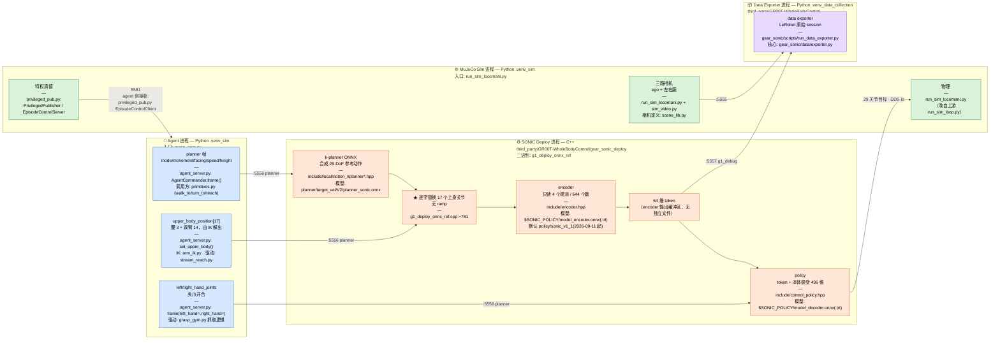
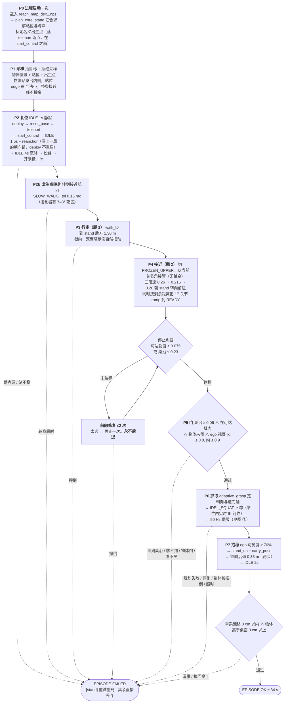
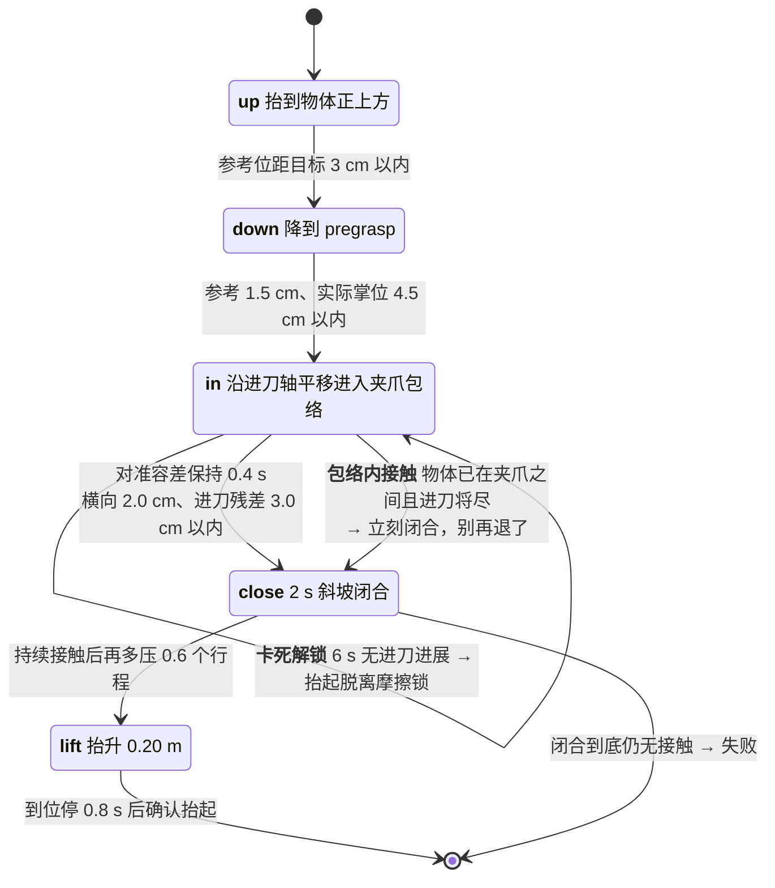

# 数据采集

> 场景、单局流程、大规模采集,以及控制逻辑 / 随机化 / 相机的工作原理。

## 场景:直接用现成的(推荐)

场景生成(EmbodiedGen 文生 3D + 布局 + 物理注入)非常耗时,仓库直接附带了做好的场景:

```bash
SCENE_PRESET=bottle_only bash scripts/install_scene.sh   # VLA 实验的瓶子场景
# 不带 SCENE_PRESET = 老的多物体桌面。预设定义在 scene_lib.SCENE_PRESETS;
# bottle_only = 一个 RoboCasa 水瓶(assets/robocasa/,已入 git),其余全空。
# crate_bimanual = 一个 NVIDIA 蓝色 600x400 周转箱(assets/crates/blue_crate/),
#   长边横放、两端把手在 y=±0.30,近侧箱壁与桌沿齐平,给双手搬运任务用;箱体碰撞
#   是 11 个 box 拼的,把手上方的箱沿(3 cm 高、2.4 cm 厚)是夹爪该夹的地方,
#   site grip_px/grip_nx。可达性(2026-09-07 IK 扫描):脚/膝比骨盆前伸 0.22 m,
#   骨盆最近只能站到桌沿外 0.27 m,箱沿在前方 0.47 m——单靠手臂差 12-15 cm,
#   要腰前倾 33°、手掌下俯 60° 才能双手同时到位且无穿透;箱子每往桌里挪 1 cm
#   都要多弯腰,放桌子中央够不到。扫描脚本 outputs/scene/crate_bimanual/reach_pitch.py。
```

解包 `assets/scene_locomani_v1.tar.gz` 到 `outputs/scene/`(双桌面 + 目标/干扰物体的
MJCF、布局、抓取标注、reach map、hand points),把 MJCF 里的绝对路径改写到当前
checkout,**然后重建场景**。

三点值得知道:

- 路径前缀是**探测**出来的,不是写死的,所以在哪台机器上重新打包都不会坏。
- **重建不是多余的一步。**tarball 装的是 EmbodiedGen 慢慢生成的那部分(网格与布局),
  而摆放、桌高、目标物体、腕上相机全在 `scene_lib.py` 里,改得很勤。tarball 里放一个
  构建好的 `scene_locomani.xml`,第一次有人编辑 `scene_lib.py` 它就过时了,而且失败
  是静默的:sim 照常跑,只是新目标物体不存在。重建约 1 秒。
- 需要 `.venv_sim` 才能重建;venv 还没建时脚本会明确说它跳过了这一步。

**验证**:

```bash
ls outputs/scene/sim/scene_locomani.xml outputs/scene/sim/scene_meta.json
python -c "import json;m=json.load(open('outputs/scene/sim/scene_meta.json'));print(m.get('target_pool'))"
# -> ['can', 'bottle', 'cup', 'jar']
```

如需重新生成场景:装好 EmbodiedGen(`scripts/setup/install_embodiedgen.sh`),依次跑
`compose_scene.py` → `inject_physics_into_mjcf.py` → `build_sim_scene.py`,再用
`make_hand_points.py` / `reach_map.py` / `wrist_map.py` 重建缓存。

---

## 跑一局:起 stack、看日志、读结果

### 三个进程

`start_stack.sh` 按依赖顺序拉起三个长驻进程,采集脚本(`grasp_gym.py`)是第四个,
单独启动:

| 进程 | 用哪个 python | 干什么 |
|---|---|---|
| MuJoCo sim | `.venv_sim` | 跑物理、发三路相机、发特权真值、录第三人称视频 |
| C++ deploy | `target/release/g1_deploy_onnx_ref` | SONIC:encoder 产 token,policy 产关节指令 |
| data exporter | `.venv_data_collection` | 订阅相机与 deploy 输出,落 LeRobot 原始 session |
| **`grasp_gym.py`** | `.venv_sim` | 脚本化 agent:决定机器人做什么 |

```bash
SIM_VIDEO_DIR="$PWD/outputs/sim_video" bash scripts/stack/start_stack.sh "pick up the water bottle"
```

它按 `[1/3] [2/3] [3/3]` 打印,每一步等到真的起来了才继续(等端口、等日志关键字,
不是 sleep),最后打印:

```
stack up. logs in /workspace/tmp/p03/{sim,deploy,exporter}.log
```

**没看到这一行就是没起来**,去那三个日志里看。`[2/3]` 第一次会卡十分钟,那是在编
TensorRT engine,属正常;之后走缓存,20–40 s。

三个参数在这一步就定死、后面改不了:`SIM_VIDEO_DIR`(不设就完全不录第三人称视频)、
`SIM_VIS` 里的 `reach`(可达域点云在建模型时注入)、`SIM_ONSCREEN=1`(开一个实时
MuJoCo 窗口,需要真的 `$DISPLAY`;`grasp_gym.py` 只是连过去的客户端,不管渲染)。

```bash
SIM_ONSCREEN=1 bash scripts/stack/start_stack.sh "pick up the water bottle"
```

**已知限制**:`SIM_ONSCREEN=1` 偶尔会拖垮走路控制(sim 单线程被窗口刷新阻塞,
C++ deploy 按真实墙钟时间跑自己的控制环路,两边对不上就可能失稳、走到一半卡住)。
已经做了节流缓解,但没根治。**不要跟正式 `--record` 采集同时开**——平时调参数用它看
效果,采数据时关掉。

### 先不落盘跑一局

调参数、改控制逻辑的时候用这个 —— 不启动 exporter 那条路径,不产生 session:

```bash
third_party/GR00T-WholeBodyControl/.venv_sim/bin/python -u \
    src/locomani/tasks/bottle/grasp_gym.py --rounds 1
```

### 落盘

```bash
third_party/GR00T-WholeBodyControl/.venv_sim/bin/python -u \
    src/locomani/tasks/bottle/grasp_gym.py --rounds 12 --seed 21 --record \
    --manifest outputs/logs/manifest.jsonl
```

- `--record` 才驱动 exporter 落盘,而且**只有通过全部 stage 判据的才留**,失败的
  当场发 `x` 丢弃。
- `--manifest` **不是可选的调试项**:要做逐局不同的指令就必须有它,原因见
  [指令是怎么进数据集的](#指令是怎么进数据集的)。
- `--seed` 固定这一串局的随机数(目标、出生点、外观),复现问题时用。

#### 保存的数据在哪、怎么配路径

三类产出,三个不同的配置入口——**都是 `start_stack.sh` 启动时定死,中途改了不生效**:

| 产出 | 路径 | 怎么配 |
|---|---|---|
| exporter 原始 session(LeRobot 训练数据:三路视频 + 关节/latent parquet) | `$LOCOMANI_TMP/p03/outputs/<时间戳>/`。一次 `start_stack.sh` 一个 session,这次启动之后跑的所有 episode(不管跑几次 `grasp_gym.py`)都落进同一个目录,直到你 `stop_stack.sh` 再重新 `start_stack.sh` | `LOCOMANI_TMP`(默认 `$LOCOMANI_WORKSPACE/tmp`,见[路径约定](setup.md#0-路径约定));多实例并行时目录名跟 `INSTANCE` 走 |
| 第三人称跟踪录像(`gym_<timestamp>.mp4`,ego + 双腕画中画) | `$SIM_VIDEO_DIR`,不设就完全不录 | `export SIM_VIDEO_DIR=<绝对路径>`,**必须在 `start_stack.sh` 之前**,而且**必须给绝对路径**——sim 进程自己的工作目录是 `third_party/GR00T-WholeBodyControl/`,不是仓库根,给相对路径会悄悄写到 `third_party/GR00T-WholeBodyControl/outputs/sim_video/` 那边去,不是你以为的仓库根 `outputs/sim_video/` |
| manifest(每次**尝试**一行 JSON:目标、指令、成败、外观 seed、桌高、物体尺寸) | 你用 `--manifest PATH` 指定的路径,`grasp_gym.py` 会自动建好父目录 | `grasp_gym.py --manifest <路径>`。**追加写**(`open(path, "a")`),不会清空旧内容——同一个文件跑多次,新记录接在旧记录后面,统计成功率前检查一下别把几批数据混在了一起 |

```bash
# 三个都配好的完整例子(注意 SIM_VIDEO_DIR 是绝对路径):
SIM_VIDEO_DIR="$PWD/outputs/sim_video" bash scripts/stack/start_stack.sh "pick up the water bottle"

third_party/GR00T-WholeBodyControl/.venv_sim/bin/python -u \
    src/locomani/tasks/bottle/grasp_gym.py --rounds 12 --record \
    --manifest outputs/logs/manifest_$(date +%s).jsonl   # 时间戳文件名,避免和旧数据混在一起
```

批量采集(`scripts/collect.sh`)是另一套路径,自动按批建目录,见[大规模采集 → 产出在哪](#产出在哪)。

### 结果怎么读

每局一行,失败的行带**阶段前缀**,一眼能看出是哪一段坏的:

| 前缀 | 含义 | 典型原因 |
|---|---|---|
| `[stand]` | 复位 / 走到站位这一段 | teleport 没落稳、出生点转身超时、走路摔倒 |
| `[view]` | 站定后的可见性门 | 顶到桌沿、够不到、罐倒了、ego 里看不见 |
| `[grasp]` | 下蹲 + 50 Hz 伺服 | 规划失败、伺服追不上、把物体推倒、超时 |
| `[hold]` | 抱稳与后退 | 掌内滑脱、物体掉回桌上 |
| `[gym]` | 局外的框架问题 | stack 挂了、端口冲突 |

`[stand]` 类失败会**重试整局**(不算一条数据),其余直接丢弃,**不重试** ——
数据集里只留一次成功的 episode,训出来的模型才会一次成功。

**当前实测**:近几批 11/12、12/12、5/5;一条成功 episode 约 **34 s**(2026-09-10 起不再每局重启 deploy;之前 64–105 s),
落盘约 **13–18 MB**(三路相机;只留 ego 时约 4.7 MB)。

### Stop and Clean 

```bash
bash scripts/stack/stop_stack.sh
```

杀掉 sim / deploy / exporter 三个长驻进程,以及 `zmq_driver.py`、`collect_episode.py`、
`grasp_gym.py`、`diag_walk.py` 这几个会绑 `:5556`/`:5580`(跟 `zmq_driver.py` 抢同一对
端口,见 `Primitives` -> `AgentCommander`)的客户端脚本。杀完会打印 `remaining:` /
`ports:` 让你确认真的干净了 —— **不干净**的话下一次 `start_stack.sh` 会在打完启动
横幅之后才报 `Address already in use`,看着像起来了其实没有。

---

## 大规模采集

**不要手工循环那三步。**用 `scripts/collect.sh`:

```bash
bash scripts/collect.sh <批数> <每批局数> [起始 seed]

# 目标 200 条,按 10 批 × 20 局(spawn 用 grasp_gym 的宽默认):
bash scripts/collect.sh 10 20 1

# 复现本仓库实验的那套窄分布 —— 四个变量缺一不可,SCENE_PRESET 也要给,
# 因为这个脚本每批都重建一次场景,preset 是在重建那一刻读的
SCENE_PRESET=bottle_only TARGETS=water_bottle JITTER=0.20 \
SPAWN_ARGS="--spawn-edge 0.7 --face-object --spawn-yaw-err 20 --spawn-lateral 0.20" \
    bash scripts/collect.sh 10 20 1
```

脚本开头会把它实际用的 preset / targets / jitter / spawn 打印出来,对不上就是没传进去。

### 为什么要分批:两类随机化轴

| 轴 | 换的频率 | 为什么 |
|---|---|---|
| 目标物体、出生散布、外观 | **每局** | 都能在运行时改(`mjModel` 字段 / teleport / 采样),零成本 |
| 桌高、物体尺寸 | **每批** | 烘在编译好的 MJCF 里,sim 只在启动时读一次 XML |

所以一批 = 重建场景(约 1 s)+ 重启 stack(约 40 s)+ 跑 N 局。20 局一批的话,
场景尺寸这个轴摊到每条 episode 上只要约 2 s。

`collect.sh` 每批做的事:停 stack → `SCENE_SEED=<seed>` 重建场景 → 起 stack
(**等 `stack up`,不是 sleep**) → `grasp_gym --rounds N --record --manifest` → 下一个 seed。

### 产出在哪

```
outputs/logs/collect/manifest_<seed>.jsonl   每批一个 manifest
outputs/logs/collect/gym_<seed>.log          每批的逐局日志
outputs/logs/collect/stack_<seed>.log        每批的 stack 启动日志
$LOCOMANI_TMP/p03/outputs/<时间戳>/           每批一个 exporter session
```

结束时会打一份汇总:

```
===== totals =====
    112 EPISODE OK
      6 EPISODE FAILED [grasp]
      2 EPISODE FAILED [stand]
```

**一批 = 一个 manifest = 一个 session**,而且顺序一致 —— 转换器就是按这个配对的。

### 中途看进度

```bash
grep -c "^EPISODE OK" outputs/logs/collect/gym_*.log      # 每批成功了几条
tail -3 outputs/logs/collect/gym_*.log | tail -20         # 现在跑到哪
```

### 成本(按实测,不是估算)

| | |
|---|---|
| 一局 | 约 34 s(成功局中位;失败局 20–50 s)|
| 一条 episode 落盘 | 13–18 MB(三路相机) |
| **200 条** | 约 320 局(yield 0.6)、**约 3.5 小时**(2026-09-10 前每局重启 deploy 时约 6 小时)、**约 3 GB** |

visible 协议的 yield 约 0.6(19% 是刹车后判定的 stand infeasible),200 条大约要跑 320 局;每局的时间账见台账 bottle §10。

### 只想先测通 pipeline:`collect_pilot.sh`

第一批数据的目的往往不是"模型能泛化到哪",而是"**转换 → 微调 → 78 维喂回 deploy**
这条链路通不通"。那就不要摊开五个轴 —— 摊得越开,失败时越说不清是哪一环:

```bash
export SCENE_RANDOM=0 SIM_VIS=bbox,readout       # 外观钉死,去掉可达域点云
SCENE_PRESET=bottle_only bash scripts/install_scene.sh   # 本仓库实验用的那张桌子
SIM_VIDEO_DIR="$PWD/outputs/sim_video" \
    bash scripts/stack/start_stack.sh "pick up the water bottle"

# SPAWN_ARGS 默认是空的 —— 不给就吃 grasp_gym 的宽默认(3 m 外、背对物体、
# 朝向偏差 ±90°),脚本专家成功率 30% 出头。本仓库两轮实验的全部数字都是在
# 下面这套窄分布上测的,复现必须带上
SPAWN_ARGS="--spawn-edge 0.7 --face-object --spawn-yaw-err 20 --spawn-lateral 0.20" \
JITTER=0.20 PROMPT="pick up the water bottle" \
    bash scripts/collect_pilot.sh 200 water_bottle       # 200 条成功为止
```

四个 spawn 参数的含义和取值理由见 [README 快速开始第 3 步](../README.md#快速开始)
那张表;`--spawn-edge` / `--face-object` 的完整语义见
[grasp_gym.py 的命令行参数](reference/silent_failures.md#grasp_gympy-的命令行参数)。

只有两样东西变:**机器人出生点**和**物体在桌沿上的位置**。这两个是有理由留下的 ——
去掉出生点,200 条就是同一条轨迹的 200 次重放,模型可以纯按时间索引拟合;去掉物体
位置,伸手那一段同理。留着它们,"能 work"才说明了点什么。

`collect_pilot.sh` 和 `collect.sh` 有两个关键区别:

**一、它不起 stack。**stack 自己起一次、一直不动,脚本只管跑局。

**二、只有它能复现本仓库的实验分布。**`collect.sh` 调 `grasp_gym` 时不传任何 spawn
参数,也不透传 `SPAWN_ARGS` —— 拿它采出来的是宽默认分布,不是上面那套。要复现实验
就用 `collect_pilot.sh`。

**每个 chunk 一个 session,不是所有 chunk 共用一个。**exporter 每 episode 泄漏约 93
个线程,顶着容器的 `pids.max` 跑到第 33 个 episode 左右整个 session 会楔死,所以每个
chunk 结束都重启 exporter、滚一个新 session,顺序记进 `sessions.txt`。分 chunk 同时也
带来可续:崩了再跑一次,它会数已经落盘的成功条数接着补。

**转换命令不要自己拼**,脚本跑完会把配对好的那条打印出来,直接抄:

```
convert with (sessions and manifests pair up in this order):
  --sessions  <session1> <session2> ...
  --manifest  outputs/logs/pilot/manifest_01.jsonl outputs/logs/pilot/manifest_02.jsonl ...
```

一个 chunk = 一个 session = 一个 manifest,三者同序 —— 转换器就是按这个配对的,
错位会被硬校验拦下(见 [dataset.md](dataset.md#导出-lerobot-v21-并对接-gr00t))。

### 两个坑

- `collect.sh` **就地重建 `outputs/scene/sim`**,跑完场景停在最后一批的尺寸上。
  要回到出厂尺寸:`SCENE_PRESET=<你那套> bash scripts/install_scene.sh`(漏掉
  `SCENE_PRESET` 会连桌上的物体一起换回默认那套)。
- 采完之前不要动 `scene_lib.py`。改了它,后面的批和前面的批就不是一个物体集合了,
  而这件事在数据里是看不出来的。

---

## 控制逻辑

### 一句话:数采逻辑

**一局 = 复位一次 + 完整做一遍任务;做成了就留下,做砸了当场丢掉。**
采集就是不停跑局,直到攒够 N 条成功的。

```
①放场景  随机摆物体 + 把机器人瞬移到 1–3 m 外(带角度误差),静置沉降
②开录    ← 'c' 键。在静置之后才开,所以数据第一帧就是任务第一帧
③转身    转到接近航向;转不过去 → 这局作废
④走过去  走到目标前,按"看得见的深度"刹车停下(约 0.30 m)
⑤站定判定 停稳后算一次:以这个站位,手够不够得着?够不着 → 整局丢掉,不挪窝重站
⑥蹲+伸手 一边蹲一边把手运到物体上方的预抓点
⑦对准    盯着实测物体位置微调,深度/横向/高度/爪子倾角都进容差才算"就位"
⑧合手    持续接触后再多夹一点
⑨抬起    抬 10 cm,物体必须真的离桌 > 6 cm
⑩抱稳验证 收到胸前 → 后退两步 → 站 2 s,物体在掌系里滑动 < 3 cm
```

走完 ⑩ 才算**成功**,录像存盘;中间任何一步失败 → **按 'x' 当场丢弃**,不进数据集。

三条最容易被忽略的设计:

* **站位不纠正**(visible expert 的核心):站在哪里是**抓取高度的确定性函数**,
  站错了丢掉整局,绝不挪一步再试。因为 VLA 只看单帧图像 —— 同一个画面不能一会儿标
  "往前走"一会儿标"停下"。代价是 **yield 只有约 0.6**,采 200 集要跑约 330 局。
* **丢弃是当场的,不是事后筛。**磁盘上的 session 基本只有成功集;manifest 另记
  `ok` / `produced`,转换时按它 join —— 两个数对不上说明 manifest 和 session 不是同一批,
  那批**不能转**。
* **一批一个 session、一个 manifest。**混用会让 `gate.py` 把两批当成一个群体。

### 三层,谁决定什么

| 层 | 在哪 | 它决定什么 | 它**不**决定什么 |
|---|---|---|---|
| **决策** | `grasp_gym.py` | 这一局抓哪个物体、从哪出生、站到哪、现在该走还是该抓、成没成功 | 关节角、步态 |
| **原语** | `primitives.py`、`stream_reach.py`、`reach_map.py`、`arm_ik.py`、`adaptive_grasp.py` | 把"走到 X"、"把手放到 Y"变成 50 Hz 的**意图流** | 怎么迈腿、怎么维持平衡 |
| **控制** | C++ deploy 里的 SONIC(encoder + policy) | 把意图编码成 64 维 token,再解成 29 个关节目标 | 任务是什么 |

agent 能往 deploy 发的**只有四种东西**,全部走 :5556:

| 发什么 | 内容 | 谁消费 |
|---|---|---|
| planner 帧 | `mode` / `movement` / `facing` / `speed` / `height` | k-planner → 合成参考动作 |
| `upper_body_position[17]` | 腰 3 + 双臂 14,由 IK 解出 | **逐字替换**进参考动作 |
| `left/right_hand_joints` | 夹爪开合 | 直接下发,不过 policy |
| `vr_position[9]` / `vr_orientation[12]` | 左腕点、右腕点、颈点的**骨盆系位姿** | encoder 的 `teleop` 模式,**policy 自己解手臂和腰**(2026-09-12 起) |

最后一行有个**反直觉的协议事实**:这个字段的**"有无"本身就是 encoder 模式开关**。
deploy 在"planner 消息带 `vr_position`"这个标志的**上升沿**把 encoder 切到 mode 1 `teleop`
(此时腕位姿是伺服目标),**下降沿**切回 mode 0 `g1`(此时那个槽位被清零);
而 `Planner()` 初始化和每次 safety reset 都会把模式打回 0。
所以它必须**在 planner 起来、机器人站稳之后**才第一次出现,并且第一帧要等于**实测位姿**。
2026-09-12 之前我们从开机起每帧都带它,上升沿在初始化之前就烧掉了 —— deploy 一直停在 `g1`,
这个字段是死的。详见 ledger bottle.md §35 与 `reference/silent_failures.md` 的静默失败表。

下面三张图分别回答三个不同的问题。**这里是唯一的真相源** —— `docs/` 下不再有平行的
流程图,因为两份平行文档正是上一版图落后 10 个 commit 的原因。

### ① SONIC latent 是怎么产生的

最容易误解的一点:脚本化 agent **从来不直接输出 latent**,也不直接输出关节角。
它输出的是**意图**;latent 是 deploy 内部的 encoder 从意图渲染出的参考动作里编码出来的。



**进程归属速查:**

| 分组 | 语言 / venv | 入口进程 | 关键源码 |
|---|---|---|---|
| 🤖 Agent | Python, `.venv_sim` | `grasp_gym.py` | `agent_server.py`(ZMQ 发布端)、`arm_ik.py`、`primitives.py`、`stream_reach.py` |
| ⚙️ SONIC Deploy | C++,不在本仓库 | `g1_deploy_onnx_ref` | `third_party/GR00T-WholeBodyControl/gear_sonic_deploy/src/g1/g1_deploy_onnx_ref/src/g1_deploy_onnx_ref.cpp`,及 `include/{localmotion_kplanner,encoder,control_policy}.hpp` |
| 🌐 MuJoCo Sim | Python, `.venv_sim` | `run_sim_locomani.py` | `privileged_pub.py`(发布端)、`sim_video.py`、`scene_lib.py` |
| 📦 Data Exporter | Python, `.venv_data_collection` | `run_data_exporter.py` | `third_party/GR00T-WholeBodyControl/gear_sonic/{scripts/run_data_exporter.py, data/exporter.py}` |

Agent 进程和 Sim 进程虽然都用同一个 `.venv_sim`,但是**两个独立的操作系统进程**,靠 ZMQ(:5581/:5582)通信,不是同一个 Python 解释器;D4(64 维 token)没有独立文件,只是 `encoder.hpp` 输出、`control_policy.hpp` 读取之间的一段内存缓冲区,同时镜像发到 `:5557` 给 exporter;SONIC Deploy 的源码在 `third_party/` 下,是 clone 来的上游仓库,不受本仓库 git 管理。

三个必须记住的点:

1. **`upper_body_position` 是 17 个关节一起替换的**(腰 3 + 双臂 14,MuJoCo 索引
   12–28),而且是**逐字替换、没有 ramp**。所以 IK 只解一只手,另一只手也会被这 17 维
   带走 —— 走路时"举起手臂"是**双臂一起举**,闲着的那只只是被顺带写进去了。
2. **encoder 看不见机器人。**mode 0 下它只读 4 个观测共 644 个数:`encoder_mode_4`(4)、
   `motion_joint_positions_10frame_step5`(290)、`motion_joint_velocities_...`(290)、
   `motion_anchor_orientation_...`(60)。其余声明过的观测全被置零。**token 是纯意图**,
   不含任何本体状态。
3. **下蹲不走 `upper_body`。**它是 planner 帧里的 `mode=IDEL_SQUAT` + `height=<骨盆
   目标高度,绝对米>`,由 k-planner 渲染成弯腿参考动作,再由 encoder 编码进 token。
   所以下蹲**在 token 里**,不需要额外通道。旧 `diag_lean.py` 曾记录孤立腰 pitch
   指令交付 2–10%;这不等于 SONIC 无法完成全身弯腰。该测试未提供髋、腿和躯干协同参考,
   原始日志已丢失。当前 ready-grasp 还主动排除了腰部 IK;见 [弯腰诊断](ledger/bottle.md#12-sonic-弯腰能力审计2026-09-10codex)。

### k-planner 的完整输入

`k-planner`(`planner_sonic.onnx`,V2,TensorRT 后端)对外声明了 11 个具名输入
tensor,但 grasp_gym.py 只摸得到其中 5 个 —— 其余由 deploy 自己维护,agent 从不写:

| tensor 名 | dim | dtype | 谁写它 |
|---|---|---|---|
| `mode` | 1 | int64 | **grasp_gym.py 驱动**(经 `agent_server.frame()`) |
| `movement_direction` | 3 | float32 | **grasp_gym.py 驱动** |
| `facing_direction` | 3 | float32 | **grasp_gym.py 驱动** |
| `target_vel`(agent 侧叫 `speed`) | 1 | float32 | **grasp_gym.py 驱动** |
| `height` | 1 | float32 | **grasp_gym.py 驱动** |
| `context_mujoco_qpos` | 4×36=144(4 帧 ×(7 根位姿+29 关节)) | float32 | deploy 内部自回归维护(上一次推理输出),agent 不碰 |
| `random_seed` | 1 | int64 | deploy 内部维护 |
| `has_specific_target` | 1 | int64 | 恒为 0(waypoint 功能,这条 pipeline 没用上) |
| `specific_target_positions` | 12(4 个路点 × xyz) | float32 | 恒为 0 |
| `specific_target_headings` | 4 | float32 | 恒为 0 |
| `allowed_pred_num_tokens` | 11 | int64 | 恒为构造时的默认 mask |

即 agent 真正驱动的只是 9 个标量,对应 `agent_server.py` 的
`AgentCommander.frame(mode, movement, facing, speed, height)`,一路映射到
`localmotion_kplanner_tensorrt.hpp` 的 `UpdateInputTensors()`(字段名字都对得上,
`speed` ↔ `target_vel`)。**`upper_body_position[17]` 和 `hand_joints` 完全不进
k-planner** —— 前者是 k-planner 出完 29 维参考动作之后才逐字替换进去的
(`g1_deploy_onnx_ref.cpp:781`),后者直接下发给执行器,连 encoder/policy 都不经过。

Navigation(走路)和 grasp(下蹲/伺服)两个阶段共享同一组 5 字段接口,只是喂的值不同:

| 字段 | Navigation(`primitives.walk_to` / `grasp_gym.do_approach`) | Grasp(`stream_reach.PlannerArm._push`) |
|---|---|---|
| `mode` | `SLOW_WALK`(1) | `IDEL_SQUAT`(4) |
| `movement_direction` | 朝目标/站位的单位向量 `(dx, dy, 0)` | `(0, 0, 0)`(默认值,不传,原地不走) |
| `facing_direction` | 朝目标/接近航向的单位向量,逐 tick 更新 | 进入抓取前锁定的朝向,伺服全程不变 |
| `target_vel`(speed) | `walk_to`:`clip(0.45·gain, 0.35, 0.45)`;`do_approach`:三档 `0.20/0.215/0.30` 按剩余距离切换 | -1(默认,静态模式下无意义,不传) |
| `height` | -1(默认,不覆盖,站立高度用 mode 默认值) | 目标骨盆绝对高度(米),clip 到 `[0.40, 0.78]` —— 这一阶段唯一"活"的输入 |

一句话:navigation 阶段靠 `movement_direction` + `target_vel` 让 k-planner 生成走路
参考动作;grasp 阶段把 `mode` 切到静态的 `IDEL_SQUAT`,只靠 `height` 这一个标量让
k-planner 生成弯腿下蹲的参考动作。

### ② 一局 episode 分几步



失败的 episode 直接丢弃(exporter 收到 `x`),**不重试** —— 数据集里只留一次成功的
episode,训出来的模型才会一次成功。唯一的例外是 `[stand]`:那是复位没做成,整局重来,
不算一条数据。

> **P6 有两套实现**(coupled / teleop),上面的图画的是默认那套。两者共享 P0–P5 与 P7,
> 只有"手臂怎么被驱动"不同 —— 见下一节开头的对照表。

### ③ 伸手那几秒里发生了什么

**抓取本身(上面流程图的 P6,也就是「一句话」里的 ⑥~⑨)有两套实现,选哪套由 `ReachConfig.teleop_arm` 决定:**

| | 默认(coupled) | 2026-09-12 起可选(`teleop_arm: true`) |
|---|---|---|
| 手臂谁解 | **我们自己**跑 DLS IK,腰锁死 | **policy 自己解**,腰自由 |
| 下蹲后撤 | 用常数 `squat_prediction_backshift_ratio` **预测**,预测解不出就拒绝这个站位 | 不预测:每 tick 用**实测**骨盆位姿把世界系腕目标重新表达一遍 |
| 通道 | planner + `upper_body_position[17]` | planner + `vr_position/vr_orientation`(encoder `teleop` 模式) |
| 入口 profile | `configs/tasks/bottle_visible.json` | `configs/tasks/bottle_visible_teleop.json` |
| 代码 | `tasks/bottle/coupled_grasp_policy.py` | `tasks/bottle/teleop_grasp_policy.py` + `backends/sonic/teleop_arm.py` |
| 同一组站位上 v1.1 | **0/30** | **20/30**(7/10, 7/10, 6/10;Fisher p = 1.4e-08) |

为什么差这么多:coupled 那套的常量全是按 `policy/release` 的**跟踪误差**标定的(自家 IK、
预测后撤、关节舒适界),换 checkpoint 之后这些"替身"就不成立了;teleop 通道把这一层整个删掉,
让 checkpoint 自己做它本来就会做的事。完整经过见 ledger bottle.md §35。

**这条通道的三条必知事实**:
1. VR 字段的**有无**就是 encoder 模式开关 —— `TeleopArm.start()` 必须在 planner 起来、
   机器人站稳之后,**以实测位姿为第一帧**置位 `AgentCommander.vr_targets`;
2. 每次 safety reset 把模式打回 `g1`,所以通道**按局进出**,不能跨局保持;
3. 验收方式:`deploy.log` 里 `[Mode Filter] Switched to mode 'teleop'` 必须出现在
   `Planner initialized` **之后**。没有这一行,腕字段就是死的,任何测量都不算数。

录出来的数据也不一样:这条通道上 `teleop.stream_mode` 是 5(`PLANNER_VR_3PT`)且
`teleop.vr_3pt_*` **有真值**(抓取段约 6 成帧),coupled 通道上那两列**恒为零**(见 `dataset.md`)。

**它还没有大规模采集验证**:每轮录了 6–7 集,但还没跑过 `convert_to_hf_format` + `check_dataset`。
正式开采之前先拿一批跑通这两步。

下面这一节描述的是**默认那套**(coupled)的伺服细节。

`stream_reach._servo_continuous`,50 Hz 闭环,目标全部由**实时物体真值**重算,
从不从当前掌位外推(否则会追着自己推动的罐子跑)。



两个当初花了很多局才找对的细节:

- **`in → close` 的"包络内接触"分支**是必须的。物体已经进了夹爪、只是被腕部压着时,
  再执行"接触闪避"退一次就会把它捅倒。改成立刻闭合之后,悬停不闭合的现象消失了。
- **`close` 阶段仍在主动保位**。冻结参考会让手掌下沉,闭合的横扫把物体带倒。

---

## 演示的"形状":官方要求与我们做到的部分

**这一节是采集前必读。**round 3 用实验换来的结论 —— 同样 200 局,只把脚本专家的
停顿削掉(到位→伸手中位 4.6 s → 3.0 s),闭环成功率从 13.7% 翻到 28.0% —— 官方其实
早就写下来了,在一个我们直到 2026-08-28 才读到的页面
(`user_guide/teleoperation.html`,原文):

> **"Try to be as natural as possible.** The GEAR-SONIC policy is trained on
> natural human motion, so moving naturally gives the best results.
> **Hesitating when moving actually lead to more stumbling!**"
>
> - ✅ **Walk naturally** — 正常步态、自然摆臂,别夸张也别试图"帮"机器人
> - ✅ **Transfer weight smoothly** — 像平时那样重心转移,"Be confident!"
> - ✅ **Use moderate speeds** — 从舒适步速起步,熟练后可以加快
> - ❌ **Overtly slow movements** — 别慢过头
> - ❌ **Trying to match the robot's movement** — 你去追机器人,机器人反过来追你,
>   于是开始踉跄
> - **Reaching** — 手臂要**平滑地**伸出去抓

**我们已经做到的**:只有"别停顿"这一维(cadence,见上文的 settle 削减)。

**从没检查过的**:运动剖面的其余部分 —— 加减速曲线、转身方式、伸手轨迹的形状,
是否满足"自然"。脚本专家是按几何规划写的,不是按人类运动写的,所以这些维度上它
**先验地不自然**,而官方明说这会让底层控制器更容易踉跄。这是一条有官方背书、
尚未开采的改进方向(`docs/official_parity_audit.md` C7)。

下次采集前值得先做的一件小事:把一局脚本专家的骨盆速度/加速度曲线与
`user_guide/teleoperation.html` 的描述对一遍,看有没有明显违反的段落(例如伸手前
的急停、转身时的原地旋转)。

## 动作质量:和人类 teleop 逐项量过一遍(2026-08-28)

起因是一个提案:"采集时用更简单的控制逻辑和 IK 得到更丝滑的动作,再转换成 SONIC
latent"。转换这一步不需要新机制 —— encoder 就是那个转换器(见上面的图 ①),而且
`tools/sonic_encoder.py` 现在可以离线跑它。真正要先回答的是**我们到底哪里不够好**。

手上正好有可比对象:`datasets/g1_sonic_orange_to_plate_locomani` 是人类 teleop 采的
同构 session —— 同 exporter、同 43 维 `observation.state`、同 64 维 token、同 30 fps。
`tools/motion_smoothness.py` 在两边算同一组统计,60 局对 60 局,取中位数。

```bash
PYTHONPATH=src .venv_sim/bin/python -m teleop_free.tools.motion_smoothness \
    datasets/g1_sonic_orange_to_plate_locomani datasets/g1_locomani_fast200_train \
    --n 60 --events
```

**只有 `observation.state` 能跨数据集比。**参考 session 里 `action.wbc` 与
`observation.state` **逐字节相同**(最大差 0 ),即那边没有独立的指令通道;我们这边
有(最大差 4.4 rad)。拿 `action.wbc` 对比 = 拿人家的"实测"比我们的"指令",每个比值
会虚高约 20 倍。工具检测到这种退化通道时会打 WARNING。

### 结论:不是"普遍不够丝滑",是三件具体的事

| 量(任务臂 `state[29:36]`) | 人类 teleop | 我们 | 比值 |
|---|---|---|---|
| 速度中位数 `vel_med` (rad/s) | 0.228 | 0.193 | **0.85** |
| 速度 p99 | 0.938 | 1.575 | 1.68 |
| 速度 RMS | 0.251 | 0.553 | 2.20 |
| jerk RMS (rad/s³) | 92.9 | 687.8 | **7.40** |
| >3 Hz 功率占比 | 0.079 | 0.248 | 3.13 |
| 速度 lag-1 自相关 | 0.922 | 0.577 | 0.63 |
| 9–11 Hz 能量 / 4–14 Hz 本底 | 0.560 | 2.972 | **5.30** |
| 最长静止 `still_max_s` | 0.42 s | 0.43 s | 1.04 |
| wrist SPARC(整局 / 末 5 s) | −3.98 / −3.11 | −12.79 / −3.96 | 3.21 / 1.27 |

读法:比值随统计量对尾部的敏感度单调上升(中位数 0.85 → p99 1.68 → RMS 2.20 →
jerk 7.4),这是**重尾**的签名,不是普遍粗糙。三件具体的事:

1. **典型运动已经到位,甚至更慢。**速度中位数 0.85×,末 5 s 的 SPARC 与 LDLJ 与人
   类无法区分(1.27× / 0.97×)。round 3 的 cadence 治理也确实落地了:最长静止
   0.43 s vs 人类 0.42 s。**"抓取那几秒不够丝滑"这个假设被证伪了。**

2. **差距集中在罕见的剧烈段,而且它们是模式切换。**取每局速度最高的 1% 帧:
   **98.0% 落在 planner/stream 模式切换的 0.5 s 之内**,81.7% 发生在 `SLOW_WALK`
   (占 18.8% 的帧,富集 4.4×),领头关节 55% 是任务臂的肘。切换瞬间指令的台阶:

   | (pm前,pm后,sm前,sm后) | n | 中位台阶 | p90 |
   |---|---|---|---|
   | (0,1,**5→3**) | 60 | **29.6°** | 61.5° |
   | (1,0,3,3) | 122 | 6.2° | 10.7° |
   | 其余三种 | 各 60 | 2.8–4.1° | 4.5–5.8° |

   `upper_body_position[17]` 是**逐字替换、没有 ramp**(图 ① 第 1 条),在 agent 接管
   上身那一刻就是一个 30° 的阶跃。这既是最不丝滑的地方,也是最不可模仿的地方 ——
   像素里没有任何东西解释这一跳。

3. **有一半的高频是我们自己的重采样造出来的。**`convert_to_hf_format.py:632` 用
   `round(k·50/30)` 做 50→30 的最近邻抽帧,采样间隔按 2,1,2 的周期-3 交替,在
   30 fps 上正好是一条 **10 Hz 谱线**。把 8.5–11.5 Hz 陷波掉,我们的 >3 Hz 占比
   0.270 → 0.136,而参考 0.078 → 0.071 —— 即**我们超出的高频有一半是重采样伪影**,
   不是机器人真的在抖。剩下的 0.136 vs 0.071 是 1.9×,真实但温和。
   注意它**没有进 label**:`tok_10hz_ratio` 我们 1.22、参考 1.48,token 是阶梯信号,
   抽帧抖动在上面看不出来。所以这条只脏了 state 和视频这两路**输入**。

### 由此该做和不该做的

- **不该做**:为"普遍更丝滑"重采 200 局。中位数已经比人类慢,亚度级的打磨还低于
  label 的量化死区(见 [dataset.md](dataset.md#action78-维) 的死区表:0.5° 改动动 0–1 维)。
- **该做(便宜)**:给 `upper_body_position[17]` 的接管加 ramp。**已做**,见下一节 ——
  实测那个"30°"是 0.33 s 窗口口径,真正的单帧跳变是 **123°**。
- **该做(便宜,但要重转+重训)**:换掉最近邻重采样。**已做**(2026-08-28,
  `DST_FPS = 25`)—— 25 整除 50,抽帧均匀、图像与状态仍逐帧对齐,伪影消失;代价是
  每局少 17% 的帧,以及 Nyquist 从 15 Hz 降到 12.5 Hz(实测只丢 0.75% 的功率)。
  现有 200 局仍是 30 fps,要吃到得重转 + 重训。见
  [ROADMAP](ROADMAP.md#已做dst_fps--25消掉重采样的-10-hz-伪影2026-08-28)。
- **要权衡**:`_servo_continuous` 里由特权量触发的离散事件(接触闪避退 5 cm、6 s 卡死
  解锁)同时是不丝滑和不可模仿的,但当初正是它们让"悬停不闭合"消失。去掉会掉脚本
  成功率,得先跑 12 局看崩没崩。

## 上身接管:两个台阶,和它们的修法(2026-08-28)

### 机制

`g1_deploy_onnx_ref.cpp:781`:planner 消息里**只要带** `upper_body_position` 这个 key
(`zmq_manager.hpp:259` 只看 key 在不在),deploy 就把参考动作的 17 个上身关节逐字
替换掉 —— 而且是 10 个 lookahead 帧**全部**替换成同一组当前值。encoder 读的是参考,
不是实测,所以接管那一刻参考里的任何跳变都直接进 token。

原来的接管是这样写的:

```python
q_free = upper_body_from_mj(p.obs()["joints"])  # 实测关节
p.cmd.set_upper_body(q_free)
p.cmd.stream_mode = StreamMode.PLANNER_FROZEN_UPPER_BODY
```

两个缺陷,都在**参考**里而不在动作里:

1. **锚错了量。** 被替换掉的是 k-planner 自己的手臂参考,不是实测姿态,两者相差整个
   frozen decoder 的跟踪误差。实测(15 局):17 个关节平均差 **15.5°**,最大差
   **61–65°,永远落在 wrist pitch 上**(远端轻关节,全身 decoder 跟得最松)。
2. **ramp 的参数是"剩余距离",不是速率。** `--spawn-edge 0.7` 下 leg 1 几乎每局都被
   跳过,接近一开始就已经在 `RAISE_LEAD` 以内,smoothstep 第一 tick 就取到 u=0.3–0.6,
   于是三分之一的抬手在 20 ms 里发完。

### 修法:`upper_ref.py`

- **`RefTap`** 订阅 g1_debug 的 `body_q_target`(key 22,29 维,MuJoCo 序)。它就是被
  替换的那个量:`output_interface.hpp:192` 直接读 `current_motion_->JointPositions`,
  **不加 default-angle 偏移**(和 `body_q` 不同,已用腿部逐关节比对确认:腿的
  `|target - body_q|` 最大 0.12 rad,而减去/加上 default 都是 0.65–0.79)。而且替换只
  写进 observation buffer、**从不写回 `current_motion_`**,所以覆盖期间它照样报
  k-planner 的手臂 —— 释放方向的 ramp 也因此可做。
- **`UpperRamp`** 做两件 `set_upper_body` 本身做不到的事:每 tick 最多走
  `MAX_STEP`(默认 2.0°,`GYM_UPPER_SLEW_DEG` 可调;人类 teleop 任务臂 p99 是
  1.07°/tick),以及**每 tick 显式发 `upper_body_velocity`**。
- 抬手结束时 `settle()` 显式发零速度,不靠"不发"。

### 实测(同一套 spawn 分布,各 14 局)

接管那一刻,任务臂:

| | 旧(fast200,40 次接管) | 新(12 次) |
|---|---|---|
| **单帧**指令台阶 `action.wbc` | 中位 **123.5°**(max 219.6) | 中位 **14.1°**(max 23.1) |
| **单帧**实测台阶 `observation.state` | 中位 **35.8°**(max 49.7) | 中位 **6.0°**(max 8.0) |
| 0.33 s 窗口(`--events` 的口径) | 29.6°,p90 **61.5** | 26.8°,p90 **28.1** |

窗口口径几乎没动是对的:抬手总行程本来就有 ~27°,ramp 只是把它摊开而不是取消。
p90 从 61.5 掉到 28.1 说明尾巴没了 —— 现在每局都以同一个速率上限走完。

整局的运动质量(比人类 teleop 的倍数,越接近 1 越好):

| 指标 | 旧 | 新 |
|---|---|---|
| `st_r_arm_jerk_rms` | 6.74 | **4.34** |
| `st_r_arm_vel_rms` | 1.96 | **1.33** |
| `st_r_arm_hf_frac` | 4.31 | **3.15** |
| `st_waist_jerk_rms` | 4.14 | **2.38** |
| `wrist_sparc` | 3.53 | **2.42** |
| `tok_change_frac` | 1.80 | **1.57** |
| `still_frac` | 2.65 | 2.57(没变 —— ramp 没有换来"站着不动") |
| `st_r_arm_10hz_ratio` | 2.41 | 4.33 ← **变差** |

最后一行不是新的能量:绝对高频占比是**下降**的(0.343 → 0.251),10 Hz 那条线是
重采样伪影、幅度没变,底噪降下去之后它相对更突出。它加强而不是削弱了
[ROADMAP](ROADMAP.md) 里 `DST_FPS = 25` 那一条。

脚本成功率 12/12,`[gym] arm rise finished at the table` 一次都没打印 —— 抬手全部在
走路途中完成,没有换来任何一帧站着不动。

### 还剩下的

- **单帧 14° 不是 ramp 造成的**(2°/tick × 30 fps 的一帧只有 3.3°)。剩下的来自
  lookahead 被拍平:接管前那 10 帧是 k-planner 未来 1 s 的摆臂,接管后全部变成同一个
  当前值。`upper_body_position` 只有一组 17 个数,给不了未来,所以这一段**结构上无法
  用锚点消掉**。
- **释放方向**(`upper_body = None`)现在没加 ramp。录制窗口内没有释放 —— 录制从
  `key("c")` 开始、到 run_round 返回后结束,而唯一的释放在下一局开头 —— 所以先不动。
- **`carry_pose` / `stand_up`** 在 frozen 模式下一次性写 `READY_UPPER`,是同一类台阶,
  发生在抱稳那一段(**在**录制窗口内)。还没量,量了再说。

## 随机化:五个轴

一条 episode 里下面五样东西每次都不同。前三个逐局变,后两个按批变(要重建场景)。

| 轴 | 频率 | 怎么控制 |
|---|---|---|
| [目标物体与指令](#1-目标与指令) | 每局 | `--targets` |
| [物体位置 + 站位](#2-物体位置与站位) | 每局 | 自动(拒绝采样) |
| [出生点:距离/横偏/朝向](#3-机器人从哪里出发) | 每局 | `--spawn-off` / `--spawn-lateral` / `--spawn-yaw-err` |
| [外观:颜色/光照/地面](#4-外观每局重掷默认关) | 每局 | `SCENE_RANDOM`(**默认关**) |
| [桌高与物体尺寸](#5-桌高与物体尺寸按批) | 每批 | `SCENE_SEED` + 重建 |

### 1. 目标与指令

每局的目标是从**目标池**里随机抽的,指令里指名它 —— 这是"抓取策略"和"VLA"的
分界线:目标固定时,一个完全不读指令的模型和一个读指令的模型得分一样。

```bash
--targets pool          # 默认,scene_meta 里的整个 target_pool
--targets default       # 只用单一目标(旧行为)
--targets can,bottle    # 指定
```

| 目标 | 尺寸 | 桌沿 | 指令 |
|---|---|---|---|
| `can` | φ4.0–5.6 × 10–13 cm 深红 | +y | pick up the red can |
| `bottle` | φ5.2–6.8 × 12–15 cm 蓝 | −y | pick up the blue bottle |
| `cup` | φ6.2–7.6 × 9.5–11 cm 米白 | −x | pick up the cream cup |
| `jar` | φ3.0–4.2 × 10–12 cm 绿 | −y | pick up the green jar |

`plate` / `fork` / `napkin` / `orange` 是**干扰物**,不进目标池。

#### 为什么目标池只能是细高物体

dex1 平行夹爪有两条硬约束,是量出来的不是拍的:

```
水平跨距 ≤ HAND_APERTURE − PINCH_MARGIN      = 8.48 cm
高度     ≥ GRIP_BELOW_RIM + 伺服 z 地板       = 9.0 cm
```

抓取中心在物体顶面下 6 cm,而伺服把命令 z 压在桌面 +3 cm 以上
(`stream_reach.py:1405`)。**球体因此在结构上出局**:直径 = 高度,不可能同时
≤ 8.48 且 ≥ 9.0 —— 橘子(9.3 cm)缩放也进不来,缩小解决宽度的同时等速破坏高度。
目标只能是 **φ3–8.5 cm × 高 9–15 cm** 的一族(圆柱、瓶、杯)。

`scene_lib.PRIMITIVE_OBJECTS` 里加一条就是一个新目标,重建场景 1.2 秒。

#### 指令是怎么进数据集的

exporter 的 `--task-prompt` 是 **per-session** 的,整个 session 共用一条,所以
逐局不同的指令必须绕过它:

```
grasp_gym --manifest m.jsonl     每产生一个 episode 追加一行(目标、指令、成败)
        ↓
convert_to_hf_format.py --manifest m.jsonl
        ↓
meta/tasks.jsonl      多条 task
meta/episodes.jsonl   每局自己的 task_index
```

对齐靠**顺序**:exporter 按写入顺序给 episode 编号,就是 gym 产生它们的顺序。
转换器会硬校验行数与成败,不符就**直接报错退出**而不是警告 —— 指令标错在数据里是
看不见的,而且恰好毁掉目标随机化想教的东西。

manifest 是**每次尝试一行**而不是每局一行:`[stand]` 类失败会重试整局,而如果
那次失败发生在开始录制之后,session 里就已经留下了一个 episode。判断"这行有没有
对应一个 episode"看 `produced` 字段。

### 2. 物体位置与站位

物体贴桌沿内侧随机摆放,站位由 `plan_core_stand` 从 reach map 里联合求解(站在哪 +
蹲多深),并拒绝掉整条接近线会撞桌的组合。这一轴没有开关,是流程的一部分。

### 3. 机器人从哪里出发

```bash
--spawn-off 1.0 3.0     # 出生在站位后方这个范围(单值=固定)
--spawn-lateral 0.35    # 最多偏离接近线这么远
--spawn-yaw-err 90      # 初始朝向最多偏这么多度,走之前在出生点转出来
```

上面是**默认**分布,也是最难的一档。本仓库两轮 VLA 实验实际用的是另外两个参数
钉出来的窄分布,它们没有默认值、不给就不生效:

```bash
--spawn-edge 0.7        # 距【桌子】0.7 m 起步,而不是距【站位】1-3 m。
                        # 站位本身离桌沿 0.17-0.32 m 且随目标移动,所以同一个
                        # --spawn-off 每局对应的桌距都不一样;--spawn-edge 是
                        # 人真正会去量的那个量,逐局用二分法解出来
--face-object           # 醒来正对【物体】,而不是正对【接近线】,并把
                        # --spawn-yaw-err 当成绕这个朝向的抖动。两者只在正好
                        # 落在接近线上时才重合 —— 有横偏、尤其 --spawn-edge 很近
                        # 时,朝着接近线醒来会让物体明显偏出画面中心
```

**这两个开关决定任务有多难。**0.7 m + `--face-object` 基本把走路段送掉了(实测
walk / approach 零失败),脚本专家成功率 85%;退回默认分布是 30% 出头。任何跨批次
比较成功率之前,先确认两边的 spawn 分布是同一套。

**转身发生在出生点**,离桌子 1–3 m。近距离转身是记录在案的坑:靠近物体时的
`face_target` 会让机器人原地转 110–160°,骨盆直接怼上桌沿。

两个反直觉的点(都由 `diag_turn.py` 测出来):

- **控制器有 7–8° 的朝向死区。**转身容差不能收到 0.15 rad 以下,收进死区里不会转得
  更准,只会耗光超时。转完必然残留 ±8–9°,后面的接近段按位置闭环把它吸收掉。
- **转身用 `SLOW_WALK` 不用 `IDLE`。**SLOW_WALK 12/12 全收敛、±120° 只要 6 s;
  IDLE 10/12 且耗时在 1–13 s 之间乱跳。人本来也是踏步转身的。

### 4. 外观:每局重掷(默认关)

**2026-08-28 起默认关闭。** 机制完整保留,打开是:

```bash
SCENE_RANDOM=1 bash scripts/stack/start_stack.sh "..."   # 每局重掷
```

> **它在 `start_stack.sh` 那一刻定死**,起完 stack 再设没用。开着时录出来的每一局
> 地面颜色、光照、桌面材质都不一样 —— 上一局蓝格子地面、这一局绿格子是正常的,
> 不是 bug。关着时反过来:整批录像外观一致,便于逐局比动作。
>
> 手工渲染(`mujoco.Renderer` 直接读 `scene_locomani.xml`)不经过
> `scene_random.py`,所以永远是默认外观 —— 和开着随机化的录像对不上是正常的。
>
> **量成功率时本来就要关。** 20 局的样本本来就小,再叠一个外观方差就说明不了问题。

**关掉的代价,记在这里免得以后忘:** ego 画面里变化最大的两轴正是地面(34.3)和光照
(20.5,平均绝对像素,见下表)。全部钉死之后,数据集里每一帧共享同一套灯光和同一张
桌子,模型没有任何理由去学"红罐子"而不是"那个确切 RGB 在那个确切光照下的样子",
而**数据集本身看不出这个区别** —— 只有换一套外观去评测才会暴露。要开就在
`start_stack.sh` 那一行加 `SCENE_RANDOM=1`,采集侧无需改动。

在 sim 进程里、复位那一刻直接改 `mjModel` 字段,**不重建场景**,所以逐局随机零成本;
也完全不碰控制路径(几何、质量、接触都不动)。

| 变什么 | 幅度 |
|---|---|
| 地面色相 / 格子密度 / 反射率 | 全色相、`texrepeat` 3–14 |
| 光照方向 / 强度 / 环境光 | 天顶 ±50°、diffuse 0.4–1.0、ambient 0.05–0.35 |
| 目标物体颜色 | **在命名色系内**抖动(见下) |
| 桌面等网格物体 | 只有明暗与饱和度 |

**目标颜色是指令的一部分**,所以只能在色系内动:红罐子在红色范围内变,蓝瓶子在蓝色
范围内变。这不是限制而是要点 —— 采一个范围的红,教出来的"红"是色彩空间里的一个区域
而不是一个精确 RGB。另外有 OKLab 距离检查保证任意两个目标不会撞到人眼分不开:
**首次采样有 27% 会撞**,所以那个拒绝循环是真在干活的。

#### 三个看起来能用、其实不能用的机制

都试过、都量过,因为它们**失败得很安静** —— 字段能写进去,渲染不理它:

- **`tex_data`**:纹理在渲染上下文创建时上传到 GPU,之后不再读。重写地面棋盘的像素,
  画面只动了 0.19。所以 builtin 棋盘和天空渐变都改不了色,天空干脆不碰。
- **`mat_texid = -1`**(丢掉贴图改画纯色):同样无效。字段读回来确实是 −1,贴图照旧
  渲染。它一开始看着像有效,是因为我把它和 `mat_rgba` 一起改了,而效果全来自后者 ——
  一张"纯蓝"的桌子量出来是 (121, 66, 20),还是橙的,只是暗了。
- **纹理材质上的 `mat_rgba` 换色**:它是**相乘**,只能压暗和去饱和。桌子的木纹几乎没有
  蓝通道,任何 tint 都变不出蓝桌子。

所以**桌子永远是橙色**。它是抓取瞬间画面里最大的物体,模型仍可能靠它定位 —— 要真正
换掉桌面材质需要**按批重建场景**(约 1 秒,见 `docs/ROADMAP.md`)。

### 5. 桌高与物体尺寸:按批

这两样烘在编译好的 MJCF 里,只能重建场景时换:

```bash
SCENE_SEED=7 "$VENV_SIM_PY" src/locomani/sim/build_sim_scene.py outputs/scene outputs/scene/sim
```

`collect.sh` 每批自动做这件事。范围:

| | 范围 |
|---|---|
| 桌面高度 | 0.62–0.80 m,**但会被夹一次**(见下) |
| can | φ4.0–5.6 × 10–13 cm |
| bottle | φ5.2–6.8 × 12–15 cm |
| cup | φ6.2–7.6 × 9.5–11 cm |
| jar | φ3.0–4.2 × 10–12 cm |

**桌高的上限不是任选的,是量出来的。**抓取高度
`grip_z = 桌高 + 物体高 − GRIP_BELOW_RIM`,当它接近站立骨盆高度(0.793)时成功率单调
下降:42 局汇总下,`grip_z − 骨盆 < −0.070` 是 12/15,`≥ −0.045` 只有 6/21
(Fisher p = 0.006)。所以 `scene_lib.GRIP_CEILING = 0.793 − 0.080`,而桌高是在
**物体尺寸之后**采的,按当批最高的物体反算一个上限再夹:

```python
cap = GRIP_CEILING - tallest + GRIP_BELOW_RIM
```

代价是真实餐桌高度(0.72–0.76 m)现在采不到 —— 要打开这一轴,得先修伺服"往上够"
那个 case,记在 `docs/ROADMAP.md` 里。

---

## 相机

三路 **640×480**,都进数据集:

| 流名 | 挂在哪 | 用途 |
|---|---|---|
| `ego_view` | `head_camera`(躯干,pitch 52° / fovy 70) | 主视角,VLA 的输入 |
| `left_wrist` / `right_wrist` | `wrist_yaw_link`(fovy 80,下俯 37.9°) | 近距离看夹爪与物体的相对关系 |

`WRIST_CAMS=0` 同时关掉两侧(sim 少渲染两路、exporter 少录两路)。三路的代价:
渲染约 3 倍,单局落盘从约 4.7 MB 涨到约 **13–18 MB**。

第三人称录像(`SIM_VIDEO_DIR`)把三路都做成画中画:ego 在右下,左腕在左上,
右腕在左下。

### 官方提供到什么程度

**URDF 里没有腕上相机。**`assets/dex1/...urdf` 唯一的相机是 `d435_link`,挂在
`torso_link` —— 那就是 `head_camera`,而且那个 link **不带 mesh**。挂载点是我们自己
加的,而且**只有一个 `<camera>`,没有实体**:Intel 官方那个 D435 mesh 挂上去试过
(commit `9dca405`),挂在腕上像块黑板砖,又摘掉了。要找那个资产和它的转换步骤:
`git show 9dca405 -- assets/realsense`。

**但对接方式是官方的、统一的**,所以接进去只有几行:

```
sim       base_sim.camera_configs = {流名: {height, width, mjcf_name}}
exporter  run_data_exporter.py --record-wrist-cameras
          → observation.images.{left,right}_wrist
对接约定   exporter 用 feature 名的最后一段查 images[...]
          所以流名叫 left_wrist 就自动对上,缺了会报错而不是录空
```

唯一需要绕的是 `SimulatorFactory` 不转发 `camera_configs`,所以按仓库已有的惯例
monkey-patch `DefaultEnv.__init__`(`run_sim_locomani.install_camera_configs`)。

### 挂载位置是量出来的,不是猜的

`wrist_yaw_link` 系里(从编译后的模型量的):外壳占 x −0.018..0.1108 / z ±0.031,
手指 x 0.0938..0.1848,抓取中心 x 0.1515。相机在 **(0.055, 0, 0.085)**,瞄准抓取
中心**上方 1 cm** 的 (0.1515, 0, 0.010),下俯 37.9°;视线在外壳前端(x 0.1108)
高 0.042 > 顶面 0.031,**避开自己的外壳**。

第一版放在 (−0.02, 0, 0.045) 沿 +x 下俯 20°,视线整条从外壳内部穿过,渲染出来
满屏白塑料。**它没被解析检查拦住,因为那个检查和挂载点用了同一个坐标系假设** ——
自洽但同样错。挂载参数改动之后,一定要渲染真实编译后的模型确认。

#### 2026-08-28:从 (0.095, 0, 0.055) 往后挪,因为它在穿模

编译出的场景是 `statistic extent="2"`,MuJoCo 默认 `map.znear = 0.01`,所以
**近平面在 2 cm**。旧位置离抓取中心 7.9 cm —— 瓶子立着没事,但抓起来之后瓶子会
往后倒、倒向相机,倒进 2 cm 以内就被裁掉,画面里就是瓶子的**内壁**。

量的方法是渲染,不是投影(理由见上一段)。`diag_wrist_cam.py` 从转好的数据集里
取真实的抓取帧离线重建场景,扫最后 5 秒:

| | 旧 (0.095, 0.055) | 新 (0.055, 0.085) |
|---|---|---|
| 物体最近距离(14 局的中位) | 1.41 cm | **6.73 cm** |
| 最差一局 | 0.00 cm | **3.45 cm** |
| 发生穿模的局数 | **10 / 14** | **0 / 14** |
| 最严重一帧被裁掉的物体表面 | 14.6% | 0% |

单纯往后挪不行:相机就在外壳的 x 跨度里,越往后视线越贴外壳顶面。要**后 + 上 +
把瞄准点抬 1 cm** 三件一起做;抬瞄准点不花代价,抓取中心偏离光轴才 8°,而 fovy
是 80°。

顺带查清一件事:腕相机画面底部那片灰色麻点**不是穿模,是 shadow acne**(关掉
阴影就干净了),和挂载位置无关,没动它。

## 2026-09-03 抓取阶段质量修正(scripted expert)

批量遥测(`[servo-dbg]`,每局按相位打印手掌-参考跟踪误差、骨盆 dz/pitch/漂移)得到的事实和相应改动:

| 现象 | 量到的原因 | 改动 |
|---|---|---|
| 右手把瓶子碰倒(flow200 中 94 局碰倒里 77 局记录为右手接触,左手仅 2) | WBC 手臂落后上肢参考约 0.2 s × 速度:行进段 0.30 m/s 时 5–6 cm(最大 7.8),staging 点只比瓶顶高 ~5 cm | `V_TRAVEL` 0.30→0.15、`V_DESCEND` 0.18→0.10、`STAGE_UP` 0.10→0.15;碰倒从 3/7 降到 0/7 |
| 抬起太高 | `LIFT_HEIGHT` 0.20 | 0.10(评测判据 0.06 m 之上留 4 cm;实测抬 11–12 cm) |
| "stand is wrong"(抓取目标落到身体处) | 不是 IK 过期(躯干在 in/close 只动 1–2 cm、2–3°,IK 每帧重解);是接近结束到下蹲之间 IDLE hold 前漂 ~9 cm、planner 下蹲又把骨盆**后**移 4–16 cm,二者方差叠加,下蹲后 grip 的骨盆系 x 分布 0.19–0.44 m,带宽只有 [0.22, 0.36] | 下蹲后复测 grip x,出带则 stand → 按本局实测的下蹲后移量对虚拟 grip 做 nudge → 再蹲(最多两次);两批 23 局零 stand-wrong |
| 左手转身时碰瓶(用户观察) | 日志里极少(≤2/94) | 仍加了左手 guard(`_guard_left`,`GYM_LEFT_GUARD=0` 关),很少触发 |
| 容器 pid 上限 3840 | exporter 三个进程各 ~800 线程 | `start_stack.sh` 给 exporter 设 `EXPORTER_THREADS`(默认 4),一个栈 ~50 个 pid |

采集流水线本身从头到尾在 planner 模式(`GYM_ARM_CHANNEL=planner`,`PlannerArm` 从不切模式),
deploy 二进制统一为 nvdef(与干净评测协议相同)。最近一批(seed 4249)12 局 10 OK,失败为 1 局
view gate、1 局 hold 阶段滑落;每局 66–87 s(纠正循环触发时更长)。

### 站位纠正循环取消(one-shot),改为"停稳再量"(2026-09-03 下午)

用户不要数据里出现"站起-挪步-再蹲"的修复段,也不要修复期间越抬越高的右手。改为:

1. **停稳再量**:接近刹车是在步态还带着动量时量的,之后骨盆继续前滑 5–18 cm。抓取开始前先等
   骨盆速度 < 0.04 m/s 持续 0.3 s(最长 2 s,实际 1.3–2.0 s),再量 grip x、再 nudge、再蹲。
   停稳后 planner 下蹲的后移变得一致:+6–10 cm(没停稳时 3–16 cm)。
2. **蹲前带下移**:蹲前 nudge 目标 [0.18, 0.27] m(`_nudge_closer(x_max=0.27, x_min=0.18)`),
   加上 ~8 cm 后移正好落在蹲后带 [0.22, 0.36] 的中央。
3. **one-shot 丢局**:`--one-shot`(`GYM_ONE_SHOT=1`)下蹲后出带直接判 FAILED
   `[stand] band correction needed`,不再修复;非 one-shot 仍走修复循环。

| 批次 | 局数 | OK | 丢局 | 备注 |
|---|---|---|---|---|
| seed 4250(带中心 [0.26,0.32],无 settle) | 14 | 9 | 5 全"太近" | 滑移没被量到,nudge 从未触发 |
| seed 4251(+settle) | 12 | 10 | 2 全"太远"(0.38/0.39) | 蹲前带没减去后移 |
| seed 4252(+蹲前带 [0.18,0.27]) | 12 | 10 | 1"太近"(后移只有 3 cm) | 另 1 局 view gate |

reel:`outputs/videos/still_demo.mp4`、`outputs/videos/shift_demo.mp4`。

### 去掉停顿(2026-09-03,用户原则:动作可以慢,但中间不能有明显停顿)

pose sidecar 量到 settle-until-still 让"步态结束 → 开始下蹲"从 flow200 的 0.9 s 变成 2.4 s,而蹲后
grip x 的分布有没有 settle 都一样(0.20–0.38 vs 0.19–0.37),所以它只是纯停顿。改为:

- 刹车后立即 arm.start + 下蹲,底盘在下蹲中自己停下;one-shot 下不再调用蹲前 nudge;
- `grasp_gym.MARGIN_STOP` 0.075 → 0.04,刹车提前 ~4 cm(braked at x 0.37–0.42 → 0.42–0.46)吸收滑移;
- 伸手速度保持慢速(`V_TRAVEL` 0.15 / `V_DESCEND` 0.10)。

| 中位数 | flow200 | seed 4252(settle) | seed 4253(去 settle) |
|---|---|---|---|
| 步态结束 → 下蹲 | 0.9 s | 2.4 s | 1.1 s |
| 步态结束 → 抬起 | 6.0 s | 10.1 s | 8.2 s |

seed 4253:11 局 10 OK,1 局"太远"丢(0.40 m,带上限 0.38);蹲后 grip x 0.24–0.40,居中。
剩下比 flow200 多的 ~2 s 是有意放慢的 reach。reel:`outputs/videos/nopause_demo.mp4`。

## 2026-09-10 每批第 1 局必败(出生阶段 turn_to 超时 / 物体不在 ego 视野)

stack 起来后的名义出生点标定已经对 deploy 调过 `start_control`,朝向锚定在 yaw 0;第 1 局 teleport 到 −90° 后
`round_phases` 却按"新 deploy、锚 = 落地 yaw"处理,少了 hold + reanchor,转身收敛不了。visible200 的 17 批第 1 局
17/17 失败,第 2 局起正常。修法:标定处用 `grasp_gym.start_control_once`(置 `_gym_started`)。台账 bottle §14。
看到 manifest 里第 1 局固定是 `[stand] could not turn` / `[view] ... at spawn`,就是这个坑回来了。
