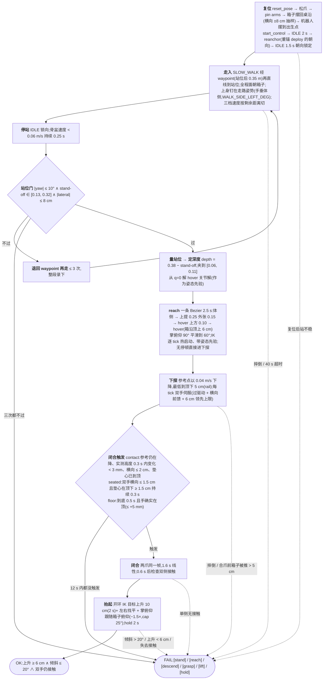

# 双臂搬箱数据采集

> 场景、单集流程、多集 pilot 与验收、渲染,以及控制逻辑 / 随机化 / 相机的工作原理,和离训练数据集还差的
> 一步。结构对齐 `docs/collection.md`(单手采集),设计原因见 `docs/bimanual_grasp_design.md`,渲染原理见
> `docs/rendering.md`。所有路径相对仓库根目录;每个新 shell 先做 §1 的两行(`export INSTANCE=2`,再
> `. scripts/paths.sh`),本文后面的命令都假定这两步已做。

## 0. 这条流水线现在能给什么

| 产物 | 有没有 | 怎么来 |
|---|---|---|
| 每集第三人称视频、50 Hz 状态轨迹(`qpos`/`qvel`)、manifest、expert 日志 | **有** | §4–5 pilot |
| MuJoCo / Isaac 并排视频 | **有** | §10 |
| **可训练的 LeRobot 数据集**(三相机 + 60 维 state + 66 维 action) | **还没有** | expert `bimanual_wall.py` 没接 exporter 的录制开关,见 §11 |

所以本文能复现的是"专家 10 集 ≥ 8 成功 + 视频";要出训练集还要做 §11 那一步。单手线的每一次闭环提升都是把
数据形状拉向"策略闭环时会处在的状态"(`docs/bimanual_grasp_design.md` 开头那句),双臂 expert 的每个阶段和判据
都按这个原则写,本文 §6–7 逐条说明它们为什么长这样。

---

## 1. 前置条件

| 项 | 要求 |
|---|---|
| 环境 | 按 `docs/setup.md` 装好;`. scripts/paths.sh` 后有 `$VENV_SIM_PY`(sim + expert)、`$VENV_DATA_PY`(exporter / 转换)、`$RENDER_PY`(SIMPLE venv,mujoco + EGL;预检、预览和渲染用,可选) |
| SONIC deploy | 已编译(`$SONIC_DEPLOY_ROOT/target/release/g1_deploy_onnx_ref`),同单手线 |
| SONIC checkpoint | `$SONIC_DEPLOY_ROOT/policy/sonic_v1_1/`(2026-09-11 起的默认,`SONIC_POLICY`)。缺了 `start_stack.sh` 会直接失败;下载见下面步骤 3 |
| **INSTANCE** | 决定端口(`5555 + 10·INSTANCE` 一组)和 DDS domain。**0 是采集/评测栈,pilot 永远用非 0**(runner 默认 1,本文用 2)。`INSTANCE` 必须在 `paths.sh` 之前设置——`paths.sh` 把它默认成 0;runner 本身会拒绝 0 |
| GPU | runner 默认 `CUDA_VISIBLE_DEVICES=1 MUJOCO_EGL_DEVICE_ID=1`(双卡机器上让 GPU 0 给采集/评测)。**只有一块 GPU 的机器要显式设成 0**,否则起栈失败 |
| 资源 | 容器 pid 上限 3840(一个栈约 700,带 exporter 的采集栈约 2500);磁盘 ≥ 20 GB(轨迹 3 MB/集,Isaac 渲染 100 MB/集) |
| 别人的栈 | **不要用 `stop_stack.sh`**,它的 pkill 不分实例。停自己的用 §4 |
| 同机负载 | 别在同一块 GPU 上并行跑别的仿真:deploy 的 LowState 保护一次 80–100 ms 卡顿就退出(§12) |

开工前逐条自检:

1. 先定实例号,再加载路径。顺序不能反,`paths.sh` 会把没设的 `INSTANCE` 默认成 0:

   ```bash
   export INSTANCE=2
   . scripts/paths.sh
   ```

2. deploy 二进制在:

   ```bash
   ls -la "$SONIC_DEPLOY_ROOT/target/release/g1_deploy_onnx_ref"
   ```

3. checkpoint 在:

   ```bash
   ls "$SONIC_DEPLOY_ROOT/policy/"
   # 期望:sonic_v1_1  release  low_latency ...
   ```

   没有 `sonic_v1_1` 就下载(一次性,要网络;首次起栈会重建 TensorRT engine,约 10 min):

   ```bash
   (cd "$SONIC_ROOT" && .venv_data_collection/bin/python download_from_hf.py --sonic-v1-1)
   ```

   只想先把流程跑通,可以临时用旧 checkpoint:后面每条起栈命令前加 `SONIC_POLICY=policy/release`。

4. GPU 编号对得上、卡是空的:

   ```bash
   nvidia-smi --query-gpu=index,name,memory.used --format=csv
   ```

   只有 `index 0` 一块卡的机器,§4 步骤 2 里的两个 GPU 变量必须设。

5. instance 2 没被别的栈占着:

   ```bash
   pgrep -af "run_sim_locomani.py --instance 2|bimanual_wall.py"    # 期望没有输出
   ```

---

## 2. 场景:`crate_bimanual`

单手线的场景由 `install_scene.sh` 解包再重建;双臂线的场景**不共用** `outputs/scene/sim`,而是单独构建到自己的目录,
用 `LOCOMANI_SIM_DIR` 指给 sim,所以单手采集随时可以在 instance 0 上跑而互不影响。

1. 构建场景(几秒):

   ```bash
   $VENV_SIM_PY src/locomani/tasks/crate/bimanual_scene.py outputs/scene/crate_bimanual
   ```

2. 核对桌面高度和箱子初始位置:

   ```bash
   python3 -c "import json;m=json.load(open('outputs/scene/crate_bimanual/scene_meta.json'));\
   print(m['surfaces']['A']['top'], m['objects']['blue_crate']['init_pos'])"
   # 期望: 0.62 [-0.368, 0.0, 0.707]
   ```

`bimanual_scene.py` 在 `build_sim_scene.py` 之上只做两件事,都还不适合放进共用文件:

- 强制 `SCENE_PRESET=crate_bimanual`:桌上只有一只 NVIDIA 蓝色 600×400 周转箱(`assets/crates/blue_crate/`,按 2/3
  缩放),近侧箱壁贴桌沿,两端把手在 y = ±0.30。箱体碰撞由 11 个 box 拼成;**四根把手立柱已经从资产里去掉**
  (碰撞和 `visual/blue_crate_noposts.obj` 都去了)。这是成功率 1/30 → 20/20 的第一步:有立柱时指尖要落进 73 mm 的
  槽里(沿箱沿 ±25 mm),没有立柱后 30 mm 高的箱沿横杆就是一堵"墙",沿杆的深度变成一个可以按实测站位选的自由量。
  别换回带立柱的网格。
- 把 dex1 四片指垫的接触硬化(priority 1、condim 4、solref 0.002、solimp 0.995/0.9999),写进 xml 并在编译后的模型上
  验证。MuJoCo 默认软接触下 0.30 kg 的瓶子以 0.5 cm/s 从闭合的夹爪里蠕滑出来,1.44 kg 的箱子全靠两片指垫的摩擦
  挂着,不硬化根本抬不起来。匹配失败是静默的,所以脚本自己核对。

两个可调项和一个不要动的:

| 变量 | 默认 | 说明 |
|---|---|---|
| `SCENE_TABLE_TOP` | 0.62 | 桌面高度。**不要降桌子来躲桌沿**:0.45 m 桌面站立够不着,要蹲 17 cm,膝盖顶桌沿 |
| `CRATE_SETBACK` | 0 | 箱子从桌沿往里挪的距离。每往里 1 cm 都要多弯腰,放桌子中央够不到(可达性扫描 `outputs/scene/crate_bimanual/reach_pitch.py`) |
| `GRIPPER_GEAR` | 250 | 夹爪执行器齿比。1000(pilot 24–28)让 87 g 的手指在 20 ms 控制保持下 PD 失稳、来回抖 |

含义:桌面 0.62 m,篮沿顶 0.792 m ≈ 骨盆高度。可达性(2026-09-07 IK 扫描):脚/膝比骨盆前伸 0.22 m,骨盆最近只能
站到桌沿外 0.27 m;站位 + 沿杆深度的预算是 0.38 m(IK 极限 0.40,留 2 cm),掌俯仰 60° 时双手同时到位且无穿透。

场景目录里还有两个变体,是历史对照,不要拿来采集:`crate_bimanual_native`(原始尺寸)、`crate_bimanual_t045`
(0.45 m 桌面)。

---

## 3. 预检:改几何或手臂姿势之后必跑

三个纯运动学检查,几十秒,不起 stack。**动作像不像人,在 c) 的视频里判断,不要用 10 集 pilot 去发现。**
三个脚本的旋钮都是 CLI flag(`--help` 看全部);2026-09-09 之前的环境变量写法(`POSE_LEFT_DEG=…`、
`PW=… OUT=…`)现在**不再被读**,脚本见到会拒绝启动并提示对应的 flag,不会静默跑成默认值。

### a) 抓取可达

站位 × 深度 × 垫深 × 掌俯仰的网格,每格解一次双手 IK:

```bash
$VENV_SIM_PY src/locomani/tasks/crate/reach_wall_sweep.py | tail -30
```

期望:stand-off + depth ≤ 0.40 的组合全部 OK(IK 残差 < 1 cm、无穿透,掌俯仰 60);expert 用 `REACH_SUM = 0.38`。
结果存到 `outputs/reach/wall_grasp_sweep.json`。

### b) 走路姿势

指尖到桌沿 / 篮壁的余量,以及 ego 画面里篮子被手遮挡的比例。身体姿态默认取 pilot trace 第 10 帧(policy 交付的
站立姿势),所以分两种机器:

- 有 pilot 产物(`outputs/videos/wall_pilot/trace/`)的机器:

  ```bash
  MUJOCO_GL=egl $RENDER_PY src/locomani/tasks/crate/walk_pose_preflight.py --pose-left-deg 10,10,0,60,0,30,0
  ```

  默认读 `wall_s0_05_state_trace.npz`(第 5 集);只跑过 1 集就 `--trace $V/trace/wall_s0_00_state_trace.npz`。

- 没有 pilot 产物的机器,用场景 qpos0 代替(骨盆同样 0.793 m,输出第一行会标明;腿 / 腰姿态与 pilot 不完全一致):

  ```bash
  MUJOCO_GL=egl $RENDER_PY src/locomani/tasks/crate/walk_pose_preflight.py --pose-left-deg 10,10,0,60,0,30,0 --trace none
  ```

期望:四个站位 contacts 都是 `-`;指尖在平面后 ≥ 0.12 m;遮挡 0%。

`--pose-left-deg` 就是 expert 的 `WALK_SIDE_LEFT_DEG`(走路时左臂七个关节角,右臂按 (+,−,−,+,−,+,−) 镜像);改了走路
姿势就把新值传给 b)。这类姿势要**用 FK 搜索来写**,不要用 IK 从 q = 0 解:IK 解到胸前高度的目标会落到"手甩到身后
/ 身侧"的分支(pilot 21 的教训)。

### c) reach 曲线 + 预览视频

1. 解四个站位的 reach 轨迹并保存:

   ```bash
   MUJOCO_GL=egl $RENDER_PY src/locomani/tasks/crate/reach_preflight.py \
     --pw 0.02 --out-dist 0.15 --up 0.25 --over 0.10 --warm prev \
     --save outputs/reach/reach_preview/traj
   ```

   期望:contacts `-`;越沿时指尖离篮沿顶 ≥ +2.5 cm;终点关节解 = hover 解。

2. 用保存的轨迹渲染预览视频:

   ```bash
   MUJOCO_GL=egl $RENDER_PY src/locomani/tasks/crate/reach_preview.py
   ```

   看 `outputs/reach/reach_preview/reach_preview.mp4`:上排跟踪相机、下排 ego,四列 = 0.13/0.18/0.24/0.31 m 站位。

---

## 4. 跑一集:起 stack、看日志、读结果

### 三个进程(不是四个)

runner 只起三个长驻进程;单手线的第四个 data exporter 在 `INSTANCE != 0` 时被 `start_stack.sh` 跳过,这就是
§0 里"还没有数据集"的直接原因。

| 进程 | 用哪个 python | 干什么 |
|---|---|---|
| MuJoCo sim | `.venv_sim` | 跑物理、发三路相机、发特权真值、录第三人称视频、按 `SIM_STATE_TRACE_DIR` 落 50 Hz 状态轨迹 |
| C++ deploy | `target/release/g1_deploy_onnx_ref` | SONIC:k-planner 合成参考动作 → encoder 产 token → policy 产 29 个关节目标 |
| agent server | `.venv_sim` | expert 往 deploy 发意图的 ZMQ 发布端(`agent_server.py`) |

expert(`bimanual_wall.py`)是第四个进程,由 runner 在 stack 起来后启动。

### 先跑一集看流程

`$V` 是这次 pilot 的产出目录,§5、§10 都用它。前提:§1 步骤 1 的 `INSTANCE=2` 和 `paths.sh` 已在当前 shell 生效。

1. 建产出目录:

   ```bash
   V=$LOCOMANI_ROOT/outputs/videos/wall_pilot
   mkdir -p "$V/trace"
   ```

2. 导出 runner 要读的变量。第二行只有单卡机器需要(双卡机器省略,默认 GPU 1):

   ```bash
   export SIM_VIDEO_DIR=$V SIM_STATE_TRACE_DIR=$V/trace
   export CUDA_VISIBLE_DEVICES=0 MUJOCO_EGL_DEVICE_ID=0
   ```

3. 后台起 runner。位置参数是 **集数、种子**,之后的参数原样转给 `bimanual_wall.py`:

   ```bash
   nohup bash scripts/run_wall_pilot.sh 1 0 --config configs/tasks/crate_wall.json > "$V/runner.log" 2>&1 &
   ```

4. 先看起栈(约 40 s;首次用新 checkpoint 会多等 TensorRT 重建):

   ```bash
   tail -f "$V/runner.log"
   # 开头一行 [pilot] instance 2  scene ...;起栈里有 policy: policy/sonic_v1_1 一行
   ```

5. 栈起来、expert 启动后才有 `pilot_s0.log`,切过去只看阶段行:

   ```bash
   tail -f "$V/pilot_s0.log" | grep -E "^\[wall\] round|\[stand\]|closing|\[lift\]"
   ```

   一集约 40–60 s,末尾一行 `[wall] round 0: OK (…s)`。

runner 做的事,按顺序:检查 `LOCOMANI_SIM_DIR/scene_meta.json` 存在 → 起 instance 2 的栈(`SIM_VIS=none`:默认
的位姿框叠加层会把 60 cm 的箱子画成一团点云,把机器人全遮住)→ 跑 `bimanual_wall.py --rounds N --seed S --manifest
$V/manifest.jsonl --label wall_sS` → 结束时**只杀自己实例**的进程(按 `--instance` 与端口匹配;sim 会 fork 一个
image-publisher 子进程,活得比父进程久且占着相机端口,所以先杀子再杀父)。

`CrateTaskConfig` 的两个字段决定 expert 的形态。2026-09-09 重构 step 3 起**不再读环境变量**,runner 见到
`WALL_FEATURE=` / `WALL_WALK=` 会拒绝启动(§12);用 `--config configs/tasks/crate_wall.json`,或 `--set wall_walk=true`
这样逐项覆盖,runner 把 `[rounds] [seed]` 之后的参数原样转给 `bimanual_wall.py`:

| 字段 | 值 | 含义 |
|---|---|---|
| `wall_feature` | `rail`(默认)/ `wall` | 夹哪个特征。`rail`:箱子不转,夹两端 30 mm 高的箱沿横杆,下探底 5 cm;`wall`:箱子转 90°,夹左右两面整高箱壁,下探底 8 cm。20/20 是在 `rail` 上做到的 |
| `wall_walk` | `true` / `false`(**默认 false**;`crate_wall.json` 里是 true) | `true`:从 1.0–1.3 m 外走进来,完整 episode;`false`:出生在站位后 0.45 m,双臂先抬到 hover 姿势再**瞬移**到抽样的站位上,只量抓取本身(ready-stand pilot) |

### 产出在哪

| 产物 | 路径 |
|---|---|
| 第三人称视频 | `$V/wall_s0_NN.mp4`(`NN` 从 `00` 起编号;`s0` 是种子) |
| 状态轨迹(50 Hz `qpos`/`qvel`,nq = 47:自由基 7 + 关节 29 + 4 指 + 箱子 7) | `$V/trace/wall_s0_NN_state_trace.npz` |
| manifest(每集一行 json) | `$V/manifest.jsonl` |
| expert 日志(每 0.5 s 一行) | `$V/pilot_s0.log` |
| 栈日志(sim / deploy / agent) | `$(locomani_session_root 2)/{sim,deploy,agent}.log` |
| 每集结束时的关节/位姿快照(调参用) | `$V/wall_end_roundN.json` |

### 日志怎么读

一集正常的日志长这样(节选,`wall_walk=true`):

```
[walk] t= 2.0 pelvis [-1.61, 0.12] dist 1.05 along +1.03 edge 1.25 speed 0.3 facing_err +4 deg  L ... R ...
[walk] waypoint reached: lateral -2.1 cm, 35 cm to the stand
[stand] stand-off 0.238 m, lateral -0.031 m, yaw +2.3 deg -> depth 0.11  ...
[hover] left: ik residual 0.4 cm, arm q [-48, 12, 8, 43, 7, ...]
[reach] u=0.50 lag L 2.1 R 2.4 cm  arm q L [...]
[hover] residual L 1.8 R 2.2 cm errs L [3, -4, 31] R [2, 5, 29]
[descend] t=1.5 ref dz +0.0 cm errs L [2, -3, 4] R [1, 4, 2] seated {...} touch [...]
[grasp] closing (contact) after 2.4 s: {'left': [2.0, -3.0, -1.0], 'right': [1.0, 4.0, -2.0]}
[lift] t=1.0 rise +0.061 m tilt 3.2 deg pitch_down +4.1 palm 54 wall dz +3 mm level +2 mm touch ['left', 'right']
[wall] round 0: OK  (52.3 s)
```

- `[stand]` 一行给出实测站位(stand-off 是骨盆到箱子近面、lateral 是偏离中心线、yaw 是相对箱子法线的残差)和由它
  算出的抓取深度 `depth = 0.38 − stand-off`,夹在 [0.06, 0.11]。
- `errs` 三元组是**实测垫心相对箱沿抓取线**的 [沿杆, 横向, 高度] 毫米误差——这是判据用的量,和 IK 残差不是一回事。
- `[grasp] closing (contact|seated|floor)`:三种闭合触发,含义见 §6。
- 每集只有一行 `[wall] round N: OK|FAIL <why>`,`why` 的前缀 `[stand]/[reach]/[descend]/[grasp]/[lift]/[hold]` 就是
  失败阶段。

### 中途停止 / 清理

```bash
bash scripts/stack/stop_instance.sh 2        # 只杀 instance 2 的 sim / deploy(按 --instance 与端口匹配)
for p in $(pgrep -f "[b]imanual_wall.py"); do kill -9 $p; done   # expert 本身;[b] 让模式不匹配这行自己
```

`pkill -f <模式>` 要从**单独的一条命令**里发——模式若出现在同一条 shell 命令行里(包括 heredoc 和 echo 的内容)
会杀掉自己,退出码 144 就是这个。不要编辑正在运行的 bash 脚本(bash 按偏移量读),runner 改完要重启。

---

## 5. 多集 pilot 与验收

### 跑 10 集

和 §4 完全一样,只是第一个位置参数改成 10(§4 步骤 1–2 的变量要还在当前 shell 里):

```bash
nohup bash scripts/run_wall_pilot.sh 10 0 --config configs/tasks/crate_wall.json > "$V/runner.log" 2>&1 &
```

同一个 `$V` 下换种子(第二个参数)会追加到同一个 manifest,`label` 变成 `wall_s<seed>`。**每一集都是一次
`reset.reset(...)`**:箱子被摆回桌沿(横向按 seed 抽样),机器人被摆到出生点,arms pin 住,IDLE 沉降 2 s。

### 为什么不用分批

单手线要每批重启栈,是因为 exporter 的线程数随集数增长、会顶到容器 pid 上限;双臂 pilot 不带 exporter,一次跑
20 集没有问题。接了 exporter 之后(§11)就要沿用单手线的分批。

### 验收

```bash
python3 src/locomani/tasks/crate/summarize_wall_pilot.py $V
```

每集一行:`ok`、走位次数 `att`、闭合触发 `trig`、篮子首次移动时刻 `move_s`、集长 `len_s`、静止帧比例 `static`、
实测站位 `so`、`yaw`、失败原因。`static` 的定义:50 Hz 帧里所有关节 < 1e-3 rad、骨盆 < 0.5 mm、箱子 < 0.5 mm 都没动
的帧的比例——单帧策略分不开的帧,即吸收态预算。

| 指标 | 合格 | 为什么 |
|---|---|---|
| 成功 | ≥ 8/10 | 历史:ready-stand pilot 16 20/20;走入 pilot 21 20/20,22 9/10,23 8/10 |
| `move_s` | = lift 开始时刻(约集长 − 4 s) | lift 前篮子不能被碰。pilot 18 的 20 集都在走路时被指尖扫转 7–14°,当时以为的"站位 yaw 门"失败其实是这个 |
| `trig` | 绝大多数 `contact` | `floor` 是兜底,`seated` 是毫米判据,都不该是主流 |
| `static` 中位 | ≤ 0.10 | 吸收态预算(单手线 cover400 的 creep 就是这么来的) |
| 站位 `so` | 0.13–0.32 内 | reach 预算 0.38 减去深度 [0.06, 0.25] |
| 站位 `\|yaw\|` 中位 | ≤ 3° | 篮子没被碰时步态自身的散布 |

### 成本(实测)

每集 40–60 s 仿真 + 起栈约 40 s;10 集 pilot 约 10 min。状态轨迹 3 MB/集,视频约 2 MB/集。

---

## 6. 控制逻辑

### 三层,谁决定什么

和单手线一样是三层,但决策层和原语层的内容变了:

| 层 | 在哪 | 它决定什么 | 它**不**决定什么 |
|---|---|---|---|
| **决策** | `bimanual_wall.py` | 站位与出生点、走还是抓、什么时候合爪、成没成功 | 关节角、步态 |
| **原语** | `primitives.py`(走路)、`upper_ref.py`(上身 ramp)、`stream_reach.PlannerArm` + `bimanual_carry.BimanualArms`(双臂 IK 与推送)、`arm_ik.py` | 把"走到站位"、"双手放到箱沿上方"变成 50 Hz 的意图流 | 怎么迈腿、怎么维持平衡 |
| **控制** | C++ deploy 里的 SONIC | 把意图编码成 token,再解成 29 个关节目标 | 任务是什么 |

agent 能往 deploy 发的仍然**只有三种东西**,双臂线用法如下:

| 发什么 | 单手线怎么用 | 双臂线怎么用 |
|---|---|---|
| planner 帧(`mode/movement/facing/speed`) | 走路;抓取时 `IDEL_SQUAT` + `height` 下蹲 | 走路(`SLOW_WALK`,三档速度 0.30/0.25/0.20 按剩余距离切);到站后 `IDLE` + 锁定朝向。**不下蹲**:骨盆高度全程站立 |
| `upper_body_position[17]` | IK 只解一只手,另一只手被顺带写进去 | 两只手**都**由 IK 解(`BimanualArms`),腰 3 个关节**锁死为 0**:命令的腰前倾只交付 2–10%(`diag_lean.py`),身体不跟的参考写进数据就是谎话 |
| `left/right_hand_joints` | 右爪开合 | 两爪**同一帧**开合(`CLOSE_RAMP` 1.6 s 线性) |

三个必须记住的点(与单手线的三点对照):

1. **`upper_body_position` 逐字替换、无 ramp**,所以 expert 自己用 `upper_ref.UpperRamp` 做 2°/tick 的平滑,
   走路时每 tick `ramp.push(q_walk17)` 把上身钉在走路姿势。deploy 有个 latch:一旦收过 `upper_body_position`,
   之后每个参考动作的上身都被覆盖——runner 起栈后 expert 先在 `PLANNER_VR_3PT` 下 `start_control`,再切到
   `PLANNER_FROZEN_UPPER_BODY` 推 17 维。
2. **IK 分支要用边界锁死。**`BimanualArms` 给两条手臂加了硬边界:肘只能前臂向下(≥ 5°)、肩 yaw 与腕 roll ±45°、
   肩 pitch ≥ −80°。没有这些边界,pilot 7–9 里总有一只手解到"肘反伸、腕滚 50–70°、手甩到箱沿上方 60–70 cm"的分支,
   policy 然后什么都跟不上。右腕的坐标系**不是**左腕的镜像(memory `dex1-right-palm-frame-not-mirrored`):给两只手
   镜像对称的目标姿态,右腕要多转半圈,近处就没有行程;所以右手的抓取轴取反,IK 才对称。
3. **policy 对手臂参考是欠跟踪的**,而且有系统偏差:手比参考高 3–5 cm、两手向外 2–3 cm。expert 不假装这不存在:
   高度用"下探底"(参考点降到箱沿顶下 5 cm,手才真到顶)、横向用 1.2 cm 的向内前馈 `ACROSS_BIAS`(2.0 过头)、
   伺服里用 0.7 倍的残差过驱动(`OVERDRIVE`,每轴 ≤ 4 cm)加横向单独一路(`ACROSS_OD`),命令点领先实测点最多
   `LEAD_CAP` 6 cm(pilot 4 一次无界跳变把双手甩了 ±10 cm)。

### ① 一集 episode 分几步



`wall_walk=false` 时把"走入 → 停站 → 站位门"换成:先在出生点把双臂 2 s 平滑抬到 hover 关节解,再 `align_robot_xy`
瞬移到抽样站位(stand-off 0.14–0.28、横向 ±5 cm、yaw ±5°)。出生点在站位后 0.45 m 而不是站位上,是因为 policy
起控时的甩臂把箱子撞转了 84°(pilot 1)。

失败的集直接记 FAIL,**不重试**;唯一像重试的是站位门失败时退回 waypoint 重走——那是要录下的"桌边闭环修正",
不是丢弃。

### ② 伸手、下探、合爪那几秒里发生了什么

单手线在这一段是"下蹲 + 50 Hz 伺服进 capture region";双臂线不蹲,所以整段都是手臂的事:

- **reach 是一条曲线,不是相位序列。**从走路姿势的垫心出发,三次 Bezier 经两个控制点到 hover 点,2.5 s 走完;
  掌俯仰从 90°(手指下垂)线性到 60°。每 tick 用上一 tick 的解热启动 IK,并以 hover 关节解为姿态先验
  (`REACH_POSTURE_W` 0.02)——先验是为了不让 IK 在越沿那一段跳到"手腕扭 90–110°"的分支。日志里 `lag L/R`
  是实测垫心落后曲线的距离,2–3 cm 正常。
- **没有 hover hold。**reach 一结束下探就开始,policy 还欠着的 2–3 cm 由下探伺服吃掉。`wall_walk=false` 保留一段
  ≤ 2.5 s 的 hover(手停下就结束),只是为了旧 A/B 数字可比。
- **下探是参考点在降,不是手在降。**参考以 0.04 m/s 匀速下降到"底"(顶下 5 cm),手跟不跟得上由三个判据看:
  `contact`(手被箱沿顶住不再下降)是主判据,`seated`(垫心确实进到顶下 1.5 cm 且横向居中)是毫米级备用,
  `floor`(参考到底 0.5 s)是兜底、且要求手真在顶上——pilot 23 r5 从 0.30 m 站位闭合时双垫离顶 26–33 mm,夹的是空气。
- **闭合是双爪同一帧。**先左后右会把 4 种开合组合里的两个混合态变成随机过渡帧;单手数据里 grip 是双峰
  (53/44/3%),模型学的是离散态。闭合后 0.6 s 查双侧接触,一侧没接触就算失败,不允许单手硬抬。
- **抬起的 IK 目标是开环的。**闭环抬升(用伺服)被领先上限 + policy 的高度偏差压到 6.5 cm 就不动了;开环目标能升
  9–14 cm。找平(左右垫心高度差 × 1.0,cap 2 cm)和俯仰跟随(箱子前倾角 × 1.5,cap 25°)负责箱子水平:矩形横杆被
  平口夹爪刚性夹住,箱子跟着手转,近站位(< 0.22 m)折叠的手臂抬升时腕俯仰会变,不跟随就每次都到 20°。

### 阶段与判据速查(改参数时对照)

| 阶段 | 判据 | 常量(`bimanual_wall.py`,标 † 的在 `bimanual_carry.py`) |
|---|---|---|
| 出生 | 站位后 1.0–1.3 m,横向 ±0.15,朝向朝箱子 ±0.17 rad(写死,没有常量) | `WALK_SPAWN_BACK`,`WALK_SPAWN_LAT` |
| 走入 | 经 waypoint(站位后 0.35 m)直线到站位;三档速度;手垂体侧 | `WAYPOINT_BACK`†,`APPR_SPEED`†,`STAND_OFF_WALK = 0.24`,`WALK_LAT_BIAS = −0.04`,`WALK_SIDE_LEFT_DEG` |
| 停站 | 骨盆 < 0.06 m/s 持续 0.25 s,最长 6 s | |
| 站位门 | yaw ≤ 10°,stand-off 0.13–0.32,横向 ≤ 8 cm;≤ 3 次 | `STAND_YAW_MAX_DEG`,`WALK_STAND_OFF_BAND`,`WALK_LAT_TOL`,`WALK_ATTEMPTS` |
| 深度 | 0.38 − stand-off,夹到 [0.06, 0.11] | `REACH_SUM`,`DEPTH_MIN/MAX` |
| reach | Bezier 2.5 s,上提 0.25 / 外张 0.15 / 越沿 0.10,俯仰 90→60°,姿态先验 0.02 | `REACH_S`,`REACH_UP/OUT/OVER`,`REACH_PITCH0_DEG`,`PALM_PITCH_DEG`,`REACH_POSTURE_W` |
| hover 目标 | 箱沿顶上 6 cm,向内 1.2 cm 前馈 | `HOVER_ABOVE`,`ACROSS_BIAS` |
| 下探 | 0.04 m/s,底 = 顶下 5 cm(rail)/ 8 cm(wall),超时 12 s | `DESCEND_SPEED`,`GRIP_BELOW`,`DESCEND_TIMEOUT` |
| 伺服 | 领先 ≤ 6 cm;过驱动 0.7×(≤ 4 cm);横向 1.0×(≤ 4 cm) | `LEAD_CAP`,`OVERDRIVE`†,`OVERDRIVE_CAP`†,`ACROSS_OD(_CAP)` |
| 闭合触发 | contact 0.3 s / 3 mm;seated 横向 1.5 cm、顶下 1.5 cm、0.3 s;floor 0.5 s | `CONTACT_STALL_S/MM`,`ACROSS_TOL`,`SEAT_BELOW`,`SEAT_DWELL`,`FLOOR_DWELL` |
| 闭合 | 双爪同一帧,1.6 s;双侧接触 | `CLOSE_RAMP`† |
| 抬起 | 开环 +10 cm / 2 s;找平 1.0×(≤ 2 cm,LP 0.15);俯仰跟随 1.5×(≤ 25°,LP 0.2);hold 2 s | `LIFT_HEIGHT`†,`LEVEL_*`†,`PITCH_FOLLOW_*`,`HOLD_S`† |
| 判定 | 上升 ≥ 6 cm、倾斜 ≤ 20°、双手接触 | `LIFT_MIN`†,`TILT_OK_DEG` |

---

## 7. 演示的"形状":这些判据为什么长这样

三条原则,各对应一次付过学费的失败:

1. **阶段切换只用画面 / 本体感知里可见的量。**闭合看的是"手被顶住不再下降"和"垫心相对箱沿的实测误差",不看时间;
   抬起看的是箱子的实际俯仰。策略闭环时只有这些量可用。
2. **导航阶段不预备抓取姿势。**pilot 18 的 20 次走入全都用张开的爪子擦过近侧箱壁顶(参考让垫心在杆上方 12 cm,
   policy 只交付 1–8 cm,右手最低、手指下俯、手在骨盆前 24 cm),把箱子转了 7–14°——那个"yaw 残差"其实是箱子被
   转了。手垂体侧走路(pilot 21)之后 20/20,|yaw| 中位 2.3°,箱子在 lift 前不动。
3. **停偏了不丢弃,退回重走并录下。**单手线的失败变量是 stand yaw,而专家从不在桌边闭环修朝向,策略也就不会。
   这里 8° 的偏航会把一个把手推远 5 cm、另一个拉近 5 cm,横向容差直接吃光;所以站位门失败的修正过程本身是数据。
   朝向在走入过程中对齐,**不在桌边原地转**:heading 通道原地转有 7–8° 死区(`diag_turn.py`),步态中跟得很好。

和 `docs/bimanual_grasp_design.md` A–D 对照,现在的 expert 实现了 A(走入中对齐、站位门、不加远停)、B 的一半
(走路时手不预备;到位后 reach 与掌俯仰是一条曲线;**腰锁死**而不是前倾 33°——前倾交付不了)、C(双区同时满足、
同帧闭合、双侧接触)、D 的抬起与水平判据;**没有**恢复分支(单侧进区继续伺服 / 松开重来)和搬到 B 面。这两项是
设计里明确要"显式采一批"的,还没做。

---

## 8. 随机化:现在的轴和还没打开的轴

| 维 | 范围 | 状态 |
|---|---|---|
| 箱子横向偏移 | ±8 cm(`CRATE_DY_RANGE`) | 每集抽样 |
| 出生点 | 站位后 1.0–1.3 m,横向 ±0.15 m,朝向 ±10° | 每集抽样(`wall_walk=true`) |
| 停靠距离 | 目标 0.24 m,实际由步态散布(0.13–0.32 内接受) | 自然分布,不取单点 |
| 站位(ready-stand 模式) | stand-off 0.14–0.28,横向 ±5 cm,yaw ±5° | 按走入实测散布抽样 |
| 箱子 yaw | ±15°(`crate_yaw_levels_deg`,默认关) | 2026-09-10 打开为按集设计:站位沿箱子实测法线;远站位 + 转角让远端手够不到(台账 09-10 难度场景) |
| 桌高 | — | 没打开(`SCENE_TABLE_TOP` 是场景级常量;按批随机要像单手线那样每批重建场景) |
| 箱子在桌上的深度 | {1, 3} cm(`crate_setback_levels_m`,默认关;reset 时平移,不重建场景) | 上限约 5 cm(reach 0.38 − 站位 0.27);3 cm 时无独立效应,只让远站位更常见(台账 09-10) |
| 外观 | — | 没打开 |

`WALL_LAT_BIAS = −0.04` 不是随机化,是补偿:步态总是停在目标左侧约 4 cm(pilot 36/37)。`STAND_OFF_WALK` 从
0.24 改到 0.21 反而让步态停得**更远**(中位 0.31,yaw ±7°,横向 7–11 cm;3/20 和 0/5),所以 0.24 不动。

---

## 9. 相机与数据形状

录制侧和单手线相同:`start_stack.sh` 默认 `--record-wrist-cameras`,三路相机(ego + 左腕 + 右腕)、
`teleop.left_hand_joints`、`eef_state` 0:7 本来就在 parquet 里,所以出数据集时**录制不用改**。变的是训练配置
`configs/gr00t_sonic_3cam_bimanual.py`,三处各对应一个单手测量在这里失效:

| 项 | 单手(2cam) | 双臂(3cam) | 为什么 |
|---|---|---|---|
| 相机 | ego + right_wrist | ego + left_wrist + right_wrist | 2cam 去掉左腕是因为 23,103 帧里左臂从不动、画面是静态贴图;这里左手要夹自己的箱沿,决定成败那一帧里左腕相机被箱沿填满,和右腕对瓶子一样 |
| state | 53 | 60(+左腕位姿) | `observation.eef_state` 0:7 已在 modality.json 里声明,不用重转;和右腕一样是机器人自身编码器的 FK,真机可得 |
| action | 64 + 1 = 65 | 64 + 1 + 1 = 66 | 左爪第一次成为动作。两个标量而不是 7 维组:单手 grip 是双峰、模型学离散态,双手四态里混合态要单独可见 |

腰前倾后的 ego 可见性:expert 现在腰锁死、不前倾,所以 ego 看到的是箱子近侧半边和两只手;采集前仍要用
`diag_ego_geom` 过一遍"到位和闭合两个时刻两个把手都在帧内"的门(memory `vla-target-must-be-in-frame`)。

**混合训练的告诫**:单手数据里 `left_gripper` 是常量 0 列、左腕位姿是常量;合并训练会把左臂压回"不动",要么分开
训,要么盯着比例。

---

## 10. 渲染并排视频(可选)

1. 把 MuJoCo 场景转成 Isaac 资产。有缓存(`$ISAAC_ASSETS/{robot,scene/<label>}/.stamp`),场景变了才会重做;加 `--force` 可强制:

   ```bash
   bash scripts/build_isaac_assets.sh --snapshot outputs/scene/crate_bimanual
   ```

2. 建输出目录:

   ```bash
   R=outputs/renders_isaac/my_run
   mkdir -p "$R"
   ```

3. 渲染。位置参数是 **pilot 目录、输出目录、集数、label**(label = `wall_s<seed>`):

   ```bash
   bash scripts/render_wall_pilot.sh "$V" "$R" 10 wall_s0 > "$R/render_all.log" 2>&1
   ```

每集约 3 min:MuJoCo 用跟踪相机重放状态轨迹(`--stride 4`,并写出 `cam_traj.npz`)→ Isaac 沿同一条相机轨迹重放
→ ffmpeg hstack。产出 `$R/sbs_roundNN.mp4`(左 MuJoCo、右 Isaac);每集目录 `$R/rNN/` 有
`tracking_mujoco.mp4`、`cam_traj.npz`、`ego_isaac.mp4`、`render.log`。第 0 集出来先看三样:只有一个机器人、有头、
脚在地面上(三个都曾出过问题,见 §12)。

**双臂导出的两条默认规则(2026-09-10)**:
- `MUJOCO_RENDER_ARGS="--insets"`:MuJoCo 侧叠三路画中画(ego / L wrist / R wrist),和采集时的第三人称录像同一布局。
- **ghost hands**:专家每次解 IK 时把双手的目标手腕位姿(抓取点减去 `OFFSET`,`ghost_trace.py`)按状态 `seq` 记到
  `trace/<label>_NN_ghost.npz`(`run_wall_pilot.sh` 只要设了 `SIM_STATE_TRACE_DIR` 就默认写,`GHOST_TRACE=0` 关);
  `render_wall_pilot.sh` 发现这个文件就把它传给两个渲染器,MuJoCo 和 Isaac 都画一对洋红半透明的张开夹爪
  (`sim/isaac/ghost.py`,几何和 `scene_lib.add_ghost_hand` 同一套数学,Isaac 侧引用机器人 USD 的 `/meshes/*`)。
  走路阶段没有 IK 目标,ghost 停在地下;画中画里永远没有 ghost。看视频时:ghost 是"想去哪",实手是"到了哪"。
  ghost 画的是**纯目标点 `ref`**(hover → 杆上 → 下探 → 抬起,随阶段移动),不是伺服真正交给 IK 的命令
  (`ref + lead cap + overdrive`,那个会超前于目标、来回抖);两者的差就是伺服在补的跟踪滞后。

---

## 11. 到训练数据集还差的一步

现状:`bimanual_wall.py` 只写视频 / 轨迹 / manifest,**不控制 exporter**,而 exporter 只在 `INSTANCE=0` 的栈里启动。
要出 LeRobot 数据集:

1. 在 `bimanual_wall.py` 每集里接 exporter 开关,和单手 `grasp_gym.py` 一样:任务开始(复位沉降之后)
   `p.cmd.key("c")` 开始录,成功再 `key("c")` 保存,失败 `key("x")` 丢弃;manifest 每行带 `ok` / `produced`
   (转换器按行和 session 里的 episode **按顺序**一一对应——这个对齐看不出残段,见 §12 最后一条)。
2. 在 **INSTANCE=0** 的栈上跑(默认 `--record-wrist-cameras`);录之前确认 instance 0 没有别人的采集或评测,并像
   单手线一样每 10 集重启栈(exporter 线程增长,pid 上限)。
3. 转换:`$VENV_DATA_PY src/locomani/pipeline/convert_to_hf_format.py --sessions <session> --manifest <manifest.jsonl>
   --out <ds> --holdout N --holdout-out <ds>_val --jobs 4`(视频流从 session 自动发现;`left_gripper` 键已在转换器里),
   然后 `check_dataset.py <ds>`——它的 grasp-causality 检查(合爪后物体上升 > 3 cm、末端物-腕距离稳定)对双臂同样
   适用,是唯一能抓出残段 episode 的地方。
4. 训练用 `configs/gr00t_sonic_3cam_bimanual.py`。
5. 恢复分支的数据(单侧未进区、松开重来、站位重定位)按 `docs/bimanual_grasp_design.md` D 显式采一批;没有它们
   策略只见过 (开,开) 和 (闭,闭)。

---

## 12. 已知坑(按日期)

- **2026-09-04 右腕坐标系**:`right_wrist_yaw_link` 不是左腕的镜像。镜像对称的目标让右腕多转半圈、近处没行程,
  IK 残差 1.9–3.7 cm(左 0.04)。翻转右手的抓取轴即可;任何离线 reach map 都要对两条手臂分别跑,"对称的 map"就是
  忘了的信号。
- **2026-09-07 上午,pilot 1–9(ready-stand)**:出生在站位上会被起控甩臂撞转箱子(→ 出生在后 0.45 m 再瞬移);
  deploy 的朝向锚跨复位保留,只按骨盆 yaw 设 `heading_offset` 会让 IDLE 的朝向命令把残差变成真转动,每集 ±5°
  交替累积到 −84°(→ 每集 `reanchor(p)`);IK 无边界时手臂解到过顶分支(→ 肩 pitch ≥ −80° 等边界)。
- **2026-09-07 下午,pilot 11–16(rail)**:深度超过箱子中线(0.135)抬起时箱子俯仰 > 20°(→ `DEPTH_MAX` 0.11);
  `ACROSS_BIAS` 2.0 cm 过头、手落到杆内 0.6–1.4 cm(→ 1.2);闭环抬升卡在 6.5 cm(→ 开环目标);近站位每次 20°
  (→ 俯仰跟随)。pilot 16 20/20。
- **2026-09-07 傍晚,pilot 18–21(走入)**:走路时张开的爪子擦过箱壁顶把箱子转 7–14°(→ 手垂体侧走路);
  `STAND_OFF_WALK` 0.21 让步态停得更远(→ 留 0.24);IK 从 q=0 解胸前目标进错分支(→ 姿势用 FK 搜索写死)。
  pilot 21 20/20。
- **deploy 的 LowState 保护**:一次 80–100 ms 的周期卡顿就让 deploy 自行退出,之后每集 "did not stabilise"。同机别的
  会话起栈 / 重启 deploy / 在同一块 GPU 上跑别的仿真都会触发。expert 连续两集不稳定会自动 `scripts/restart_deploy.sh`;
  看 `$(locomani_session_root 2)/deploy.log`。**接了 exporter 之后这不再是自愈**:2026-09-08 单手 07d-200 采集期间
  同卡的仿真探针让 deploy 重启,三个 session 的 episode 被切成 1–6 s 残段,convert 按顺序对齐看不出来,只有
  `check_dataset` 的 grasp-causality 抓到——采集时不要在同一块 GPU 上跑别的东西。
- **Isaac**:`/World/G1` 占位机器人、ego 相机要隐藏的头部网格、地面残差埋脚——三个都已修;RTX 首帧后网格还要
  ~10 帧才加载完;出生点在后墙里就调 `isaac_scene.py` 的 `BG_SHIFT_XY`。
- **2026-09-10 `WALL_WALK=1` 静默失效**:重构 step 3 把旋钮搬进 `CrateTaskConfig` 后环境变量不再被读,`wall_walk`
  默认 false;按旧教程设 `WALL_WALK=1 WALL_FEATURE=rail` 跑出来的 10 集全是 ready-stand 变体(每集 25 s、视频 10–12 s、
  日志里一行 `[walk]` 都没有),渲染完才发现没有走路段。看 `[walk]` 行有没有就是判据;runner 现在遇到这两个环境变量
  会直接拒绝。
- **2026-09-11 预检的 `POSE_LEFT_DEG=` / `PW=…` 静默失效,以及 `ModuleNotFoundError`**:同一次 argparse 化让
  `walk_pose_preflight.py` / `reach_preflight.py` 不再读环境变量,按旧教程跑出来的是默认姿势的检查结果,看不出异常;
  两个脚本现在见到旧变量会拒绝启动。另外 `tasks/crate/` 下四个预检脚本(`reach_wall_sweep` / `walk_pose_preflight` /
  `reach_preflight` / `reach_preview`)之前只 `chdir` 到仓库根、没把 `src/` 放进 `sys.path`,在任何 venv 里直接跑都是
  `No module named 'locomani'`(`locomani` 没有 pip 安装);已统一改成和 `bimanual_wall.py` 一样先 `sys.path.insert`。
  `walk_pose_preflight` 还依赖 pilot trace,缺文件时报错并提示 `--trace none`;`reach_wall_sweep` / `reach_preflight`
  写结果前会自己建 `outputs/reach/…` 目录。同日发现 `run_wall_pilot.sh` 写死了一台机器的绝对路径
  `/workspace/code/locomanipulation/scripts/paths.sh`,别的机器上第一行就退出;改成和 `run_bimanual_pilot.sh` 一样按
  自身位置找 `paths.sh`。
- **夹爪齿比**:`GRIPPER_GEAR=1000`(pilot 24–28)让手指 PD 在 20 ms 控制保持下失稳抖动;250 是对的。

---

## 复现清单

1. §2 场景:桌面 0.62、箱子 x = −0.368、指垫已硬化。
2. §3 三个预检无接触,预览视频动作连续。
3. §4 单集日志里 `[stand]` → `[reach]` → `[descend]` → `[grasp] closing (contact)` → `[lift]` → `OK` 一条线走完。
4. §5 10 集 pilot:成功 ≥ 8,`move_s` 都在 lift,`static` ≤ 0.10,`trig` 以 `contact` 为主。
5. §10 渲染第 0 集:一个机器人、有头、脚着地。
6. 要训练集:先做 §11,采集期间 GPU 上不跑别的。
