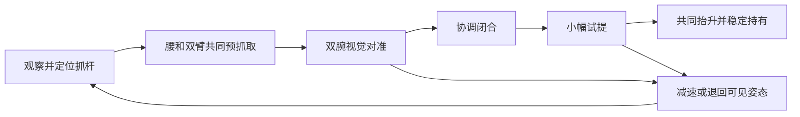

# 双臂抓篮子的视觉指导专家：设计草案

日期：2026-09-12。设计审计基线：`db32641`。状态：RGB 视频 pilot 已实现，正在采集验证。
当前使用方式与交付边界见 [采集说明](../crate_visual_collection.md)；下文保留完整目标，未将待验证部分视为完成。
实测命令、版本、结果与限制见 [视频证据](crate-visual-pilot-20260912.md)。
适用：新增 crate 专家、设计采集观测或审查 privileged information 的使用。
第一版按“双手抓住篮子、离开支撑面并稳定持有”设计；站起和搬运是后续扩展。
本方案沿用当前 SONIC v1.1 路线；不以历史 crate 成功率作为设计目标或可靠基线。

## 1. 目标与信息约束

目标是产生平滑、可执行，而且能由部署时观测解释的专家动作。
专家可以利用仿真进行标注、运动学计算、轨迹优化和结果判定。
训练标签中的动作选择与修正，必须有学生能够获得的依据。

设 `h_t` 为学生实际输入的图像、本体状态和已执行动作历史，`z_t` 为未观测的仿真真值。
对观察上无法区分的情形，专家应选择同一种稳健动作，或通过观察/小幅试探获得信息。
不能因为知道 `z_t` 就在图像与状态相同的时候选择相反的修正方向。
这里要求的是可模仿性与任务尺度上的动作一致性；不要求任意不同画面产生不同动作。
成功率高本身不说明滥用了真值；判断依据是动作依赖和对照实验。

信息不对称会让学生无法模仿专家，这一问题也见于
[Student-Informed Teacher Training](https://arxiv.org/abs/2412.09149) 与
[Robust Asymmetric Learning in POMDPs](https://proceedings.mlr.press/v139/warrington21a.html)。
这里借用问题定义，提出下面的脚本专家设计；不引入这些论文的训练算法或 DAgger。

## 2. 已核对事实与证据边界

- [现有专家](../../src/locomani/tasks/crate/bimanual_carry.py) 的 `WAIST_PITCH_MAX=0`，
  `BimanualArms` 还把三条腰关节的 IK 上下界设为零。
- 它按先左后右顺序调用单臂 IK。解锁共享腰后，后一次求解可能改变前一只手的结果；
  新设计需要同时约束两只手，不能只删掉腰锁。
- `crate_frame()` 每次从物体真值位置/四元数构造两个抓点；
  [抓取阶段](../../src/locomani/tasks/crate/carry_phases.py) 用它做闭环修正。
  [闭合/抬升阶段](../../src/locomani/tasks/crate/carry_phases_lift.py) 用真值接触推进阶段，
  用两根抓杆的真值高度差调平。当前策略因此不能直接称为视觉指导专家。
- [当前训练配置](../../configs/gr00t_sonic_3cam_bimanual.py) 有头部和双腕三路图像、
  60 维状态、66 维动作（64 维 motion token 与两个夹爪标量）。图像/状态的
  `delta_indices=[0]`，动作有 40 个未来索引；它没有显式输入多帧观测历史。
- [当前推理客户端](../../src/locomani/backends/sonic/vla_obs.py) 的 `ObsBuilder` 仍按
  `SONIC_BOTTLE` 组装两相机/右腕观测，`PolicyLink.get_chunk()` 只返回右夹爪动作。
  三相机配置存在不代表双臂 VLA 已经能端到端运行；实现必须补齐真实消费者。

本次重新读取 `outputs/diag/lean_20260912/lean_{release,sonic_v1_1}.json`：

| 固定右臂姿势下的 planner 扫描 | release | v1.1 |
|---|---|---|
| 非零指令的实测腰角/指令中位数 | 0.0933 | 0.8707 |
| 指令 0.52 rad 时实测腰角 | 1.99° | 25.94° |

另用 `arm/lean_*.json` 的实测手臂关节与仓库的便携几何 fixture 重算 FK：
固定手臂和骨盆坐标、腰 yaw/roll 设零，只切换实测腰 pitch 与零 pitch，
v1.1 末档右腕前向变化约 −2.22 cm、竖向变化约 −10.39 cm。
这复核了特定姿势的几何变化，不能推广成“弯腰不能增加任何姿势的前伸”。
这些 JSON 的身份信息主要是 policy 路径，未提供现代回归要求的完整模型/场景哈希；
本次没有重启仿真。数据支持重新测试解锁腰，不足以证明负载下双臂工作空间扩大。
25.94° 也没有达到模型的 29.79° 上限，不能仅凭这组数值断言硬限位是唯一约束。
历史原文保留在 [crate 台账](../ledger/crate.md)；上述限制约束本方案对它的使用。

[上游 v1.1 部署说明](https://nvlabs.github.io/GR00T-WholeBodyControl/tutorials/vla_inference.html)
要求匹配模型与观测配置，并说明它与 low-latency 版本不同。新采集固定模型、编码器、
观测配置、部署增益和场景身份；现有历史数据不能只凭同名 token 与新数据混用。

## 3. 哪些信息可以影响动作

| 信息 | 使用方式 | 必须满足的条件 |
|---|---|---|
| 关节、夹爪开度、IMU、由其计算的 FK | 反馈控制、速度估计和关节限位 | 使用与记录/部署一致的信号；避免偷偷使用世界坐标下的真值腕位姿 |
| 机器人模型、固定标定、已知篮子几何 | IK、相机投影、可见特征拟合、离线轨迹优化 | 作为统一任务先验；随回合变化而学生未知的几何不能成为隐藏控制量 |
| 物体位姿、深度、分割真值 | 生成感知训练标签、候选抓法、离线轨迹与可达性数据 | 在线选择基于记录的 RGB 与本体观测；遮挡后的真值不能持续更新抓点 |
| 完整仿真动力学、质量、摩擦 | 离线优化在一组可能条件下都能执行的轨迹 | 不能按本回合隐藏质量/摩擦选择不同的动作标签 |
| 接触、精确离地高度、真值倾角 | 独立评价成功、分析失败、标记介入 | 在线闭合/提起/调平依据来自视觉与可记录状态；评价结果不回流到专家 |
| 真值发现的严重异常 | 外部中止并标记介入 | 中止后的控制不成为正常专家示范；保留发生频率与采样分母 |

这样仍能充分使用仿真：用精确模型求平滑轨迹，用真值标注视觉，再用完整物理检查
轨迹是否稳健。关键是不能让未记录的真值在每个控制周期决定“往哪边补多少”。
只给物体真值加噪声，或只检查它是否出现在视野里，都不能保证这个条件。
“同一画面能否辨别所用精度”比“目标是否可见”更严格。

第一版建议：利用仿真标签训练/验证抓杆关键点检测，结合已知几何与多相机标定拟合
篮子坐标系；在线策略只接收这个图像估计。可用真值抓点建立机械能力上界实验，
但该实验的轨迹单独标为 oracle 数据，不直接进入正式 VLA 示范集。
若先采用可见区域的真值标注代替检测器，必须保留替换检测器后的误差/控制对照，
在对照通过前它仍是候选数据。不能因通过一个可见性门就视为可学习。

## 4. 腰与双臂的共同运动

先使用一种固定几何的篮子，两侧抓杆/把手在头部与对应腕部图像中可辨认。
杆间距、厚度和抓持余量同时满足双臂共同可达与夹爪的物理要求，保留真实接触约束。
从可见抓杆的有效区段选择稳定、统一的抓点与手掌姿态，避免每回合任意切换等价抓法。
几何调整单独版本化；随后再扩展不同形状，确保几何差异体现在图像中。

先在固定可重复的起始站姿测量双臂工作空间。通过视觉可区分的篮子深度、横向偏移、
偏航和支撑高度改变目标；记录左右手位置/姿态误差、腰交付、躯干姿态与基座漂移。
对比锁腰和解锁 pitch 的共同求解，不沿用 release 的补偿系数。
初期保持腰 yaw/roll 中性；pitch 指令边界由 v1.1 实测决定并受模型限位约束。
[ArmIK](../../src/locomani/primitives/arm_ik.py) 当前还把腰界限放大 1.6 倍，
新的求解器必须显式设置经过校准的界限，不能继承这条历史假设。

采用一个同时包含左右手与腰 pitch 的约束 IK/短时轨迹优化：

```text
目标 = 两手抓点位置/姿态误差
     + 两手相对抓取关系误差
     + 相邻命令的速度/加速度与姿态变化代价
约束 = 已验证的腰/臂参考范围、碰撞间隙、跟踪误差和每步变化限幅
```

把两个手部任务的残差/Jacobian 堆叠后共同求解；每步从实测关节附近开始。
使用同一个运动进度：当某一只手跟不上，另一只手等待或减速，不能继续单边拉篮子。
首先优先使用手臂与腰调整到共同可达解；超出共同工作空间时停止推进并重新观察。
第一版不恢复历史上已搁置的走入站位调参；站位扩展作为独立阶段验证。
IK 可行只证明几何可达；SONIC 实际交付、稳定性和负载下跟踪需要单独 GPU 实测。

抬升用一个共享的篮子运动参考产生左右手目标，并保持两手相对位姿。
可见的篮子倾斜用于缓慢修正该参考；腰回正与手臂补偿共同求解，避免回正时把篮子拉歪。
静态平衡模型/保守姿态范围仅辅助规划，不能替代 SONIC 动态稳定性测量。

## 5. 专家阶段与可观察的切换条件



| 阶段 | 动作与推进依据 |
|---|---|
| 观察 | 头部视图建立篮子/桌沿位置，双腕图像确认各自抓杆；置信不足时先获得更清楚的视图 |
| 预抓取 | 共同求解腰与双臂；平滑靠近抓杆外侧的预抓取位，保留腕部视野及碰撞间隙 |
| 对准 | 用腕部抓杆相对夹爪的图像误差和 FK 小步修正；两侧都进入可辨别的抓取范围才闭合 |
| 闭合 | 连续收拢双夹爪，观察开度变化和抓杆相对运动；一侧先夹住时保持其姿态，限制另一侧调整幅度 |
| 试提 | 先执行小幅抬升，观察篮子是否随两手共同运动、是否滑动/偏转，再决定继续或放回重试 |
| 抬升与保持 | 按共同参考抬起，持续看篮子姿态和两侧滑移；由视觉与本体反馈决定调平与减速 |

试提幅度、正式高度与保持时长在 pilot 中确定；可从厘米级试提、约 10 cm 正式抬升、
2 s 保持开始，这些是实验起点而非已经通过的验收阈值。
短暂遮挡只允许在已有可见历史支持下小幅推进；不确定性超过抓取容差时先重观察。
目标不可达或连续丢失时有界退出；恢复次数和超时集中在配置中。
失败是可记录的任务结果。只有从学生观测触发的恢复才是正常示范。

## 6. 学生必须实际拿到的信息

保持三路 RGB 和当前可部署的本体状态，明确升级短时历史输入；用历史估计运动方向、
速度与滑移。上一条实际执行命令和真实采样时间用于解释过渡/控制延迟。
历史长度与采样间隔通过遮挡/闭合阶段的消融确定，不先堆一组状态字段。
当前 GR00T 数据加载、模型输入和推理缓存是否支持选定历史形状，需要端到端验证。
如果暂时只支持单帧，专家必须相应简化，不能先生成依赖长期记忆的示范再期待学生补齐。

专家的阶段、感知置信、规划参考和真值轨迹可以作为审计侧记录。
仅在日志里存下它们，不等于学生获得了这些信息；不能用只在训练时存在的 phase ID
或 contact flag 解决歧义。专家内部状态必须从学生可用历史恢复，或消除其对标签的影响。

三路图像、本体状态、指令发出/生效时间保留时间戳，限制异步观测年龄。
动作标签记录当时真正发出的 motion token 与左右夹爪指令；保留参考和实测轨迹用于审计，
不以事后真实运动替换当时的命令标签。审查编码器参考前视窗：不能利用未来真值修正过去标签。
初期沿用 SONIC 动作接口，按 [schema.py](../../src/locomani/schema.py) 版本化历史输入变化；
训练转换和真实推理同时迁移。40 步预测不代表必须开环执行 40 步：临近接触缩短执行前缀并重观测。
实际客户端必须发送左腕图像/位姿，独立读取和执行左右夹爪预测；用非对称开合命令
做端到端检查，确认不会把左夹爪丢弃、固定张开或复制成右夹爪。

## 7. 如何证明视觉在指导动作

| 验证 | 对照方式 | 要排除的问题 |
|---|---|---|
| 弯腰收益 | 同一起始状态/目标集合，锁腰 vs 共同求解腰与双臂；报告逐侧误差和成功范围 | 单关节能动却没有扩大实际抓取范围 |
| 真值依赖 | 固定学生历史与可重建专家状态，改变/屏蔽隐藏位姿、接触或质量；比较最终发出命令 | 相同学生输入被隐藏变量映射成不同修正 |
| 视觉响应 | 改变可见篮子位置/偏航，保留相同本体起点；检查方向、幅度与接触时机 | 专家只重复固定轨迹，画面只是被动录制 |
| 遮挡 | 遮住单腕/双腕或在不可见时移动目标；检查减速、重观察和有界退出 | 失去视觉仍用新物体真值追踪 |
| 精度 | 用图像估计替换真值候选、加入实测感知误差，比较策略与成功范围 | 像素中无法辨别的毫米差决定动作 |
| 学习 | 固定演示预算，整回合及场景组合划分训练/验证；实际训练小型 VLA pilot | 仅凭专家成功率推断学生一定学得会 |

动作依赖测试是离线干预：冻结观测而改变隐藏数据可定位控制信息通道；它不声称这些
组合都是物理可实现世界。真实闭环的遮挡/物体扰动实验另行执行。
相近观测下存在不同动作可能是合理多解；重点审查是否存在由不可见条件要求的互斥动作。
学习实验同时比较本体-only、单帧与短历史输入，结合物体位姿干预判断视觉作用，
避免把打乱图像造成的分布外失败单独当成视觉必要性的证据。

采集先固定篮子形状/负载范围与可重复的初始站姿，再增加可见位置/角度/高度变化。
视觉不可区分的质量/摩擦随机化，应使用共同稳健动作或先试提获得可观察响应。
保持所有尝试的 manifest：区分采样拒绝、控制失败、感知失败、真值中止和最终接纳。
保存成功示范及其中可学习的恢复；另存失败/退出轨迹用于诊断或单独训练退出行为。
即使正常训练只选成功回合，也报告原始成功率和每类剔除比例，避免隐藏困难分布。
不同 checkpoint、场景结构、观测版本和专家版本分开记录，旧门禁不能直接证明新任务通过。

## 8. 实现归属与交付顺序

模块归属（决策接口实际位于 `visual_policy.py`，`expert.py` 负责运行时组合）：

- `tasks/crate/expert.py`：小接口 `step(observation_history, state, config)` 返回参考、夹爪动作、
  下一状态与可审计的决策原因。其运行时输入不包含完整 privileged observation。
- `tasks/crate/perception.py`：图像/本体历史到抓杆估计、误差与不确定性。
- `tasks/crate/bimanual_ik.py`：共同腰/双臂求解，接收显式目标与实测关节；先保留在任务内。
- `tasks/crate/evaluation.py`：用真值评价完成的轨迹，输出任务结果；无控制回调。

复用 `pipeline/run_crate_pilot.py` 的专家选择入口与 stack/stages 生命周期。
数值字段和校验归 `CrateTaskConfig`，按现有 schema 迁移约定增加配置。
实验 runner 属于 `scripts/experiments/`，生产模块不导入它。
最终消费仍是既有 SONIC 执行协议；后端不导入 crate 策略。
新增接口和测试完成时更新 [变更地图](../reference/change-map.md)，遵循 [标准](../reference/standards.md)。

顺序与完成条件：

1. 固定 v1.1 实际模型/配置/场景，完成双手抓取姿态的锁腰/解锁扫描；确认共同可达与稳定范围。
2. 跑通相机特征与共同 IK，在固定站姿完成观察、对准、闭合、试提、抬升；通过真值依赖与遮挡测试。
3. 验证记录器→转换→训练输入→真实推理的历史/时间/动作一致性，小批量生成版本化候选数据。
4. 训练并闭环评估小型 VLA pilot；检查隐藏条件下的动作歧义，再扩大场景与演示数量。

已实现彩色标记的真实 RGB 定位、共同 IK、观察至持有的控制和视频审计记录，
单集 GPU pilot 已完成抓取。当前仅推进第 1–2 阶段：系统工作空间扫描、实际遮挡对照、
碰撞约束、主动重观察/重试与视觉调平尚未全部实现或验证。当前倾角守卫以骨盆坐标为准，
独立评价以世界竖直方向为准。第 3–4 阶段的训练数据闭环与学习实验仍待执行；视频不等于合格训练集。
