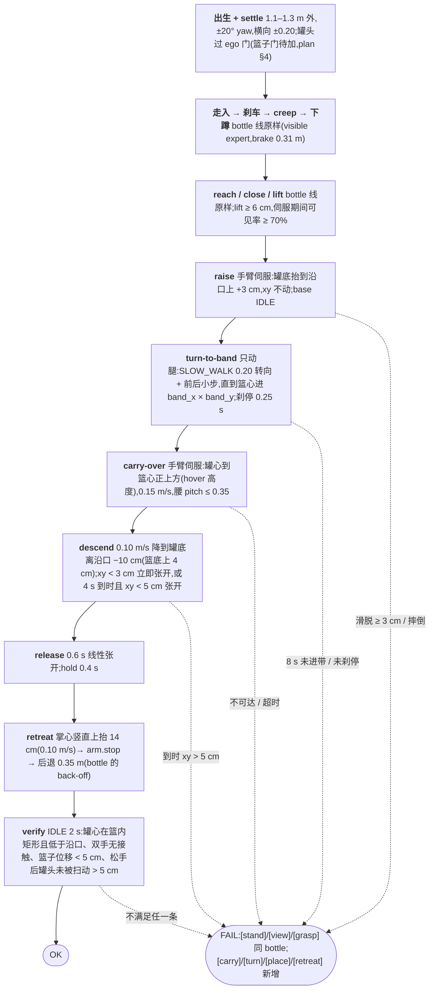

# pick-and-place 数据采集

走到桌前,右手抓起罐头,转身放进左边的篮子。它是 bottle 单臂线的延长:出生、走入、抓取、抬起四段原样复用
`docs/collection.md` 的 expert,抬起之后接一个 place 阶段。本文按教程的固定章节写;设计与取舍在
`docs/handoff/pick_place_plan.md`,实验数字只记在 `docs/ledger/pick_place.md`。

## 0. 这条流水线现在能给什么

- 一个注册好的 Task `pick_place`(`src/locomani/tasks/pick_place/`),配置 `configs/tasks/pick_place.json`,场景预设
  `pick_place`,10 局验收 pilot 已过(台账 §4:19 局 10 成功,失败全在抓取侧,place 段 10/10)。
- 每局产出与 bottle 线相同:exporter session(三路相机 + 状态 + 动作)、manifest、第三人称视频。**还没有**转换出
  数据集,也没训练。
- 2 相机 / 右手动作空间与 bottle 线一致(`configs/gr00t_sonic_2cam.py`),转换和训练直接沿用 `docs/dataset.md`、
  `docs/training.md`。

## 1. 前置条件

`docs/setup.md` 装好的环境;`third_party/SIMPLE/data/assets` 里有篮子和罐头的原 mesh(已复制到 `assets/simple/`,
仓库自带,不需要再动 SIMPLE)。GPU 上不能有别的 stack(memory `no-sim-probes-beside-recording-stack`),起栈前读
`docs/STATE.md` 的 RUNNING 行 —— 2026-09-10 我自己没读,和另一个 session 在同一秒抢了 instance 0 的端口块(见 §12)。

## 2. 场景:`pick_place`

```bash
MUJOCO_GL=osmesa third_party/Isaac-GR00T/.venv/bin/python src/locomani/sim/build_sim_scene.py \
  --preset pick_place --harden-pads outputs/scene outputs/scene/pick_place
# 期望三行:
#   basket    -> surface A at (-0.370, 0.000, 0.698)  mesh x1.001 (h 15.2 -> 15.2 cm, barrel 0.0 cm, jaw 8.48)
#   soup_can  -> surface A at (-0.400, -0.280, 0.692)  mesh x0.998 (h 14.0 -> 14.0 cm, barrel 5.6 cm, jaw 8.48)
#   [scene] finger pads hardened: 4 geoms (--harden-pads, level object)
```

| 物体 | 来源 | 尺寸 / 位置 | 为什么是这样 |
|---|---|---|---|
| 篮子 `basket` | SIMPLE `objects:0`,`assets/simple/basket/model.xml`(视觉 mesh + 23 片 CoACD 凸包做碰撞,空心) | 0.30 × 0.20 × 0.15 m,中心 (-0.37, 0),yaw 90°,近壁离近边 3 cm | 骨盆停在桌边外 ~0.25 m 就不能再近,篮心在骨盆系 x 0.38–0.43,是右手能放到的极限(台账 §3.2) |
| 罐头 `soup_can` | SIMPLE graspnet id 2 的 mesh,`assets/simple/soup_can/model.xml`,x/y 缩 0.848、z 拉 1.321 | 6 × 14 cm,(-0.40, -0.28),机器人右手边 | grip_z 必须 0.70–0.73、grip 上方 ≤ 5 cm、直径 ≤ 6.5 cm(台账 §2 四次 smoke) |
| 桌子 | 沿用 bottle 的 dining table | 桌面 0.62 | ready-grasp baseline 的标定高度;抬到 0.70 左手 ready 姿态碰桌 |
| 指面 | dex1 的 4 个碰撞 geom | priority 1、condim 4、solref 0.004、solimp 0.99/0.999(`build_sim_scene.PAD_LEVELS["object"]`,即 `--pad-level` 的默认值;`crate` 那一档更硬,是双臂线用的) | 持物超过几秒的默认软接触会蠕变(memory `mujoco-grip-creep`);只对 `--harden-pads` 的场景生效,bottle/crate 的 gate 场景不变 |

`scene_meta.json` 里 `target_object=soup_can`、`goal_object=basket`;`privileged_pub` 对两者都发位姿和 ego 归一化坐标。
渲染检查:`python src/locomani/sim/compose_scene.py --preset pick_place outputs/scene <out>`。

## 3. 预检:换物体或改篮子位置之后必跑

三个离线检查,都不用 stack(2026-09-10 的数字):

```bash
# a) grip 高度是否在 ready-grasp 模板覆盖内(templates >= 1 或 lower_grip_samples >= 3)
#    期望: grip_z 0.722: templates 4, lower 9        —— 台账 §2 的 9 cm 罐是 0/0,直接抛异常
# b) 放置带的 IK 可达(策略同样的舒适限位 + 腰 pitch 0.35):z_pf +0.10..0.13 处 x 0.44 误差 <= 0.5 cm
# c) ego 帧:出生、抓取站位、放置站位三处罐头和篮子都在 |u_x|<=0.8, |u_y|<=0.9 内(plan §1 的表)
```

a 和 b 的脚本片段在台账 §2/§3 里;c 用 `place_phase.ego_visible` 的同一门限。改篮子位置就重跑 b 和 c。

## 4. 跑一局:起 stack、看日志、读结果

进程和 bottle 线完全一样(sim / deploy / exporter / agent),用 `run_learn_pilot.py` 起,expert 是
`grasp_gym.py`,多一个 `--task-config`(把 `goal` 和 `place` 字段交给 gym)。

```bash
E=outputs/experiments/pick_place_smoke_$(date +%Y%m%d)
third_party/GR00T-WholeBodyControl/.venv_sim/bin/python -u src/locomani/pipeline/run_learn_pilot.py \
  --config configs/pilot/learn_200.json --task configs/tasks/pick_place.json \
  --out $E --scene outputs/scene/pick_place \
  --set through=collect --set successes=1 --set batch_rounds=2 --set max_batches=1 --set seed0=32000 \
  --set stack_env=CUDA_VISIBLE_DEVICES=1,MUJOCO_EGL_DEVICE_ID=1
tail -f $E/collect_00.log | grep -E '\[gym\] round|post-approach|lifted|\[place\]|\[carry\]|\[turn\]|EPISODE'
```

`run_learn_pilot` 把 task config 快照到 `$E/task_config.json`(gym 每批读它),reach 段快照到 `$E/reach_config.json`,
场景复制到 `$E/scene`。**改 `configs/tasks/pick_place.json` 对已经起跑的实验无效**,要改 `$E/task_config.json`。

### 日志怎么读

一局成功的日志(2026-09-10 验收 pilot 节选):

```
[gym] round 4/5 ok (ok 0): soup_can [-0.46 -0.39] rel [0.27 -0.20] yaw 6 side right | spawn 0.90m ... | "pick up the red can and put it in the basket"
    [gym] approach: exit=visible brake depth braked at x 0.31 edge 0.30 -> stopped x 0.31 edge 0.29
    [gym] post-approach: rel [0.30 -0.24] yaw_err +4 deg
      stream: lifted 12.7 cm
      ego visibility through servo: 100%
    [place] turn done: container at pelvis-frame x 0.42 y -0.06
    walk_to [-1.05 -0.3 ] done (0.075 m)
    [place] OK: object 2.2 cm from the container centre, goal in view 100%
EPISODE OK in 42s
```

- `[place] turn done` 给出转身结束时篮心的骨盆系坐标,必须落在 `place.band_x` × `place.band_y`(默认 [0.26, 0.44] ×
  [-0.16, -0.06])。x 接近 0.44 的局是 IK 极限,放置误差会偏大。
- `[place] OK` 的两个数:hold 2 s 后罐心到篮心的 xy 距离(< 3 cm 是竖直落地,5–7 cm 是倒在篮里)和篮子在 ego 帧内的
  tick 比例。
- 失败只有一行 `EPISODE FAILED [tag] ...`,tag 在 §6 的判据表里。
- manifest 每局的 `execution.metrics.place` 有 `xy_error`(释放瞬间)、`released_on_time`、`final_offset`;
  `place_trace` 是 10 Hz 的 (阶段, t, 掌系漂移),看滑脱在哪一段。

### 产出在哪

| 产物 | 路径 |
|---|---|
| manifest / 视频 / 状态轨迹 | `$E/collect/manifest_NN.jsonl`、`videos_NN/gym_*.mp4`(与 manifest 行按时间顺序一一对应)、`state_trace_NN/` |
| exporter session | `/workspace/tmp/p03/outputs/<时间戳>/`,`$E/collect/inputs.json` 记录 session 与 manifest 的配对 |
| 栈日志 | `/workspace/tmp/p03/{sim,deploy,exporter}.log` |

### 中途停止 / 清理

`bash scripts/stack/stop_instance.sh 0`(只杀 instance 0 的 sim / deploy / 本实例的 exporter);runner 正常结束时自己会调。
不要用 `stop_stack.sh`(杀掉机器上所有实例)。instance 被别的栈占着时 `start_stack.sh` 会以退出码 3 拒绝并打印持有者(flock,
2026-09-10 起)。runner 要从 scratch 副本跑(memory `never-edit-a-running-bash-script`)。

## 5. 多局 pilot 与验收

```bash
bash scripts/experiments/pick_place_pilot_20260910.sh <out_dir> 10 10 3 32300   # 成功数 每批局数 批数上限 seed0
```

runner 先等 GPU1 空闲和 CPU 余量(`scripts/cpu_headroom.sh`),然后同上调用 `run_learn_pilot`。每批重起栈,
和 bottle 线一样为了 exporter 的线程数。

| 指标 | 合格 | 2026-09-10 验收 pilot |
|---|---|---|
| 抓起的局里 place 成功 | ≥ 8/10 | 10/10 |
| 释放时 xy 误差中位 | < 3 cm | 1.9 cm(1.4–2.6) |
| 持物期间掌系漂移 | < 2 cm | ≤ 1.0 cm |
| 篮子在 ego 帧内 | ≥ 70% | 100% |
| 总 yield(含抓取侧 discard) | 参照 bottle 线 0.56–0.62 | 0.53(19 局) |

成本:每局 37–45 s + 起栈 40 s;10 局 pilot 约 12 min;视频 3–9 MB/局。

## 6. 控制逻辑

三层与 bottle 线相同(决策 `grasp_gym` / 原语 `primitives` + `PlannerArm` / 控制 SONIC)。place 段的新东西是:
决策层把"篮子"当第二个目标,原语层**复用抓取策略自己的 `PlannerArm`**(同一套 IK、舒适限位、frozen-upper 通道),
腿和手臂**从不在同一阶段动**。

### ① 一局 episode 分几步



### ② place 伺服怎么动

`place_phase._servo` 每 tick:读实测罐心(或掌心),把一个**参考点**以设定速度朝目标推进(这就是策略要学的速度剖面),
掌心目标 = 掌心 + (参考点 − 实测罐心),偏移封顶 6 cm(防 windup);IK 解 8 关节(腰 + 右臂,保持抓取时的掌姿态),
每关节每 tick 最多 0.01 rad;`arm._push` 发 17 维上身 + 手指 + IDLE 帧。控制的是**罐心**而不是掌心,所以抓取时的握偏
不进放置误差。

### 阶段与判据速查(改参数时对照,`PlaceConfig`,`docs/reference/config_fields.md`)

| 阶段 | 判据 | 字段 |
|---|---|---|
| 出生 | 罐头离篮心沿桌边 ≥ 0.21 m,否则重采 | `goal_gap` |
| raise / carry-over | 罐底离沿口 +3 cm;0.15 m/s;各 6 s | `hover_clearance`,`v_travel`,`carry_timeout` |
| turn-to-band | 篮心骨盆系 x ∈ [0.26, 0.44],y ∈ [-0.16, -0.06];8 s | `band_x`,`band_y`,`turn_timeout` |
| descend / release | 罐底离沿口 −10 cm;0.10 m/s;xy < 3 cm 即放,4 s 到时 xy < 5 cm 仍放;张开 0.6 s | `release_clearance`,`v_descend`,`place_tol`,`place_tol_late`,`descend_timeout`,`release_s` |
| retreat | 上抬 14 cm,后退 0.35 m | `retreat_up`,`back_off` |
| verify | 篮内矩形半宽 (0.12, 0.07)(篮子系),篮子位移 < 5 cm | `goal_inner_half`,`goal_move_max` |
| 全程 | 掌系漂移 < `palm_drift_max`(3 cm,bottle 的常量) | — |

## 7. 演示的"形状":这些判据为什么长这样

plan §0 的五条原则,每条对应一个数字:
1. 决策时刻目标在画面里 —— 篮子在抓取站位就在画面中央(plan §1 表),放置全程可见率 100%。
2. 没有隐藏停止点 —— 下降到位即张开,到时也张开,不悬停。
3. 速度剖面连续 —— 每段都是参考点匀速推进,没有 IDLE 发呆。
4. 闭环纠偏被示范 —— turn-to-band 是边看篮子边转 30° 左右的闭环,bottle 数据里没有这一段。
5. 持物时间短 —— raise + turn + carry + descend ≈ 8–12 s;滑脱曾经出现,是 IK 抖动不是接触蠕变(台账 §3.1)。

## 8. 随机化:现在的轴和还没打开的轴

打开的:bottle 线的出生分布(距离、yaw、横向)、罐头沿桌边 ±0.20 m 滑动(加 `goal_gap` 门)、外观按 `appearance`
种子。**没打开**:篮子位置/yaw、罐头相对篮子的哪一侧(现在恒在右手边,一只手不学左右选择)、指令措辞。
plan §4 有建议范围。

## 9. 相机与数据形状

与 bottle 线相同:ego + 右腕两路,state 53、action 64 + 1(motion token + 右爪),schema 在
`src/locomani/tasks/pick_place/__init__.py` 直接引用 bottle 的。指令是 `BottleTaskConfig.prompt`
(`"pick up the red can and put it in the basket"`),写进 manifest 的 `task` 字段;`round_loop` 在 `goal` 非空时用它
替代 `grasp_gym.instruction()` 的模板。

## 10. 渲染(可选)

第三人称视频由 sim 自带(`SIM_VIDEO_DIR`,runner 按批设);拼 reel 用 ffmpeg concat(台账 §3/§4 的 reel 就是这样拼的),
分局压缩到几百 KB:`ffmpeg -i in.mp4 -vf scale=480:-2,fps=10 -c:v libx264 -crf 34 -an out.mp4`。Isaac 渲染未验证篮子贴图。

## 11. 到训练数据集还差的一步

exporter session + manifest 已经是 `convert_to_hf_format.py --sessions ... --manifest ...` 的输入,
`--trim-verification-tail` 切掉后退之后的 hold(`training_tail.end_seq` 在 place 段结束时写入)。没跑过。

## 12. 已知坑(按日期)

- **2026-09-10 物体高度**:9 cm 罐头 grip_z 0.647 直接抛 `target height has no comfortable baseline grasp`;20 cm 罐头
  grip 在罐心时 coupled squat 的 safe-hand sweep 报 palm 撞罐。物体形状要过 §3 a。
- **2026-09-10 持物滑脱不是蠕变**:place 伺服用 `upper_ref.MAX_STEP` 限幅时冗余 IK 逐拍跳,3.4–3.8 cm 滑脱;
  `JOINT_STEP` 0.01 后 ≤ 1 cm。任何新的 IK 伺服都先看 `place_trace`。
- **2026-09-10 放置带靠走路进不去**:骨盆离桌边最近 ~0.25 m,篮心 x 0.38–0.43;带要按 IK 可达定,不按"走近"定。
- **2026-09-10 落地翻倒**:沿口上 3 cm 松手是 17 cm 落差,每次都倒;现在篮底上 4 cm,仍有 ~3 成倒,算成功。
  倒地曾被 `[retreat] moved 7 cm` 错误归因,sweep 参考点改到手抬离之后取。
- **2026-09-10 spawn 撞篮**:edge_jitter 把罐头画进篮壁带,reset 把罐头顶开,表现为抓取侧失败;`goal_gap` 0.21 门。
- **2026-09-10 与别人的栈抢端口**:两个 runner 同一秒抢 instance 0 的端口块(对方的 gym 报 `Address already in use :5556`,
  我的每局 1 s 报 `teleport landed 1.85 m off`),而两边的 `start_stack.sh` 都打印了 "stack up"。只看 nvidia-smi 和 CPU
  余量不够:起栈前读 STATE 的 RUNNING 行,runner 的准入检查要看端口是否真的空(session 29 正在把它做进 runner)。
- **`--harden-pads` 是构建时开关**:`run_learn_pilot` 复制 `--scene` 目录,忘了带这个 flag 重建的场景会静默回到软指面,
  看 `scene_locomani.xml` 里 `dex1_col_1` 有没有 `priority="1"`。

## 复现清单

1. §2 构建场景,三行期望值对上,`priority="1"` 在 XML 里。
2. §3 a/b/c 三个离线检查。
3. §4 单局:`lifted` → `[place] turn done` → `[place] OK` → `EPISODE OK`。
4. §5 10 局 pilot:抓起的局里 place ≥ 8/10,释放 xy 中位 < 3 cm,漂移 < 2 cm。
5. 采集期间 GPU 和 instance 上不跑别的;起栈前读 STATE。
