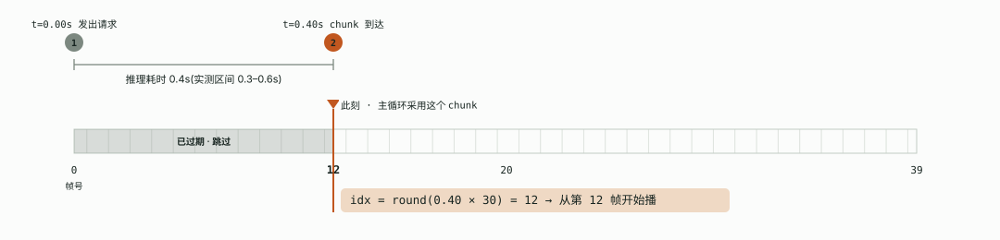
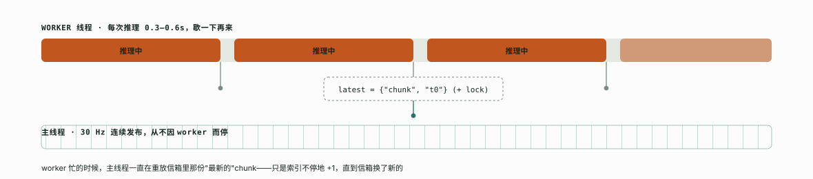
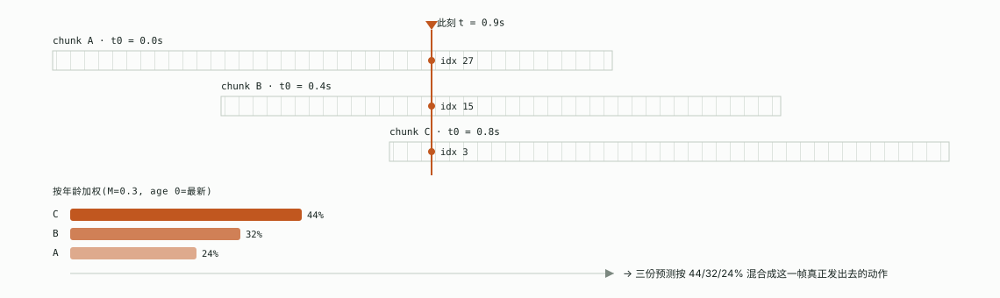

# Real-Time Action Streaming:async client 的三个机制

> `vla_round.make_vla_policy_async` 是 [evaluation.md](evaluation.md) "async 客户端"一节
> 提到的那个默认 client。这里把它拆成三个机制,各自讲清楚"不这么做会怎样"，再用实测数字
> 把流程走一遍。三者的位置都在 [vla_round.py](../src/teleop_free/vla_round.py)。

## 1. 实时动作分块(延迟补偿索引)

**问题**:推理不是瞬间完成的。GPU 去噪 + 网络往返实测要 0.3–0.6 秒(阻塞式 client 就是被
这段时间冻住的那个)。chunk 里的"第 0 帧"描述的是**请求发出那一刻**该做什么——如果拿到
chunk 后还从第 0 帧开始播,就是在执行一个已经过时的指令。

**解法**:给每个 chunk 记一个时间戳 `chunk_t0`(推理开始的那一刻),拿到 chunk 后不问"这是
第几个 chunk",只问"现在几点了、比 `chunk_t0` 过去了多久、按 30 帧/秒算应该播到第几帧"——
直接跳过已经"来不及"的那些帧。



**举例走一遍**(推理耗时取实测区间 0.3–0.6s 里的 0.4s 示意):

| 时刻 | 事件 |
|---|---|
| t = 0.00s | 发出推理请求,`chunk_t0 = 0.00` |
| t = 0.40s | chunk 到达(推理耗时 0.4s) |
| — | `idx = round(0.40 × 30) = 12` → **跳过前 12 帧**(占 40 帧 chunk 的 30%),从第 12 帧开始播 |

chunk 的 40 帧原本代表 t=0.00s 到 t=1.333s 这段未来。等它真正落地时,时钟已经走到 t=0.40s,
前 12 帧描述的"未来"已经变成了"现在之前",直接跳过,机器人执行的动作才始终对应"现在"而
不是"发请求那一刻"。

```python
with lock:
    if latest["t0"] is not None and latest["t0"] != chunk_t0:
        tok, grip = latest["chunk"]
        chunk_t0 = latest["t0"]
        idx = latency_index(time.time() - chunk_t0, RATE, len(tok))  # ← 这里算 12
j = min(idx, len(tok) - 1)
tok_j, grip_j = tok[j], float(grip[j])
idx = min(idx + 1, len(tok) - 1)   # 下一轮循环, idx 变 13
```
`vla_round.py:721-729`——`latency_index` 就是 NVIDIA 官方的 `calculate_latency_compensated_index`
(`vla_round.py:68-70`,verbatim import,不是照猫画虎重写的一份)。

**对照:阻塞式(blocking)client 怎么处理同一次等待**——等了 0.4s 拿到 chunk 后**永远从
第 0 帧开始播**,不管等了多久;等待期间机器人是**冻结**的,因为阻塞式在等
`link.get_chunk()` 返回时什么也不发([vla_round.py:426-435](../src/teleop_free/vla_round.py#L426-L435))。

## 2. 异步推理(worker / 主线程双时钟)

**问题**:推理慢(0.3–0.6s),但发指令给机器人必须快且不能停——真机的控制环等不了半秒。
如果用同一个循环"先等推理、再发指令",推理的那 0.3–0.6s 里机器人只能吃上一条指令的老本,
这正是阻塞式 client 每 ~0.9s 冻结 0.3–0.6s 的来源。

**解法**:把"算得慢的推理"和"发得快的发布"拆成两个各自独立运行的循环(线程),中间用一个
共享的"信箱"(`latest` 字典)传递结果。谁也不等谁:worker 线程按自己的节奏算完就把结果
放进信箱;主线程雷打不动地每 33ms(30Hz)从信箱里拿"当前最新的东西"发一帧,不管信箱里的
东西是不是刚放进去的。



- **worker 线程**:每次推理 0.3–0.6s,推完把结果写进 `latest`,按 `replan_interval`
  (默认 0.4s)歇一下再请求下一次——如果推理实际耗时已经逼近甚至超过 `replan_interval`,
  这个"歇一下"直接归零,worker 连轴转。
- **主线程**:固定 30Hz 连续发布,永远不因为 worker 是否在忙而停顿,只从 `latest` 里取
  "当前最新的"chunk 继续播,索引照第 1 节的规则往后走。
- 两者靠 `lock` 同步共享字典;靠职责分工避开 ZMQ socket 非线程安全的问题——相机流/状态流/
  policy socket 只活在 worker 里,commander 和特权状态查询只活在主线程里。

```python
def worker():
    while not stop.is_set():
        t0 = time.time()
        obs = obs_src.build()                    # worker 专属:相机/状态 socket
        if obs is not None:
            tok, grip = link.get_chunk(obs)       # worker 专属:policy socket
            with lock:
                latest["chunk"] = (tok, grip)
                latest["t0"] = t0
        rest = inference_interval - (time.time() - t0)
        if rest > 0:
            time.sleep(rest)                      # 歇一下,没歇够就直接下一轮

th = threading.Thread(target=worker, daemon=True)
th.start()                                        # 主线程接着往下走,不等它
```
`vla_round.py:596-617`

## 3. 动作混合

### (a) 时序集成(ACT 式)

**问题**:新 chunk 每 `replan_interval`(默认 0.4s)落地一个,但每个 chunk 覆盖 1.33s 的
未来——也就是说在任意时刻,通常有好几个还没"过期"的 chunk 同时对"现在该做什么"有自己的
意见。只认最新那个、把旧的直接扔掉,每次切换都会在指令上留下一个小台阶(前后两次推理看到
的观测略有不同),这正是"手抬起来但一直不收敛"这类失败的典型成因。

**解法**(ACT / Diffusion Policy 的标准做法):不选边,投票——把所有仍然覆盖"现在"的
chunk 各自认为"现在该做的动作"取出来,按新旧程度加权平均。



**举例走一遍**(三个 chunk,t0 分别是 0.0s / 0.4s / 0.8s,在 t=0.9s 这一刻投票,
`ENSEMBLE_M=0.3`):

| chunk | t0 | 在 t=0.9s 对应的本地帧 idx | 权重(`exp(-0.3×age)` 归一化) |
|---|---|---|---|
| C(最新,age=0) | 0.8s | round((0.9−0.8)×30) = 3 | 44% |
| B(age=1) | 0.4s | round((0.9−0.4)×30) = 15 | 32% |
| A(最旧,age=2) | 0.0s | round((0.9−0.0)×30) = 27 | 24% |

三个 chunk 都还"活着"(各自的 1.33s 窗口都还没走完),都对 t=0.9s 这一刻有自己的预测——
C 最新、权重最高,但 A、B 仍然参与投票,边界处的跳变被这样的加权平均抹平。

```python
def _ensemble(buf, now, rate):
    picks, ws = [], []
    for age, (tok, grip, t0) in enumerate(reversed(buf)):   # age 0 = 最新
        i = int(round((now - t0) * rate))
        if i < 0 or i >= len(tok):
            continue                              # 这个 chunk 已经放完了,不投票
        picks.append((tok[i], grip[i]))
        ws.append(np.exp(-ENSEMBLE_M * age))          # 越老权重越小
    w = np.asarray(ws) / sum(ws)
    tok = np.sum([p[0] * wi for p, wi in zip(picks, w)], axis=0)
    grip = float(np.sum([p[1] * wi for p, wi in zip(picks, w)]))
    return tok, grip
```
`vla_round.py:143-166`——默认关闭(`ENSEMBLE_N=1`),要 `eval_closed_loop.py --ensemble N>1`
才会真正投票。

### (b) 交接时的 1 秒淡入淡出

跟上面的多 chunk 投票是两码事——局刚开始时机器人被一个"站立不动"的托管 token 撑住,等
第一个真实 chunk 算出来后,不是硬切换,而是用 1 秒时间从托管 token 线性过渡到真实动作的
第一帧,像淡入淡出一样,避免交接瞬间的硬跳变。

```python
for i in range(n_bl):                          # n_bl = 1.0s × 30Hz = 30 步
    a = (i + 1) / n_bl
    tk = (1.0 - a) * INIT_TOK + a * np.asarray(tok0[0])   # 线性插值
    p.cmd.token_frame(tk, ...)
```
`vla_round.py:648-656`——只要走 async 路径就一定执行,不受 `--ensemble` 控制。

## 三者怎么拼在一起

1. **异步推理**(第 2 节)是骨架——它创造出"worker 慢慢算、主线程从不停"这个结构,没有它,
   后面两个机制都无从谈起(阻塞式 client 单线程,压根没有"信箱"和"独立时钟"这回事)。
2. **实时分块索引**(第 1 节)和**时序集成**(第 3(a) 节)是**互斥的两选一,不是叠加**——
   代码里是 `if ENSEMBLE_N > 1: 用投票 else: 用延迟补偿单 chunk 索引`
   (`vla_round.py:704-729`)。默认(`ENSEMBLE_N=1`)走第 1 节那条路;显式 `--ensemble 3`
   才会切到第 3(a) 节的投票,这时候"该从第几帧开始播"这个问题直接被"混合所有活着的 chunk"
   取代了,不会同时用两套逻辑。
3. 第 3(b) 节的 1 秒淡入淡出交接独立于以上两者,只在每局**开场**触发一次,之后的整局都是
   第 1/3(a) 点的地盘。
