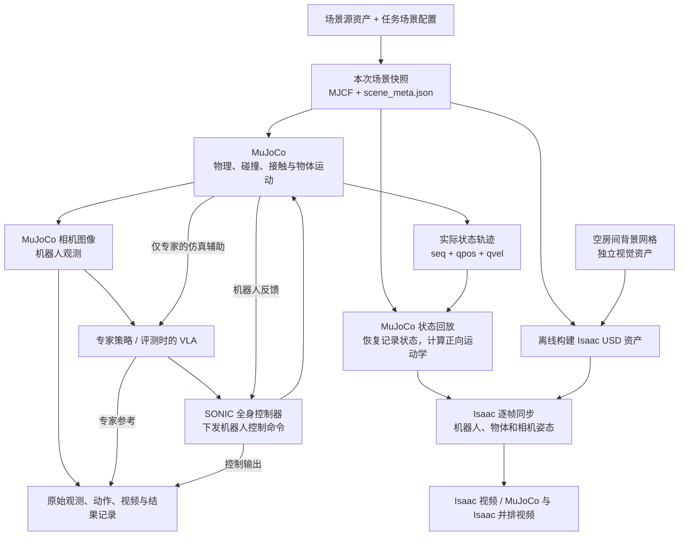
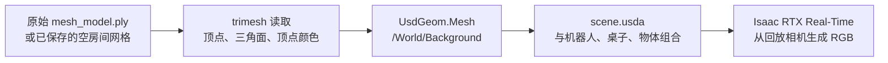

# MuJoCo 仿真与 Isaac 离线渲染

本页说明场景、控制、采集和重渲之间的数据流。首次理解系统读“整体流程”，
已有轨迹要重渲读“运行时”和“资产构建”；具体双臂批处理命令见
[双臂回放](crate_collection.md#渲染并排视频)，分享视频见 [Video export](#video-export)。
背景的表征、导入和着色见 [EmbodiedGen 背景如何进入 Isaac](#embodiedgen-背景如何进入-isaac)。

## 整体流程

**MuJoCo 运行任务并记录实际运动；Isaac 根据记录重建每一帧的姿态，生成另一种渲染画面。**
当前 SONIC 采集和闭环评测使用 MuJoCo 相机，Isaac 位于采集完成后的离线处理阶段。



这条链路有三个不同的工作：

| 工作 | 决定什么 | 主要入口 |
|---|---|---|
| 在线任务执行 | 机器人如何走、弯腰、抓取；物体是否真的抬起、滑脱或飞走 | 专家 → SONIC → [run_sim_locomani.py](../src/locomani/sim/run_sim_locomani.py) |
| 采集与记录 | 实际状态、相机、动作参考、控制输出和任务结果 | 任务 runner、exporter、[StateTrace](../src/locomani/sim/privileged_pub.py) |
| 离线渲染 | 在已记录的动作上生成光照、材质和相机画面 | [isaac_render.py](../src/locomani/sim/isaac/isaac_render.py) |

例如一次抓篮中，篮子在 MuJoCo 里滑脱了，Isaac 会按对应轨迹重现这个运动。
重渲不会重新调用专家或 SONIC 去尝试抓取；成功标签来自原任务的验收。
渲染需要自己的 GPU 资源，但不需要保持原来的控制栈运行。
这样的分工让离线 RTX 渲染可以独立调画质，不占用在线控制循环的每步时间预算。
专家可额外使用约定的仿真辅助信息；VLA 接收其数据/模型配置定义的观测字段，
不默认继承专家用到的全部信息。

## 采集时记录什么

场景构建把源网格、物体尺寸/摆放、机器人和碰撞设置写入
`scene_locomani.xml`，配套 `scene_meta.json` 描述目标与桌面等信息。
任务 runner 使用该次场景副本；重渲也必须使用**同一次运行对应的副本**。

| 记录 | 用途与边界 |
|---|---|
| MuJoCo 相机 RGB | ego、左腕、右腕等实际采集视角；专家/VLA 和 exporter 按各自接口消费 |
| 第三人称原片 | 由 `SIM_VIDEO_DIR` 开启，方便检查走近、接触和抬升；画中画不等于训练视频文件 |
| `*_state_trace.npz` | `seq`、完整 `qpos`、`qvel`；包含机器人浮动基座、关节和场景自由物体状态 |
| exporter session | 原始相机、机器人观测与动作字段；支持录制的任务才产生正式 episode |
| manifest、配置快照与动作日志 | 任务指令、成败、输入身份、控制来源；不由渲染器重新生成 |

`StateTrace` 在仿真进程内、发布状态之后，以该次发布的 `seq` 记录同一份状态。
它记录的是发布/控制帧，不是所有物理积分子步，也不是专家希望到达的目标姿态。
`SIM_STATE_TRACE_DIR` 控制轨迹记录；单臂/pick-and-place 的自动 runner 会设置它，
双臂 runner 默认开启，可用 `--no-state-trace` 关闭。

视频、trace 和 session 是独立产物：有 MP4 不代表有可重渲的完整状态，
有 trace 也不代表已经生成可训练的数据。轨迹写入失败可能只产生警告，
开始重渲前要检查文件实际存在。各任务目录和录制边界见
[单臂](collection.md#5-产物与验收)、[双臂](crate_collection.md#5-产物与验收)、
[pick-and-place](pick_place_collection.md#5-产物与验收)。

## Isaac 怎样重现同一段动作

### 从一份状态恢复机器人、物体和相机

[MujocoReplay](../src/locomani/sim/isaac/replay.py) 加载该次 MJCF，
逐帧恢复 `qpos` / `qvel`，调用 `mj_forward` 计算关节链和相机的世界位姿。
此处的 MuJoCo 用来解释记录状态，不执行 `mj_step` 重新模拟动作。

随后 [stage.py](../src/locomani/sim/isaac/stage.py)：

1. 按关节名称把记录值映射到 Isaac 机器人，设置关节体根链接的世界位姿。
   根链接从导入的 articulation 读取，不能直接把骨盆位姿当成它；当前 G1 导入通常以 `torso_link` 为根。
2. 同步各物体世界位姿，并应用从 MJCF 保留的网格缩放与偏移。
3. 用同一次 MuJoCo 正向运动学得到的相机世界位姿设置 Isaac 相机。
4. 推进渲染更新并读取图像，进入下一条记录。

Isaac 内部仍创建 World 并调用 `world.step(render=True)` 来更新变换和图像。
镜像流程关闭重力、清零机器人根与关节速度，并反复下发记录姿态；
这些更新不构成第二次任务执行，也不能作为独立的抓取物理验证。
默认进行两次更新让相机变换进入渲染管线；这也不是让原任务多执行两步。

### 主视角、画中画与并排视频

| 输出 | 相机来自哪里 |
|---|---|
| Isaac 默认主画面 | 同帧 MuJoCo `head_camera` 的位姿和视场角 |
| 第三人称主画面 | `--cam-traj` 提供的世界相机轨迹 |
| ego / 左腕 / 右腕画中画 | 各自 MJCF 相机在该帧的正向运动学，不是从主画面裁切 |

双臂并排脚本先用 [mujoco_render.py](../src/locomani/sim/isaac/mujoco_render.py)
读取 trace，生成 `tracking_mujoco.mp4`，同时保存每帧第三人称相机的 `cam_traj.npz`。
Isaac 再读取**相同 trace、场景和相机轨迹**生成画面，最后由 ffmpeg 横向拼接。
因此左侧是 MuJoCo 的离线重渲，右侧是 Isaac 重渲，两侧无需分别跑一次任务。

Isaac 输出文件虽叫 `ego_isaac.mp4`，传入第三人称 `--cam-traj` 后内容实际是第三人称。
`--insets` 会增加独立的第二遍回放，生成该渲染器自己的三路相机画中画再合成；
不是贴上原来 MuJoCo 的 RGB。Isaac 对缺失、陈旧或不同渲染帧的画中画输入会报错。
需要 ghost 时只在诊断视角显示规划目标，不把它当作真实手部或训练观测。

### 轨迹与训练行的对齐

优先使用 `--state-trace`。若还传入 exporter `--session` / `--episode`，
[frames.py](../src/locomani/sim/isaac/frames.py) 根据该 episode 的 `priv_seq`
选取、排列 trace 行；缺少对应状态会报错，避免用上一帧填补。
`--session ""` 则按 trace 自身顺序回放完整尝试。
这是状态行的对齐，原相机曝光时刻与 action 时间仍需通过各自记录核对。

旧数据没有 trace 时，仍可用 parquet + pose sidecar 重建近似状态；
这是历史兼容路径，不能声称逐帧重现原片。
旧 `compute_cam_traj.py` 主要用于这条路径；当前 trace 模式直接计算 ego/腕相机，
并排模式由 `mujoco_render.py` 生成第三人称轨迹，不要求先跑该旧工具。

当前 NPZ 只有 `seq/qpos/qvel`，视频按 `--fps` 和 `--stride` 编码：
例如 50 Hz 状态、stride 4 对应 12.5 FPS。匹配 session 后应按该输入的实际采样率设置，
不能机械沿用 50 FPS 默认值。测量停顿或抖动还需核对对应日志时间戳和丢帧情况，
不能把渲染所花的墙钟时间当成机器人动作时长。

## 运行时

按 [安装指南](setup.md)第 7 步准备 Isaac 环境，在仓库根目录的 Bash 终端执行：

```bash
. scripts/paths.sh
export PYTHONPATH="$LOCOMANI_ROOT/src"
bash scripts/setup_render_runtime.sh
# 需要验证实际 Kit 启动时再运行；会占用渲染资源
bash scripts/setup_render_runtime.sh --deep
```

`SIMPLE_ROOT` 是固定版本的 SIMPLE 检出目录，`RENDER_PY` 是装有 Isaac Sim 的 Python，
默认来自 `$SIMPLE_ROOT/.venv/bin/python`。二者可分开配置。
安装脚本的 pin 与补丁见 [SIMPLE 补丁说明](../patches/simple.md)。

离线重渲不 import `simple` 包，也不需要下载它的大型 `data/` 资产集合。
机器人和场景 USD 由本仓库构建；SIMPLE 检出主要提供当前使用的渲染运行环境。
环境升级后需要重新验证像素、相机和耗时，旧版本测量不自动适用。

## 资产构建

资产分成**可追溯的源文件**和**本机生成的 USD 缓存**：

| 部分 | 来源 → 生成物 |
|---|---|
| 机器人 | 已安装的 G1/Dex1 MJCF 与网格 → `assets/isaac/robot/g1_dex1.usda` |
| 桌子、台面、静态道具 | 安装的场景网格/贴图与本次元数据 → `assets/isaac/scene/<label>/scene.usda` |
| 水瓶、篮子等可动物体 | 本次 MJCF 引用的可视网格、缩放与材质 → 同一场景缓存中的 `usd/<object>/` |
| 房间背景 | 生成的背景源，或仓库自带 `assets/scene/empty_room_world.ply.gz` → 场景 USD |

先执行 `bash scripts/install_scene.sh` 安装仓库的 `assets/scene_locomani_v1.tar.gz`，
再按任务指南准备对应场景。桌面网格/贴图和 [压缩房间源](../assets/scene/README.md)
随仓库提供，不需要从另一台机器复制 `outputs/`。

```bash
# 换成该次采集保存的场景副本，而非后来修改过的工作场景
SNAPSHOT="$LOCOMANI_ROOT/outputs/crate_collect_10/crate_table30"
export CUDA_VISIBLE_DEVICES=0 MUJOCO_EGL_DEVICE_ID=0
bash scripts/build_isaac_assets.sh --snapshot "$SNAPSHOT"

# 仅构建机器人；需要强制重建时可显式添加 --force
# bash scripts/build_isaac_assets.sh --robot-only
```

示例 GPU 0 须按 [资源规则](../AGENTS.md#shared-resources-and-artifacts)确认空闲。
不传 `--snapshot` 时使用当前工作场景，label 为 `work`；
传入快照后 label 默认为目录的完整 basename，上例为 `crate_table30`，
可用 `--label` 显式指定。渲染的 `--scene-dir` 必须匹配该次构建位置。

构建器检查必需的房间、桌面源文件，并对来源、几何、贴图和路径等做缓存校验。
场景缓存失效时保留旧目录再重建；机器人导入还会执行多网格 reference 拆分，
保留躯干、骨盆和手腕的可视部件。生成的 `assets/isaac/` 不进 Git，
换机器应根据源资产重新构建。

场景 USD 与机器人 USD 分开缓存。它们复用源几何，但碰撞体与可视网格用途不同；
新物体的可视网格转换是否受支持仍需检查构建日志及画面，不能只看脚本成功退出。
资产缺失与新安装验证见 [资产可移植性报告](handoff/isaac-asset-portability-20260912.md)。

## EmbodiedGen 背景如何进入 Isaac

### 当前背景是什么表征

**当前 Isaac 路线使用带顶点颜色的三角网格（mesh），没有加载 3D Gaussian Splatting 模型。**
“EmbodiedGen 生成”描述资产的来源，不能据此判断渲染时采用哪一种表征。
[EmbodiedGen 官方输出说明](https://horizonrobotics.github.io/EmbodiedGen/docs/tutorials/layout_gen.html)
列出了同一背景的两种文件：

| 文件 | 内容 | 本仓库 Isaac 路线 |
|---|---|---|
| `gs_model.ply` | 3DGS 高斯模型 | 未读取 |
| `mesh_model.ply` | 带颜色的三角网格 | 读取并转换成 USD Mesh |

两者都可以使用 `.ply` 后缀，要看文件内部字段和加载代码。
当前仓库的背景副本 [empty_room_world.ply.gz](../assets/scene/README.md)
包含 **2,099,513 个顶点、4,190,791 个三角面**；文件头明确列出顶点的
`x/y/z`、`red/green/blue` 和面的 `vertex_indices`。
这是由很多小三角形组成、颜色存于顶点的房间表面；
相机移动时，视角和遮挡由这些三维表面决定。

`.gz` 只是压缩包装，不改变三维表征。数量、校验和及坐标系记录在
[资产元数据](../assets/scene/empty_room_world.json)，无需启动 Isaac 就能核对。

### 从原始背景到 USD

`build_isaac_assets.sh` 调用 [isaac_scene.py](../src/locomani/sim/isaac_scene.py) 构建场景，
其中 [background_source](../src/locomani/sim/isaac/scene_assets.py) 按以下顺序选源：

1. 原始 `outputs/scene/bg_empty/scene_0000/mesh_model.ply` 存在时，使用该文件。
2. 否则使用随 Git 分发的 `assets/scene/empty_room_world.ply.gz`。

本次核对的 checkout 中原始文件已不存在，因此使用第 2 条。
这个副本来自先前 Isaac 场景的 `/World/Background`，保留同一空房间的顶点、三角面和颜色，
来源记录见 [资产说明](../assets/scene/README.md)。世界坐标变换和地板修正已经烘焙，
加载时不会再缩放、旋转或修正一次。



`add_vertex_coloured_mesh` 直接构造 `UsdGeom.Mesh`：
顶点写入 `points`，三角面写入 `faceVertexCounts/faceVertexIndices`，
RGB 写入按顶点插值的 `displayColor`。
原始背景需要坐标变换和地板修正；保存的世界坐标副本跳过这些步骤。
这条转换使用现成网格数据，不在 Isaac 中重新生成房间或训练 3DGS。

### 进入 Isaac 后怎样渲染

离线回放打开生成的 USD 场景，
[configure_renderer](../src/locomani/sim/isaac/stage.py) 显式调用
`rep.settings.set_render_rtx_realtime()`，选择 **Omniverse RTX Real-Time 实时渲染**。
场景构建预览使用 `RayTracedLighting`；相关模式可对照
[Isaac Sim 4.5 官方示例](https://docs.isaacsim.omniverse.nvidia.com/4.5.0/replicator_tutorials/tutorial_replicator_isaac_snippets.html)。
当前路线渲染的是 USD 网格和材质，没有调用 Gaussian splatting 渲染器。

**背景的材质有单独处理。** 房间顶点颜色已经包含生成/重建时的光照外观，
`bind_unlit_vertex_colour_material` 将 `displayColor` 接到
`UsdPreviewSurface.emissiveColor`，并将 `diffuseColor` 设为黑色。
这样以保存的背景颜色为主，避免再当作普通漫反射表面重复打光。
两个材质字段的含义见 [NVIDIA 材质文档](https://docs.omniverse.nvidia.com/materials-and-rendering/latest/templates/UsdPreviewSurface.html)。

机器人、桌子和物体则使用各自网格、材质及场景灯光。
背景颜色保留了原有明暗，因此“RTX 渲染”不意味着房间已恢复成可以任意重新打光的完整材质场景；
曝光和色调映射等仍会影响最终像素。当前也没有把 3DGS 的视角相关外观带入这条网格路线。

房间网格在这里是视觉背景，不会自动增加 MuJoCo 的墙体碰撞。
实际地面、桌面和抓取物体的碰撞仍由 MuJoCo 场景定义。
原始 RGB、网格重渲和未来可能接入的 3DGS 图像需要分别记录来源。

## 从已有采集开始重渲

1. 在任务运行目录找齐 trace、对应场景快照、manifest 和实际 episode 标签。
2. 用上面的 `--snapshot` 构建该场景的 USD；核对桌高、物体尺寸和场景路径。
3. 选择输出：直接用 `isaac_render` 渲染 ego，或按
   [双臂回放命令](crate_collection.md#渲染并排视频)生成同相机的 MuJoCo / Isaac 并排视频。
4. 检查每集输出、完整解码、首尾、背景/桌面、双手与物体，再生成下载预览。

直接渲染已有 trace 的 ego 主视角示例（替换 `TRACE` 为实际文件）：

```bash
TRACE="$LOCOMANI_ROOT/outputs/crate_collect_10/trace/visual_crate_s41_00_state_trace.npz"
"$RENDER_PY" -m locomani.sim.isaac.isaac_render \
  --session "" --episode 0 --state-trace "$TRACE" \
  --scene-xml "$SNAPSHOT/scene_locomani.xml" \
  --scene-dir "$ISAAC_ASSETS/scene/crate_table30" \
  --out outputs/renders_isaac/crate_ego_example --fps 50 --stride 4
```

这条直接命令在前台运行，用 Ctrl-C 停止。双臂批处理入口由 `render_job.py` 管理归属，
停止方式见 [受管渲染停止](crate_collection.md#中途停止渲染--清理)；
独立启动的渲染器不在该停止命令范围内。Kit 初始化和画面预热可能较慢，日志在输出目录。

## 当前接通范围与限制

| 功能 | 当前状态 |
|---|---|
| MuJoCo 在线物理与相机采集 | 已接通；按任务指南选择录制方式 |
| 基于 trace 的 Isaac 离线重渲 | 已实现；双臂有受管并排脚本 |
| `collect` 的 `RENDER_BACKEND=isaac` | **仅打印计划，没有启动重渲**；旧指南把它描述成自动追加阶段，现已更正 |
| `collect` 阶段自动追加 Isaac 重渲 | 当前没有该阶段（`scripts/` 里没有渲染脚本），需显式调用离线渲染入口 |
| Isaac 图像作为在线专家/VLA 的输入 | 当前主流程未接入 live mirror；不能从离线视频推断已支持 |
| 自动把 Isaac 视频写回训练数据集 | 当前转换器读取原 session 图像，没有自动替换步骤 |

Isaac 画面可用于检查或后续数据处理，但若要作为 VLA 训练 RGB，需要另行完成
相机、时间戳、状态/action 和裁剪边界的对齐，并保留图像来源。
当前双臂 visual 的正式数据导出限制仍按 [双臂指南](crate_collection.md)执行。

不同渲染器的材质、光照和背面处理会造成像素差异；Isaac 还有时域渲染状态，
不能要求同一输入两次出图逐像素相同。核验时应对齐几何、状态和相机，并在相同版本上建立容差。
主画面、画中画、ghost、源视频和训练 RGB 的用途要区分清楚。

## Video export

导出任何任务的视频、提供播放链接或打包 ZIP 前，必须满足
[AGENTS 的视频大小规则](../AGENTS.md#shared-resources-and-artifacts)。
这是面向查看和下载的交付步骤；原始采集、训练和审计视频保留在原位置。

1. 在新的预览目录中压缩；保持完整时长、正常播放速度和画面比例。
   可以降低分辨率、帧率和码率。声音有信息时保留，不能通过裁掉任务阶段或加速来达标。
2. 从以下命令开始，再按实测大小调整 CRF、分辨率和帧率。固定 CRF 不保证文件大小。

   ```bash
   ffmpeg -v error -nostdin -n -i input.mp4 \
     -map 0:v:0 -map '0:a?' -vf 'scale=640:-2,fps=10' \
     -c:v libx264 -preset medium -crf 32 -pix_fmt yuv420p \
     -c:a aac -b:a 24k -movflags +faststart preview.mp4
   wc -c preview.mp4
   ffmpeg -v error -xerror -i preview.mp4 -f null -
   ```

3. 每个文件都要检查实际字节数、完整解码、起止画面，以及与原片的时长差
   （只允许重采样到输出帧率时的一帧舍入差）。超限就继续压缩。
   长视频若无法兼顾上限和可辨识性，拆成编号连续片段，覆盖原片完整时间范围并明确标注。
4. 播放页面和回复链接指向合格预览。ZIP 仅包含这些预览和必要的小型说明文件；
   打包后再次核对成员和总体积，并报告单片范围及 ZIP 大小。历史原片和旧大包保留作审计。

## 代码入口与历史证据

- [渲染代码导航](reference/change-map-rendering.md)：定位场景资产、逐帧同步、相机和进程生命周期。
- [渲染修复与验证](handoff/review-fixes-20260914.md)：Isaac 4.5 画中画和受管停止的验证范围。
- [重组前渲染文档](archive/rendering_20260914.md)：保留时延、相机更新、关节体根、多网格及背面遮挡的历史调查原文。
  这些测量和旧“无需 hybrid clock”的裁定不替代当前模式、机器或新版本的验证。
