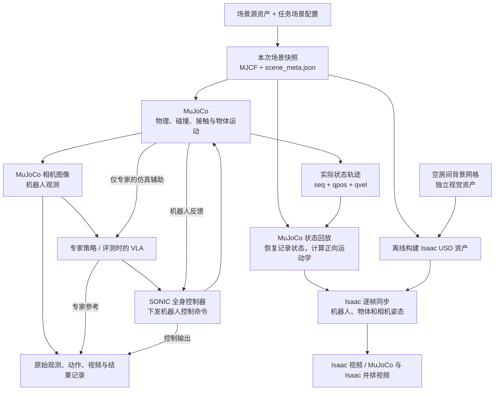
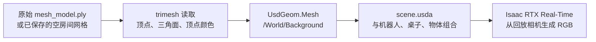

# MuJoCo 仿真与 Isaac 渲染

本页说明场景、控制、采集和重渲之间的数据流。首次理解系统读“整体流程”，
已有轨迹要重渲读“运行时”和“资产构建”，策略的训练图和评测图要用 Isaac 读“图像来源”和“按需镜像”；具体双臂批处理命令见
[双臂回放](bimanual_design.md#渲染并排视频)，分享视频见 [Video export](#video-export)。
背景的表征、导入和着色见 [EmbodiedGen 背景如何进入 Isaac](#embodiedgen-背景如何进入-isaac)。

## 整体流程

**MuJoCo 运行任务并记录实际运动；Isaac 根据记录（或 sim 此刻的状态）重建姿态，生成另一种渲染画面。**
物理永远在 MuJoCo 里，Isaac 只出图：可以是采集后的离线重渲，也可以按 [`images.source: isaac`](#图像来源imagessource)
充当策略的训练图和闭环评测图。下图是默认的 MuJoCo 出图路线。



这条链路有三个不同的工作：

| 工作 | 决定什么 | 主要入口 |
|---|---|---|
| 在线任务执行 | 机器人如何走、弯腰、抓取；物体是否真的抬起、滑脱或飞走 | 专家 → SONIC → [run_sim_locomani.py](../src/locomani/sim/run_sim_locomani.py) |
| 采集与记录 | 实际状态、相机、动作参考、控制输出和任务结果 | 任务 runner、exporter、[StateTrace](../src/locomani/sim/privileged_pub.py) |
| 离线渲染 | 在已记录的动作上生成光照、材质和相机画面 | [isaac_render.py](../src/locomani/sim/isaac/isaac_render.py) |

例如一次抓篮中，篮子在 MuJoCo 里滑脱了，Isaac 会按对应轨迹重现这个运动。
重渲不会重新调用专家或 SONIC 去尝试抓取；成功标签来自原任务的验收。
渲染需要自己的 GPU 资源，但不需要保持原来的控制栈运行。
这样的分工让离线 RTX 渲染可以独立调画质，不占用在线控制循环的每步时间预算。
专家可额外使用约定的仿真辅助信息；VLA 接收其数据/模型配置定义的观测字段，
不默认继承专家用到的全部信息。

## 图像来源（images.source）

实验文件的 `images.source` 决定**策略看到的相机图由哪个渲染器画**。训练集和闭环评测永远用同一个：
换了渲染器，策略面对的就是训练里没见过的画面。物理、控制和专家都不受它影响——专家不看 Isaac / Unreal 图，它们只出图。

| | `mujoco` | `isaac` | `unreal` |
|---|---|---|---|
| 画面 | MuJoCo 自带的 OpenGL 渲染，与物理同一个模型 | Isaac Sim RTX 渲染同一时刻的状态，场景另有一份 USD（Isaac stage），光照和材质更接近真实 | Unreal 5.7（URLab 插件）渲染同一时刻的状态：Blender 烘焙的房间关卡，Lumen 全局光照 |
| 采集时 sim 出不出图 | `backend.render: live` 实时出；`offline` 不出，事后补 | 必须 `offline`，采集时不出图 | 同 `isaac` |
| 数据集相机（convert 之前） | `offline` 时由 `render_dataset_cameras.sh` 从 trace 补渲（只渲成功局） | 由 `render_dataset_cameras_isaac.sh` 用 Isaac 从 trace 补渲（只渲成功局、只渲 25 Hz 取到的行） | 由 `render_dataset_cameras_unreal.sh` 在运行中的编辑器里补渲（同上；每行约 130 ms） |
| 闭环评测时策略的图 | eval sim 自己实时渲（eval 栈强制 `live`） | eval sim 不渲（强制 `offline`），另起 [Isaac 镜像](#vla-闭环的-isaac-画面按需镜像)，策略要图时按 sim 此刻的状态渲 | 同 `isaac`，镜像是 `run_unreal_mirror.sh`（同一协议、同一端口） |
| 额外需要 | — | [安装](setup.md)第 7 步；场景在 `configs/scenes.yaml` 有 `isaac` 条目且已建 stage；第二张 GPU | [安装](setup.md)里可选的 Unreal 一步；`bash scripts/start_unreal.sh --gpu N` 起编辑器；场景有 `unreal` 条目且关卡已建（`build_scene.sh <场景> --unreal`） |
| 能用的场景 | 全部 | `warehouse_textured`、`warehouse_box_45x*`、`box_platform` | `warehouse_textured`、`warehouse_box_45x*`；其余场景没有房间可烘焙，条目里写明不支持，加载实验文件时就拒绝 |

补渲脚本和镜像用同一组相机（ego + 左右腕，`CAMERA_CONFIGS`）；同一渲染器的补渲和镜像还是同一个渲染对象
（`IsaacView` / `UnrealView`）、同一份场景、同一组外观设置（Isaac：`configs/scenes.yaml` 的 `rtx_settings` 和 `supersample`；
Unreal：关卡里的后处理体积和 `repeats`），所以"同一个状态 → 同一张图"。行的选取、占位帧的覆盖和 marker 是两者共用的
`src/locomani/sim/view_render.py`，镜像协议是共用的 `src/locomani/sim/mirror.py`。
convert 查 session 是哪个渲染器补的，与 `images.source` 不一致就拒绝；矛盾的配置（如 `isaac` 或 `unreal` 配 `backend.render: live`）
加载实验文件时就拒绝。完整命令见 [warehouse runbook](warehouse.md) 第 3–6 步；Unreal 的编辑器、关卡与坑见
[Unreal 交接文档](handoff/unreal-urlab-20260928.md)。

## 采集时记录什么

场景构建把源网格、物体尺寸/摆放、机器人和碰撞设置写入
`scene_locomani.xml`，配套 `scene_meta.json` 描述目标与桌面等信息。
任务 runner 使用该次场景副本；重渲也必须使用**同一次运行对应的副本**。

| 记录 | 用途与边界 |
|---|---|
| MuJoCo 相机 RGB | ego、左腕、右腕等实际采集视角；专家/VLA 和 exporter 按各自接口消费 |
| 第三人称原片 | 由 `SIM_VIDEO_DIR` 开启，方便检查走近、接触和抬升；画中画不等于训练视频文件 |
| `*_state_trace.npz` | `seq`、完整 `qpos`、`qvel`；包含机器人浮动基座、关节和场景自由物体状态 |
| exporter session | 原始相机、机器人观测与动作字段；支持录制的任务才产生正式 episode |
| manifest、配置快照与动作日志 | 任务指令、成败、输入身份、控制来源；不由渲染器重新生成 |

`StateTrace` 在仿真进程内、发布状态之后，以该次发布的 `seq` 记录同一份状态。
它记录的是发布/控制帧，不是所有物理积分子步，也不是专家希望到达的目标姿态。
`SIM_STATE_TRACE_DIR` 控制轨迹记录；单臂/pick-and-place 的自动 runner 会设置它，
双臂 runner 默认开启，可用 `--no-state-trace` 关闭。

视频、trace 和 session 是独立产物：有 MP4 不代表有可重渲的完整状态，
有 trace 也不代表已经生成可训练的数据。轨迹写入失败可能只产生警告，
开始重渲前要检查文件实际存在。各任务目录和录制边界见
[单臂](single_arm.md#6-看结果)、[双臂](bimanual_design.md#产物和日志)、
[pick-and-place](single_arm_design.md#四pick-and-place-这条变体)。

## Isaac 怎样重现同一段动作

### 从一份状态恢复机器人、物体和相机

[MujocoReplay](../src/locomani/sim/isaac/replay.py) 加载该次 MJCF，
逐帧恢复 `qpos` / `qvel`，调用 `mj_forward` 计算关节链和相机的世界位姿。
此处的 MuJoCo 用来解释记录状态，不执行 `mj_step` 重新模拟动作。

随后 [stage.py](../src/locomani/sim/isaac/stage.py)：

1. 按关节名称把记录值映射到 Isaac 机器人，设置关节体根链接的世界位姿。
   根链接从导入的 articulation 读取，不能直接把骨盆位姿当成它；当前 G1 导入通常以 `torso_link` 为根。
2. 同步各物体世界位姿，并应用从 MJCF 保留的网格缩放与偏移。
3. 用同一次 MuJoCo 正向运动学得到的相机世界位姿设置 Isaac 相机。
4. 推进渲染更新并读取图像，进入下一条记录。

Isaac 内部仍创建 World 并调用 `world.step(render=True)` 来更新变换和图像。
镜像流程关闭重力、清零机器人根与关节速度，并反复下发记录姿态；
这些更新不构成第二次任务执行，也不能作为独立的抓取物理验证。
默认进行两次更新让相机变换进入渲染管线；这也不是让原任务多执行两步。

### 主视角、画中画与并排视频

| 输出 | 相机来自哪里 |
|---|---|
| Isaac 默认主画面 | 同帧 MuJoCo `head_camera` 的位姿和视场角 |
| 第三人称主画面 | `--cam-traj` 提供的世界相机轨迹 |
| ego / 左腕 / 右腕画中画 | 各自 MJCF 相机在该帧的正向运动学，不是从主画面裁切 |

双臂并排脚本先用 [mujoco_render.py](../src/locomani/sim/isaac/mujoco_render.py)
读取 trace，生成 `tracking_mujoco.mp4`，同时保存每帧第三人称相机的 `cam_traj.npz`。
Isaac 再读取**相同 trace、场景和相机轨迹**生成画面，最后由 ffmpeg 横向拼接。
因此左侧是 MuJoCo 的离线重渲，右侧是 Isaac 重渲，两侧无需分别跑一次任务。
机位默认是录像器的跟踪相机（骨盆后方 2.5 m、方位 135°、仰角 −20°），可用 `--distance/--azimuth/--elevation` 改；
warehouse 的起点离南侧隔断只有约 1 m，默认机位在墙外、两边都只看到墙，用 `--azimuth 225 --distance 2.2`（机器人前右方，室内）。

Isaac 输出文件虽叫 `ego_isaac.mp4`，传入第三人称 `--cam-traj` 后内容实际是第三人称。
`--insets` 会增加独立的第二遍回放，生成该渲染器自己的三路相机画中画再合成；
不是贴上原来 MuJoCo 的 RGB。Isaac 对缺失、陈旧或不同渲染帧的画中画输入会报错。
需要 ghost 时只在诊断视角显示规划目标，不把它当作真实手部或训练观测。

### 轨迹与训练行的对齐

优先使用 `--state-trace`。若还传入 exporter `--session` / `--episode`，
[frames.py](../src/locomani/sim/isaac/frames.py) 根据该 episode 的 `priv_seq`
选取、排列 trace 行；缺少对应状态会报错，避免用上一帧填补。
`--session ""` 则按 trace 自身顺序回放完整尝试。
这是状态行的对齐，原相机曝光时刻与 action 时间仍需通过各自记录核对。

旧数据没有 trace 时，仍可用 parquet + pose sidecar 重建近似状态；
这是历史兼容路径，不能声称逐帧重现原片。
旧 `compute_cam_traj.py` 主要用于这条路径；当前 trace 模式直接计算 ego/腕相机，
并排模式由 `mujoco_render.py` 生成第三人称轨迹，不要求先跑该旧工具。

当前 NPZ 只有 `seq/qpos/qvel`，视频按 `--fps` 和 `--stride` 编码：
例如 50 Hz 状态、stride 4 对应 12.5 FPS。匹配 session 后应按该输入的实际采样率设置，
不能机械沿用 50 FPS 默认值。测量停顿或抖动还需核对对应日志时间戳和丢帧情况，
不能把渲染所花的墙钟时间当成机器人动作时长。

## 运行时

按 [安装指南](setup.md)第 7 步准备 Isaac 环境，在仓库根目录的 Bash 终端执行：

```bash
. scripts/paths.sh
export PYTHONPATH="$LOCOMANI_ROOT/src"
bash scripts/setup_render_runtime.sh
# 需要验证实际 Kit 启动时再运行；会占用渲染资源
bash scripts/setup_render_runtime.sh --deep
```

`SIMPLE_ROOT` 是固定版本的 SIMPLE 检出目录，`RENDER_PY` 是装有 Isaac Sim 的 Python，
默认来自 `$SIMPLE_ROOT/.venv/bin/python`。二者可分开配置。
安装脚本的 pin 与补丁见 [SIMPLE 补丁说明](../patches/simple.md)。

离线重渲不 import `simple` 包，也不需要下载它的大型 `data/` 资产集合。
机器人和场景 USD 由本仓库构建；SIMPLE 检出主要提供当前使用的渲染运行环境。
环境升级后需要重新验证像素、相机和耗时，旧版本测量不自动适用。

## 资产构建

资产分成**可追溯的源文件**和**本机生成的 USD 缓存**：

| 部分 | 来源 → 生成物 |
|---|---|
| 机器人 | 已安装的 G1/Dex1 MJCF 与网格 → `assets/isaac/robot/g1_dex1.usda` |
| 桌子、台面、静态道具 | 安装的场景网格/贴图与本次元数据 → `assets/isaac/scene/<label>/scene.usda` |
| 水瓶、篮子等可动物体 | 本次 MJCF 引用的可视网格、缩放与材质 → 同一场景缓存中的 `usd/<object>/` |
| 房间背景 | 生成的背景源，或仓库自带 `assets/scene/empty_room_world.ply.gz` → 场景 USD |

机器人的材质不在 USD 缓存里，改材质不需要重建资产：每次组装 stage 时，`stage.assemble_stage` 给机器人绑两种 OmniPBR 材质（`stage.G1_LOOKS`）。
- 数值取自 Unitree 官方的 Isaac Lab 资产 `unitree_sim_isaaclab_usds` 里的 `g1_29dof_with_dex1_rev_1_0.usd`：浅色壳反照率 0.68（线性）；深色件 0.011，接近黑色，metallic 0.42。
- 深色件是头、骨盆、髋俯仰、踝横滚、Dex1 底座和手指。这正好是 MJCF 里 rgba < 0.4 的那些网格，所以由 MJCF 颜色决定用哪种材质。
- 和官方一样，外壳是拉丝金属：metallic 1，roughness 0.75。金属会映出周围环境，所以在 warehouse 的深色地面和黑货架旁边，外壳比同反照率的漆暗一些。
  用户 2026-09-29 在两者之间选了金属。对照静帧和视频见 `outputs/isaac_g1_colour_20260929/`。
- Unreal 用同一组数值（`src/locomani/sim/unreal/in_editor/robot_materials.py` 的 `unitree` 预设）。
- MJCF 的 rgba 不能直接当颜色用：它是显示值（MuJoCo 不做 gamma），RTX 却按线性值读。2026-09-29 之前就是直接用的，0.2 显示成 0.48，整台发白。URLab 导入是同一个问题。
- 另一个同期修掉的问题：importer 按 body 名给可视 prim 命名（`left_dex1_finger_1_link`），而颜色表原先只按网格名查（`Dex1_finger_link_1`）。结果 4 根 Dex1 手指全落到默认的近白色。
- 材质改动会同时改变镜像、数据集补渲和视频里的机器人像素。之前用 Isaac 图训练的 checkpoint 看的是发白的旧外观。

先执行 `bash scripts/install_scene.sh` 安装仓库的 `assets/scene_locomani_v1.tar.gz`，
再按任务指南准备对应场景。桌面网格/贴图和 [压缩房间源](../assets/scene/README.md)
随仓库提供，不需要从另一台机器复制 `outputs/`。

```bash
# 换成该次采集保存的场景副本，而非后来修改过的工作场景
SNAPSHOT="$LOCOMANI_ROOT/outputs/crate_collect_10/crate_table30"
export CUDA_VISIBLE_DEVICES=0 MUJOCO_EGL_DEVICE_ID=0
bash scripts/build_isaac_assets.sh --snapshot "$SNAPSHOT"

# 仅构建机器人；需要强制重建时可显式添加 --force
# bash scripts/build_isaac_assets.sh --robot-only
```

示例 GPU 0 须按 [资源规则](../AGENTS.md#shared-resources-and-artifacts)确认空闲。
不传 `--snapshot` 时使用当前工作场景，label 为 `work`；
传入快照后 label 默认为目录的完整 basename，上例为 `crate_table30`，
可用 `--label` 显式指定。渲染的 `--scene-dir` 必须匹配该次构建位置。

构建器检查必需的房间、桌面源文件，并对来源、几何、贴图和路径等做缓存校验。
场景缓存失效时保留旧目录再重建；机器人导入还会执行多网格 reference 拆分，
保留躯干、骨盆和手腕的可视部件。生成的 `assets/isaac/` 不进 Git，
换机器应根据源资产重新构建。

场景 USD 与机器人 USD 分开缓存。它们复用源几何，但碰撞体与可视网格用途不同；
新物体的可视网格转换是否受支持仍需检查构建日志及画面，不能只看脚本成功退出。
资产缺失与新安装验证见 [资产可移植性报告](handoff/isaac-asset-portability-20260912.md)。

## ghost 夹爪规则（2026-09-24 起，所有场景）

每次跑 expert 都把**命令的抓取目标**（反馈修正之前的纯参考：两手抓点 + 掌姿态，按状态 seq）记到 `<run>/trace/<label>_ghost.npz`
（`CoordinatedReach.ghost` → `tasks/crate/ghost_trace.py`）。`scripts/render_trace_videos.py` 发现该文件就把半透明品红夹爪放在目标位姿上，
目标每次微调都能在视频里看到它动。**只画在第三人称跟踪视角**（geom group 4 只对主相机打开）；ego 和左右腕相机的画中画用默认选项渲染，
永远不含 ghost，VLA 数据不受影响。Isaac 重渲（`render_isaac_videos.sh`）发现同名文件时把 `--ghost-trace` 传给两个渲染器，同样只在主画面。
没有 `_ghost.npz` 的旧 run 渲染时没有 ghost（不能事后重建当时的目标）。

## warehouse（Blender 房间）的 Isaac 重渲

两桌面场景的资产构建器（`scene_assets.py` / `isaac_scene.py`）要 layout、桌面网格和 PLY 房间，对 Blender 导出的房间不适用。
warehouse 走另一条路，结果仍是 `stage.py` 期望的目录布局，重放代码不变：

```bash
python3 scripts/build_isaac_warehouse_scene.py     # 需要 pxr（pip install usd-core，或任一 Isaac/Blender python）
python3 scripts/build_isaac_warehouse_scene.py --scene outputs/scene/warehouse_box_45x20x18   # 换尺寸的纸箱：缩放取自该 MuJoCo 场景，label 取目录名加 `_env`，source.json 钉住它的 MJCF
bash scripts/render_isaac_videos.sh outputs/runs/<run>   # 每局：mujoco_render → isaac_render → 并排 → previews_isaac/；stage 与曝光取运行场景的 isaac 条目
bash scripts/render_isaac_videos.sh outputs/runs/<run> --path-trace <label>   # 给人看的一局：Isaac 侧改路径追踪（见下）
bash scripts/render_isaac_videos.sh outputs/runs/<run> --traces outputs/runs/<run>/eval/state_trace --out outputs/runs/<run>/eval --insets
```

- 只渲成功局：每局几分钟（见下「画质」），失败的采集局也进不了数据集。成败读判这一局的 manifest——`<run>/trace` 读运行的 `manifest_NN.jsonl`
  （`label`），评测的 `state_trace` 读旁边的 `closed_loop.manifest.jsonl`（`video`），没有任何一行点名的 trace（中断批次）也跳过；
  开头打印 `rendering N of M traces`。`--all` 渲全部 trace，命令末尾点名 label 就只渲那几局（`run_context.successful_traces`）。

- `scene.usda` 把 `assets/scene/logistics_room_box_v1/isaac/logistics_room_box.usdc` 的 `/root` 引用到 `/World/room`，停用其中的静态纸箱。
  `env_light` 是 Blender 的环境光，保持打开：USDC 里它已修成纯色 dome，RTX 不认的 EXR 已清掉。stage 里有了 dome，`assemble_stage` 就不再补通用的 dome + 平行光。
  构建器写的 label 一律带 `_env`：当前 stage 是 `warehouse_textured_env` 和四边线的 `warehouse_box_<尺寸>_env`。2026-09-29 以前的
  `warehouse_textured`、`warehouse_box_<尺寸>` 关着 `env_light`，留给用它们渲过的运行；在这个封闭房间里两者只差 0.1/255。
- 两层都屏蔽了 14 条「单通道贴图 → `normal`」连接：v1 USDC 早于 `blender_to_usd.py` 的高度图修复（blender_scenes.md §2 表末行），
  不屏蔽时实时渲染里每个照片纸箱满面白色噪点。改了构建器就重跑它（`assets/isaac/` 不入库），用任一带 pxr 的 python，例如 Blender 自带的
  `<blender 目录>/5.2/python/bin/python3.13`；三个 venv 都没有 pxr。
- `usd/nor_cal_box/` 是可动纸箱：同样引用 `/root` 但停用其余 237 个子 prim。只引用纸箱 prim 会丢掉 `/root/_materials` 的绑定
  （纸箱渲成素灰，日志里一串 `_ReportErrors ... material:binding`）。sidecar 的 `offset_pos = (0, 0.39, −0.371)` 把烘在世界坐标里的网格
  挪到 MJCF body 原点（底面中心），之后 `sync_replay` 直接用 body 位姿。
- 机器人仍是 MJCF 导入的 `g1_dex1.usda`；`--scene-xml` 用 `outputs/scene/warehouse_textured/scene_locomani.xml`（见 blender_scenes.md：旧 `warehouse` 场景的纸箱没贴图）。
- 机位：`mujoco_render --azimuth 225 --distance 2.2`。默认 2.5 m / 135° 在南侧隔断外面，两边都只渲到墙。
- 四边线场景（`warehouse_box_45x*`，`scene_meta` 带 `surfaces.A.edges`）：225 是"从 −y 边走入"时的机位，其余边按该局走入方向转同样的角度（xm 135、xp 315、yp 45），机器人在每条边都从前右方被拍到。哪条边由 trace 第一行机器人的偏航认出（`sim/scene_edges.py`；起点偏角被限制在 ±45° 内）。
- 曝光：`isaac_render --rtx-setting`（新，可重复，`路径=值`）；批处理默认关自动曝光、`filmIso` 80、间接光 ×2、Hejl–Hable 色调映射（2026-09-29 起，按 Blender 标，见下）。房间由 5 块 24828 强度的天花板 RectLight
  和自发光灯板照亮（USDC 里 1200× 增益已烘入），dome/平行光强度改了没有像素变化；默认自动曝光 + ACES 把机器人 0.2 灰抬到 108/255、0.7 灰推到 212，
  头/躯干比 0.51（MuJoCo 0.23）。ISO 30 后躯干 139 对 MuJoCo 136、头/躯干 0.36；剩余差距是白房间的间接光，MuJoCo 没有全局光。
  这些数都是在 2026-09-29 颜色修正之前量的（见"资产构建"）。
  2026-09-29 改为按 Blender 的 Cycles 参考图标定（`reverse_room` 相机）：ISO 30 时地面 39 对 Blender 80，ISO 80 时墙、地面、纸箱都和 Blender 一致，平均绝对差 59 → 17。
  天花板只靠反射光照亮，RTX 实时模式只有 2 次反弹，所以偏暗（151 对 183）。再加两项设置：间接光 ×2（`/rtx/indirectDiffuse/scalingFactor=2.0`），色调映射从 ACES 换成 Hejl–Hable（`/rtx/post/tonemap/op=4`）。
  加上以后天花板 176，灰度平均绝对差 11.1 → 6.9，耗时不变。见 [台账](ledger/blender_scenes.md) 第 4、6 节。
- 抗锯齿：RTX 实时模式只有 FXAA（1 spp），小字糊、货架网格闪。2026-09-29 起每个相机按 2 倍分辨率渲、再按 2×2 块平均缩回
  （`configs/scenes.yaml` 的 `isaac.supersample: 2`，用户定；`stage.downsample`）。镜像、数据集补渲、`render_isaac_videos.sh` 三处读同一个值。
  对 Blender 的结构相似度 0.89–0.94 → 0.93–0.96（台账第 5 节）；代价是三路相机每次 95 → 209 ms（GPU0，`IsaacView`），不是先前估的 1.4 倍。
  `tonemap/op=0`（Clamp）全帧饱和，`op=1`（Linear）比 ACES 更平，都不用。
- 2026-09-24 首次跑通：房间贴图、纸箱印字、机器人（含头）在 Isaac 里都完整，机位与 MuJoCo 逐帧一致。
- 画质（2026-09-28 A/B，台账 blender_scenes.md 第 2 节）：两个渲染器都按 `--size` 出图，默认 1280×960（640×480 下纸箱印字和机器人边缘锯齿）。
  Isaac 侧默认 RTX Real-Time，与数据集补渲、评测镜像同一个渲染器，也用场景的 `supersample`（`--path-trace` 时不用）：1280×960 在 1× 下约 110 ms/帧，2× 下带小窗的整局约慢 1.7 倍（2026-09-29 一局实测，TODO 12.19.2）。
  `--path-trace` 改成 PathTracing（64 spp + OptiX 降噪）：有间接光和软接触阴影，1280×960 约 1.5 s/帧（640×480 约 0.43 s），
  平均亮度比 Real-Time 调出来的 ISO 高约 10/255。只用于给人看，不进数据。

## EmbodiedGen 背景如何进入 Isaac

### 当前背景是什么表征

**当前 Isaac 路线使用带顶点颜色的三角网格（mesh），没有加载 3D Gaussian Splatting 模型。**
“EmbodiedGen 生成”描述资产的来源，不能据此判断渲染时采用哪一种表征。
[EmbodiedGen 官方输出说明](https://horizonrobotics.github.io/EmbodiedGen/docs/tutorials/layout_gen.html)
列出了同一背景的两种文件：

| 文件 | 内容 | 本仓库 Isaac 路线 |
|---|---|---|
| `gs_model.ply` | 3DGS 高斯模型 | 未读取 |
| `mesh_model.ply` | 带颜色的三角网格 | 读取并转换成 USD Mesh |

两者都可以使用 `.ply` 后缀，要看文件内部字段和加载代码。
当前仓库的背景副本 [empty_room_world.ply.gz](../assets/scene/README.md)
包含 **2,099,513 个顶点、4,190,791 个三角面**；文件头明确列出顶点的
`x/y/z`、`red/green/blue` 和面的 `vertex_indices`。
这是由很多小三角形组成、颜色存于顶点的房间表面；
相机移动时，视角和遮挡由这些三维表面决定。

`.gz` 只是压缩包装，不改变三维表征。数量、校验和及坐标系记录在
[资产元数据](../assets/scene/empty_room_world.json)，无需启动 Isaac 就能核对。

### 从原始背景到 USD

`build_isaac_assets.sh` 调用 [isaac_scene.py](../src/locomani/sim/isaac_scene.py) 构建场景，
其中 [background_source](../src/locomani/sim/isaac/scene_assets.py) 按以下顺序选源：

1. 原始 `outputs/scene/bg_empty/scene_0000/mesh_model.ply` 存在时，使用该文件。
2. 否则使用随 Git 分发的 `assets/scene/empty_room_world.ply.gz`。

本次核对的 checkout 中原始文件已不存在，因此使用第 2 条。
这个副本来自先前 Isaac 场景的 `/World/Background`，保留同一空房间的顶点、三角面和颜色，
来源记录见 [资产说明](../assets/scene/README.md)。世界坐标变换和地板修正已经烘焙，
加载时不会再缩放、旋转或修正一次。



`add_vertex_coloured_mesh` 直接构造 `UsdGeom.Mesh`：
顶点写入 `points`，三角面写入 `faceVertexCounts/faceVertexIndices`，
RGB 写入按顶点插值的 `displayColor`。
原始背景需要坐标变换和地板修正；保存的世界坐标副本跳过这些步骤。
这条转换使用现成网格数据，不在 Isaac 中重新生成房间或训练 3DGS。

### 进入 Isaac 后怎样渲染

离线回放打开生成的 USD 场景，
[configure_renderer](../src/locomani/sim/isaac/stage.py) 显式调用
`rep.settings.set_render_rtx_realtime()`，选择 **Omniverse RTX Real-Time 实时渲染**。
场景构建预览使用 `RayTracedLighting`；相关模式可对照
[Isaac Sim 4.5 官方示例](https://docs.isaacsim.omniverse.nvidia.com/4.5.0/replicator_tutorials/tutorial_replicator_isaac_snippets.html)。
当前路线渲染的是 USD 网格和材质，没有调用 Gaussian splatting 渲染器。

**背景的材质有单独处理。** 房间顶点颜色已经包含生成/重建时的光照外观，
`bind_unlit_vertex_colour_material` 将 `displayColor` 接到
`UsdPreviewSurface.emissiveColor`，并将 `diffuseColor` 设为黑色。
这样以保存的背景颜色为主，避免再当作普通漫反射表面重复打光。
两个材质字段的含义见 [NVIDIA 材质文档](https://docs.omniverse.nvidia.com/materials-and-rendering/latest/templates/UsdPreviewSurface.html)。

机器人、桌子和物体则使用各自网格、材质及场景灯光。
背景颜色保留了原有明暗，因此“RTX 渲染”不意味着房间已恢复成可以任意重新打光的完整材质场景；
曝光和色调映射等仍会影响最终像素。当前也没有把 3DGS 的视角相关外观带入这条网格路线。

房间网格在这里是视觉背景，不会自动增加 MuJoCo 的墙体碰撞。
实际地面、桌面和抓取物体的碰撞仍由 MuJoCo 场景定义。
原始 RGB、网格重渲和未来可能接入的 3DGS 图像需要分别记录来源。

## 从已有采集开始重渲

1. 在任务运行目录找齐 trace、对应场景快照、manifest 和实际 episode 标签。
2. 用上面的 `--snapshot` 构建该场景的 USD；核对桌高、物体尺寸和场景路径。
3. 选择输出：直接用 `isaac_render` 渲染 ego，或按
   [双臂回放命令](bimanual_design.md#渲染并排视频)生成同相机的 MuJoCo / Isaac 并排视频。
4. 检查每集输出、完整解码、首尾、背景/桌面、双手与物体，再生成下载预览。

直接渲染已有 trace 的 ego 主视角示例（替换 `TRACE` 为实际文件）：

```bash
TRACE="$LOCOMANI_ROOT/outputs/crate_collect_10/trace/visual_crate_s41_00_state_trace.npz"
"$RENDER_PY" -m locomani.sim.isaac.isaac_render \
  --session "" --episode 0 --state-trace "$TRACE" \
  --scene-xml "$SNAPSHOT/scene_locomani.xml" \
  --scene-dir "$ISAAC_ASSETS/scene/crate_table30" \
  --out outputs/renders_isaac/crate_ego_example --fps 50 --stride 4
```

这条直接命令在前台运行，用 Ctrl-C 停止。双臂批处理入口由 `render_job.py` 管理归属，
停止方式见 [受管渲染停止](bimanual_design.md#四中途停止渲染与清理)；
独立启动的渲染器不在该停止命令范围内。Kit 初始化和画面预热可能较慢，日志在输出目录。

## 离线渲染（backend.render offline）

实验文件里设 `backend.render: offline`（默认 `live`）后，sim 不建渲染器、不发布相机图像、不写 `SIM_VIDEO_DIR` 的录像，
只保留物理和 state trace。视频事后从 trace 渲出，和实时录像逐帧一致（2026-09-23 核对 184/184 帧）：

```bash
MUJOCO_GL=egl MUJOCO_EGL_DEVICE_ID=0 CUDA_VISIBLE_DEVICES=0 \
  third_party/GR00T-WholeBodyControl/.venv_sim/bin/python scripts/render_trace_videos.py outputs/runs/<run>
# 默认用该 run 的场景副本、写到 <run>/videos；--scene / --out 可改
```

用在渲染拖慢仿真的场景。warehouse 的纸箱显示网格有 46.3 万面，3 路相机每 tick 渲染 39–44 ms，sim 只剩 0.35× 实时，
deploy 按墙钟推进参考，机器人走得比指令快约 3 倍；离线后回到 0.95×。证据见
[warehouse 渲染负担交接](handoff/warehouse-render-cost-20260923.md)。
**2026-09-24 更正根因**：慢的不是面数，是旧 `warehouse` 场景把纸箱放在**一整块**网格里。MuJoCo 单块网格 3×面数超过 2²⁰（> 349,525 面）就掉出快路径：349,525 面 0.31 ms、349,526 面 3.91 ms。现行 `warehouse_textured` 把同样的面按材质拆成 9 块（最大 23.1 万），同一批状态三路相机 p50 3.2 / p90 6.9 ms。实时栈里的 RTF 还没测（TODO 4.7.7），测之前 warehouse 仍用 `offline`。证据 `outputs/diagnostics/render_speed_20260924/`。

限制：

- 只支持双臂 assisted 专家（`visual.pose_source: assisted`），它读的是黑色占位帧 `PlaceholderCamera`；
  markers 专家要读像素，`expert.run` 会直接拒绝。
- 录制时 exporter 存黑色占位帧，数据集的三路相机在转换前由 `scripts/render_dataset_cameras.sh` 从 trace 渲出（只渲成功局，
  失败局留占位帧；convert 本就不读它们，`--include-discarded` 转换未渲的局会被拒），
  `images.source: isaac` 的运行改由 `scripts/render_dataset_cameras_isaac.sh` 用 Isaac 渲（同样只渲成功局，另外只渲 25 Hz 取到的行）
  （[跑法](warehouse.md#3-补渲相机)）；没渲过、或渲染器与 `images.source` 不一致的离线运行 convert 会拒绝。
  VLA 闭环评测的图像走下节的 Isaac 镜像，MuJoCo 物理照样 `offline`。
- 渲染慢先查最大的单块显示网格（`max(model.mesh_facenum)`）：超过 349,525 面就无损拆块，不减面，见 [Blender 场景](blender_scenes.md#7-常见错误对照)。

## VLA 闭环的 Isaac 画面（按需镜像）

`images.source: isaac`（整次运行的选择，训练图也由 Isaac 渲）时，策略的相机图像不来自 sim 的 MuJoCo 相机流（:5555），而来自 Isaac 镜像
（`src/locomani/sim/isaac/mirror.py`，render venv，单独一张卡）：

```bash
bash scripts/start_stack.sh eval           outputs/runs/<run> --gpu 0   # 终端 1：栈
bash scripts/run_vla_server.sh             outputs/runs/<run> --gpu 0   # 终端 2：策略服务
bash scripts/run_isaac_mirror.sh           outputs/runs/<run> --gpu 1   # 终端 3：镜像，栈起来之后
bash scripts/bimanual/run_vla_inference.sh outputs/runs/<run> --gpu 0   # 终端 4：rounds
```

- **起法。** 镜像从栈的状态文件取场景和端口，先等到 sim 的第一条特权状态，所以要在终端 1 之后起；Kit 启动先打印几百行警告，
  出现 `isaac mirror listening on :<端口>` 才就绪。终端 4 会等策略服务的端口，但**不等镜像**，要看到这一行再起，否则每局
  `[vla] isaac mirror: no reply`。`--gpu` 是 Isaac 的卡，与栈同卡时打印 WARNING（渲染和 sim 抢卡）。输出在前台终端，
  Ctrl-C 停；`run_overnight.sh --isaac-gpu N` 把它放到后台、写 `<run>/eval/isaac_mirror.log`，等到 `listening` 才起跑局。

- **物理不等渲染。** sim 每个控制 tick 在特权状态流上发布完整 qpos（与 state trace 同 seq 的那一行，JSON 浮点逐位还原）；
  镜像只在策略要观测时渲一帧最新状态，所以渲染再慢也只让图像晚到，不会让物理和 deploy 的墙钟错开。
- **不改延迟补偿。** 客户端先读本体状态、再向镜像要图，图像与状态是同一时刻；渲染时间落在 `vla_client` 从 t0
  到出 chunk 的计时里，被现有补偿覆盖。warehouse 三路相机按需渲染 p50 89 / p90 108 ms（GPU1，台账 crate.md 2026-09-24）；
  2026-09-29 起 2× 超采样，p50 218 / p90 267 ms（GPU0，间隔 0.4 s 的按需渲染）。
- **镜像只认 eval 栈。** 它从栈的状态文件取场景和端口（`TF_ISAAC_MIRROR_PORT` = 5558 + 10·instance），
  场景的 Isaac stage 与曝光取自 `configs/scenes.yaml` 的 `isaac` 条目；现有 `warehouse_textured`、四个 `warehouse_box_45x*` 和 `box_platform`。
  qpos 长度对不上（栈跑的是别的场景）或 sim 没发 qpos，请求直接报错，客户端这一局记为 observation stream dropped。
- **记录**：每次渲染的 seq、状态年龄、渲染耗时写进 `<run>/eval/isaac_mirror.jsonl`；单臂客户端的延迟记录、双臂的 `eval/traces/round_NNN.json` 每行另有 `image`（那一块动作所用图的 seq 与状态年龄）。
  eval 栈还写 `<run>/eval/state_trace/`，同 seq 的图可以事后离线重渲（一致性闸门 4.7.9.8 的输入）。
- **eval sim 渲不渲由 `images.source` 推出**（`run_context.evaluation_of`）：`mujoco` → `live`（策略只能从发相机流的 sim 读 MuJoCo 图），`isaac` → `offline`；实验文件写了矛盾的 `eval.backend.render` 加载即拒。有 Isaac stage 的场景：`warehouse_textured`（Blender USDC）、`box_platform`（`scripts/build_isaac_primitive_scene.py` 从 MJCF 的盒子生成，ISO 20；stage `box_platform_srgb`：MJCF 颜色先从 sRGB 转成线性，2026-09-29 之前的 `box_platform` 直接当线性用，纸箱近白）。
- **首次真实闭环**（2026-09-27，warehouse checkpoint-5000，10 局）：渲染 p50 95 ms、图像对应状态年龄 p50 11 ms、观测 → 动作 p50 166 ms，9/10 抬起（台账 crate.md 2026-09-27 末节）。
- **lockstep 下的镜像**（2026-09-27，双臂）：`eval.client: lockstep` 时 sim 和 deploy 按 tick 推进，渲图期间世界冻结，渲染耗时不再计入世界时间。客户端带上冻结那一刻的特权状态 seq（`{"op": "render", "seq": N}`），镜像只渲这一条，最新状态不是它就报错；冻结的 sim 每 0.5 s 重发一次最新状态（同一 seq），所以镜像在栈之后起也拿得到第一条状态。单臂评测器不实现这个组合，配置了就拒绝。时间模型见 [双臂详解 §五](bimanual_design.md#评测的时间模型墙钟与-lockstep)，计划与验收见 [lockstep + Isaac 评测计划](handoff/lockstep-isaac-eval-plan-20260927.md)。
- **做了什么、还没做什么**（训练图是否也走 Isaac、一致性闸门、真实闭环、分支对账）：[镜像状态索引](handoff/isaac-vla-mirror-20260925.md)。

## 当前接通范围与限制

| 功能 | 当前状态 |
|---|---|
| MuJoCo 在线物理与相机采集 | 已接通；按任务指南选择录制方式 |
| 基于 trace 的 Isaac 离线重渲 | 已实现；双臂有受管并排脚本 |
| `backend.render: offline` + trace 出 MuJoCo 视频 | 已实现；仅双臂 assisted 专家，见[上一节](#离线渲染backendrender-offline) |
| `collect` 的 `RENDER_BACKEND=isaac` | **仅打印计划，没有启动重渲**；旧指南把它描述成自动追加阶段，现已更正 |
| `collect` 阶段自动追加 Isaac 重渲 | 当前没有该阶段，采集完显式调用 `scripts/render_trace_videos.py`（MuJoCo）/ `scripts/render_isaac_videos.sh`（Isaac 并排） |
| Isaac 图像作为 VLA 闭环的输入 | 已实现按需镜像（`images.source: isaac` + `scripts/run_isaac_mirror.sh`，见[上文](#vla-闭环的-isaac-画面按需镜像)）；warehouse checkpoint-5000 已真实闭环 10 局（台账 crate.md 2026-09-27）；专家仍读 MuJoCo |
| Isaac 图作为 VLA 训练图 | 已实现：`images.source: isaac` 的运行在 convert 前跑 `scripts/render_dataset_cameras_isaac.sh`，把 Isaac 图写进 session 替换占位帧（见[图像来源](#图像来源imagessource)） |
| Unreal（URLab）出策略的图 | 已接通（2026-09-29）：`images.source: unreal`，命令见[图像来源](#图像来源imagessource)；有关卡的场景是 `warehouse_textured` 和四个 `warehouse_box_45x*`。验证过数据集补渲 + convert（2 集）和 3 局 lockstep 闭环（3/3，用的是 Isaac 训练的 checkpoint-5000，所以存在分布偏移，这个数字不能和 Isaac 的直接比）；还没有用 Unreal 图训练过。安装见 [setup.md](setup.md) 第 8 步，编辑器和坑见 [Unreal 交接文档](handoff/unreal-urlab-20260928.md) |

补渲之外的 Isaac 画面（并排预览、`isaac_render` 直接渲的 ego）只用于检查。要让训练用 Isaac 图，走上面的补渲，
不要手工替换 session 里的视频：补渲按 exporter 每行记下的 seq 取状态，并在 session 里记下渲染器，convert 据此核对来源。
当前双臂 visual 的正式数据导出限制仍按 [双臂指南](bimanual.md)执行。

不同渲染器的材质、光照和背面处理会造成像素差异；Isaac 还有时域渲染状态，
不能要求同一输入两次出图逐像素相同。核验时应对齐几何、状态和相机，并在相同版本上建立容差。
主画面、画中画、ghost、源视频和训练 RGB 的用途要区分清楚。

## Video export

实时 MuJoCo 录像可在场景的 `scene_meta.json` 中设置 `"video_camera": "reverse_room"`
等 XML 相机名，使用固定机位。未指定时保持骨盆跟踪视角；小房间中应先检查
跟踪机位是否落到墙外。固定机位只影响录像主画面，腕部和第一视角小窗保持原相机。
四边线场景每条边另有一个固定机位 `edge_<边>`：`scripts/render_trace_videos.py` 按每局 trace 第一行的机器人偏航选边、换机位；仿真实时录像（`SIM_VIDEO_DIR`）仍只用 `video_camera`，四边线按离线渲染跑。

导出任何任务的视频、提供播放链接或打包 ZIP 前，必须满足
[AGENTS 的视频大小规则](../AGENTS.md#shared-resources-and-artifacts)。
这是面向查看和下载的交付步骤；原始采集、训练和审计视频保留在原位置。

1. 在新的预览目录中压缩；保持完整时长、正常播放速度和画面比例。
   可以降低分辨率、帧率和码率。声音有信息时保留，不能通过裁掉任务阶段或加速来达标。
2. 从以下命令开始，再按实测大小调整 CRF、分辨率和帧率。固定 CRF 不保证文件大小。

   ```bash
   ffmpeg -v error -nostdin -n -i input.mp4 \
     -map 0:v:0 -map '0:a?' -vf 'scale=640:-2,fps=10' \
     -c:v libx264 -preset medium -crf 32 -pix_fmt yuv420p \
     -c:a aac -b:a 24k -movflags +faststart preview.mp4
   wc -c preview.mp4
   ffmpeg -v error -xerror -i preview.mp4 -f null -
   ```

3. 每个文件都要检查实际字节数、完整解码、起止画面，以及与原片的时长差
   （只允许重采样到输出帧率时的一帧舍入差）。超限就继续压缩。
   长视频若无法兼顾上限和可辨识性，拆成编号连续片段，覆盖原片完整时间范围并明确标注。

   第 2、3 步已实现为 `python -m locomani.pipeline.video_preview <原片> <输出前缀>`（只依赖标准库和 ffmpeg）：
   - 宽度默认 1280、帧率默认 10，都不超过原片。
   - CRF 按 32→38 逐级提高；到 38 仍超限，就拆成 `<前缀>_partKofN.mp4`，每段在帧边界上连续切开。
   - 每个文件都检查字节数、完整解码和时长；同前缀的旧预览会先删除。
   - 起止画面仍需人工看一眼。`render_isaac_videos.sh` 的 `previews_isaac/` 就是这样生成的。
4. 播放页面和回复链接指向合格预览。ZIP 仅包含这些预览和必要的小型说明文件；
   打包后再次核对成员和总体积，并报告单片范围及 ZIP 大小。历史原片和旧大包保留作审计。

## 代码入口与历史证据

- [渲染代码导航](reference/change-map-rendering.md)：定位场景资产、逐帧同步、相机和进程生命周期。
- [渲染修复与验证](handoff/review-fixes-20260914.md)：Isaac 4.5 画中画和受管停止的验证范围。
- [重组前渲染文档](archive/rendering_20260914.md)：保留时延、相机更新、关节体根、多网格及背面遮挡的历史调查原文。
  这些测量和旧“无需 hybrid clock”的裁定不替代当前模式、机器或新版本的验证。
