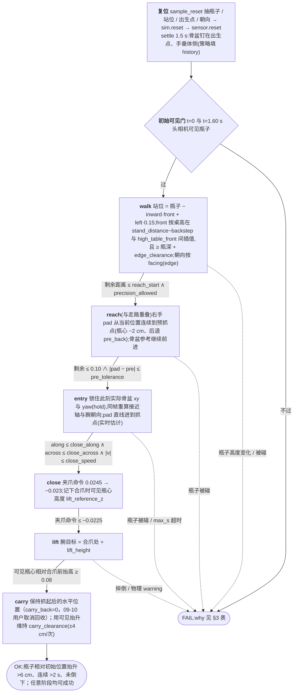

# ScaleBFM 视觉抓瓶数据采集

首次正式采集读环境、渲染与吞吐准入规则及运行入口；修改策略按
[bottle / ScaleBFM 导航](reference/change-map-bottle.md)定位。实验数字查带日期的台账，
不作为任意新配置的成功率保证。

> 场景、单集流程、pilot 与验收、以及控制逻辑 / 数据形状 / 随机化 / 相机的工作原理。结构对齐
> `docs/single_arm.md`(SONIC 单手采集)和 `docs/bimanual.md`(双臂搬箱)。这条线用 ScaleBFM
> 替代 SONIC 做全身控制,expert 与 sim 在**同一个进程**里逐 tick 运行,没有 stack、没有 ZMQ、没有墙钟。
> 所有数字、日期化结果和 ruling 都在台账 `docs/ledger/scalebfm.md`;本文只写判据和路径。Codex 线程的
> 原始文档已冻结到 `docs/archive/scalebfm_*.md`,本文按章节链接。所有路径相对仓库根目录。

## 0. 这条流水线现在能给什么

全链路都有:每集轨迹 / 动作 / 命令 / 观测 / `result.json`(§3 `round.py`)→ 学生数据 `student.npz` + 两路 mp4
(§3 `--record-observations` 或 §4 `collect.py`)→ 离线验收 `audit.json`(§4)→ 10 集跟随视频 + 播放页(§4)→
LeRobot v2.1 数据集 → GR00T 3000 步 checkpoint → 配对闭环评测(§6 `pipeline/`)。

与 SONIC 两条线的根本差别:这里的 expert **只能用部署时学生也有的信息做决策**(§5 的信息边界),仿真真值
只进审计与判定通道。设计原因见 `docs/archive/scalebfm_visual_expert_design.md`,一段摘要在 §5。

---

## 1. 前置条件

| 项 | 要求 |
|---|---|
| Python | 统一用 `third_party/Isaac-GR00T/.venv/bin/python`(GR00T 训练 venv 里带 torch + mujoco);不同 PyTorch 环境之间观测到过微小重放差异,不要混用 |
| 模型 | `/workspace/models/scalebfm/humanoid_transformer_m_22200.pt`(HF `WeishuaiZeng/ScaleBFM`,唯一用过的 checkpoint);`assets/scalebfm/{mode_table.pt, model_22200_tensorrt_metadata.json, g1_29dof_fk.xml}`。路径在 `ScaleBfmBackendConfig.checkpoint`,`pipeline/provenance.verify_runtime_assets()` 对它们做哈希 |
| 场景 | `outputs/scene/sim`(瓶子场景,`scene_meta.json` + MJCF),由 `ScaleBfmBackendConfig.scene_dir` 指定,空串即默认 |
| expert(CPU) | `CUDA_VISIBLE_DEVICES='' MUJOCO_GL=osmesa OMP_NUM_THREADS=1 PYTHONPATH=src` —— 单线程、软件渲染、不占 GPU,可以在别人的采集栈旁边跑(它没有 SONIC deploy 那种 LowState 保护;但 GPU 上的仿真探针会打断别人的 SONIC 采集,见 §9) |
| 采集 / 训练(GPU) | `collect.py` 固定 `policy_device="cuda"`、`MUJOCO_GL=egl`;先按 `docs/STATE.md` 核对 GPU 归属 |
| 测试 / 磁盘 | `make test` 跑 unit tier(`tests/test_visual_*.py`);`test_visual_training.py` / `test_visual_validation.py` 是 torch tier(`pytest --run-torch`)。checkpoint 20 GB 量级,采集前 `df` |

---

## 正式采集必须遵循的渲染与吞吐规则

1. **正式批量采集必须显式使用 `MUJOCO_GL=egl`。** `CUDA_VISIBLE_DEVICES` 只选择推理设备,
   不会把 OSMesa 转成 GPU 渲染。必须同时明确 `MUJOCO_EGL_DEVICE_ID`,核对 EGL 实际设备;
   不要因为 CUDA 只暴露一张卡就假设 EGL 的物理设备编号自动变成0。
2. **OSMesa只用于单独的CPU诊断或明确要求逐位复现的实验。** 不得把此类环境直接沿用到200集采集。
   `pipeline.collect` 默认EGL;非EGL须显式 `--allow-software-rendering`,并在独立实验ID记录理由。
3. **每次新建或切换渲染/设备/场景的批量任务,先运行独立短测再放行。** 至少覆盖高桌近瓶、低桌近瓶、
   低桌深瓶,保存实际渲染后端/设备、逐集仿真秒数/墙钟秒数、成功/可见性/质量审计及视频检查。
   当前200集runner自动跑12集 `--pilot`(不混入训练),要求12集入选、24条视频可完整解码、
   单集墙钟中位数<=60s。60s是此场景的防退化阈值,不是目标速度;场景改变需先实测并解释新阈值。
4. **吞吐异常先停止扩大采集并查渲染,不能只看GPU显存或利用率。** 对比同场景GPU基线,
   检查真实进程环境、软件渲染器、CPU配额/限流、图像分辨率和额外渲染次数。
   不得通过降低录像帧率、分辨率或跳过可见性审计来隐式提速。
5. **运行中切换须保留断点与来源记录。** 完整集复用,不覆盖;中断集记账并跳过。
   记录旧/新渲染方式对应的集、配置历史、源代码和资产哈希。OSMesa/EGL可能有像素差异,
   混合数据不得声称逐位复现;训练与评测的渲染方式也必须记录。
6. GPU归属、CPU余量>=6核及无限流要求仍按 `docs/STATE.md` 执行;短测通过不豁免资源检查。

GPU1环境示例(本机已验证EGL设备1;其他机器应重新核对):

```bash
CUDA_VISIBLE_DEVICES=1 MUJOCO_GL=egl MUJOCO_EGL_DEVICE_ID=1 \
OPENBLAS_NUM_THREADS=1 OMP_NUM_THREADS=1 MKL_NUM_THREADS=1 PYTHONPATH=src \
third_party/Isaac-GR00T/.venv/bin/python -m locomani.tasks.bottle_visual.pipeline.collect \
  --arm B --pilot --scene-profile yplus_center_v1 --out outputs/experiments/NEW_ID/pilot \
  --backend PATH_TO_BACKEND_JSON --runtime-assets PATH_TO_RUNTIME_MANIFEST_JSON
```

先检查pilot再用同环境运行正式 `--train-only`。当前带自动短测和转换的固定runner:
`scripts/experiments/scalebfm200_20260910.py`;已有实验读取自身冻结plan,不重新prepare或改写专家快照。
事故与实测见 [台账§20](ledger/scalebfm.md#20-本次采集慢的诊断2026-09-10codex)。

---

## 2. 场景与后端

### 后端:`src/locomani/backends/scalebfm/`

| 文件 | 作用 |
|---|---|
| `network.py` | vendor 的 ScaleBFM transformer,eager torch,不需要 TensorRT |
| `runtime.py` | `Sim`:我们的 MuJoCo 场景 + ScaleBFM 的 PD(200 Hz,decimation 4,增益/力矩限幅来自 metadata)+ 我们自己的 dex1 夹爪 PD;`Policy`:拼 9 个 tensor 的观测、history 3 帧、mode 2;`Refs`:骨盆 / 手参考 → 未来 6 帧 |
| `action.py` | 29 维原生动作 codec(§6),`encode_action` / `decode_action` |
| `executor.py` | `ActionExecutor`:25 Hz 动作 → 50 Hz 控制,每行保持两个 tick;采集与部署共用 |
| `chunks.py` | `ChunkScheduler`:带延迟的 action chunk 切换(部署用) |
| `reference.py` | `PoseTransition` / `bounded`:连续腕参考插值与限幅 |
| `state.py` | 91 维学生 state(`STATE_DIMS`,§6) |
| `camera.py` | `RobotCameraObserver`:`ego_view`(`head_camera`)+ `right_wrist`,320×240 RGB,带 0.4 s 图像历史 |
| `config.py` | `ScaleBfmBackendConfig`:`checkpoint` / `scene_dir` / `object_name` / `grip_kp` / `grip_kd`;JSON 在 `configs/backend/scalebfm.yaml` |

策略接口(每个 50 Hz tick):`root_quat[1,3,4]`(wxyz)、`base_ang_vel[1,3,3]`、`dof_pos` / `dof_vel` / `last_action`
`[1,3,29]`(**IsaacLab 关节顺序**,metadata `joint_names`)、`target_pos[1,6,14,3]`、`target_quat[1,6,14,4]`
(**骨盆系**下 14 个 body 的未来 6 帧目标;mode 2 只有 pelvis / 左腕 / 右腕有效,其余按 `mode_table.pt` mask 掉)、
`mode_index[1]=2`、`time_offsets[1,6,1]`。输出 29 个 PD 目标。手的目标是 `right_wrist_yaw_link` 位姿,dex1 pad
中心在腕系 x 方向 `runtime.OFF` = 0.1515 m。夹爪模型不管,`Sim.step` 用 `grip_kp` / `grip_kd` 自己 PD,力限
`sim.grip_clip`(瓶子 0.6)。更多接口事实见 `docs/archive/scalebfm_spike_handoff_20260908.md`。

策略的两个已测特性决定了 expert 的形状(§5):**对静态偏差响应弱**——骨盆 / 手离目标 ~10 cm 以内基本不动,
参考必须带速度并领先身体;**手开环有系统偏差**——早期版本用一个世界系常量 `BIAS` 补,现在 `reference_style=direct`
不加偏置、靠 `integral_gain` 的受限积分补(§9)。

### 场景:`tasks/bottle_visual/scene.py`

`STRATA` 定义三个分层:`high_near` / `low_near` / `low_deep`,前者是**高桌**(低桌 + 0.14 m),后两个是低桌。
`scene_directory(root, stratum)` 从 `outputs/scene/sim` 生成对应桌高的副本(桌面网格与桌腿一起竖直缩放,碰撞用一个
不可见 box),放在 `<out>/scene_assets/table_<高度>/`,每次运行自带。`make_sim(policy, directory, backend)` 构造
`Sim`,并在运行时补 pad 接触硬化(priority 1、condim 4、solref 0.002、solimp 0.995/0.9999)——瓶子场景 MJCF 本身
没有,不补瓶子在爪里转。

```bash
# 只看候选重置,不跑物理、不加载策略
bash scripts/scalebfm_video_check.sh --plan-only
```

---

## 3. 跑一集:`round.py`、产物、日志

### 命令

```bash
CUDA_VISIBLE_DEVICES='' MUJOCO_GL=osmesa OMP_NUM_THREADS=1 PYTHONPATH=src \
third_party/Isaac-GR00T/.venv/bin/python -m locomani.tasks.bottle_visual.round \
  --out outputs/diagnostics/bfm_smoke --seeds 18001,18002,18003 \
  [--config configs/task/bottle_visual.yaml] [--backend configs/backend/scalebfm.yaml] \
  [--set grasp.stand_distance=0.4] [--set-backend grip_kd=0.03] [--edges y+] \
  [--record-observations] [--case-offset N]
```

| 参数 | 含义 |
|---|---|
| `--config` / `--backend` | `BottleVisualTaskConfig` / `ScaleBfmBackendConfig` 的 JSON;不给就是 dataclass 默认值 = ruled 的采集 expert(`config.py` 的 `ruled_grasp()`) |
| `--set` / `--set-backend` | 点号路径覆盖(`grasp.*` 是 planner 几何,顶层是 `scene_profile` / `strata` / `recoveries` / `max_s` / `native_codec` / `action_hz` / `integral_gain` / `reference_style` / `policy_device`) |
| `--edges` | 接近的桌边;`yplus_center_v1` 只允许 `y+`,`legacy_edges_v1` 允许 `x-,y-,y+`;不合法直接 `parser.error` |
| `--record-observations` | 写 `student.npz` + 两路 mp4;要求 `native_codec=True` 且 `action_hz=25` |
| `--case-offset` | 续跑不连续 seed 后缀时,保持原 scene-plan 的 stratum / recovery / edge 轮转 |

seed i 的分层是 `strata[i % 3]`,恢复类型 `recoveries[(i // 3) % len]`,桌边 `edges[(i//3 + i%3) % len]`。

### 目录里有什么

```
<out>/config.json   task + backend + seeds + edges + render_backend + source_sha256(line_sources 的每个文件)
<out>/run.json      started_utc / command / pid / status(running|complete);source/ 是源码快照
<out>/scene_assets/table_<h>/   每个分层的场景副本
<out>/seed18001_y+/trace.npz(50 Hz qpos)  actions.npz(29 维,executor 保持后的值)
                  commands.json(每 tick 送给策略的骨盆/腕命令 + 姿态角,审计主输入)
                  observations.json(每 0.4 s 一条 sensor 证据:pixels / fractions / boxes / bottle)
                  simulation_result.json(物理跑完就写)→ result.json(加 stratum / scene_directory 后提交)
                  student.npz, ego_view.mp4, right_wrist.mp4(仅 --record-observations)
<out>/summary.json  count / successes / cases
```

`config.json` 与已有目录不一致(源码或参数改了)会 `SystemExit("Saved config/source differs; use a new experiment ID")`
——不能向旧目录追加新分布或新代码的结果。已有 `result.json` 的 case 直接复用;物理完成但 `student.npz` 缺失会报错
而不是重跑(重跑会改变尝试计数)。

### `result.json` 怎么读

| 键 | 含义 |
|---|---|
| `ok` / `why` / `phase` | 成功;失败原因(`timeout` / `physics warning/fall` / `bottle knocked before close` / `bottle height changed before reach` / `head camera cannot see bottle at t=…` / 恢复扰动的 error);结束时所在阶段 |
| `events` | 每次阶段切换:`t` / `phase` / `pad` / 当时估计的 `bottle` |
| `scene` | `sample_reset` 的 meta:`inboard` / `along_center_offset` / `stand_d` / `spawn_edge` / `spawn_lat` / `spawn_yaw_deg` / `bottle_xy` |
| `rise_cm` | 结束时瓶子相对起始的**世界 z** 抬升 |
| `metrics` | `harness.summarize`:`torso_roll_max_deg` / `torso_roll_above15_s` / `waist_yaw_max_deg` / `wrist_step_max_cm` / `wrist_step_max_deg` / 各阶段的姿态角最大值 |
| `first_move` | 瓶子首次移动的 `[t, phase]`;在 `close` 之前移动就是失败 |
| `forecast_linearization_max_cm` | codec 六帧线性外推与真实目标的最大差 |
| `initial_visibility` | `reset` / `task_start` / `first_record` 三个头相机可见门(§4) |
| `recovery_kind` / `recovery_triggered` / `recovery_events` | 恢复扰动(§5) |

一集正常的 `events` 是 `walk → reach → entry → close → lift → carry` 一条线,瓶子相对初始位置抬高 >6 cm 并持续 >2 s 后结束（成功不依赖阶段）。每集 CPU 单线程
约 1–2 min 墙钟;不需要停 stack、不需要清理端口。

---

## 4. 多集 pilot 与验收

### 采集入口

```bash
CUDA_VISIBLE_DEVICES=0 MUJOCO_GL=egl MUJOCO_EGL_DEVICE_ID=0 PYTHONPATH=src \
third_party/Isaac-GR00T/.venv/bin/python -m locomani.tasks.bottle_visual.pipeline.collect \
  --arm B --out outputs/experiments/<新实验ID> [--scene-profile yplus_center_v1] [--train-only] [--pilot] \
  [--prior-attempts N]        # 已在退役 cohort 里花掉的物理尝试,计入 880 次上限
# arm C:恢复示范替换 B 的 25% 常规示范
  --arm C --normal-cohort <已完成的 B 目录>
```

`collect.py` **可续跑**:物理执行前先写 `attempt.json`(中断也消耗预算),录制完整、元数据齐备才提交 `result.json`;
每个 split 的 `*_attempts.json` 保留所有失败,`*_inputs.json` 固定被接受的输入顺序。恢复时先看 `run.json` 的 PID,
不要并行起两个同目录的采集;源码哈希不一致时拒绝续跑。arm A(冻结的 v3 真值 expert)已删除,历史见台账 §7。

### 离线验收:`audit.py`

```bash
CUDA_VISIBLE_DEVICES='' MUJOCO_GL=osmesa PYTHONPATH=src third_party/Isaac-GR00T/.venv/bin/python \
  -m locomani.tasks.bottle_visual.audit --run <out>
```

每个 case 写 `audit.json`,根目录写 `audit_summary.json`(`count` / `accepted`)。`accepted` = 下表全过;缺
`stratum` 或 `scene_directory` 直接报错。

| 门 | 判据 | 为什么 |
|---|---|---|
| `initial_visibility` | reset(t=0)、任务开始(t=1.60 s)、学生第一帧三个时刻头相机都能看见瓶子(≥ 32 像素、robot-unoccluded fraction ≥ 0.2) | 单帧策略在第一帧就要有证据;腕相机可见不能替代 |
| `task` | `result.ok` | |
| `physics` | 无 MuJoCo warning、qpos 有限、骨盆 z ≥ 0.40 | |
| `wrist_position` / `wrist_rotation` | 相邻 tick 腕命令 ≤ 2 cm / ≤ 5° | 腕旋转突变会诱发腰侧弯(archive `scalebfm_sidelean_diagnosis_20260908.md`) |
| `side_lean` | 胸部 roll 最大 ≤ 20°,> 15° 累计 ≤ 0.2 s | |
| `twist` | 腰 yaw ≤ 25° | |
| `forward_bend` | 胸部 pitch ≤ 40° | 允许任务必要的前倾,不要求"所有姿态接近零" |
| `visibility` | 从任务开始到合爪之间,每次 0.4 s 决策观测两相机之一可见的比例 ≥ 0.9 | |
| `upright` | 仅 `high_near`:合爪阶段胸部 pitch 中位 ≤ 15° | 高桌不该弯腰 |

另外报告 `arm_extension_onset_s` / `pelvis_speed_at_extension` / `walk_reach_overlap`:用 FK 实测手臂抬起时刻的
骨盆速度,证明"走路与抬手重叠"(≥ 0.05 m/s),不是看 phase 名。

### 固定触发:"检查采集视频"

对助手说 **"检查采集视频"**,或:

```bash
bash scripts/scalebfm_video_check.sh [--scene-profile yplus_center_v1|legacy_edges_v1] [--out DIR] [--plan-only]
```

它是 `pipeline/video_check.py`(计划 + 执行)和 `pipeline/follow_video.py`(跟随相机 + 编码)。该请求只授权跑这项
有界检查,不表示恢复任何 Goal 或启动训练。八条固定要求(原文 `docs/archive/scalebfm_video_check.md`):

1. 用当前采集 expert、当前场景资产、当前随机化分布,真实执行 10 集完整动作。
2. 先用采样器生成候选重置(不调物理、不加载策略),按瓶子沿边位置、向内深度、起步距离、横移、朝向偏差五个维度挑差异大的组合。
3. 三个分层分配高近 4、低近 3、低深 3;每类先取接近中间值的代表再补其它区间。计划在运行前存 `plan.json`,不按成功挑选、补抽或隐去失败。
4. 全部导出第三视角 MP4:800×696(含 96 px 信息栏)、25 fps、原速,包含启动、走近、伸手、抓取及结束状态。
5. 镜头在机器人右侧略偏前方,随骨盆位置与朝向平滑跟随,始终在前半空间;自动拉远容纳头、四肢、手掌、脚和瓶子。
6. 每帧检查投影边界与相机是否落到背后;每条视频 ffprobe 帧数 / 分辨率 / 帧率;从成片解码代表帧供人工确认遮挡。
7. 视频标注场景、seed、瓶子位置、起步参数、时间、阶段、结果;导出 `index.html`、`overview.jpg`、`review_1/2.jpg`、`plan.json`、`manifest.json`、`videos_10.zip`。
8. 成功与失败都保留。它是覆盖式行为检查,不是成功率评估、不是 VLA 测试,不写入训练集。

输出默认 `outputs/videos/scalebfm_check10_<profile>_<配置哈希>/`;哈希含源码、expert 参数、模型与场景资产,改了就进
新目录;同配置重复调用复用已完成的轨迹与视频,同目录有文件锁。交付步骤:跑命令 → 看两张 `review_*.jpg` → 核对 10 条
视频与逐集结果 → 给播放页和 ZIP 的绝对路径;有失败或遮挡如实指出。增减分层或随机化维度时同步改 `STRATUM_ORDER` 与
检查器的覆盖参数。

### 验收清单

三个分层各自跑通且 `audit_summary.accepted` 接近 `count`(一个分层系统性挂掉是几何问题,不是 seed 问题);
`first_move` 都在 `close` 之后;`wrist_step_max_cm` ≤ 2、`torso_roll_max_deg` ≤ 20;视频检查里每集 walk 与 reach
重叠、没有 hover 停顿(静止帧是吸收态预算);`initial_visibility` 三门全过(否则 `ok=false`,不可导出)。expert 成功率与上述接口验证**不能替代学生验证**;pilot 的数字与 ruling 见台账 §8(`yplus_center_v1` + policy audit)
和 §9(yplus200 闭环)。

---

## 5. 控制逻辑

### 信息边界

`scene.py` 的仿真场景 → `sensor.py`(可见性门控的几何代理)→ `observation.py`(0.4 s 采样 / 80 ms 延迟 / 1 s 记忆)
→ `planner.py` 决策 ← 本体状态;决策 → `motion.py` 50 Hz 连续参考 → `action.py` 29 维 → `executor.py`(25→50 Hz)
→ ScaleBFM mode 2 → 29 关节 PD。学生那一侧只有两路 RGB + 91 维 state → VLA → 同一个 `action.py` / `executor.py`。
仿真真值另走 `round.py` 判定与 `audit.py` 的通道。

三层:**决策** `planner.VisualGraspPlanner.decide(SceneEstimate, RobotObservation)` 定站位、朝向、阶段、抓点、夹爪,
不管关节和时间;**原语** `motion.GraspMotion → action.encode_action → executor.ActionExecutor` 把意图变成带速度的连续
腕 / 骨盆参考与未来 6 帧;**控制** `runtime.Policy`(mode 2)让腿、腰、肘由模型 inpaint。

`decide()` **不接触 sim**:场景信息只来自 `SceneEstimate`(瓶子位置、桌高、桌边点、内法向、置信度、当前是否可见),
它由 `SceneTracker` 从 `BottleProxySensor` 的测量构造——每 0.4 s 渲染两路分割图,两项门限(≥ 32 像素且 fraction
≥ 0.2)都过的相机才产生几何,瓶子坐标在相机系按 5 mm 量化,交付延迟 80 ms,遮挡时不刷新、最多保留 1 s 衰减记忆。
`precision_allowed` = 当前可见且置信度 ≥ 0.5;不满足时 reach / entry / lift / carry 全部 `pause`,只允许短记忆走路。

设计原则(`docs/archive/scalebfm_visual_expert_design.md` 一段话):在相近的部署观测历史下 expert 必须给相容的动作,
动作变化要有观测中的原因——不能靠计时器、随机站距、接触真值或遮挡后的实时真值切分支;允许估计误差、短期记忆和
连续运动生成器,关键是 expert、学生与共享执行器处在相同的信息条件下。相位是解释和日志用的标签,不是学生的输入;
走路、抬手、减速、前倾允许重叠。"够不够、要不要弯腰"没有显式规划器,低桌的前倾是手目标 + 底层全身控制涌现的。

### ① 一集 episode 分几步



三个必须记住的点:

1. **阶段切换只用可见量和本体量。**`close → lift` 看的是夹爪**命令**到阈值,不是接触真值;`lift → carry` 看的是
   合爪后**可见**瓶心相对合爪前高度的位移,不是"桌高 + 固定瓶半高"。这是台账 §8 policy audit 修掉的两处真值泄漏。
2. **参考必须带速度并领先身体。**`GraspMotion` 以 50 Hz 生成骨盆梯形速度(`WALK_V` 0.5 m/s、加速度 0.6)与腕的
   `PoseTransition`,每 tick 限幅(位置 2 cm、旋转 5°),受限积分(`integral_gain`,单步误差 ≤ 5 cm、累计 ≤ 10 cm)
   补策略的开环偏差;纯状态驱动的"胡萝卜"会卡在不动点(archive handoff 的 v4 教训)。
3. **entry 之后不再向桌移动。**`hold_xy` / `hold_yaw` 锁住进入时的实际位置,所以每集停点是"到达阈值内的动态位置",
   不是同一个坐标;这是数据里站位散布的来源,不要试图用 `stand_distance` 消掉。

### 阶段与判据速查

| 阶段 | 进入判据 | 退出判据 | 失败标签(`why`) |
|---|---|---|---|
| settle | 复位 | t ≥ 1.5 s 且初始可见门过 | `head camera cannot see bottle at t=0.00/1.60` |
| walk | settle 结束 | 骨盆到站位 ≤ `reach_start`(0.5 m)且 precision_allowed | `timeout`、`physics warning/fall` |
| reach | walk 退出 | 剩余 ≤ 0.10 m ∧ pad 距预抓点 ≤ `pre_tolerance`(3.5 cm) | `timeout` |
| entry | reach 退出(锁 hold) | along ≤ `close_along`(2 cm)∧ across ≤ `close_across`(1.8 cm)∧ 手速 ≤ `close_speed`(0.1 m/s) | `timeout` |
| close | entry 退出 | 夹爪命令 ≤ −0.0225 | `timeout` |
| lift | close 退出 | 可见瓶心抬升 ≥ 8 cm | `timeout`、`physics warning/fall` |
| carry | lift 退出 | 抬升 >6 cm 持续 >2 s → `ok`（全阶段评分） | `timeout`、`physics warning/fall` |

成功评分从 2026-09-10 起使用 `success.py` 的 `sonic_lift6cm_hold2s_v1`：高度跌回 ≤6 cm 会重置计时，骨盆 <40 cm 判倒地。评分使用每 20 ms 的仿真时间，SONIC async 使用约 0.5 s 间隔的墙钟检查；两者任务条件一致，采样时钟不同。24 s 单集预算保留；90 s 的 SONIC 预算未迁移。倾斜、手速、夹爪命令、carry 阶段和恢复触发不再是成功门；合爪前碰瓶仅记录、不提前终止。初始可见性与采集动作质量审计仍独立保留。

参数都在 `GraspConfig`(`config.py`,`--set grasp.<字段>=` 覆盖);`ruled_grasp()` 是采集用的那组。

---

### 恢复扰动

`recovery.py` 的 `KINDS`:`none` / `stop_short`(出生在算出的站位后方 10 cm,只在 y+ 侧)/ `wrist_offset`(伸手时
腕被推偏)/ `blackout`(一段时间 sensor 返回空证据)/ `object_shift`(瓶子被挪)。由 expert 的 phase + 固定延迟
触发,`recording_ready()` 决定学生录制从扰动后才开始;这类录制的第一帧单独做可见门(`first_record_evidence`),
不把这次额外采样交给 planner。`collect.py --arm C` 按 `RECOVERIES` 轮转四种扰动,替换 B 的 25% 常规示范;它不是
已证明有效的 DAgger——ruling 见台账 §7。数据的三条原则:走路时就抬手、没有 hover;每集只有一次 open → close;
成功与失败都写盘、只有 `audit.accepted` 的才导出。

---

## 6. 数据形状

| 项 | 固定定义 |
|---|---|
| 相机 | `ego_view`(`head_camera`)、`right_wrist`,各 320×240 RGB,25 Hz |
| 图像历史 | 当前帧与 0.4 s 前的帧(`delta_indices=[-10, 0]`);开头用首帧补齐 |
| state(91) | `state.STATE_DIMS`:左右腿 6+6、腰 3、左右臂 7+7、左右手 7+7、projected_gravity 3、right_wrist_pos 3、right_wrist_abs_quat 4(**实际是 root-relative**)、robot_velocity 9、previous_action 29 |
| action(29) | `action.py`:骨盆位姿 9(pos 3 + rot6d 6)、右腕位姿 9、骨盆线速度 3 / yaw 速度 1、右腕线速度 3 / 角速度 3、夹爪 1;float32,**当前骨盆 yaw 系**;rot6d 是旋转矩阵两列依次展开 |
| 采样 / 控制 | 动作 25 Hz、控制 50 Hz,一行保持两个 tick(`ActionExecutor`) |
| 未来帧 | `decode_action` 从原生速度构造 6 帧短期参考,不读未来实测骨盆 / 物体状态 |
| 重规划(部署) | 每 0.4 s,80 ms 延迟(`ChunkScheduler(latency_ticks=4, action_stride=2)`),等待期间继续执行上一 chunk |
| 启动 | 首次观测 1.60 s,首块动作第 2 行于 1.68 s 执行;采集包含前两行启动观测 |
| 录制顺序 | `RawEpisodeRecorder.capture`(动作前:同一时刻两路 RGB + 91 维 state + 上一动作)→ `append_action`(当前动作标签);数量不配对直接报错 |

学生**不接收**物体位置、桌面真值、任务阶段、接触或成功标志;expert 的本体跟踪补偿已含在动作标签里,部署不再重复
应用。`ActionExecutor` 保留上一腕命令,限制每 tick 腕位移与旋转,采集和部署走同一段代码。

```bash
# 导出 LeRobot v2.1(观测键 observation.proprio / action.visual_command;每集 ≥ 40 帧,形状 (n,91)/(n,29))
python -m locomani.tasks.bottle_visual.pipeline.export --inputs <split>_inputs.json --out <ds> [--baseline-control]
# 训练:GR00T,固定 3000 步,seed ∈ {17, 29},每 500 步存 optimizer + RNG;allow_padding=True,use_percentiles=True
python -m locomani.tasks.bottle_visual.pipeline.preflight --dataset <ds> --out <json>
python -m locomani.tasks.bottle_visual.pipeline.train --dataset <ds> --out <run> --seed 17 [--resume <ckpt>] [--dry-run]
python -m locomani.tasks.bottle_visual.pipeline.audit_checkpoint --checkpoint <run>/checkpoint-3000 --step 3000 --out <json>
# 配对闭环评测(同一 seed 序列,默认 21001:21061;--replay-run 走精确动作重放契约)
python -m locomani.tasks.bottle_visual.pipeline.eval --model <run>/checkpoint-3000 --out <eval> [--seeds a:b] [--policy-device cuda]
python -m locomani.tasks.bottle_visual.pipeline.report --root <exp>; python -m ...pipeline.summarize --root <exp>
```

`allow_padding=True` 防止负历史索引绕到同一轨迹末尾的未来图像;保持完整视野,不做可能裁掉目标证据的空间裁剪。
`replay.py` 是重放契约:同一初始状态下已记录动作过执行器必须复现录制轨迹,先排除动作表示损失再谈闭环。
`provenance.line_sources()` 列出的源码哈希写进每个 run 的 `config.json`,`verify_runtime_assets()` 校验模型与资产。

---

## 7. 随机化

`sampling.py` 两个 profile(`PROFILES`),`sample_reset(geometry, sim, rng, edge, stratum, profile)` 保留旧 profile 的
随机数顺序;每集 `result.scene_profile` 记录版本,重放按它恢复。原文 `docs/archive/scalebfm_yplus_collection_20260909.md`。

| 维 | `yplus_center_v1`(默认) | `legacy_edges_v1`(冻结对照) |
|---|---|---|
| 接近侧 | 只 `y+`,机器人向 −y 接近 | `x-` / `y-` / `y+` 轮转 |
| 瓶子沿边 | 桌面中心 x ± 0.08 m | 原名义 x 附近 ± `BOTTLE_JITTER` |
| 瓶子向内深度 | `high_near` / `low_near` 0.12–0.18 m;`low_deep` 0.18–0.24 m | `EDGE_INBOARD` / 分层 |
| 桌高 | 三分层:低桌 0.621 m、高桌 +0.14 m(`scene.STRATA`) | 同 |
| 出生 | 距桌边 `SPAWN_EDGE` 1.1–1.3 m,横向 ± `SPAWN_LAT` 0.20 m,朝瓶方向 ± `SPAWN_YAW_ERR` 20° | 同 |
| 站距 | expert 钉 `stand_distance`(planner 算站位),`geometry.STAND_D` 只给 legacy 用 | U(STAND_D) |
| 实际停点 | 由 entry 锁定时刻的到达散布决定(§5),不是抽样量 | 同 |
| 外观 / 瓶子 yaw / 桌子朝向 | **没打开**;planner 首次看到瓶子按世界轴选桌边,暗含桌子与世界轴对齐(台账 §8 风险表) | — |

近瓶深度 12–18 cm 与沿边 ± 8 cm 是"向内一点、沿边靠中间"的实现取值,不是 VLA 选优的结果。桌高影响站位:planner 的
`height_weight` 在两桌高间插值 `front` 与桌边安全间隔(高桌 `high_table_front`、低桌 ≥ `edge_clearance`)。不能向旧
profile 的输出目录追加新 profile 的 case(`config.json` 校验会拒绝)。

---

## 8. 相机

`ego_view` = MJCF `head_camera`(固定在 torso,fovy 70,无独立颈部),走近阶段的主证据、**三个初始可见门**的唯一
依据;`right_wrist` 是近距离对准的主线索,抓取瞬间 ego 允许短暂丢目标。两路都由 `backends/scalebfm/camera.RobotCameraObserver` 渲染给学生,由 `tasks/bottle_visual/sensor.BottleProxySensor`
渲染分割图给 expert 的可见性门——同一个相机、同一分辨率,所以"expert 看得见"与"学生画面里有"是同一件事。
可见判据是"分割像素 ≥ 32 且隐藏机器人后的可见比例 ≥ 0.2":它保证最小图像证据,**不保证**瓶身完整入镜、不检测
视野外裁切(fraction 的分母是隐藏机器人后的同一视野)。扩大随机化时另做首帧检测率 / 框面积 / 边界覆盖分析。
前倾 35° 时头相机看地面、站距 ≥ 0.60 m 抓取瞬间会丢瓶子——这是站位上限的来源,不是可调项。

第三视角视频(§4 视频检查、`follow_video.py`)是事后从 `trace.npz` 重放渲染的,不是训练画面;它对新 `MjData`
必须调 `mj_camlight`(或完整 `mj_forward`),否则灯光运行时数据全零、画面变暗(§9)。

---

## 9. 已知坑(按日期)

- **2026-09-08 FK MJCF**:`assets/scalebfm/g1_29dof_fk.xml` 必须是 ScaleTrack 那份;ScaleBridge 的 `g1_29dof.xml` 多出
  无关节 body,`network.py` 解析时断言失败。不要"顺手"换成仓库里另一个 G1 模型。
- **2026-09-08 BIAS 是世界系常量**:v3 expert 用 `(0.100, −0.030, 0.028)` 的固定偏置补手的开环误差,它是在一个朝向下
  量出来的 **+x 世界常量**,换桌边就错;现在 `reference_style=direct` 不加偏置,靠受限积分。`legacy` 只为重放旧 case。
- **2026-09-08 pelvis 系物体位姿低估抬升**:审计用 `observation.<obj>_pose` 一类 pelvis 系字段算 z-delta,会被骨盆本身
  的下沉 / 后退吃掉,产生假 FAIL 并停掉过一次 pilot。抬升一律用 `trace.npz` 的世界 z(`result.rise_cm` 就是)。
- **2026-09-08 不要在采集中的 SONIC 栈旁边跑仿真探针**:SONIC deploy 的 LowState 保护一次 80 ms 卡顿就退出、自愈重启,
  把别人的 session 切成 1–6 s 残段。本线 expert 是 CPU 单线程没有这个问题,但 `collect.py` / `eval.py` 用 GPU 与 EGL,
  起之前看 `docs/STATE.md` 和 `nvidia-smi`。
- **2026-09-09 mj_camlight**:`follow_video.py` 与小视频导出器对新 `MjData` 只调 `mj_kinematics`,灯光位置 / 方向全零,
  第三视角视频整体变暗。训练 RGB 和闭环观测走 `sim.step` 后的状态渲染,不受影响;修导出器要用新目录重出片,
  不要把暗视频当成暗光训练的证据。台账 §10。
- **2026-09-09 q99 clamp 与相对骨盆 z**:动作第 2 维是相对实时骨盆高度的偏移(`target_z = live_root_z + action[2]`),
  expert 数据里骨盆从不下沉,该维 q99 只有 ~2 cm;`use_percentiles` + `[-1,1]` clip 让学生**无法输出起身命令**,
  低桌闭环里下沉后回不来。任何改动作表示或归一化的方案先看台账 §10 的分析。
- **2026-09-09 可见门与真值读取**:旧审计只统计任务阶段到合爪的可见比例,t=0 不可见后来可见仍 accepted;旧代码取
  像素最多的相机而不是两门都过的相机;固定瓶半高判抬升。三处都已修(台账 §8),但 expert 仍在瓶子可见后直接读
  三维中心与 `surfaces['A']` 的桌高 / 中心 / 半宽,**未验证桌边在视野内**——这是仍存在的信息可得性缺口。
- **2026-09-10 outputs/ 丢失**:合并误跟踪的 `outputs` 符号链接删掉了整个目录(`docs/STATE.md` INCIDENT)。
  ABCD 实验的 `run.py` / `PLAN.md` / `progress.json` 当时放在 `outputs/experiments/<id>/` 里,一起没了。
  **编排脚本、计划、配置只能住在 `src/` / `scripts/` / `configs/` / `docs/`,`outputs/` 只放实验产物**;
  checkpoint 与数据集另做独立备份。影响核查见台账 §13。

---

## 复现清单

1. §1 GR00T venv 能 import `locomani.backends.scalebfm.runtime`;`verify_runtime_assets()` 哈希通过。
2. §2 `--plan-only` 能列出 10 个候选重置,三个分层的 `scene_assets/table_*` 都生成。
3. §3 三个 seed(三分层各一)`events` 走完 `walk → reach → entry → close → lift → carry`,`ok=true`。
4. §4 `audit_summary.accepted == count`;"检查采集视频"两张 review 图里走路与抬手重叠、无背面视角。
5. §6 `--record-observations` 的 `student.npz` 形状 `(n,91)` / `(n,29)`,`replay.py` 重放与录制一致。
6. 采集用 GPU 之前查 `docs/STATE.md`;实验目录里不放任何脚本。
