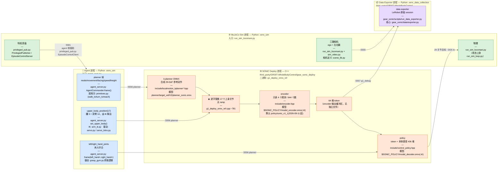
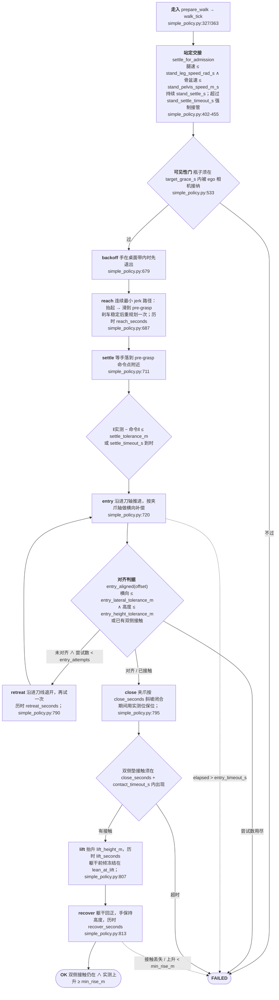
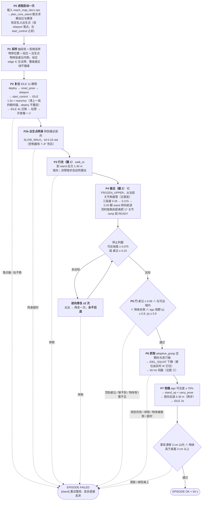
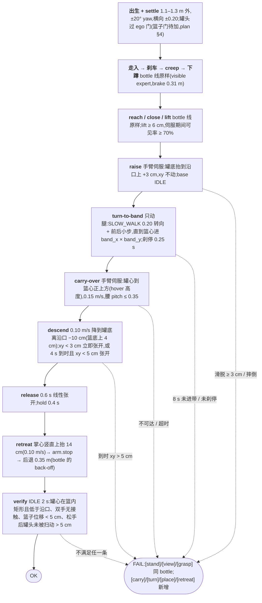

# 单臂详解：设计、原则与演化

怎么跑在 [单臂 runbook](single_arm.md)；哪天跑出什么数在 [单臂台账](ledger/bottle.md)。
这一页回答的是**为什么是这样**：专家怎么设计的、什么原则不能违反、试过什么被否掉了、
数据和模型这两端各自长什么样。

按需读，不必从头读到尾。数据集格式那几节（LeRobot 布局、schema）对双臂同样适用，
[双臂详解](bimanual_design.md) 直接链到这里。

## 一、任务与能力


| 项目 | 当前支持 |
|---|---|
| 默认任务 | `bottle_only` 场景（硬垫）+ `configs/task/bottle_whole_body.yaml`；`bottle_visible.json` 是 2026-09-14 前的基线入口 |
| 动作过程 | 随机出生 → 走近可见目标 → 减速、准备抓取 → 伸手、闭合、抬起 → 退手与验收 |
| 专家输入 | 相机可见性、机器人状态与仿真物体信息辅助规划；不是纯 RGB 策略 |
| 采集能力 | 单局检查、按成功数批量采集、exporter session、manifest、视频与状态轨迹 |
| 后续链路 | 已有 LeRobot 转换、GR00T 训练与评测入口；新配置的数据质量和学习效果需单独验证 |

成功率取决于场景和控制配置。历史实验数字见文末，不作为本页命令的成功率承诺。


## 二、复现要点与采样方法

#### 复现要点与预期成功率

另一台机器要得到与本页相同的数字，下面每一项都必须一致；任何一项不同都先比它，再谈策略：

| 项目 | 要求 | 核对方法 |
|---|---|---|
| SONIC 权重 | `policy/sonic_v1_1`（`scripts/paths.sh` 默认） | 运行目录 `deploy_receipts.jsonl` |
| deploy 二进制 | 按 [安装指南第 3 步](setup.md#3-编译-c-deploy必需) 编译，含 POSE ownership 与夹爪交接补丁 | 同上的 capability 标记 |
| 场景 | `SCENE_PRESET=bottle_only bash scripts/install_scene.sh`，回显 `finger pads HARDENED`；`simple` 线还要按 [runbook §1](single_arm.md) 再建 `outputs/scene/sim_lowcom` | 实验文件的 `scene.dir` 指向哪个，就核对那个目录的 `scene_meta.json` |
| 任务配置 | `configs/task/bottle_whole_body.yaml`，不改字段（2026-09-15 起 `visible_brake_depth` 为 0.31，此前 0.40；见下表最后一行） | 运行目录 `task_config.json`、`config_snapshot.json` |
| 采集配方 | `configs/experiments/<name>.yaml`（全展开，一次运行读的每个值都在里面） | 运行目录 `config.yaml`（逐字节副本）、`collect/inputs.json` |
| 资源 | 该 GPU 上没有第二个仿真；CPU 配额有余量 | `nvidia-smi`、`/sys/fs/cgroup/cpu.stat` |
| 闭环评测的初始 token | `--initial-token-file configs/deployment/whole_body_initial_token.json`（与这份数据的垂臂开局一致；默认的 READY token 会让 100 局全部卡在 prelude） | 评测目录 `config_snapshot.json` 的 `initial_token` 摘要 |

2026-09-14 在上述配置下的实测（同一天、同一份代码，失败按"阶段 × 连杆"分类）：

| 运行 | 结果 | 剩余失败 |
|---|---|---|
| 采样 20 局，`seed0=30000`（`outputs/bottle_hardpads_sampled20_20260914`） | 15/20 | 髋/桌接管判定 3（停得 ≤0.44 m 时）、抬升中手指/桌 1、无双侧接触 1；无滑脱 |
| 同 20 局，`visible_brake_depth` 0.40→0.31（`outputs/bottle_brake031_sampled20_20260915`，2026-09-15） | 17/20 | 髋/桌接管判定 2、腕/瓶接管判定 1；park 0.355 m（0.34–0.39），park 到全身阶段开始的骨盆前移由 10.6 cm 降到 3.4 cm |
| 固定 10 case，`seed0=31000`（`outputs/bottle_hardpads_fixed10_20260914`，软垫场景同代码为 6/10） | 7/10 | 抬升中手指/桌 1、髋/桌接管 1、无双侧接触 1；无滑脱 |

10 局批次之间本身有 ±2 局的波动（同 seed 步态不可复现），比较时至少用 20 局并按失败族对照，
不要只看总数。证据与历次改动见 [开局与抬升交接](handoff/bottle-hanging-start-20260914.md)。

#### 固定采样比较新策略

`bottle_whole_body.json` 是本页的采集入口（连续全身策略，2026-09-14 起）；
`bottle_visible.json` 是此前的基线入口，只用于与旧数据对照。
使用前安装 [POSE 与夹爪交接补丁](setup.md)，确认所选 deploy 包含两个 capability 标记。
当前实现与实验结果见 [行走准备和连续抓取](handoff/bottle-direct-20260914.md)，
上一版基线见 [固定样本验证记录](handoff/bottle-continuous-20260914.md)，
不能把“能运行候选策略”理解为已提高成功率或已验证 VLA 学习效果。

当前默认 profile 已启用 `reach.whole_body.natural_walk_prep` 和
`wrist_roi_supervisor`。自然准备同时选择停车位置和预抓姿态，以舒适关节先验、
实际网格扫掠检查及腕相机投影筛选候选；无可行候选时保持并低频重试。
停车距离包含速度相关的制动提前量，伸手目标还受实时瓶子距离约束。
ego 尺寸用连续图像确认和滞回触发抬手，腕相机稳定获取目标后停止搜索抬升，
以 2 Hz、带死区和幅度限制的画面修正维持取景。规划之间仍连续发送关节参考。
POSE 接管继承当前参考速度，并让完整未来窗口的位置与速度使用同一条有界轨迹。
开始夹紧时固定实测手部世界位置目标，保留平移跟踪补偿及其变化速度，继续限制补偿的速度和加速度；
腕部旋转补偿和舒适姿态先验保持不变，关节参考继续受速度、加速度约束；
恢复直立后先检查持瓶制动路径，再连续收住参考速度，
保持右爪闭合并交回行走控制。日志分别记录指令连续性和实测运动。
实现、逐版失败原因和新采集结果见
[自然准备、腕相机取景与连续参考](handoff/bottle-natural-expert-20260915.md)。

全身抓取的目标深度现为标定工具点前方 1.2 mm（共享指垫区间的中点），合爪窗口为该点 ±5 mm，
使瓶子进入指垫中部；规划与实测准入使用同一深度定义，保留腕、掌和桌面的碰撞检查。
伸手目标根据实测前进速度连续后退，为剩余制动行程留出空间；实际中央几何和预测停下时的深度都满足窗口后才闭合，静稳窗口仅作诊断。
跟踪补偿限制变化速度和加速度，
保留接管时的解码偏差；全身 IK 使用舒适姿态先验和速度、加速度硬约束。
当前配置关闭速度连续代价，避免其在停止伸手时继续偏好原有前进速度。
停车先发制动命令，再做耗时手臂规划，并在完成支撑制动后检查站位；
当前制动提前量上限仍为 0.10 m，实际制动距离的散布需要继续校准。
抓起和恢复直立的进度受双侧接触与掌心坐标系内的滑动速度调节，短暂失去接触时
减速并保持闭爪，稳定恢复后再继续；超时仍报告失败。具体改动、物理验证及限制见
[中部抓取、接触恢复与运动跟踪](handoff/bottle-contact-expert-20260915.md)。 后续按响应辨识、停车与全身规划、带物轨迹与稳定交接的顺序推进，见 [当前实施记录](handoff/bottle-dynamics-expert-20260915.md)。
这些改动尚不代表已验证 VLA 学习收益。

共同动作原则与此前诊断记录如下；固定髋旁手目标和固定停车距离的记录属于旧版：

- 走近时由 ego / 右腕相机的实际可见性准入仿真目标点，结合本体状态补偿身体移动。
  视觉观测在独立线程处理，先滤掉步态摆动，再以 5 Hz 更新手臂规划；关节指令连续发送，
  并限制速度和加速度。迟到的图像结果不会延长目标缓存的有效期。
- 行走阶段做保守的方向、伸手距离准备；腿部仍由 SONIC 控制，腰部平滑回到行走中性参考。
  相机短暂遮挡只沿用最后可见目标，超时不继续追踪隐藏的物体位置。
- 减速后延续同一瓶子目标与抓取方向，接入双脚支撑的全身求解，协调腰、髋和手臂。
  最终伸手不再强制经过“高处保持 → 下降 → 前插”三个路点；实际碰撞、接触与承载验收仍保留。
- 接管从当前参考开始，不瞬间跳到 READY；抬起和身体恢复继续重叠进行。
- transport guard 的预测碰撞门限（`transport_margin`）在三处含义不同：接管时允许手指
  贴着瓶子（准备好的手本来就该在那里）；伸手阶段接近后允许手指接触；闭合并持续接触
  后进入抬升，手里的瓶子对右臂不再算障碍，桌子和身体的检查不变。2026-09-14 之前
  抬升中腕部连杆碰到手里的瓶子会中止回合（81 局里 21 局，瓶子已离桌中位 8 cm），
  接管时手指贴瓶又中止 12 局。抬升高度、稳持、滑移验收没有放宽。
- 全身抓取失败后先钉住一个零速度的停止参考，再把同一姿势交还 planner 并退出 POSE 流。
  以前失败路径不退出流模式，下一局 reset 后机器人落点偏 0.10–0.12 m，
  并一直重复到批次结束（2026-09-14 当天 8 个 stand 阶段失败全部紧跟在一次全身失败之后）。
  连续专家在 engage 后只把腰部准备到中性参考，不再先送双臂 READY 基线：录制从 SONIC
  自己的垂臂参考开始，右臂在走近中按速度 / 加速度限制逐渐抬起（与双臂采集的开局一致）。
  此前的顺序会在 0.5 s 双臂抬起、1.5 s 又落回，再于走路时重新抬起。腰部准备不能省：
  engage 姿势前倾约 8°，不回中性时出生视野门限会拒绝大部分回合；而且要等实测腰角
  收敛到 0.03 rad 内再放行，手臂那档 0.30 rad 的容差会在腰还没动时就放行。

- 旧版走路阶段的手目标（2026-09-15，自然准备接入前，照双臂 `ApproachPreparation`）：从第一次规划起腕就转向入口
  姿态（手指朝前），工具点保持在抓点上方 `walk_clearance`（0.06 m）、髋旁 x 0.08（骨盆坐标系常量，
  对应双臂的 `stand_off − walk_brake_margin`：手不前伸，瓶子走过来），横向跟随瓶子，且始终留在瓶子
  后方至少 12 cm（基座会越过 0.31 m 刹车点停在约 0.2 m）；腰在双臂线的行走包络内（yaw/roll ±0.1、
  pitch 0–0.12 rad）参与求解，走路限速 `walk_joint_speed` 0.7 rad/s。这样掌心基本保持垂臂高度，
  停下后只剩约 15 cm 滑入和 5 cm 下降。同 20 seed 14/20（基线 17/20），多出的 3 局是刹停时髋/桌接管判定，
  来自走路 IK 把腰 roll 打满 +0.1。
- 2026-09-15 起的"胶囊相切"方案：走路包络去掉腰 roll；抬手由 ego 视野里瓶子的像素高度触发
  （`raise_trigger_px` 36 px ≈ 1.5 m，触发前双臂保持原样）；刹车改为"骨盆离桌沿 `visible_brake_edge`
  0.27 m 或物体深度 `visible_brake_depth` 0.31 m，先到者停"（瓶子在桌沿内 4–8 cm，所以通常是桌沿先到，
  停下时瓶子离骨盆 0.31–0.35 m；直立站在 ≤0.23 m 时右髋连杆会贴到桌面，0.27 m 无碰）；停下后的
  全身伸手里躯干前倾目标取"高度项"和"距离项（骨盆到抓点 0.30→0.60 m 线性到 `lean_max`）"中较大者，
  `bottle_whole_body.json` 把 `lean_max` 设为 1.0 rad，远瓶自动深弯；伸手终点仍由 `entry_step`
  停在抓点后 1.8 cm。之前的目标是骨盆坐标系里的固定盒子
  （z ≥ 骨盆 +0.05，掌心 0.84 m），那是清障高度：dex1 手指从掌心向下伸 19 cm，垂臂指尖 0.53 m
  低于 0.62 m 桌面。第一次尝试（抓点上方 4 cm、不用腰、0.45 rad/s）2/20，见
  [handoff](handoff/bottle-hanging-start-20260914.md#seventh-step-the-crate-style-walking-preparation-does-not-fit-this-table-2026-09-15)。
- `reach.whole_body.walk_plan_hz` 控制规划频率，`walk_filter_seconds` 控制滤波时间常数，
默认 5 Hz / 0.45 s。配置定义在 [whole_body_config.py](../src/locomani/tasks/bottle/whole_body_config.py)，
行走引导在 [walking_reach.py](../src/locomani/tasks/bottle/walking_reach.py)，
全身抓取在 [whole_body_policy.py](../src/locomani/tasks/bottle/whole_body_policy.py)。
本次固定 10 次尝试为 6/10 成功（上一版 3/10），刹车到闭合的成功样本中位数从 9.84 s 降到 6.68 s。
但实测关节步进 p99 和接管后的抬手幅度未改善，因此它仍是候选策略，不能等同于全面更平滑。
原始动作标签检查 10/10 通过；转换后的 6 集训练格式检查为 30/32 通过，尚未通过全部验收。
世界坐标轨迹复核确认 6 集都真实抬升，但图像与状态的 1–2 帧对齐疑点仍待解决，不能直接视为训练就绪。
完整指标、检查器的坐标系问题与全部失败记录见上述验证文档。

这是使用仿真几何辅助的专家，并非从 RGB 直接估计抓取位姿；数据标签是否正确与 VLA 是否学会，
需要分别检验。动作更直接不能代替真实接触成功或训练评测。

先冻结同一组目标位置、站位、出生扰动、外观和物体 yaw：

```bash
LOCOMANI_SIM_DIR="$LOCOMANI_ROOT/outputs/scene/sim" "$VENV_SIM_PY" \
  -m locomani.tasks.bottle.grasp_gym --task-config configs/task/bottle_whole_body.yaml \
  --targets water_bottle --rounds 10 --seed 31000 \
  --sample-only --write-cases outputs/bottle_cases10.json
```

然后对同一 case bank 分别运行基线和候选；保留全部十次尝试，不用成功后重采样填满：

```bash
# 两份实验文件，只差 task 块和 name：把 scene.cases 指向上面这份 bank，
# collect 设成 successes/batch_rounds 10、max_batches 1、seed0 31000
for variant in visible whole_body; do
  bash scripts/single_arm/run_agent_server.sh configs/experiments/bottle_fixed_${variant}.yaml --gpu 0
done
```

不足 10 条成功时采集阶段返回非零退出码，但失败记录和视频仍保留。
case bank 绑定场景 metadata hash，并须覆盖整个尝试预算；换场景须生成新 bank。
固定的是采样条件，异步控制、接触和渲染时序仍可能使重复实验产生不同结果。


## 三、观测、动作与专家设计

#### 相机与动作

默认 exporter 录 ego、左腕、右腕三路；单臂训练配置
[gr00t_sonic_2cam.py](../configs/gr00t_sonic_2cam.py)使用 ego + 右腕。
原始记录、转换后的训练字段和控制器命令不是同一种数据格式，字段说明见 [数据指南](single_arm_design.md)。
第三人称画中画用于检查，不能替代训练相机。

验收时核对完整走近与抓取过程、真实抬升和持物结果，以及 manifest / session 的对应关系。
`collect.record=true`（默认）才触发 episode 录制，失败尝试不作为成功示范保留；
`produced` 用于判断该行是否对应 exporter episode，不能只数 `ok`。
逐局指令通过 manifest 传给转换器，不应全部替换为 exporter 的单条 session prompt。

转换步骤、图像/动作对齐、`--trim-verification-tail` 与数据检查统一见 [数据集转换](single_arm_design.md)；
训练和闭环结果分别见 [训练](single_arm_design.md)、[评测](single_arm_design.md)。
分享或打包视频执行 [视频导出规则](rendering.md#video-export)：保留原片，
每条预览压到几百 KB，最多 **500,000 字节**，保持完整时长和正常速度。

### 调整任务

| 想调整什么 | 修改入口 | 注意事项 |
|---|---|---|
| 出生距离、朝向、横向偏移、目标沿桌沿散布 | 任务 JSON 的 `spawn` | 当前 profile 的桌边距离为 1.1–1.3 m；不等于裸 CLI 的默认分布 |
| 目标与语言指令 | `target`、`prompt` 与场景目标池 | 指令必须对应场景中实际存在的目标 |
| 抓取策略、站位和接近行为 | `reach` | 沿用已有策略入口；改控制逻辑用 [bottle 代码导航](reference/change-map-bottle.md) |
| 桌高、物体形状和尺寸 | `scene_lib.py` 与场景构建入口 | 重建场景、使用新输出目录；配置文件不会自动改几何 |
| 外观与相机 | sim 外观设置、相机配置 | 采集阶段固定 `SCENE_RANDOM=0`；改变记录相机时同步数据配置 |

直接调用 gym 时，已支持的选项按默认值 → 任务 JSON → 显式 CLI 合并。
先用无需模拟器的命令检查实际参数来源：

```bash
"$VENV_SIM_PY" -m locomani.tasks.bottle.cli_args \
  --task-config configs/task/bottle_whole_body.yaml
```

命令行覆盖项按组分开：`collect.*` 改采集规模（成功条数、每批轮数、种子），
`task.*`（含 `task.spawn.*`、`task.reach.*`）改专家行为，`scene=` 换场景。
要复现的配方就是 `configs/experiments/<name>.yaml` 本身——复制一份改几行，不要把一长串覆盖项留在 shell 历史里；
跑之前用 `--dry-run` 看一眼会执行什么，跑完以运行目录里的 `config.yaml` 为准。
`task` / `backend` / `eval` 三块的字段含义和默认值以 [生成的配置表](reference/config_fields.md)为准；`collect` 和 `train` 不是 dataclass，不在那张表里，逐字段说明写在 `configs/experiments/bottle_simple_200.yaml` 的注释中。组合规则见 [运行基础设施](single_arm.md)。

#### 连续全身候选的动作原则

`reach.strategy=whole_body` 沿用相同走近和采样入口，在走近时逐渐准备手臂，减速后让
腰、髋、手共用带速度/加速度约束的支撑参考。三个腰部自由度均可参与。
接近可抓区域时开始闭合，持续双侧接触后抬升；物体离桌后，抬升和恢复直立重叠进行，
手相对躯干的位置保持不变，不再向身体回收（此前 6 cm 的回收加上躯干直立会把肘折到
胸前的别扭角度）。抬升高度由 `reach.whole_body.lift_height`（默认 0.06 m）、时长由
`lift_seconds`（默认 5 s）给出，躯干直立本身再额外抬高约 0.2 m。此前 0.16 m / 3 s
的组合让瓶子以约 13 cm/s 上升 35–41 cm，2026-09-14 的 30 局里有 4 局从爪中滑出。
回到走路控制前预发保持夹爪和上肢的 planner 命令，再退离桌边并验收稳持。

仿真位姿辅助几何规划，但目标须通过真实 ego/右腕图像的新鲜度和近似可见性检查，
短时遮挡只沿用上次可见目标；不会用隐藏的新位置无限追踪。可见性由相机几何和 ray
近似判定，尚不是 RGB 位姿估计器。碰撞、物体被推走、失去接触或身体不稳定仍判失败。
支持约束和连续参考不能保证 SONIC 的实际动作同样平滑，应同时检查参考与执行轨迹。

运动参数集中在 `reach.whole_body`，通过类型化配置传到消费者；不增加散落的环境变量。
抓取后的退离与稳持验收沿用原标准。训练转换只截去已标记的末端验收尾段，不删除
任务中间的停顿来掩盖控制问题。参数和证据分别见配置表与验证记录。

#### 简化单臂专家（`reach.strategy=simple`，2026-09-16）

和双臂线同形：回合开始站立时双臂以 1.0 rad/s 收到配置的下垂姿态（`prepare_walk`，实测到 0.15 rad 内即走，上限 3 s；走路期间不再有任何手臂动作）（`reach.simple.hang_*`：肘 1.2、肩滚外展 0.45、腕关节全零，左臂镜像），手腕不做任何翻转，整臂比规划器的下垂姿态离身体远 8 cm（骨盆外 30 cm），腕相机 80° 视锥内到自身几何 ≥ 35 cm（离线射线扫描；外展 0.25 打到大腿 12 cm；前臂前伸的姿态会改变步态，停位冲到 0.08–0.10 m）；不跟踪瓶子。步态一结束（骨盆 < 0.10 m/s、腿 < 0.50 rad/s，不等静止）就接管 POSE，`stats.stand` 记录站姿；接管时两只手显式张开。之后是一条连续的最小加加速度路径：手在桌面高度带且离桌沿
不足 6 cm 时先后缩 10 cm，竖直抬到 max(抓取高度 +8 cm, 桌面 +12 cm) 并前移 10 cm，按
停稳后的位置重算接近线，滑到预抓取点；然后一段 8 cm/s 的进入，横向按实测掌坐标偏移
在线修正（3 cm/s、最多 4 cm），到位或双侧接触即闭爪 → 抬升 → 躯干回正，交接给规划器。
手指方向不沿骨盆到瓶子的方位，而是随瓶子向右的偏移向内转（1.2 rad/m，上限 20°）：
离线 IK 在 8 个实测站位上扫描，手指朝前到向内 20° 的关节余量最大（65–70°），沿方位
向外 30–40° 只有 42–55°，向内 60° 只剩 17–27°。前倾只按前向深度算（0.30 m 内为 0）。
站位由刹车时的步速决定，不由刹车点决定：规划器停步会随步态相位冲出 0.02–0.26 m，
而 v1.1 的 shuffle 指令（0.20）低于它的速度阶跃（0.28–0.30），减速带原本不减速。
`reach.visible_shuffle_speed` 0.32 配 0.60 m 减速带让最后半米慢速爬行，刹车沿 0.40
（`visible_brake_depth` 0.44）使停稳站位落在离桌沿 0.20–0.31 m。下垂的 Dex1 手几何
最前端在骨盆前 0.15–0.18 m、高 0.55–0.72 m，正是桌面高度带，站位 < 0.22 m 时手在
抬起前就贴着桌面（离线用 `TransportGuard` 在状态轨迹上复现，`stage4_hang8`…`8e`）。
只保留实测硬门：碰撞扫描、摔倒、瓶子被撞离 5 cm、闭爪后双侧指垫接触、抬升后瓶子
上升 ≥4 cm，以及各相位超时；没有终端观测器、异步站姿规划、静止窗和进度调速。
字段在 `reach.simple.*`（`docs/reference/config_fields.md`）。配套场景
`outputs/scene/sim_lowcom` 由 `build_sim_scene.py --object-com-drop 0.05` 生成，把
瓶子重心下移 5 cm，使单边指垫先碰到时瓶子倾向滑动而不是倾倒。

```bash
bash scripts/single_arm/run_agent_server.sh configs/experiments/bottle_simple_gate8.yaml --gpu 0 --name <run>
```


## 四、Pick-and-place 这条变体


| 项目 | 当前支持 |
|---|---|
| 默认任务 | `pick_place` 场景 + `configs/task/pick_place.yaml`；目标 `soup_can`、容器 `basket` |
| 动作过程 | 随机出生 → 走近、抓起 → 抬高避开篮沿 → 转向放置区域 → 移到篮上、下降松手 → 退手与验收 |
| 专家输入 | 复用单臂专家；仿真罐头/篮子位姿、机器人状态和相机可见性辅助规划 |
| 采集能力 | 单局检查、按成功数批量采集、exporter session、manifest、视频与状态轨迹 |
| 后续链路 | 复用单臂数据接口；该任务的 LeRobot 转换、训练及闭环学习效果尚未验证 |

当前是固定篮子、右手放置的实验任务，没有开放任意容器、左右手选择或通用搬运。
放置阶段仍分开执行移步与手臂伺服，不能据此承诺全过程无停顿。
旧 10 成功 pilot 的测量保留在 [pick-and-place 台账](ledger/pick_place.md)，不代表当前成功率。

### 产物与验收

以下路径相对于本次运行目录 `outputs/runs/<name>/`：

| 路径 | 内容 / 查看方式 |
|---|---|
| `task_config.json`、`reach_config.json`、`scene/` | 本次任务、抓取配置及场景副本 |
| `config_snapshot.json`、`deploy_receipts.jsonl` | 配置、输入身份与部署模型 |
| `collect_00.log`、`commands.jsonl`、`timings.jsonl` | 专家日志、阶段启动命令与阶段耗时 |
| `collect/manifest_00.jsonl` | 每次尝试的指令、结果、`produced`；放置指标和轨迹在 `execution.metrics.place` / `execution.metrics.place_trace` |
| `collect/inputs.json` | session / manifest 的有序配对及采集进度 |
| `collect/videos_00/*.mp4`、`collect/state_trace_00/` | 完整过程原片及物理轨迹 |
| `/workspace/tmp/p03/outputs/<时间戳>/` | exporter 原始 session；配对以 `inputs.json` 为准 |

#### 相机与动作

exporter 默认记录 ego、左腕、右腕；该任务复用单臂 schema，
[训练配置](../configs/gr00t_sonic_2cam.py)选 ego + 右腕和右手动作。
任务指令由 profile 的 `prompt` 写入 manifest，包含抓取和放置两个目标。
第三人称画中画不能替代训练相机；字段、转换与对齐见 [数据指南](single_arm_design.md)。

验收需要罐头真实落在篮内且低于篮沿、手已离开，篮子移动和退手后的扰动在配置允许范围内。
当前判据不要求罐头最终竖直。检查以下内容：

- 完整走近、抓取、转向、放置和退手过程；不要在刚抓起或刚松手时截断视频。
- manifest 的 `ok` / `produced` 与 session 配对；失败尝试保留诊断，不作为成功示范。
- `execution.metrics.place` 的释放误差和最终偏移，以及 `execution.metrics.place_trace` 的掌系漂移。
- 篮子在决策与放置过程中的可见性；记录中可见不等于已经证明 VLA 可学。

成功结果中的 `training_tail.end_seq` 为后续裁去验证尾段提供边界。
使用 [转换与检查流程](single_arm_design.md)验证后才能称为训练数据；本任务尚未完成这一验证。
分享视频执行 [视频导出规则](rendering.md#video-export)：保留原片，预览每条最多
**500,000 字节**，保留完整时长和正常速度。Isaac 下篮子贴图仍需单独检查。

### 调整任务

| 想调整什么 | 修改入口 | 注意事项 |
|---|---|---|
| 出生与罐头沿桌沿随机化 | `task.spawn`（`configs/task/pick_place.yaml`） | 当前距离为桌边 1.1–1.3 m，罐头采样还受 `place.goal_gap` 约束 |
| 抓取高度和策略 | `reach` | 更换罐头后检查抓取模板覆盖、碰撞和实际持物稳定性 |
| 放置区域与运动速度 | `place.band_x/band_y`、`v_travel/v_descend` | 区域在骨盆坐标系；同时检查脚步能否到位和持物 IK 可达性 |
| 下降与松手 | `release_clearance`、`place_tol/place_tol_late`、相关 timeout | 深度相对篮沿；放宽容差不能代替篮内落物检查 |
| 容器和任务指令 | `goal`、`prompt`、场景几何及 `goal_inner_half` | 当前篮子固定；更换尺寸或位置需同步验收范围与可见性 |

字段含义和默认值见 [配置表](reference/config_fields.md)。
命令行覆盖项按组分开：`collect.*` 只调采集规模，任务参数用 `task.*` 或换一个 `task=` profile
（组合规则见 [运行基础设施](single_arm.md)）。
无需启动仿真即可查看 gym 对该 profile 的解析：

```bash
"$VENV_SIM_PY" -m locomani.tasks.bottle.cli_args \
  --task-config configs/task/pick_place.yaml
```

改变物体或容器几何后，先检查抓取模板、持物放置带 IK、出生/抓取/放置时的相机视野，
再跑实际单局。旧测试坐标和成功率不能代替新场景的验证。
当前控制流程及参数消费者位于 [place_phase.py](../src/locomani/tasks/bottle/place_phase.py)，
改代码从 [任务导航](reference/change-map-bottle.md)进入。


## 五、训练端：模型、超参数与 checkpoint

### 产物与验收

以下路径相对于本次运行目录(即 `outputs/runs/<name>/`):

| 路径 | 内容 |
|---|---|
| `model/checkpoint-<steps>/` | 训练产出的 checkpoint(权重 + 归一化 processor) |
| `train/train.log` | `launch_finetune` 的标准输出(loss、保存记录) |
| `train/manifest.json` | `checkpoint`/`train_dataset` 路径、`steps`/`gpus`/`global_batch` 指标、config 与上游 hash |
| `run_config.yaml`/`run_config.json` | 这次运行完整解析后的配置,训练用到的所有字段都能在这里查到 |

#### bottle200 实测配置(模型与输入输出)

| 项 | 值 |
|---|---|
| Base model | `nvidia/GR00T-N1.7-3B`,embodiment `unitree_g1_sonic`(projector **slot 11**,公开权重里该槽为空,从随机初始化训) |
| 视觉输入 | 2 路 RGB:`ego_view` + `right_wrist`,crop 230 → 256×256。**不用** left_wrist(左臂全程不动,纯静态贴图);这份历史配方用的是 `configs/gr00t_sonic_2cam.py`,不是当前 `g1_single_arm` embodiment 的默认 `gr00t_sonic_3cam.py`(见本页“训练端”的 modality 表) |
| State | **53 维** = 官方 46 + right_wrist_pos 3 + right_wrist_abs_quat 4(FK 腕位姿,pelvis 系,真机可得非特权)。绝对 yaw 类(root_orientation 等)**刻意不进** —— 随机出生 yaw 下它是查表捷径 |
| Action | **65 维** = motion_token 64 + right_gripper 1。左手 7 维 std 恒为 0、右手 7 维 rank-1,官方 78 里其余 13 维是常数,留着只会稀释指标 |
| Action horizon | 40 步 chunk @30 Hz(1.33 s);推理去噪 4 步 |
| 语言 | 单指令;SONIC 的语言键是 `annotation.human.task_description` |
| 时间历史 | 无(单帧观测)。列为第一消融项 |

#### 可训练参数

| 模块 | 参数量 | 训练? |
|---|---|---|
| DiT(flow-matching action head) | 1,091.7 M | ✓ |
| vl_self_attention + vlln | 201.4 M | ✓ |
| Projector bank(32 槽) | 325.8 M(**有效梯度只有 slot 11 的 10.2 M**,其余 31 槽白占 ~2.5 GB Adam 状态) | ✓ |
| 视觉塔 / 语言塔(Cosmos-Reason2-2B) | — | ✗ 冻结。200 局单场景解冻视觉塔 = 把通用特征换成对这张橙桌的记忆 |
| **合计** | **1.62 B** | |

#### 优化

| 项 | 值 |
|---|---|
| lr / schedule | 1e-4,cosine,warmup 5% |
| optimizer | AdamW fused,weight decay 1e-5 |
| batch | 64(2×5090 单次装下,实测 ~1.3 it/s,10k 步 2h07m) |
| checkpoint | 每 1000 步、**10 个全留**(`save_only_model`,各 6.5 GB)。默认 `save_total_limit=5` 会把前半程删光,而过拟合恰恰在前半程见分晓 |
| 归一化 | q01/q99 percentile,**统计量来自训练集并冻进 checkpoint 的 processor** —— 评测/部署自动用训练统计,无泄漏 |

#### 为什么 checkpoint 事后选、不训练中选

GR00T 没有验证集机制(`DatasetFactory.build` 断言 `eval_strategy == "no"`)。
流程是:数据集层面切 180/20(`convert` 阶段的 `--holdout`,按采集 chunk 分层,
字段是 `train.holdout`)→ 训完对若干 checkpoint 逐个跑开环评测 → 按 held-out
token nMSE 选,平票取**更早**的那个。bottle200 实测 nMSE 0.314 → 0.1415
**单调降**,最优 = 10000,无过拟合。

#### Token 的三个不能不知道

1. **motion_token 是 FSQ 离散码**,不是连续 latent:每维 32 格、步长 1/16(从
   encoder ONNX 的 `/quantizer` 节点直接读出)。回归输出必须吸附回格点
   (`src/locomani/backends/sonic/sonic_token.py`),训练/评测/部署三处一致。
2. **token 空间的 MSE 没有物理意义**,要读误差得过一遍 SONIC 自己的 decoder 换算
   成关节角度(`src/locomani/backends/sonic/sonic_decoder.py`,自带噪声底 ~1.1°)。
3. **GT token 开环回放也抓不到瓶子**(浮动基座 1 分钟漂 0.77 m),开环指标只能
   当体温计,验收必须闭环。

### 调整任务(控制逻辑+判据表)

`train` 阶段的 `TrainConfig`(`configs/train/*.yaml`,`src/locomani/pipeline/train_config.py`)
只暴露 `steps`/`save_steps`/`holdout`/`gpus`/`global_batch`/`squat_max`/`base_model`
七个字段,通过 `train.<field>=<value>` 覆盖,例如
在实验文件里把 `train.steps` 改成 20000、`train.gpus` 改成 2,再跑 `scripts/train.sh`。
它们只是 `launch_finetune` 完整超参数的一个子集;下面是完整表,直接调用
`bash scripts/train.sh`(而不经过 `scripts/train.sh`)时才用得上全部选项。

#### `launch_finetune` 完整超参数表

完整超参数来自 `tyro.cli(FinetuneConfig, ...)`
([`src/gr00t/configs/finetune_config.py`](../src/gr00t/configs/finetune_config.py))
——这个 dataclass 的每个字段就是一个 CLI flag(tyro 把 `snake_case` 转成
`--kebab-case`;`bool` 字段同时生成 `--flag`/`--no-flag` 两个开关,
`train.sh` 里的 `--tune-projector`/`--no-tune-visual` 就是这么来的)。
**脚本末尾的 `"$@"` 会把额外参数原样透传**,覆盖任意一项不用改脚本,直接追加
即可,例如 `bash scripts/train.sh --learning-rate 5e-5`。

##### 数据 / 模型路径(必填,无默认值)

| flag | 说明 |
|---|---|
| `--base-model-path` | 预训练权重路径(HF hub 或本地目录) |
| `--dataset-path` | 数据集根目录,多个数据集用 `os.pathsep` 分隔 |
| `--embodiment-tag` | embodiment 标签(大小写不敏感) |
| `--modality-config-path` | modality config `.py` 路径;不给就用 `embodiment_configs.py` 里预注册的(见下节) |

##### 模型微调开关

| flag | 默认 | 说明 |
|---|---|---|
| `--tune-llm` | False | 是否微调 LLM 骨干 |
| `--tune-visual` | False | 是否微调视觉编码器 |
| `--tune-projector` | **True** | 是否微调 vision/language → 共享空间的 projector |
| `--tune-diffusion-model` | **True** | 是否微调 diffusion action decoder |
| `--state-dropout-prob` | 0.2 | state 输入的 dropout 概率 |

上表只是 `FinetuneConfig` 暴露给 CLI 的部分。`Gr00tN1d7Config`
([`src/gr00t/configs/model/gr00t_n1d7.py`](../src/gr00t/configs/model/gr00t_n1d7.py))
里实际的 `tune_*` 训练开关共 6 个,CLI 只暴露上表 4 个,另 2 个改不了:
`tune_top_llm_layers`(LLM 最后 N 层单独解冻,默认 0 不启用)和 `tune_vlln`
(`vlln` LayerNorm + `vl_self_attention`,**永远为 True、永远参与训练**,
对应上文「可训练参数」表里的 "vl_self_attention + vlln 201.4 M")——要改这两个
只能直接编辑该文件的默认值。同一份文件里还有几个不在 CLI 里的架构选择开关:
`select_layer`(12,LLM 只保前 12 层,是砍大小不是冻结)、`use_vlln`、
`use_alternate_vl_dit`(`AlternateVLDiT` 还是普通 `DiT`)、`add_pos_embed`。

##### 数据增强

| flag | 默认 | 说明 |
|---|---|---|
| `--random-rotation-angle` | None | 图像随机旋转最大角度(度) |
| `--color-jitter-params` | None | dict:`brightness`/`contrast`/`saturation`/`hue`;不给用预训练模型自带的默认增强 |
| `--use-percentiles` | True | state/action 归一化用 q01/q99 百分位,而非 min/max |

##### 训练超参数

| flag | 默认 | 说明 |
|---|---|---|
| `--global-batch-size` | 64 | 梯度累积**之前**的总 batch |
| `--gradient-accumulation-steps` | 1 | 累积步数;有效 batch = 两者乘积(`__post_init__` 在 >1 时会打印提醒,防止把累积前的值当成真实 batch) |
| `--learning-rate` | 1e-4 | 初始学习率 |
| `--warmup-ratio` | 0.05 | warmup 占总步数比例 |
| `--weight-decay` | 1e-5 | AdamW weight decay |
| `--optim` | `adamw_torch` | 可选 `adamw_bnb_8bit`(需 bitsandbytes,量化 Adam m/v,单卡塞得下的关键,见下面「单卡训练」) |
| `--max-steps` | 10000 | 总训练步数(即 `train.steps`) |
| `--num-gpus` | 1 | 参与训练的 GPU 数(即 `train.gpus`) |

##### 输出 / checkpoint / 日志

| flag | 默认 | 说明 |
|---|---|---|
| `--output-dir` | `./outputs` | checkpoint/日志输出目录 |
| `--experiment-name` | None | wandb run 名;不给用 `output_dir` 的 basename |
| `--save-steps` | 1000 | 每多少步存一次 checkpoint(即 `train.save_steps`) |
| `--save-total-limit` | 5 | 最多保留几个 checkpoint,超了删旧的(`train.py` 固定传 `SAVE_LIMIT=1`) |
| `--save-only-model` | False | 只存模型权重,不存 optimizer/scheduler/RNG 状态(省盘,但不能 resume) |
| `--resume-from-checkpoint` | False | 从 `output_dir` 里最新的 `checkpoint-*` 续训;和 `save-only-model=True` 不兼容(`experiment.run` 里强制检查) |
| `--use-wandb` | False | 是否记录到 wandb(`train.py` 固定关闭) |

数据集分片/采样(`--shard-size`/`--episode-sampling-rate`/`--num-shards-per-epoch`/
`--ds-weights-alpha`)控制预加载与多数据集混合权重,默认值对单数据集训练够用。

#### `--modality-config-path`:训练脚本怎么读 LeRobot 数据集

`--modality-config-path` 由 `train` 阶段自动传成
`run_cfg.embodiment.gr00t_modality_config`(`configs/embodiment/*.yaml` 的字段);
`g1_single_arm` 当前默认 [`configs/gr00t_sonic_3cam.py`](../configs/gr00t_sonic_3cam.py)
(官方 46/78 布局,三路相机全录),`g1_bimanual` 默认
[`configs/gr00t_sonic_3cam_bimanual.py`](../configs/gr00t_sonic_3cam_bimanual.py)。
上一节 bottle200 的 53/65 维配方用的是另一个仍然存在的文件
[`configs/gr00t_sonic_2cam.py`](../configs/gr00t_sonic_2cam.py)(改
`configs/embodiment/g1_single_arm.yaml` 或覆盖 `train.base_model` 能切回它)。
不管选哪个,它 `import` 时都会原地覆写 `MODALITY_CONFIGS["unitree_g1_sonic"]`
(NVIDIA 官方 slot 11 配置)。以 2cam 配方为例,它声明的字段是:

| modality | modality_keys | 维度 |
|---|---|---|
| `video` | `ego_view`、`right_wrist`(丢弃 `left_wrist`) | 2 路 |
| `state` | `left_leg`、`right_leg`、`waist`、`left_arm`、`right_arm`、`left_hand`、`right_hand`、`projected_gravity`、`right_wrist_pos`、`right_wrist_abs_quat` | 53 |
| `action` | `motion_token`、`right_gripper`,`delta_indices=range(40)`(预测 40 步的 action chunk) | 65 |

这些 `modality_keys` 名字必须能在数据集的 `meta/modality.json` 里按名字找到
(`lerobot_episode_loader.py:328` 的 `_extract_joint_groups`);找不到**不会
报错**,只打一句 `Warning: Joint group '...' not found` 然后静默丢掉那个字段
(`lerobot_episode_loader.py:339-342`)。**换一个新数据集训练前,先拿这张表的
`modality_keys` 逐项核对它的 `meta/modality.json`**,少一个,训练照样收敛,
只是悄悄瘸了一路输入或监督,不核对根本看不出来。

`meta/stats.json`(不要跟数据集自带的逐集统计 `meta/episodes_stats.jsonl` 搞混,
前者是 GR00T 要的**跨全部 episode 合并**的归一化统计,天生没有)是另一个硬
依赖,但会自愈:`LeRobotEpisodeLoader._load_metadata()` 对它是硬 `assert`
(`lerobot_episode_loader.py:180`),但 `DatasetFactory.build()` 会先在 rank-0
上调 `generate_stats()`/`generate_rel_stats()`(`factory.py:56-59`)——**缺失时
自动生成,不是人工步骤**。`train.sh` 的启动前检查不会替你等生成,缺失
时直接报错退出并打印生成命令(排错见 [runbook §9](single_arm.md))。

#### 单卡训练:`SINGLE_GPU=1`

`train.gpus=1` 时 `train.py` 会自动设 `SINGLE_GPU=1`;直接调用脚本
时也可以手动指定:

```bash
SINGLE_GPU=1 RUN=<name> DATA=<train_ds> bash scripts/train.sh
```

双卡需求从来不是算力,是 Adam:1.62B 可训参数的 fp32 m/v 就要 13 GB,加上主权重、
梯度、冻结 VLM 和激活约 33 GB,超出单卡 31.4 GB。ZeRO-2 靠**分片**解决;这个开关
靠**量化**解决(`adamw_bnb_8bit`,13 → 3.2 GB)。三个数字全是实测:per-device 32
OOM(峰值 32.1 GB)、16 能跑但只剩 950 MiB 余量、**8(accum 8)峰值 27.0 GB** ——
有效 batch 恒为 64,lr 与实验可比性不变。代价 ~1.4 s/it,10k 步约 3.9 h
(双卡 2.1 h),换回第二张卡做并行实验。


## 六、评测端：指标、判据与控制逻辑

#### 加速评测(A+C+B 筛选 harness)

一场 100 轮全预算闭环 ≈ 3.1 小时(失败轮 ~138 s = 90 s 预算烧满 + ~48 s 出生/
站立/走位开销),两臂 A/B ≈ 6 小时。三个正交的杠杆把筛选压到 ~1 小时:

- **A 并行实例**:两臂各占一个 stack(`INSTANCE=0/1`,DDS domain + 端口块隔离),
  policy server 各占一张 GPU,端口 **6590/6591**——不是 5590,因为 INSTANCE=1 的
  keyboard 端口恰好是 5590。
- **B 筛选预算**:`eval_closed_loop.py --budget 60`(梯子是 90)。偏差两臂共享
  且**永远朝下**(round 4 实测 7/48 的成功落在 60 s 之后)。结果 JSON 记
  `budget_s`,`full_budget` 只在 90 s 且无 stall-abort 时为 true。
- **C 序贯停止**:按轮配对(同 seed → 同初始条件;`appearance` 不一致直接拒测),
  每 20 配对轮一次 look:interim p<0.01 判 DIFFERENT,final(n=100)p<0.05,
  **追不上显著性就 FUTILE 提前收**。Pocock 风格的筛选阈值,不是精确的 STEP。

**筛选出的赢家必须再过一次 90 s 全预算确认才算数**(round 4 的教训:50 轮 A/B
报出的 +12 点在全预算配对下是 p=0.755 的噪声)。FUTILE 则是真实的"不值得再烧
6 小时"。

编排这套流程(两个并行 stack + 按轮做序贯 look)的脚本 `scripts/seq_ab.sh` 已随
本轮重构下线,配对/序贯判定逻辑本身还在 `src/locomani/pipeline/seq_mcnemar.py`,
但目前没有替代的一键驱动脚本。等价效果目前要拼:复制两份实验文件(一份加 `eval.ensemble_n=3`/`eval.ensemble_m=0.3`,
一份不加,两份都把 `eval.budget_s` 调小),各在一张卡上 `bash scripts/single_arm/run_vla_inference.sh <run> --gpu N`,
跑出两份 `closed_loop.json` 与 `traces/`,再手动喂给 `seq_mcnemar.py` 做配对判定。下面
几节里具体的历史命令(`seq_ab.sh` 的选项)因此不再能直接照抄执行,
保留仅供理解方法论与复核历史数字。

已用 2 轮 smoke 端到端验证过这套机制:双 stack 共存、按 appearance 配对、序贯
look、判定后自动清场。

逐日实验记录(2026-08-27 起的并行罚项、配对规则、观测流审计、stand-start 漂移定位、
干净全任务基线)已移入 [单臂台账](ledger/bottle.md)。

### 产物与验收

#### open-loop:自研 nMSE(`eval_open_loop.py`)

全部指标都配 persistence 基线(块首真值动作保持整块——数据 30.6% 的帧 token
与前帧相同,不摆这条线任何 MSE 都读不懂):

| 指标 | 定义 | 体现的性能 |
|---|---|---|
| `nmse_token` | 对 snap(量化吸附)后的 64 维 token 预测算 nMSE = MSE/var(gt),逐维归一化后再平均 | token(身体动作)预测的整体准确度,1.0 = 不如预测均值 |
| `nmse_token_unsnapped` | 同上但用 snap 前的原始连续预测 | 衡量量化吸附本身修正了多少误差 |
| `nmse_gripper` | 单独对 gripper 1 维算 nMSE | 抓取相关的关键维度单独评估,避免被 64 维 token 稀释 |
| `hit_rate_per_dim` | 预测(snap 后)token 索引与真值 token 索引相同的逐维命中率均值 | FSQ 空间每维实际只用 2–5 个格点,离散空间里命中率可读、MSE 不可读 |
| `hit_rate_all64` | 要求同一帧 64 维**全部**命中的比例 | 更严格的整体正确率 |
| `gripper_mae` | 预测与真值 gripper 值的平均绝对误差 | gripper 连续值(开合程度)的平均绝对误差 |
| `close_frame_gt` / `close_frame_pred` | 真值/预测 gripper 信号第一次穿过(真值的)5%–95% 分位数中点的帧号 | 夹爪开始闭合的时间点,两侧都用真值量程判定 |
| `close_frame_err`(及 `close_frame_err_abs`) | 预测闭合帧号 − 真值闭合帧号 | 抓取时机的提前/滞后帧数——任何 MSE 都看不见它 |
| **`deg_mean` / `deg_p95` / `deg_max`** | 真值/预测 token 分别喂 SONIC decoder(观测固定),取关节指令差的均值/95 分位/最大值,单位度 | **头条数字**,有物理单位 |
| `degrees_noise_floor` | decoder 对真值 token 的重建输出与实际记录关节指令的误差均值 | 误差最低可信线(~1.1°),低于它的差异不作数 |
| persistence 基线(每个指标各一份) | 块首真值动作原样冻结、复制到区间所有帧 | 判断模型是否只学到了数据的强自相关而非真实动力学 |

#### open-loop:官方(`gr00t/eval/open_loop_eval.py`)

跑的是 NVIDIA 自己的脚本,不是上面这套自研 nMSE。只有两个原始(未归一化)标量
指标,64 维 token + 1 维 gripper 一起求平均,不拆分、不归一化:

| 指标 | 定义 |
|---|---|
| MSE / MAE(单轨迹) | 对整条轨迹所有时间步、所有动作维度一起求均值/均绝对值 |
| 平均 MSE / MAE(跨轨迹) | 每条轨迹的值再取算术平均 |
| 轨迹曲线图 | 每维一张 subplot(gt/pred/state joints 三条线 + 重规划红点),不产出可比较的数字 |

每张图对应一条轨迹(65 个纵向子图:64 token + 1 gripper);官方脚本对每条轨迹的
图用同一个文件路径,多条轨迹会互相覆盖,所以脚本跑完统一把图挪到
`<out-dir>/plots/`。产出:每条轨迹一张对比图、`<out-dir>/metrics.json`、
`<out-dir>/run.log`。`--model-path`/`--dataset-path` 传反会在加载模型前就报错;
checkpoint 记录的 backbone 目录在本机不存在时也一样(`records its VLM backbone at ...,
which does not exist here`),按本节“绕开 stage 手工跑评测”加 `--backbone-path`。

**两套结果互相印证**(`scripts/crosscheck_open_loop.sh`,10 个 checkpoint,
Spearman rho +0.988,选出的最优 checkpoint 一致)——说明自研这一层(轨迹迭代、
execution-horizon 索引、指标算术)与官方实现一致。踩过一次坑:**官方 eval 的
`--steps` 默认 200,会静默截断**,val episode 长 546–832 帧、夹爪闭合在第 327 帧,
默认参数只评了走路段。改成按最长 episode 推导(832)后 rho 才从 +0.952 升到
+0.988。这个默认值对短 demo 合适,对长 episode 是静默截断。

<!-- ### bottle200 基线(checkpoint-10000,20 局 val)

| horizon | nMSE token(persistence) | 关节角差(persist.) | 闭合误差(persist.) |
|---|---|---|---|
| 1 | 0.120 | 1.05°(—) | 1.4 帧 |
| 16 | 0.142(0.323) | 0.93° | ~3 帧 |
| 40 | 0.176(0.895) | 1.30°(4.21°) | 4.9 帧(23.4) |

误差随 horizon 增长很缓,整块 1.33 s 可信;关节角差已到噪声底(1.16°)。 -->

#### closed-loop:初始 token 文件

**初始 token 文件必须与训练数据的开局姿势一致。** 采集阶段(`scripts/single_arm/run_agent_server.sh`)
的初始 token 文件默认是 `configs/deployment/ready_grasp_initial_token.json`
(READY 抬臂姿势的裸 64 维 token,prelude 之后按 `ready_q()` 的手臂检查)。用
`bottle_whole_body` 采的数据从 SONIC 自己的垂臂参考开始(2026-09-14 起),对应
文件是 `configs/deployment/whole_body_initial_token.json`:190 集训练数据首帧
token 的量化均值,外加 `arms` 字段(首帧实测 14 个手臂关节,MuJoCo 顺序),
prelude 改按它检查。拿错文件的症状是 100 局全部 `[stand] token-only ready
posture not delivered`(2026-09-14 实测 10/10)。带 `arms` 的 dict 形式和裸列表
形式都能被 `initial_pose.load_token_file` 读取。选哪一份由 **`eval.initial_token`** 决定
(2026-09-17 起;此前 `eval` 阶段硬编码 `ready_grasp_initial_token.json`,不按任务切换)。
瓶子线的 `configs/eval/closed_loop_100.yaml` 已指向 `whole_body_initial_token.json`:
`bottle_simple` 的 200 集数据首帧手臂姿态与该文件逐关节相差 ≤0.3°。

#### closed-loop:输出与验收

`outputs/runs/<name>/eval/` 下:`closed_loop.json`(`rounds`/`successes`/
`success_rate`/`wilson95`/`stand_retries_used`/失败阶段分布)、`traces/`(逐局位姿与失败签名)、
`videos/`、`serve.log`、`eval.log`。**验收只看 `success_rate` 配它的 Wilson
区间**——20 局能筛选方向,不能当最终数字(见本节开头的筛选 harness);任何要写进文档/论文的数字都
要 100 局全预算跑出。

**`[stand]` 失败就是这一局失败,不重试**(`stand_retries` 自 2026-09-17 起默认 0)。
采集侧一直就是这么算的(`task.stand_retries` 处处为 0),反倒是要出数字的评测侧此前宽松。
重试也分不清"重置后没站稳"和"走近站位本来就不对"——两者都以 `[stand]` 到达——
所以它会把策略自己造成的失败悄悄记在栈头上。只有诊断栈不稳时才临时设成 1,不要用它出结果。

设成 1 时,`closed_loop.manifest.jsonl` 仍是**每次尝试一行**而 `closed_loop.json` 是
**每回合一条**:重试跑的是**同一个 case**(相同 case_id、出生点、物体位姿和外观种子),
是同一个样本不是两局,所以回合的结果取它结束时的那次尝试,重试次数单独记在
`stand_retries_used`。2026-09-17 之前的读法直接用 manifest 行数当分母,于是分母普遍翻倍
(`eval_baseline43_noencoder` 的 49 行其实是 25 个回合),而且一局在重试后成功会被
报成 1/2 = 50%。当时的历史评测成功数都是 0,`success_rate` 0.0 未受影响,受影响的是
分母和 Wilson 区间。

> 双臂评测器 `eval_crate_closed_loop.py` **不读** `stand_retries`,也不写 `attempt`;
> 它 manifest 里的 `round` 是批内序号(0-9 循环,唯一标识是 `seed`),所以那边
> 一行就是一局,`len(rows)` 是对的。不要把单臂的按 `round` 归并搬过去——
> `crate_eval100` 的 100 局会被压成 10 局。

### 调整任务(控制逻辑+判据表)

本节只留控制逻辑与设计结论。各版本的逐轮成功率、部署参数普查、DAgger 裁定、
失败细分表都在 [单臂台账](ledger/bottle.md) 里。

#### 部署参数(闭环执行时的控制逻辑)

动作下发相关的几个参数互相有隐式生效前提(完整 help 文本见
`eval_closed_loop.py:86-124`)。**这张表的默认值就是代码里的默认值**——两者
分家过一次(表写 `--execution-horizon` 8 而代码是 16;表写 `--ensemble` 1 而
代码被改成了 3),所以改任何一个默认值时,这张表要一起改:

| 参数 | 默认值 | 生效条件 | 作用 |
|---|---|---|---|
| `--client` | `async` | 始终生效,决定下面三个参数哪些真正起作用 | `async` = 官方部署同款流式(worker 线程持续推理,主循环不间断发布,延迟补偿索引接入);`blocking` = execute-N-then-replan,round-1/2 基线,仅作 A/B 对照保留 |
| `--execution-horizon` | `16` | 仅 `--client blocking` | 一个 chunk 执行几帧再重新请求推理;`async` 下解析但不使用——传了不影响行为,只是原样记进结果 JSON,容易误读 |
| `--replan-interval` | `0.4`(秒) | 仅 `--client async` | worker 多久请求一次新 chunk,不是发布频率(发布固定 `DATASET_FPS`)。`0.4` 是梯子(5.9/13.7/28.0/47.5)的设置;`1.33`(=40/30)等于一整个 chunk 播完才重规划,chunk 间重叠归零 |
| `--ensemble` | `1`(关) | 仅 `--client async`;实际重叠的 chunk 数还受 `--replan-interval` 制约 | 混合最近 N 个仍覆盖"现在"的 chunk 预测(ACT 式时序集成)。**结论是 checkpoint 条件化的,换 checkpoint 必须复筛**(见下文历次判定) |
| `--ensemble-m` | `0.3` | 仅 `--ensemble>1` 且 `--client async` | 集成权重按 chunk 年龄衰减:`m>0` 偏新(默认)、`m=0` 均匀、`m<0` 偏旧 |

设计要点,每条都有伤疤背书:

- **复用 grasp_gym 自己的采样器**(`VLA_POLICY` 钩子,fork 点在 settle 之后)——
  参照线是脚本专家在同分布上的 **200/210 = 95.2%**,自己另写采样器 = 悄悄换分布,
  对照作废。
- **观测用 exporter 同款代码路径构建**(同一个 FK、同一个 gravity、图像原样透传),
  与训练数据构造上一致。
- VLA 局**出生即朝向 approach heading、跳过脚本转向**:token-only 模式下没收到
  token 时 `token_state` 置零,站立撑得住、主动转向是坏的;而训练 episode 本来
  就从转向完成后开始录。
- eval 会 `export NO_ENCODER=1`:gym 每局重启 deploy(`locomani.stack.cli
  restart-deploy`),不传下去的话第 2 局就被换回带 encoder 的 deploy。
- 结果 = 成功率 + Wilson 95% 区间 + **分阶段失败分布**(walk / reach / close /
  fell / timeout)。分阶段才可行动:失败在 close = 忠实继承了数据的缺陷;失败在
  walk = 没学会。
- 每局 trace 落盘(含停滞位姿),它就是下一轮靶向补数据的靶单。

#### async 客户端(默认,官方部署同款)

`eval_closed_loop.py --client async`(默认)。结构照抄 NVIDIA 自己的
`gear_sonic/scripts/run_vla_inference.py`:

> **async 客户端和 `backend.clean_deploy` 是同一个决定,不是两个。** async 会装上
> `CleanClock` 的 commander,它丢弃**所有** planner 命令——包括启动 deploy 控制回路的
> `start_control`;顶替它engage的是 `SONIC_AUTO_START`,而栈只在 `clean_deploy` 为真时导出它。
> 两者拆开时 deploy 会接受模式切换、收到站立 token,却**从不启动控制回路**,机器人就倒在
> reset 把它放下的地方,回合报 `[stand] robot did not stabilise after reset`。
> 2026-09-17 实测:deploy 日志里 245 个已收 token、**零条 `Loop timing`**。
> 重构前这对绑在一行里(`wall) export CLEAN_DEPLOY=1; CL="--client async"`),配置组把它们
> 拆到两个 dataclass 后没人再守着。现在 `EvalConfig.__post_init__` 强制 `clean_deploy =
> (client == "async")`,实验文件里写什么都覆盖不掉;`scripts/single_arm/run_vla_inference.sh` 也改成把**校验后**的
> backend 交给栈,而不是文件里的原始 dict(否则不变量在半路被绕过)。

```
worker 线程:每 0.4 s 取最新观测 → policy server 出 40 步 chunk
主循环:   30 Hz 不间断发 token;新 chunk 以延迟补偿索引接入
           (idx = 推理耗时 × 30,机器人执行的动作永远对应"现在")
```

线程分工承重:worker 持有相机/状态 socket 与 policy link,主线程持有
commander 与特权判据(ZMQ socket 不可跨线程)。与官方的两处有意差异:
30 Hz 发布(数据是 30 fps;官方 50/50,各自自洽)、FSQ 吸附保留(官方裸发浮点,
仅 `|x|>1.25` 整块丢弃)。`--client blocking` 保留作 A/B 对照。冻结 DiT 消融
(单卡,`--no-tune-diffusion-model`):val 曲线稳定落后全量 ~12%,约等于慢
1000–2000 步——DiT 贡献真实但不巨大;闭环等价性未测。

#### 处方:靶向 DAgger

让**专家出生在学生卡住的位置**(离桌沿 0.35–0.55 m;臂垂就是自然站姿,无需在线
接管——也绕开了"专家标签要 encoder、学生驱动要 NO_ENCODER"的硬冲突),录它
抬臂→伸手→抓的恢复轨迹,再与原数据合并转换重训。

#### 初始姿态:换掉 NVIDIA 的托管 token(2026-08-29)

VLA 回合开场先用一个站立 token 托管机器人,等第一个 chunk 算出来,再 1 s blend
过去(NVIDIA 的 initial-pose 机制)。托管用的常量原本是官方的
`LATENT_INITIAL_MOTION_TOKEN`,而官方 docstring 自己就写了它是 checkpoint-specific
的。

问题不是它无效,是**它的姿态不在训练分布里**:官方那个托管的是"双臂前伸屈肘、
躯干前俯",200 局里每一帧站立都是"手臂自然下垂、直立"。于是交接前机器人先摆
一个数据里不存在的姿势,blend 时再跳回数据里的姿势——第三人称录像里那个"先往前倾、
又突然挺起来"就是这个。

量的方法要注意:`sonic_decoder.joint_targets` 的**绝对值未经验证**(docstring
明写),只有 `joint_delta_deg` 可信。用它量(12 个抽样站立 token,30 帧平均):

| token | 到数据站立 token 的平均关节差 |
|---|---|
| **我们的 medoid** | **3.38°** |
| NVIDIA `LATENT_INITIAL_MOTION_TOKEN` | 23.02°(远 6.8 倍) |

**为什么是 medoid 不是合成。** 先试过三种合成,解码出来**全都比官方更远**:
逐维中位数(latent 非线性,token 的中位数不是姿态的中位数,解出 161° 的肩)、
`sonic_encoder` 的 `_stand_window()` 编 `DEFAULT_ANGLES`、以及同一个窗口编数据的
实测平均站姿。encoder→decoder **不是恒等**,所以合成在这里不可信。medoid 不需要
往返:它是自己的 stack 在静止站立时**真实发出过**的 token,取到其余 193 个 L1
距离和最小的那个。

落在 `src/locomani/backends/sonic/initial_pose.py`,默认生效;`TF_INIT_TOKEN=official`
可退回官方。实测录像里托管段已经变成手臂下垂直立,前倾和"挺一下"消失;3 局冒烟
2/3 成功。


### 绕开 stage 手工跑评测

需要绕开 stage、手动控制每个环节时(调试单个进程、临时传一个 stage 不透传的参数),
仍然是原来那三步,分别在各自的 venv 下起:

```bash
# 1. stack,必须 token-only(带 encoder 时外部 token 流压不住,cpp:3096)
python -m locomani.stack.cli up --instance 0 --gpu 0 --prompt "pick up the water bottle" --no-encoder

# 2. policy server,第二张卡(别处训练的 checkpoint 加 --backbone-path,见上)
CUDA_VISIBLE_DEVICES=1 third_party/Isaac-GR00T/.venv/bin/python \
    src/locomani/pipeline/serve_policy.py --model-path <ckpt> --port 5590 \
    [--backbone-path ~/Checkpoints/Cosmos-Reason2-2B]

# 3. 评测本体(sim venv —— 它要 gear_sonic 的相机客户端和 pinocchio FK)
"$VENV_SIM_PY" src/locomani/pipeline/eval_closed_loop.py \
    --set rounds=100 --set seed=6000 --set policy_port=5590 --set backend.dataset_fps=25 \
    --reach-config outputs/runs/<run>/reach_config.json \
    --initial-token-file configs/deployment/ready_grasp_initial_token.json \
    --out outputs/eval/<run>/closed_loop.json --trace-dir outputs/eval/<run>/traces
```

参数是 `EvalConfig` 的字段(`--config <json>` 整份替换,`--set key=value` 逐个改),
和 `eval` stage 内部拼的命令一一对应——这条正是 `eval_stage._serve`/`run()` 自动
拼出来的那条,唯一的区别是这里手动指定了 policy 端口和初始 token 文件。

**读日志**:`<out>/eval.log` 是评测本体(`eval_closed_loop.py`/
`eval_crate_closed_loop.py`)的标准输出;`<out>/eval/serve.log` 是 policy server
的(启动成功看有没有 "listening" 字样——`eval_stage._serve` 轮询的就是这一行,
600 s 超时视为失败;`eval_crate_closed_loop.py` 起 server 时设了 `PYTHONUNBUFFERED=1`,
这一行即时落盘,否则会留在子进程缓冲区里、健康的 server 被误判为没起来);栈的启停命令记在 `<out>/commands.jsonl`。每一局的详细记录
在 `<out>/eval/traces/`(位姿、失败阶段、`stall_abort_s`/`full_budget` 等字段,
见 §5、§6),视频在 `<out>/eval/videos/`。`eval/manifest.json` 的 `ok=true` 加
`metrics.success_rate` 才是一次跑完的评测;进程被中断(见 §7)不会写 manifest,
下次跑等于从头再来。


## 七、数据集：导出、审计与格式

### 导出 LeRobot v2.1 并对接 GR00T

exporter 的原始 session 在 `$LOCOMANI_TMP/p03/outputs/`（实例 0）或
`$LOCOMANI_TMP/p03_i<N>/outputs/`（`--record` 在实例 N 上录制，见
[双臂采集](bimanual_design.md#录制成正式训练数据)）。转成 LeRobot v2.1
(格式对齐 `hojjunekim/g1_sonic_orange_to_plate_locomani`,含 29-DoF 关节状态 +
64 维 SONIC motion latent + 三路 25fps 视频):

```bash
# 正常路径：转换是一个阶段，session 与 manifest 的配对从 collect 的 manifest 里读
bash scripts/convert_data.sh outputs/runs/<run>   # 产出 <run>/train_dataset 与 <run>/val_dataset
```

`train.holdout` 决定切出多少条做验证集（0 表示不切）。手工转换散落的 session
（不属于某次运行、或要自定义裁剪选项）时直接调底层转换器：

```bash
third_party/GR00T-WholeBodyControl/.venv_data_collection/bin/python \
    src/locomani/pipeline/convert_to_hf_format.py \
    --sessions "$LOCOMANI_TMP"/p03/outputs/<session1> <session2> ... \
    --manifest outputs/logs/collect/manifest_1.jsonl \
                outputs/logs/collect/manifest_2.jsonl ... \
    --out datasets/g1_locomani_lerobot
```

**`--sessions` 和 `--manifest` 必须一一对应、同序**:第 k 个 session 是第 k 个
manifest 那一批产生的。`collect` 命令的批次是按 seed 递增跑的,session 目录名是时间戳,
所以两边都按各自的自然顺序排就对上了(seed 超过 9 时记得用 `sort -V`)。

#### 只去掉末端验收尾段

新单臂采集的成功 manifest 提供 `execution.metrics.training_tail.end_seq`，
表示退离桌边结束、进入最终持物验收的序号。转换时在上述命令添加
`--trim-verification-tail`，通过 session 的逐行 sequence sidecar 保留到这个边界的
连续前缀。原始数据和视频仍保留完整验收，验收失败的局不会进入成功数据集。
缺失边界或序号不能猜测裁剪；此选项要求 manifest，且不能同时使用 `--drop-idle`
或 `--include-discarded`。任务中间的停顿应修控制逻辑，不能靠删帧掩盖。

对错了不会静默 —— 转换器在解码任何一帧之前**硬校验**四件事,不符直接报错退出:

- manifest 里 `produced` 的行数 == session 里的 episode 数
- 每一行的 `ok` == 该 episode 在 disk 上是否被 discarded
- 没有 0 字节的 episode parquet(exporter 中途死掉会留下没 flush 的空文件)
- 每个 episode 的录制密度 ≥ `MIN_RECORDING_DENSITY`(0.60 行/序号单位)

最后一条挡的是 2026-09-17 发现的静默损坏:健康 session 每个 episode 都在
1.10–1.15 行/序号单位,但机器被其他负载占用时 exporter 会安静地只留下零头 ——
同一天三个 session 出现 0.04–0.44 的 episode,其中一局 37 秒的成功回合只录到
1.2 秒画面。危险的不是报错,而是这种残片只要训练边界恰好落在它确实录到的区间内
就能通过其余所有检查,以 22 帧"示范"的身份进入数据集;当天五个残片里只有一个
响了,而且纯属运气。判定在 `recording_density.py`,拒绝时会打印实测数字;
遇到就重采,不要放宽阈值。

> **`--manifest` 名义上可选,实际上必给。**数据集里的语言标注(`task_index` →
> `meta/tasks.jsonl`)**只**来自 manifest 的逐局 `task` 字段。省掉 `--manifest`
> 不会报错,而是让每一条 episode 都退回转换器里那个硬编码常量
> `TASK = "pick up the red can"`(`convert_to_hf_format.py:43`)—— 于是一整个
> 水瓶数据集会被标成"拿起红罐子",画面和语言对不上,而且这在训练日志里完全看不出来。
>
> 注意 exporter 的 `--task-prompt`(`locomani.stack.cli up` 的那个字符串、
> `collect` 命令的 `task` 参数)**不参与**这条链路:它对整个 session 是固定的,
> 只影响录像叠字和 session 元数据。它写错不会污染数据集,但会让你在排查时看错地方
> —— 所以还是让它和场景里的目标物体保持一致。

得到的数据集可直接喂给 `third_party/Isaac-GR00T` 做 GR00T 微调。上层/底层的详细
数据流见 `docs/architecture.drawio`。

#### 转完先查一遍(强烈建议)


加 `--run-dir <运行目录>`：抬升检查改用状态 trace 里的世界坐标高度，不再受骨盆坐标系
位姿列的影响（[world_lift.py](../src/locomani/pipeline/world_lift.py)）。两种目录布局都支持
——双臂线的逐局 `label`，以及单臂线没有 label 时按 `seq` 覆盖区间把 episode 和 trace 对上。
`convert` 阶段默认就带上它：不带时机器人站起来的那部分抬升会被骨盆系抵消，2026-09-17 的
200 集数据里有 15/190 被误判为"没抬起来"（实测世界抬升中位 15 cm、最小 6 cm）。

```bash
third_party/GR00T-WholeBodyControl/.venv_data_collection/bin/python \
    src/locomani/pipeline/check_dataset.py datasets/g1_locomani_lerobot
```

**通过全部检查才去烧 GPU。** 有问题就退出码 1,能直接挂在 CI 或训练前的 gate 上。
四段检查,由便宜到贵:

| 段 | 回答什么 | 内容 |
|---|---|---|
| **structure** | 文件之间自洽吗 | 计数三方一致、`episode_index` 连续、parquet 行数 == 声明长度、`index`/`frame_index`/`timestamp`/`task_index` 自洽、列宽 == `info.json` 声明、无 NaN/Inf、抽检视频帧数 == parquet 行数 |
| **modality** | GR00T 认得出来吗 | 同时检查 stock（state 46 / action 78）与本仓库单臂 2cam（state 53 / action 65）所选字段和切片 |
| **grasp** | 数字描述的是一次抓取吗 | 每局有闭合事件、闭合时腕已在物体 30 cm 内、闭合**之后**物体才升、末段物↔腕距离恒定 |
| **alignment** | 第 t 帧和第 t 行是同一时刻吗 | 见下 |

常用开关:`--quick`(只跑前两段,不解码视频,几秒)、`--videos N`、`--align-episodes N`。

**为什么 alignment 要单独测。** 时序错位是这类数据最贵的 bug,而且**看不出来** ——
拖着视频对曲线,差一秒以内怎么看都像对的。所以这里是**量**出来的:腕相机硬连在手臂上,
所以逐帧图像变化量是手臂速度的代理,而手臂速度在表里也有
(`|d(observation.state)/dt|`)。两者互相关,峰值所在的 lag 就是错位帧数。

对齐检查报告图像变化与关节速度的相关峰值，以及 token 与身体响应的相对 lag。
这些是诊断指标，不能证明每张图的曝光时间与每条 action 精确对应。按 25 fps 换算，
3 帧是 120 ms；旧 30 fps 实验中的 3 帧才是 100 ms。重复采样、周期动作和低运动量
都会影响相关峰值，不能仅凭 lag 正负推断因果关系或宣称 VLA 可学。

**一个反直觉的坑,写在这里免得再踩:** `observation.can_pose` / `plate_pose` 是
**9 维(xyz + rot6d)且在机器人坐标系下**,不是世界坐标。所以"物体相对起始高度上升了吗"
这种判据会在**机器人下蹲**时触发(骨盆降低 → 物体相对高度跳变),在完全正常的数据上报
0/200。判据必须锚在**夹爪闭合那一帧**上。

锚的是**这一局收尾时的那次闭合**,不是第一次闭合:接管瞬间 deploy 会短暂播一下默认片段,
夹爪闭合约 20 帧又张开(2026-09-17 的 200 集里 43/190 有这种毛刺,帧号 74–136)。锚在
第一次闭合上会把毛刺当成抓取,判出"闭合时腕离物体 32 cm"。审计会把这些局逐一列出来,
它同时是训练数据的一个已知瑕疵:约四分之一的示范带一段"离瓶子很远却发出闭合"的监督信号。

#### VLA 部署时这条链路怎么变

本仓库单臂模型输出 **65 维**：64 维 token + 1 维右夹爪；部署端恢复两组 7 维夹爪
报文后，通过 protocol v4 发送，**不经过 encoder**。双臂 profile 输出 66 维。

```bash
python -m locomani.stack.cli up --instance 0 --gpu 0 --prompt "pick up the water bottle" --no-encoder   # 关键:必须不加载 encoder
```

`NO_ENCODER=1` 不是省显存。deploy 只要加载了 encoder,`initial_encoder_mode_` 就是 0,
它的 token 路径会不停地翻回 encoder("if encoder mode is not -1, we need to turn on
the encoder",`g1_deploy_onnx_ref.cpp:3096`),外部 token 流永远压不住。不给
`--encoder-file`,mode 变成 -1,才会走 "tokens can be set externally"。

当前数据应分别验证字段选择、实际消费命令、转换对齐和 live token 回放。
历史回放指标不能替代新策略的检查；从不同初始物理状态开环发送一段 token，
只能检查动作通道，不能当作整集任务复现或 VLA 闭环成功证据。

---

### LeRobot 数据集结构

`convert_to_hf_format.py` 吐出的是标准 LeRobot v2.1 目录布局,三块内容各管各的,
靠帧号隐式对齐,不存交叉引用:

```
<dataset_root>/
├── meta/                                          # 元信息,JSON/JSONL,不含大数据
│   ├── info.json                                  # 全局配置 + 完整 feature schema
│   ├── tasks.jsonl                                # task_index → 任务文本
│   ├── episodes.jsonl                             # 每个 episode 的 task_index 和帧数
│   ├── episodes_stats.jsonl                       # 每个 episode、每个字段的统计量
│   ├── modality.json / modality_gr00t_sonic.json  # GR00T/sonic 用的字段命名映射(同内容)
│   └── modality_psi0.json                         # psi0 用的字段命名映射
├── data/
│   └── chunk-000/
│       └── episode_{000000..NNNNNN}.parquet       # 每帧数值数据,不含图像
└── videos/
    └── chunk-000/
        ├── observation.images.ego_view/episode_*.mp4
        ├── observation.images.left_wrist/episode_*.mp4
        └── observation.images.right_wrist/episode_*.mp4
```

(`chunk-000` 是分片目录,一个 chunk 装 `info.json.chunks_size` 条 episode;单个
session 批量不大的话通常只有这一个 chunk。)

#### meta/info.json

数据集级配置:`total_episodes`/`total_frames`/`fps`/`splits`、`data_path`/
`video_path` 命名模板,以及 `features` —— 每个字段的 `dtype`/`shape`/关节名。
`script_config` 额外记了转换脚本和原始 session 路径,出问题先看这里对得上哪次导出。

#### meta/tasks.jsonl

`{"task_index": N, "task": "..."}`。语言标注只有这一条链路,来源和坑见上文
『导出 LeRobot v2.1 并对接 GR00T』里 `--manifest` 那段。

#### meta/episodes.jsonl

每个 episode 一行:`{"episode_index", "tasks", "length"}`。不用打开 parquet
就能拿到 episode 边界,structure 审计的行数校验就是拿这份和 parquet 实际行数对。

#### meta/episodes_stats.jsonl

每个 episode 一行,对 `info.json` 里除视频外的**每个字段**都存了逐维
`min`/`max`/`mean`/`std`/`count`,训练前的归一化统计从这里出,不用重新扫 parquet。

#### meta/modality*.json

不存数据,是 dataloader 用的**切片表**:`{组名: {start, end, original_key}}`,
把 parquet 里零散的列按名字拼成策略要的 `state`/`action`/`video` 命名空间。
`modality.json` 和 `modality_gr00t_sonic.json` 内容相同(GR00T/sonic 用),
`modality_psi0.json` 是 psi0 简化动作空间用的。哪个策略实际吃多少维、为什么
这么切,见下文「数据 schema」。

> **⚠️ `action.psi0_18` 在 2026-09-12 之前的每一个数据集里都是全零**(ledger bottle.md §35.8)。
> converter 无条件用 `teleop.vr_3pt_position/orientation` 算它(`convert_to_hf_format.compute_psi0_columns`),
> 而 exporter 只在 `stream_mode == 5` 才写那两列 —— 单臂 coupled 线录制窗口里 `stream_mode` 一直是 3,
> 于是那两列恒为零,psi0 这套 modality **是死数据**。抽查过 2026-09-11 的 session:864 帧只有一种取值。
> 只有走 `teleop_arm` 通道(`single_arm_design.md` 的通道对照表)时它才有真值,而且**只在抓取段非零**
> (run5 的 episode 0:1089 帧里 621 帧),走路与抱稳段仍是零 —— 要用它训练,**先处理这个不连续**。

#### data/chunk-000/episode_*.parquet

一个 episode 一个文件,**一行一帧**。列很多,按用途分四组:

| 分组 | 代表字段(维度) | 说明 |
|---|---|---|
| 机器人本体状态 | `observation.state`(43)、`observation.eef_state`(14)、`observation.root_orientation`(4)、`observation.projected_gravity`(3)、`observation.cpp_rotation_offset`(4)、`observation.init_base_quat`(4) | 关节角、末端位姿、朝向/重力 |
| 动作/标签 | `action.wbc`(43)、`action.motion_token`(64)、`observation.state_psi0`(15)、`action.psi0_18`(18) | WBC 关节目标、SONIC latent、psi0 坐标系简化 state/action |
| 遥操作/动捕溯源(`teleop.*`) | `smpl_joints`/`smpl_pose`/`smpl_frame_index`、`body_quat_w`/`target_body_orientation`、`left`/`right_hand_joints`、`left`/`right_wrist_joints`、`vr_3pt_position`/`vr_3pt_orientation`、`delta_heading`、`stream_mode`/`planner_mode`、`planner_movement`/`facing`/`speed`/`height` | SMPL 动捕原始量、VR 三点追踪、locomotion planner 指令;大部分不进训练,留着做分析/辅助监督。**`vr_3pt_*` 只在 `stream_mode == 5` 有值**:coupled 通道恒为零,`teleop_arm` 通道在抓取段是真实的腕/颈命令位姿(见上方 ⚠️) |
| 索引/标注 | `timestamp`、`frame_index`、`episode_index`、`index`(全局帧号)、`task_index` | 定位用,不是物理量 |

物体位姿(`observation.can_pose` / `plate_pose` / `water_bottle_pose`,按 session
里的物体命名;9 维 = pos3 + rot6d6,机器人骨盆系)只在该 session 跑了物体位姿
跟踪时才存在,是特权量,不进 modality——用它写判据时的坑见上文「一个反直觉的坑」。

`observation.images.*` 在 `info.json` 里声明成 `dtype: video`,但**不出现在
parquet 列里**——像素在 mp4 里,靠帧号对齐,parquet 不存引用。

#### videos/chunk-000/observation.images.{cam}/episode_*.mp4

三路 RGB(`ego_view` 头显视角、`left_wrist`/`right_wrist` 手腕相机),和
`info.json.fps` 一致(转换器统一重采样到 `DST_FPS`,**2026-08-28 起是 25fps**,
理由见 [ROADMAP](ROADMAP.md#已做dst_fps--25消掉重采样的-10-hz-伪影2026-08-28);
更早转出来的数据集是 30fps)。每个视频的帧数必须等于对应
parquet 的行数——这正是 structure 审计里"抽检视频帧数 == parquet 行数"要测的。

---

### 数据 schema

2026-09-14 按当前 schema 与模型配置修正本节。[修订前原文](https://github.com/yijie21/locomanipulation/blob/e302d11/docs/single_arm_design.md)
保留了旧 78/46 维说明、量化试验和延迟解释；这些历史说法不作为当前接口或动态行为结论。

原始列、模型选择的字段和部署报文分开定义。唯一代码来源是
[schema.py](../src/locomani/schema.py)；模型使用的字段由对应配置选择。

| 用途 | state | action | 相机 |
|---|---|---|---|
| 本仓库单臂 `gr00t_sonic_2cam.py` | 53 = 43 关节 + 3 重力 + 7 右腕位姿 | 65 = 64 token + 1 右夹爪 | ego、右腕 |
| 本仓库双臂 `gr00t_sonic_3cam_bimanual.py` | 60 = 单臂 state + 7 左腕位姿 | 66 = 64 token + 左右夹爪各 1 | ego、左右腕 |
| 上游 stock `unitree_g1_sonic` | 46 = 43 关节 + 3 重力 | 78 = 64 token + 两组 7 维手部字段 | 由 stock 配置选择 |

单臂右夹爪两个滑轨共用一个标量，左夹爪保持张开。
[sonic_token.py](../src/locomani/backends/sonic/sonic_token.py)负责 65 维 action 与
protocol v4 的转换。若实际采集的左手也变化，或右夹爪两分量不相等，65 维 profile
就无法无损表达这次动作，必须拒绝该数据或显式修改模型接口。

`motion_token` 在 1/16 网格上，范围为 [−1.0, 0.9375]。token 的语义取决于
encoder/decoder checkpoint；检查 `deploy_receipts.jsonl` 的模型和观测配置 hash。
相同网格不能说明旧 release 数据能交给 v1.1 decoder。量化也不意味着细微动作
优化没有价值：需要测最终 token、夹爪命令和实际运动，不能由单关节的静态试验
推导整个动态策略的平滑性上限。

43 维关节列按以下顺序保存，两组手部字段分别紧跟各自手臂：

| 切片 | 0:6 | 6:12 | 12:15 | 15:22 | 22:29 | 29:36 | 36:43 |
|---|---|---|---|---|---|---|---|
| 内容 | 左腿 | 右腿 | 腰 | 左臂 | 左手 | 右臂 | 右手 |

`meta/modality.json` 是可选择字段的映射，不能把里面所有条目相加当成模型维度。
仿真物体位姿可以用于专家规划和离线验收，但不进入这些 VLA 输入字段。

#### 夹爪标签必须来自实际消费命令

默认启动脚本现在通过仓库的 `run_instance_exporter.py` 启动 exporter。
它将 `teleop.left_hand_joints` / `teleop.right_hand_joints` 写成同一份 C++ state
报文中的 `last_left_hand_action` / `last_right_hand_action`，与记录的 token 共用来源。
不要绕过此 wrapper 直接启动上游 exporter：joint-only POSE 消息可能没有被 SMPL
订阅者解码，旧 fallback 会把真正闭合的夹爪标成张开。

自动采集的 `collect/frame_audit_*.jsonl` 记录逐行消费命令、状态序号和相机发布时刻。
对原始采集运行执行：

```bash
PYTHONPATH=src third_party/GR00T-WholeBodyControl/.venv_data_collection/bin/python \
  -m locomani.pipeline.audit_bottle_actions outputs/bottle_run \
  --out outputs/bottle_run/actions_audit.json
```

检查包括：65 维动作能否恢复原报文、标签是否等于逐行消费命令、重复 token、
关节变化与停顿诊断。旧数据缺少消费命令 receipt 时标为 **未验证**，不能仅凭维度
正确就判 PASS。该审计不替代真实持物验收、转换后的 `check_dataset` 或 VLA 训练评测。

## 八、图解

四张图，**每张只画一条策略**。`reach.strategy` 决定跑哪一条
（`src/locomani/tasks/bottle/policy.py:11` 分派）：`bottle_simple_*` 是 `simple`，
`pick_place` 是 `coupled`。两条路径**没有共用的抓取控制器**，别拿一张图套另一条。

图里**只写字段名，不写数值**——实验文件会覆盖 dataclass 默认值
（`crate_table30_record.yaml` 就覆盖了 6 个），写死的数字只会变成下一个 F2。
数值以 [配置字段表](reference/config_fields.md) 和实验文件自身为准。


### 图 ①：SONIC latent 是怎么产生的（四个进程与数据流）

最容易误解的一点:脚本化 agent **从来不直接输出 latent**,也不直接输出关节角。
它输出的是**意图**;latent 是 deploy 内部的 encoder 从意图渲染出的参考动作里编码出来的。



**进程归属速查:**

| 分组 | 语言 / venv | 入口进程 | 关键源码 |
|---|---|---|---|
| 🤖 Agent | Python, `.venv_sim` | `grasp_gym.py` | `agent_server.py`(ZMQ 发布端)、`arm_ik.py`、`primitives.py`、`servo.py`/`servo_ticks.py` |
| ⚙️ SONIC Deploy | C++,不在本仓库 | `g1_deploy_onnx_ref` | `third_party/GR00T-WholeBodyControl/gear_sonic_deploy/src/g1/g1_deploy_onnx_ref/src/g1_deploy_onnx_ref.cpp`,及 `include/{localmotion_kplanner,encoder,control_policy}.hpp` |
| 🌐 MuJoCo Sim | Python, `.venv_sim` | `run_sim_locomani.py` | `privileged_pub.py`(发布端)、`sim_video.py`、`scene_lib.py` |
| 📦 Data Exporter | Python, `.venv_data_collection` | `run_data_exporter.py` | `third_party/GR00T-WholeBodyControl/gear_sonic/{scripts/run_data_exporter.py, data/exporter.py}` |

Agent 进程和 Sim 进程虽然都用同一个 `.venv_sim`,但是**两个独立的操作系统进程**,靠 ZMQ(:5581/:5582)通信,不是同一个 Python 解释器;D4(64 维 token)没有独立文件,只是 `encoder.hpp` 输出、`control_policy.hpp` 读取之间的一段内存缓冲区,同时镜像发到 `:5557` 给 exporter;SONIC Deploy 的源码在 `third_party/` 下,是 clone 来的上游仓库,不受本仓库 git 管理。

三个必须记住的点:

1. **`upper_body_position` 是 17 个关节一起替换的**(腰 3 + 双臂 14,MuJoCo 索引
   12–28),而且是**逐字替换、没有 ramp**。所以 IK 只解一只手,另一只手也会被这 17 维
   带走 —— 走路时"举起手臂"是**双臂一起举**,闲着的那只只是被顺带写进去了。
2. **encoder 看不见机器人。**mode 0 下它只读 4 个观测共 644 个数:`encoder_mode_4`(4)、
   `motion_joint_positions_10frame_step5`(290)、`motion_joint_velocities_...`(290)、
   `motion_anchor_orientation_...`(60)。其余声明过的观测全被置零。**token 是纯意图**,
   不含任何本体状态。
3. **下蹲不走 `upper_body`。**它是 planner 帧里的 `mode=IDEL_SQUAT` + `height=<骨盆
   目标高度,绝对米>`,由 k-planner 渲染成弯腿参考动作,再由 encoder 编码进 token。
   所以下蹲**在 token 里**,不需要额外通道。旧 `diag_lean.py` 曾记录孤立腰 pitch
   指令交付 2–10%;这不等于 SONIC 无法完成全身弯腰。该测试未提供髋、腿和躯干协同参考,
   原始日志已丢失。当前 ready-grasp 还主动排除了腰部 IK;见 [弯腰诊断](ledger/bottle.md#12-sonic-弯腰能力审计2026-09-10codex)。

### k-planner 的完整输入

`k-planner`(`planner_sonic.onnx`,V2,TensorRT 后端)对外声明了 11 个具名输入
tensor,但 grasp_gym.py 只摸得到其中 5 个 —— 其余由 deploy 自己维护,agent 从不写:

| tensor 名 | dim | dtype | 谁写它 |
|---|---|---|---|
| `mode` | 1 | int64 | **grasp_gym.py 驱动**(经 `agent_server.frame()`) |
| `movement_direction` | 3 | float32 | **grasp_gym.py 驱动** |
| `facing_direction` | 3 | float32 | **grasp_gym.py 驱动** |
| `target_vel`(agent 侧叫 `speed`) | 1 | float32 | **grasp_gym.py 驱动** |
| `height` | 1 | float32 | **grasp_gym.py 驱动** |
| `context_mujoco_qpos` | 4×36=144(4 帧 ×(7 根位姿+29 关节)) | float32 | deploy 内部自回归维护(上一次推理输出),agent 不碰 |
| `random_seed` | 1 | int64 | deploy 内部维护 |
| `has_specific_target` | 1 | int64 | 恒为 0(waypoint 功能,这条 pipeline 没用上) |
| `specific_target_positions` | 12(4 个路点 × xyz) | float32 | 恒为 0 |
| `specific_target_headings` | 4 | float32 | 恒为 0 |
| `allowed_pred_num_tokens` | 11 | int64 | 恒为构造时的默认 mask |

### 图 ②：`simple` 专家的一局（`bottle_simple_*` 跑的就是这条）

八个相位，定义在 `simple_policy.py:41` 的 `PHASES`，主循环在 `simple_policy.py:528-900`
逐相位分派。**没有伺服状态机**——每个相位是一段开环笛卡尔运动，由支撑式全身 IK 执行，
判据只有"测得的硬事实"（碰撞扫掠、摔倒、瓶子被碰开、闭合后的双侧垫接触、抬升后的实测上升）
和超时。控制器不 import `servo*` 任何模块。



**整局随时可能触发的失败**（不画进主线，否则图没法看）：摔倒、物理时钟停摆或跳变、
IK 碰撞扫掠预测到碰撞（`clearance: {side}:{link}:{obstacle}`）、支撑参考超出容差、
总时长超 `recovery_timeout`；以及 **backoff–retreat 期间**瓶子被碰开超过
`disturb_limit_m`（`simple_policy.py:670`——闭合开始后这条就不再检查）。

### 图 ③ / ④：`coupled` / `ready` 系（`pick_place` 跑的是这条）

下面两张是 **2026-09-14 的原图**，画的是 `ready` → `recovery` → `coupled` 这条继承链
（`CoupledGraspPolicy` 继承 `RecoverableGraspPolicy`，经 `ready_grasp_policy.py:258/407`
调用 `execution._servo_continuous`）。`pick_place.yaml` 至今用的就是它，所以图有效；
但**图里的数值是当时那批实验的**，改参数请以配置表为准。

`simple` 线不走这条：它既不下蹲，也没有这个状态机。
#### coupled 线的一局（原图，2026-09-14）



失败的 episode 直接丢弃(exporter 收到 `x`),**不重试** —— 数据集里只留一次成功的
episode,训出来的模型才会一次成功。唯一的例外是 `[stand]`:那是复位没做成,整局重来,
不算一条数据。

> **P6 有两套实现**(coupled / teleop),上面的图画的是默认那套。两者共享 P0–P5 与 P7,
> 只有"手臂怎么被驱动"不同 —— 见下一节开头的对照表。

#### 图 ④：coupled 伺服状态机（`servo_phases.py` 至今如此）

**抓取本身(上面流程图的 P6,也就是「一句话」里的 ⑥~⑨)有两套实现,选哪套由 `ReachConfig.teleop_arm` 决定:**

| | 默认(coupled) | 2026-09-12 起可选(`teleop_arm: true`) |
|---|---|---|
| 手臂谁解 | **我们自己**跑 DLS IK,腰锁死 | **policy 自己解**,腰自由 |
| 下蹲后撤 | 用常数 `squat_prediction_backshift_ratio` **预测**,预测解不出就拒绝这个站位 | 不预测:每 tick 用**实测**骨盆位姿把世界系腕目标重新表达一遍 |
| 通道 | planner + `upper_body_position[17]` | planner + `vr_position/vr_orientation`(encoder `teleop` 模式) |
| 入口 profile | `configs/tasks/bottle_visible.json` | `configs/tasks/bottle_visible_teleop.json` |
| 代码 | `tasks/bottle/coupled_grasp_policy.py` | `tasks/bottle/teleop_grasp_policy.py` + `backends/sonic/teleop_arm.py` |
| 同一组站位上 v1.1 | **0/30** | **20/30**(7/10, 7/10, 6/10;Fisher p = 1.4e-08) |

为什么差这么多:coupled 那套的常量全是按 `policy/release` 的**跟踪误差**标定的(自家 IK、
预测后撤、关节舒适界),换 checkpoint 之后这些"替身"就不成立了;teleop 通道把这一层整个删掉,
让 checkpoint 自己做它本来就会做的事。完整经过见 ledger bottle.md §35。

**这条通道的三条必知事实**:
1. VR 字段的**有无**就是 encoder 模式开关 —— `TeleopArm.start()` 必须在 planner 起来、
   机器人站稳之后,**以实测位姿为第一帧**置位 `AgentCommander.vr_targets`;
2. 每次 safety reset 把模式打回 `g1`,所以通道**按局进出**,不能跨局保持;
3. 验收方式:`deploy.log` 里 `[Mode Filter] Switched to mode 'teleop'` 必须出现在
   `Planner initialized` **之后**。没有这一行,腕字段就是死的,任何测量都不算数。

录出来的数据也不一样:这条通道上 `teleop.stream_mode` 是 5(`PLANNER_VR_3PT`)且
`teleop.vr_3pt_*` **有真值**(抓取段约 6 成帧),coupled 通道上那两列**恒为零**(见 `dataset.md`)。

**它还没有大规模采集验证**:每轮录了 6–7 集,但还没跑过 `convert_to_hf_format` + `check_dataset`。
正式开采之前先拿一批跑通这两步。

下面这一节描述的是**默认那套**(coupled)的伺服细节。

`execution._servo_continuous`（相位函数在 `servo_phases.py`）,50 Hz 闭环,目标全部由**实时物体真值**重算,
从不从当前掌位外推(否则会追着自己推动的罐子跑)。

```mermaid
stateDiagram-v2
  [*] --> up
  up: <b>up</b> 抬到物体正上方
  down: <b>down</b> 降到 pregrasp
  in: <b>in</b> 沿进刀轴平移进入夹爪包络
  close: <b>close</b> 2 s 斜坡闭合
  lift: <b>lift</b> 抬升 0.20 m
  up --> down: 参考位距目标 3 cm 以内
  down --> in: 参考 1.5 cm、实际掌位 4.5 cm 以内
  in --> in: <b>接触闪避</b> 物体被推动超过 1.5 cm<br/>→ 沿进刀轴退 5 cm，1 s 后重新对准
  in --> in: <b>卡死解锁</b> 6 s 无进刀进展 → 抬起脱离摩擦锁
  in --> close: 对准容差保持 0.4 s<br/>横向 2.0 cm、进刀残差 3.0 cm 以内
  in --> close: <b>包络内接触</b> 物体已在夹爪之间且进刀将尽<br/>→ 立刻闭合，别再退了
  close --> lift: 持续接触后再多压 0.6 个行程
  lift --> [*]: 到位停 0.8 s 后确认抬起
  close --> [*]: 闭合到底仍无接触 → 失败
```



两个当初花了很多局才找对的细节:

- **`in → close` 的"包络内接触"分支**是必须的。物体已经进了夹爪、只是被腕部压着时,
  再执行"接触闪避"退一次就会把它捅倒。改成立刻闭合之后,悬停不闭合的现象消失了。
- **`close` 阶段仍在主动保位**。冻结参考会让手掌下沉,闭合的横扫把物体带倒。


### 图 ⑤：Pick-and-place 的一局（`pick_place.yaml`，也是 `coupled`）

走近到抓起那一段与图 ③ 完全相同；新东西从 `raise` 开始。原图，2026-09-14。
`place_phase._servo`（`place_phase.py:150`）和 `PlaceConfig`（`config.py:34`）都还在。



### ② place 伺服怎么动

`place_phase._servo` 每 tick:读实测罐心(或掌心),把一个**参考点**以设定速度朝目标推进(这就是策略要学的速度剖面),
掌心目标 = 掌心 + (参考点 − 实测罐心),偏移封顶 6 cm(防 windup);IK 解 8 关节(腰 + 右臂,保持抓取时的掌姿态),
每关节每 tick 最多 0.01 rad;`arm._push` 发 17 维上身 + 手指 + IDLE 帧。控制的是**罐心**而不是掌心,所以抓取时的握偏
不进放置误差。

